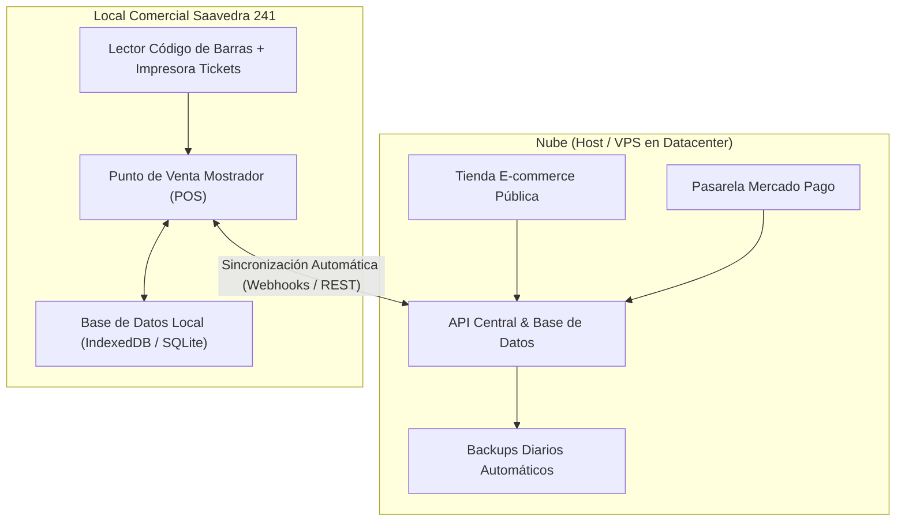

# Informe Técnico y Financiero: Análisis de Infraestructura

## Servidor en la Nube (Cloud/VPS) vs. Servidor Local On-Premise

**Proyecto:** Sistema Integral Web, Stock y Punto de Venta (POS)  
**Cliente:** Matacos Deportes (Saavedra 241, Formosa, Argentina)  
**Fecha:** Agosto 2026  
**Documento:** Evaluación de Infraestructura y Recomendación Arquitectónica  

---

## 1. Resumen Ejecutivo y Veredicto

Tras evaluar los requerimientos operativos, comerciales y el contexto geográfico/técnico de **Matacos Deportes**, se concluye de forma categórica que **la opción más conveniente, segura y rentable es la contratación de un Servidor en la Nube (Host / VPS)**, articulado con una aplicación de mostrador (POS) con capacidades de operación sin conexión (*offline-first*).

Montar un servidor físico propio dentro del local comercial de Saavedra 241 representa un alto riesgo operativo, costos iniciales elevados y limitaciones insalvables para el funcionamiento de una tienda e-commerce moderna.

---

## 2. Cuadro Comparativo: Nube vs. Servidor Local

| Criterio de Evaluación            | Servidor en la Nube (Host / VPS)                                                        | Servidor Físico Local (En Saavedra 241)                                                      |
|:--------------------------------- |:--------------------------------------------------------------------------------------- |:-------------------------------------------------------------------------------------------- |
| **Disponibilidad del E-commerce** | **24/7/365 ininterrumpida.** La tienda vende de noche, fines de semana y feriados.      | **Limitada.** Si se apaga la PC al cerrar el local (20:30 hs), la tienda web se cae.         |
| **Tolerancia a Cortes de Luz**    | **Inmune.** Los datacenters poseen grupos electrógenos diésel y redundancia energética. | **Vulnerable.** Cortes estacionales de energía en Formosa dejan inoperativo todo el sistema. |
| **Conectividad a Internet**       | Enlace de fibra óptica simétrica corporativa (99.9% uptime).                            | Dependiente del proveedor local residencial/comercial (microcortes frecuentes).              |
| **Integración con Mercado Pago**  | Webhooks instantáneos mediante dominio público con SSL seguro.                          | Complejo; requiere abrir puertos en el router, lidiar con IP dinámica o CGNAT.               |
| **Integración AFIP / ARCA**       | Conexión directa y fluida con web services fiscales.                                    | Inestable si la conexión local sufre latencia o pérdidas de paquete.                         |
| **Inversión Inicial de Hardware** | **$0 USD.** No requiere compra de equipamiento físico.                                  | **$800 - $1.500 USD** (PC dedicada, SAI/UPS, router corporativo, discos en RAID).            |
| **Costo Operativo Mensual**       | **Bajo y predecible:** ~$6 a $15 USD / mes.                                             | Mayor consumo eléctrico 24/7 + mantenimiento técnico presencial ante fallas.                 |
| **Seguridad y Backups**           | Copias de seguridad automáticas diarias en centros de datos remotos.                    | Alto riesgo de pérdida por virus (ransomware), rotura de disco, robo o incendio.             |
| **Acceso Remoto para Dueños**     | Los dueños consultan ventas y stock desde su celular o casa en cualquier momento.       | Imposible o muy complejo sin configurar redes privadas virtuales (VPN).                      |

---

## 3. Justificación Detallada de la Decisión

### A. Comercio Electrónico 24/7 y Ventas Fuera de Horario

El 40% de las transacciones en tiendas online minoristas y consultas por redes ocurren fuera del horario comercial habitual (noches, domingos y feriados).

* Con un **servidor en la nube**, el catálogo digital y el carrito de compras están permanentemente activos, permitiendo captar pedidos y cobrar con Mercado Pago a cualquier hora.
* Con un **servidor en el local**, para mantener la web abierta habría que dejar una computadora encendida toda la noche en el negocio cerrado, lo que supone un peligro eléctrico y riesgo de recalentamiento.

### B. Estabilidad Energética y Clima en Formosa

La región suele experimentar tormentas eléctricas y picos de demanda energética durante los meses de altas temperaturas:

* Si el servidor estuviese en el local, cada corte de luz desconectaría automáticamente la web de Matacos Deportes.
* La nube garantiza que, aunque el local físico se quede sin luz, los clientes externos puedan seguir navegando la tienda y comprando sin percibir ninguna interrupción.

### C. Webhooks y Procesamiento de Pagos (Mercado Pago)

Cuando un cliente paga con QR, tarjeta o transferencia por Mercado Pago, la plataforma de pagos envía una notificación automática (*webhook*) al sistema para confirmar el pago y reservar el producto:

* Los servidores en la nube poseen **dirección IP fija pública y certificados de seguridad SSL (HTTPS)**, garantizando que Mercado Pago entregue las notificaciones al instante.
* En una conexión a internet convencional de un local, la mayoría de los proveedores utilizan *CGNAT* (IPs compartidas) o IPs dinámicas que cambian periódicamente, provocando fallos en la confirmación de pagos.

### D. Seguridad de la Información y Continuidad del Negocio (Disaster Recovery)

El activo más valioso de Matacos Deportes será su base de datos (inventario, costos, cuentas corrientes de clientes, historial de facturación):

* En la nube, se configuran **snapshots y copias de seguridad automáticas diarias**. Si la máquina del mostrador se rompe, se moja o es sustraída, el negocio no pierde ningún dato; simplemente se conecta otra computadora o notebook, se ingresa con usuario y contraseña, y el local sigue operando de inmediato.
* En un servidor local, la rotura del disco duro o un ataque de virus informático provocaría la pérdida total o el congelamiento del negocio por semanas.

---

## 4. Comparativa Financiera (Costo Total de Propiedad - TCO a 3 Años)

```
┌─────────────────────────────────────────────────────────────┐
│ Costo Estimado a 3 Años: Nube vs. Servidor Físico Propio    │
├─────────────────────────────────────────────────────────────┤
│ 1. SERVIDOR FÍSICO EN EL LOCAL:                             │
│    • Inversión inicial hardware (PC servidor + UPS + Red):  │  ~$1.000 USD
│    • Mantenimiento preventivo y reemplazo de partes:       │  ~$  300 USD
│    • Consumo eléctrico 24/7 ininterrumpido (36 meses):      │  ~$  250 USD
│    TOTAL ESTIMADO EN 3 AÑOS:                                │  ~$1.550 USD
├─────────────────────────────────────────────────────────────┤
│ 2. SERVIDOR EN LA NUBE (VPS):                               │
│    • Inversión inicial de hardware:                         │  $    0 USD
│    • Alquiler de VPS Cloud ($10 USD/mes x 36 meses):        │  ~$  360 USD
│    • Copias de seguridad automáticas ($1.5 USD/mes):        │  ~$   54 USD
│    TOTAL ESTIMADO EN 3 AÑOS:                                │  ~$  414 USD
└─────────────────────────────────────────────────────────────┘
```

> **Ahorro financiero:** La nube no solo es técnicamente superior, sino que representa un **ahorro de más del 70% en costos de infraestructura y mantenimiento**.

---

## 5. La Arquitectura Recomendada: Esquema Híbrido

Para que el negocio aproveche lo mejor de ambos mundos (la disponibilidad de la nube y la velocidad del mostrador sin depender de internet), se adopta una **Arquitectura Híbrida**:



### ¿Cómo opera este esquema en el día a día?

1. **Día normal:** El cajero pasa el lector de código de barras, cobra en el mostrador y el stock se descuenta en milisegundos en la web para que nadie en internet compre el mismo par de zapatillas.
2. **Si se corta internet en el local:** El mostrador entra automáticamente en **Modo Offline**. El cajero sigue cobrando en efectivo o emitiendo tickets normalmente guardando los datos en la memoria local.
3. **Cuando vuelve internet:** El sistema detecta la red y envía automáticamente todas las ventas acumuladas a la nube en 2 segundos, actualizando el stock global sin intervención humana.

---

## 6. Proveedores de Nube Recomendados

Para este proyecto, se recomiendan opciones de excelente rendimiento, bajo costo y soporte en la región:

1. **Hetzner Cloud / DigitalOcean:** Servidores VPS de alto rendimiento desde ~$5 a $12 USD/mes (ideales por su estabilidad, escalabilidad y costo por recurso).
2. **DonWeb (Cloud VPS Argentina):** Proveedor con infraestructura en Argentina, facturación en pesos y baja latencia nacional (desde ~$8.000 a $15.000 ARS/mes).
3. **Vultr / AWS Lightsail:** Alternativas globales muy confiables con tarifas planas accesibles.

---

## 7. Conclusión y Próximos Pasos

Recomendarle a los dueños de **Matacos Deportes** el alojamiento en la **Nube** les brinda:

1. **Paz mental:** Su catálogo y datos no dependen de un corte de luz en su cuadra ni de que una PC se rompa.
2. **Cero inversión en fierros:** No deben gastar dinero comprando servidores caros.
3. **Flexibilidad total:** Pueden consultar reportes de ventas desde sus celulares mientras viajan o descansan en su hogar.
