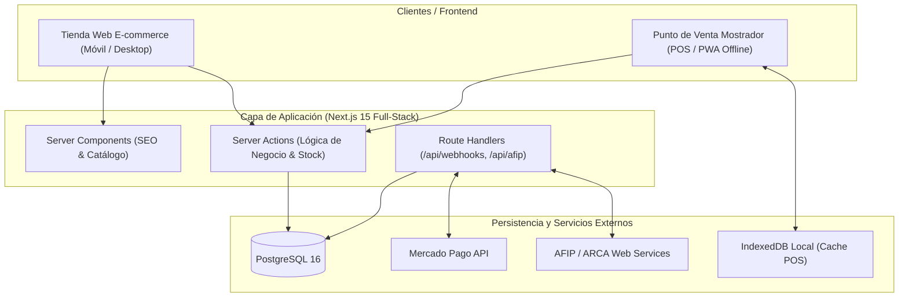

# Propuesta de Stack Tecnológico y Arquitectura de Software

**Proyecto:** Sistema Integral Web (E-commerce), Gestión de Stock y Punto de Venta (POS)  
**Cliente:** Matacos Deportes (Saavedra 241, Formosa, Argentina)  
**Destinatarios:** Equipo de Desarrollo / Arquitectura de Software  
**Fecha:** Agosto 2026  

---

## 📌 1. Resumen Ejecutivo del Stack

Se propone una arquitectura **Full-Stack 100% TypeScript** articulada en un monolito modular moderno. Esta elección unifica el lenguaje en todas las capas del sistema, reduce la duplicación de modelos de datos y acelera drásticamente el desarrollo y mantenimiento.

```
┌────────────────────────────────────────────────────────────────────────┐
│                          RESUMEN DEL STACK                             │
├────────────────────────────────────────────────────────────────────────┤
│ • Lenguaje Global:     TypeScript (End-to-End Type Safety)             │
│ • Runtime Backend:     Node.js (v20+ LTS / v22 LTS)                    │
│ • Framework Web & POS: Next.js 15 (React 19, App Router)               │
│ • Estilos e Interfaz:  Tailwind CSS + shadcn/ui                        │
│ • Estado & Offline:    Zustand + Dexie.js (IndexedDB local)            │
│ • Base de Datos:       PostgreSQL 16 (Relacional ACID)                 │
│ • ORM / Migraciones:   Prisma ORM o Drizzle ORM                        │
│ • Validación de Datos: Zod (Validación compartida Front/Back)          │
│ • Autenticación:       Auth.js / NextAuth (Roles: ADMIN, CAJERO, etc.) │
│ • Pasarela de Pagos:   Mercado Pago SDK Node.js (Webhooks)             │
│ • Facturación Fiscal:  afip.js (Web Services AFIP / ARCA)              │
│ • Infraestructura:     Docker + Docker Compose + Caddy (SSL Auto)      │
│ • Hosting Recomendado: VPS Linux Ubuntu (Hetzner / DigitalOcean/DonWeb)│
└────────────────────────────────────────────────────────────────────────┘
```

---

## 🏛️ 2. Arquitectura General y Filosofía de Diseño



---

## 🛠️ 3. Detalle Técnico por Capas

### 3.1. Frontend: Tienda Online y Punto de Venta (POS)

* **Framework:** **Next.js 15 (App Router)**
  * *E-commerce público:* Renderizado en el servidor (*SSR / Server Components*) para carga ultra rápida en celulares, óptimo para tráfico desde Instagram y posicionamiento en buscadores (SEO).
  * *Punto de Venta (`/pos`):* Renderizado en cliente con interfaz reactiva optimizada para atajos de teclado y rapidez de facturación en mostrador.
* **Sistema de Diseño y UI:** **Tailwind CSS + shadcn/ui**
  * Componentes accesibles, totalmente personalizables y sin sobrecarga de dependencias pesadas.
  * Biblioteca de iconos: **Lucide React**.
* **Gestión de Estado y Modo Offline:**
  * **Zustand:** Manejo del carrito de compras web y de la venta activa en mostrador.
  * **Dexie.js (IndexedDB):** Almacena una réplica del catálogo en el navegador de la computadora del local para permitir cobros en efectivo/tickets sin conexión si se corta internet.

---

### 3.2. Backend y Lógica de Negocio

* **Lenguaje:** **TypeScript**
* **Ejecución en el Servidor:** **Node.js**
* **Mecanismos de API en Next.js:**
  * **Server Actions:** Para mutaciones directas (crear venta, descontar stock, registrar cliente, actualizar precios) con tipado seguro de extremo a extremo.
  * **Route Handlers (`/api/...`):** Endpoints REST para recibir notificaciones asíncronas (*webhooks* de Mercado Pago) y llamadas de sincronización externa.
* **Validación de Esquemas:** **Zod**
  * Los mismos esquemas de validación (formatos de CUIT/DNI, precios, talles, reglas de descuentos) se ejecutan en el formulario del usuario y en el servidor.

---

### 3.3. Base de Datos y Persistencia

* **Motor de Base de Datos:** **PostgreSQL 16**
  * *¿Por qué relacional?:* Las operaciones de stock y dinero exigen consistencia estricta (**transacciones ACID**). PostgreSQL permite bloqueos de fila (*Row Locking con `SELECT FOR UPDATE`*) para evitar condiciones de carrera (ej. evitar que se venda la última unidad simultáneamente en mostrador y web).
* **Mapeador Objeto-Relacional (ORM):** **Prisma ORM** (o **Drizzle ORM**)
  * Esquema declarativo (`schema.prisma`), migraciones automáticas seguras y cliente fuertemente tipado.

---

### 3.4. Autenticación y Control de Accesos Basado en Roles (RBAC)

* **Librería:** **Auth.js (NextAuth.js)**
* **Estructura de Roles:**
  * `ADMIN` (Dueños): Acceso total a márgenes de ganancia, costos, reportes financieros, auditorías y configuración general.
  * `CAJERO` / `VENDEDOR`: Acceso restringido al Punto de Venta, búsqueda de stock y cobranza.
  * `DESPACHO` / `CATALOGO`: Acceso a gestión de pedidos web, empaquetado y carga de fotos/productos.

---

### 3.5. Integraciones de Hardware y Servicios Externos

| Requerimiento                    | Solución Tecnológica            | Detalle de Implementación                                                                                                                                                          |
|:-------------------------------- |:------------------------------- |:---------------------------------------------------------------------------------------------------------------------------------------------------------------------------------- |
| **Pasarela de Pagos**            | SDK Oficial `mercadopago`       | Checkout Pro / Checkout Transparente y cobro mediante QR interoperable. Endpoint de Webhooks para confirmación automática.                                                         |
| **Facturación Fiscal**           | `@afipsdk/afip.js` / `afip.js`  | Conexión con los Web Services de AFIP/ARCA (WSAA + WSFE) para autorización de Facturas Electrónicas A, B y C con obtención de **CAE**. (q)                                         |
| **Lector de Código de Barras**   | Event Listener Global `keydown` | Los lectores de código de barra USB operan como *Keyboard Wedge* (emulación de teclado). El POS captura ráfagas de caracteres y el terminador `Enter` para autocompletar la venta. |
| **Impresora Térmica de Tickets** | CSS `@media print` o `escpos`   | Hoja de estilos optimizada para 58mm y 80mm que dispara el comando de corte e impresión rápida de tickets sin desalinear texto.                                                    |

---

### 3.6. Infraestructura, DevOps y Despliegue

* **Contenerización:** **Docker & Docker Compose**
  * Archivo `docker-compose.yml` que orquestará el servicio web (Next.js), la base de datos (PostgreSQL) y el volumen de persistencia de datos y backups.
* **Servidor Web y Proxy Inverso:** **Caddy Server**
  * Gestión automatizada de certificados de seguridad SSL (HTTPS vía Let's Encrypt) con configuración mínima de 4 líneas.
* **Hosting:** Servidor VPS Linux Ubuntu en la Nube (Hetzner Cloud, DigitalOcean o DonWeb Cloud en pesos argentinos).

---

## 🗃️ 4. Modelo de Entidades Principales (Esquema Conceptual)

```
┌──────────────┐       ┌──────────────────────┐       ┌─────────────────┐
│   Category   │──────<│       Product        │──────<│ ProductVariant  │
└──────────────┘       └──────────────────────┘       └─────────────────┘
                              │                              │ (Talle, Color,
                              │                              │  Barcode EAN13,
                              │                              │  SKU, StockLocal,
                              │                              │  StockWeb)
                              │                              │
                       ┌──────────────┐               ┌─────────────────┐
                       │    Order     │──────<────────│    OrderItem    │
                       └──────────────┘               └─────────────────┘
                        │ (Canal: WEB / POS,
                        │  Estado: PAGADO/PENDIENTE,
                        │  Total, MedioPago)
                        │
       ┌────────────────┴────────────────┐
       ▼                                 ▼
┌──────────────┐                  ┌──────────────┐
│ CashRegister │                  │ FiscalInvoice│ (Factura AFIP:
│  (Caja POS)  │                  │  (CAE/ARCA)  │  Tipo A/B/C, CAE, Vto)
└──────────────┘                  └──────────────┘
```

---

## 📅 5. Plan de Desarrollo Sugerido por Fases (Roadmap)

### 🔹 Sprint 1: Fundaciones y Modelo de Datos

* Configuración del repositorio con TypeScript, Next.js 15, Tailwind y shadcn/ui.
* Diseño del esquema de base de datos en Prisma (Productos, Variantes, Categorías, Talles, Stock).
* Configuración de Docker Compose y entorno local de desarrollo.

### 🔹 Sprint 2: Módulo Mostrador / POS (Caja Física)

* Interfaz de cobro rápido con buscador de productos y soporte para lector de código de barras.
* Lógica de cobro multimetodopago (Efectivo, Tarjetas, Mercado Pago QR).
* Impresión de ticket térmico y apertura/cierre de caja diaria.

### 🔹 Sprint 3: Tienda Online (E-commerce) y Checkout

* Catálogo público responsive con filtros por disciplina deportiva, marcas y talles.
* Carrito de compras y pasarela de pago Mercado Pago Checkout.
* Recepción de Webhooks para actualización automática de pedidos.

### 🔹 Sprint 4: Sincronización, AFIP y Despliegue

* Mecanismo de bloqueo atómico de stock para evitar sobreventas cruzadas.
* Integración del módulo de facturación electrónica con AFIP/ARCA.
* Despliegue en servidor VPS en la nube con Caddy y copias de seguridad automáticas.

---

## 🚀 6. Checklist de Inicio para el Equipo (con pnpm)

- [ ] Habilitar pnpm: `corepack enable`
- [ ] Crear repositorio en GitHub / GitLab.
- [ ] Inicializar proyecto con pnpm: `pnpm create next-app matacos-app --typescript --tailwind --eslint --app`
- [ ] Instalar shadcn/ui: `pnpm dlx shadcn@latest init`
- [ ] Instalar dependencias principales: `pnpm add @prisma/client mercadopago zod zustand dexie @tanstack/react-query lucide-react`
- [ ] Instalar dependencias de desarrollo: `pnpm add -D prisma`
- [ ] Inicializar Prisma: `pnpm prisma init`
- [ ] Configurar contenedor PostgreSQL en `docker-compose.yml`.
