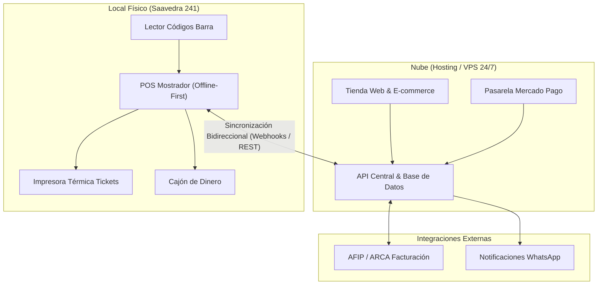

# Guía de Elicitación de Requerimientos: Matacos Deportes

**Proyecto:** Sistema Integral Web, Gestión de Stock y Punto de Venta (POS)  
**Cliente:** Matacos Deportes (Saavedra 241, Formosa, Argentina)  
**Fecha de Relevamiento:** Miércoles 26 de Agosto de 2026  
**Entrevistador(es):** Dellagnolo, Ricardo y Fornari, Nahir  
**Entrevistado(s) / Rol:** Sandra Mujica y Marchi Miguel Angel (Dueña del Local)  

---

## Contexto y Objetivo del Documento

El presente documento tiene como finalidad relevar en profundidad las necesidades funcionales, operativas, comerciales y de identidad institucional para el desarrollo e implementación del nuevo sistema integral de **Matacos Deportes**.

Dado que el comercio parte de un esquema **100% analógico** (sin base de datos previa ni software de gestión digital), este cuestionario hace especial foco en el proceso de **onboarding inicial, simplificación operativa en mostrador y gestión concurrente de stock**.

---

## Bloque 0: Historia, Identidad Institucional y Vínculo Comunitario

*(Insumo clave para la sección «Quiénes Somos» de la tienda online y el posicionamiento de marca)*

### 1. Origen y Fundación

* **¿En qué año abrió sus puertas Matacos Deportes y quién o quiénes fueron sus fundadores?**  
  *Respuesta:* Comenzó en Septiembre del año 1999 en el Paseo de Compras (Por la San Martin - Mercadito). Fundado por Sandra Mujica (Comerciante - Oriunda de Formosa) y Miguel Angel Marchi (Arquitecto) (Matrimonio desde Resistencia)   

* **¿Cómo y por qué surgió la idea de abrir una tienda deportiva en la ciudad?**  
  *(¿Proyecto familiar, pasión por un deporte específico, falta de oferta especializada en la zona?)*  
  *Respuesta (Sandra):* Comenzó como una Tienda de Indumentaria Urbana unisex por el paseo de compras, la transición a tienda de ropa deportiva ocurrió después. Anteriormente había trabajado en una tienda deportiva en Resistencia. Cuando vine acá con mi tienda de ropa se comenzó a solicitar accesorios deportivos (Medias, vendas, bucales, mallas de entrenamiento de natación, etc.), al ver el tipo de ropa que se vendía. Las tiendas deportivas se dedicaban principalmente al calzado, por lo que no estos productos no se encontraban en la provincia, detectando así una especial demanda de accesorios deportivos.  

* **¿El local siempre estuvo en Saavedra 241 o tuvieron otras ubicaciones históricas antes?**  
  *Respuesta:* Primero estuve por la San Martin en el paseo de Compras. Seguidamente  alquilé un local por la Calle Saavedra al frente del Local actual (Saavedra 238 - se mantuvo en dicho lugar por 10 años), actualmente en este local desde el año 2019 previo a la Pandemia.

### 2. Identidad y Elección del Nombre

* **¿Cuál es el significado o la historia detrás de la elección del nombre «Matacos»?**
  * [x] Homenaje e identificación con las raíces culturales y pueblos originarios de la región del Gran Chaco. El primer nombre fue: M y M (Por los apellidos de los dueños - Marchi y Mujica), pero estos se repetían de a montones entre todos los locales, por lo que se decidió realizar este cambio.

* [ ] Vínculo con algún equipo, club o apodo histórico de la zona.
* [ ] Otra razón específica: 

* **¿El logotipo actual ha tenido rediseños a lo largo de los años o conserva su diseño fundacional?**  
  *Respuesta:* El logotipo y la marca pasó por 2 evoluciones principales. Al principio el color inicial era el Amarillo, con un logo de un aborigen. A la hora de transicionar al deporte cambiaron los colores a verde (En relación al aire libre - césped - fitness). Matacos Deportes es marca registrada. 

### 3. Hitos, Evolución y Comunidad

* **¿Qué momentos o etapas marcaron un antes y un después en la trayectoria del negocio?**  
  *(Ampliaciones del local, incorporación de marcas líderes, superación de crisis, cambios generacionales en la administración).*  
  *Respuesta:* 
  
  * Ampliación del local: Pasar del Paseo de Compras al microcentro de la ciudad.
  
  * Superación de la crisis de 2001-02: Bonos en Formosa (Bocanfor), teniendo que cambiarlo por LECOP. Si no había dinero para alimentos, la gente no iba a comprar indumentaria deportiva ni mucho menos
  
  * Registro de la Marca: En la llegada a Formosa, superaron irregularidades fiscales de márgenes impositivos (inscripción en Rentas, municipalidad, AFIP, actualmente ARCA) para inscripción de aportes legales. Obtuvo prestamos bancarios para armar un depósito de distintos accesorios deportivos  

* **¿Qué disciplinas o productos eran los más vendidos en los comienzos y cómo cambió la demanda hoy?**  
  *(Ej. antes predominaba el fútbol tradicional; hoy se sumaron running, pádel, hockey, indumentaria urbana o entrenamiento funcional).*  
  *Respuesta:* En el comienzo, lo más vendido eran los accesorios deportivos (Indumentaria deportiva para gimnasios y profesores; pelotas, medias, vendas, bucales, protección en general -canilleras, rodilleras-. Luego se añadieron las mallas de natación. Mochilas Wilson, destacadas por su resistencia)
  
  * Actualmente, los productos más vendidos son las Crocs y los productos de gimnasio (Mancuernas, colchonetas, etc.)

* **¿Qué relación histórica ha tenido el local con clubes, ligas, escuelas o atletas de Formosa?**
  
  * [ ] Proveedor de indumentaria / equipamiento para clubes o colegios locales.
  
  * [ ] Auspiciante / sponsor de torneos barriales, maratones o eventos deportivos provinciales.
  
  * [ ] Apoyo a deportistas destacados de la provincia.
  
  * *Detalles / Nombres:* Llegaron a hacer fotos con una deportista (Mimí Sosa - Voley). 
  
  * Se apoyó al club Nautico en los eventos y las acciones del mismo.

* **¿Tienen alguna anécdota destacada o visita memorable de algún deportista o referente en el local?**  
  *Respuesta:* Lo más remarcado fue un spot publicitario con Locomotora Oliveras. A nivel local una jugadora de vóley Mimi Sosa. *Promoción de Maravilla Martinez?*

### 4. Filosofía de Marca y Mirada al Futuro (Misión y Visión)

* **¿Cuál consideran que es el principal valor que los diferencia de las grandes cadenas o tiendas departamentales?**  
  *(Ej. atención personalizada y asesoramiento técnico por sus propios dueños, conocimiento del cliente local, trayectoria y confianza).*  
  *Respuesta:* Un poco de todo: la atención de los propios dueños, la trayectoria de más de 25 años. La confianza y la atención personalizada de los clientes, donde se busca ofrecer un servicio a la hora de vender un producto. Se destacan por ofrecer una atención personalizada y detallada de cada uno de los deportes (asesoramiento pre-venta y post-venta)
* **¿Cómo describirían la misión del negocio hoy?**  
  *Respuesta:* Apuntamos hacia una modernización/sistematización de todas las áreas del negocio (ventas, movimiento de caja, stock. E-commerce)    
* **¿Qué representa este salto a la plataforma web dentro de la historia del negocio?**  
  *(Ej. llegar a clientes del interior provincial que antes debían viajar a la capital, modernización, agilizar la atención).*  
  *Respuesta:* Este salto nos representa un cambio importante en la dinámica del negocio: buscamos llegar a nivel nacional, modernizar nuestro funcionamiento operacional y agilizar los procesos operativos que ocurren en el local a nivel diario

---

## Bloque 1: Diagnóstico Operativo Actual (AS-IS Analógico)

*(Comprender cómo opera el negocio hoy en el papel para diseñar un sistema intuitivo y sin fricciones)*

### 1. Registro Diario de Operaciones

* **¿Cómo anotan o registran hoy las ventas del mostrador?**
  * [x] Cuaderno de ventas manuscrito.
  * [ ] Talonario de papel / boletas manuales.
  * [ ] Planilla de cálculo básica (Excel/Sheets sin automatizar).
  * [ ] De memoria / solo conteo final de dinero.

* **¿Cómo realizan el cierre de caja diario al finalizar la jornada?**  
  *(¿Cómo concilian el efectivo del cajón con los cupones de tarjetas/Posnet y los comprobantes de transferencias recibidas?)*  
  *Respuesta:* Se anota tarjeta, efectivo haciendo el cierre de en la caja, posnet, prestando detalle en las anotaciones y si coincide el registro del libro con lo demás.
* **¿Registran salidas de dinero de la caja chica durante el día?**  
  *(Pagos a cadetes, fletes, viáticos, artículos de limpieza, retiros particulares de los dueños).*  
  *Respuesta:* Generalmente no.

### 2. Consulta y Actualización de Precios en Mostrador

* **¿Cómo sabe hoy el vendedor el precio de un artículo cuando un cliente consulta?**
  * [x] Etiqueta adhesiva pegada en la prenda o caja.
  * [x] Lista de precios impresa en papel detrás del mostrador.
  * [ ] Preguntándole verbalmente al dueño o encargado.
  * [ ] De memoria.

* **Cuando los proveedores envían aumentos de precios, ¿cómo trasladan el aumento a los productos?**  
  *(¿Remarcan etiquetas una por una a mano, aplican un recargo mental al momento de cobrar, etc.?)*  
  *Respuesta:* Se realiza un remarco mano a mano de cada uno de los productos. 

### 3. Nivel de Adopción Tecnológica y Dispositivos

* **¿Qué nivel de manejo y familiaridad tiene el personal que estará a cargo del mostrador con el uso de PCs, tablets o celulares?**  
  *Respuesta:* Se tiene un manejo básico de los sistemas de gestión de stock, ventas, etc., prácticamente nada.
* **¿Qué dispositivo prefieren físicamente para cobrar en el mostrador?**
  * [ ] Computadora de escritorio (PC) con teclado y mouse.
  * [x] Notebook.
  * [ ] Tablet táctil.

---

## Bloque 2: Catálogo, Inventario Inicial y Reglas de Negocio

### 1. Estimación de Inventario y Carga Inicial (Onboarding)

* **¿Cuántos productos o artículos distintos (SKUs) estiman que tienen físicamente en el local?**
  
  * [x] Menos de 500 artículos. (entre 100 y 200 productos)
  * [ ] Entre 500 y 2.000 artículos.
  * [ ] Más de 2.000 artículos.
- **¿Cuenta con un inventario en papel con todos los productos anotados?**
  
  - *Respuesta*: Se cuenta con un inventario en papel de algunos productos, no la mayoría.
* **¿Cómo planifican realizar el primer inventario físico para alimentar la base de datos inicial?**
  
  * [ ] Cerrar el local un fin de semana completo para conteo total y carga masiva.
  * [x] Carga progresiva por marcas o categorías (ej. primero todo Calzado, luego Indumentaria).
  * [ ] Carga sobre la marcha a medida que ingresa nueva mercadería.

### 2. Estructura y Variantes de Productos

* **¿Cómo organizan las categorías y disciplinas deportivas?**  
  *(Fútbol, Running, Pádel, Básquet, Vóley, Hockey, Natación, Gimnasio / Training, Urbano).*  
  *Respuesta:* Se cuentan con productos de todos los deportes, dandole prioridad lo que tiene más salida (natación, voley y crocs y artículos de gimnasio)
* **¿Qué variantes específicas maneja cada artículo?**
  * Talles de calzado: [ ] Tabla AR [ ] Tabla US [ ] Tabla EUR [ ] Equivalencias centímetros.
  * Talles de indumentaria: [ ] S, M, L, XL, XXL [ ] Talles numéricos infantiles (4 al 16).
  * Género: [ ] Hombre [ ] Mujer [ ] Niño/a [ ] Unisex.
  * Color y combinaciones.
  * Se divide por talle y por color de ropa.

### 3. Material Fotográfico para la Web

* **¿Disponen de fotos digitales de los productos para la tienda online?**
  * [ ] Fotos oficiales provistas por los catálogos de marcas (Nike, Adidas, Topper, Umbro, etc.).
  * [x] Fotos propias tomadas con teléfono celular para redes sociales.
  * [ ] Será necesario realizar una sesión de fotos de productos antes del lanzamiento.

### 4. Listas de Precios, Promociones y Personalizaciones

* **¿Manejan listas de precios diferenciadas o convenios especiales?**
  * [ ] Precios minoristas vs. precios mayoristas.
  * [ ] Descuentos por cantidad a clubes, escuelas o ligas deportivas.
  * [ ] Combos y promociones por paquete (ej. conjunto completo camiseta + short + medias).
  - [x] TODO MINORISTA
* **¿Ofrecen servicios de personalización?** *(Estampado de nombres, dorsales, números o sponsors en camisetas).*  NO
  *¿Cómo debe solicitarse esto desde la web o registrarse en el mostrador?*  
  *Respuesta:* ____________________________________________________________________

---

## Bloque 3: Operativa del Punto de Venta (POS), Hardware y Stock Concurrente

### 1. Identificación de Artículos y Códigos de Barra

* **¿La mercadería que compran a proveedores ya viene con código de barras de fábrica?**
  
  * [x] Sí, la gran mayoría posee código EAN-13 estándar.
  
  * [ ] No, muchos artículos vienen sin código (artículos genéricos, accesorios sueltos, etc.).
    
    Algunas prendas de oferta están sin código de barra

* **¿Desean incorporar una impresora térmica de etiquetas para generar códigos de barra propios del local, o prefieren buscar los artículos en pantalla mediante buscador de texto/categorías?**  
  *Respuesta:* Preferimos ambas opciones.

### 2. Equipamiento Físico del Mostrador

* **¿Cuántas cajas o terminales de cobro simultáneas funcionarán en el local?**  
  *Respuesta:* 2 cajas
* **¿Qué periféricos planean utilizar en el puesto de cobro?**
  * [x] Lector de código de barras (USB o inalámbrico).
  * [x] Impresora térmica de tickets comandera (58mm o 80mm).
  * [x] Gaveta / cajón de dinero con apertura automática al cobrar.

### 3. Gestión de Stock Concurrente (Local Físico vs. Web / Redes)

* **¿Cómo gestionan hoy cuando un cliente pide apartar un producto por WhatsApp/Instagram mientras el local está abierto al público?**  
  *(¿Cómo evitan que otro vendedor lo venda en el mostrador en ese lapso?)*  
  *Respuesta:* Lo separan del resto de los productos teniendo en cuenta el tiempo en el que se cree que se va a retirar.
* **En el nuevo sistema: ¿Desean una función de "Reserva Temporal" (ej. bloquear stock por 2 horas para un cliente de WhatsApp hasta que envíe el comprobante de transferencia)?**  
  *Respuesta:* No es importante pero sería bueno tenerlo.
* **¿Cómo debe comportarse la tienda web cuando un producto se queda sin stock?**
  * [ ] Ocultar el producto automáticamente.
  * [x] Mostrarlo como «Agotado» impidiendo la compra.
  * [x] Permitir dejar un correo / WhatsApp con aviso de reingreso («Avisarme cuando haya stock»).

### 4. Tolerancia a Cortes de Conectividad (Modo Offline)

* **Ante un corte temporal del servicio de internet en el local físico, ¿es indispensable que el mostrador pueda seguir cobrando y emitiendo tickets en modo offline para luego sincronizarse automáticamente al volver la red?**  
  *Respuesta:* Es obligatorio tener un modo offline para seguir procesando ventas

---

## Bloque 4: Pagos, Facturación, Envíos y Postventa

### 1. Métodos de Cobro y Promociones

* **En el local:** ¿Qué medios reciben actualmente?
  * [x] Efectivo.
  * [x] Tarjetas de débito / crédito (POSNET tradicional / Mercado Pago Point).
  * [x] Transferencias bancarias (Alias / CBU).
  * [ ] QR de billeteras virtuales (Mercado Pago, Cuenta DNI, MODO, etc.).
* **En la web:** ¿Qué opciones desean habilitar para los clientes online?
  * [x] Pasarela online (Mercado Pago Checkout / Tarjetas / Dinero en cuenta).
  * [x] Transferencia bancaria directa con carga de comprobante.
  * [x] Pago al retirar en el local físico.
* **¿Aplican promociones o recargos según el método de pago?** *(Descuento en efectivo, recargo en cuotas con tarjeta, etc.)*  
  *Respuesta:* No se realizan recargos, pero se tiene un límite de compra respecto a las cuotas dependiendo del precio (3 cuotas si la compra es superior a $30.000, 4 cuotas si es superior a 80.000)

### 2. Facturación y Aspectos Impositivos (AFIP / ARCA)

* **¿Cuál es la condición fiscal del comercio ante AFIP/ARCA?**
  * [ ] Monotributo.
  * [x] Responsable Inscripto.
* **¿Cómo emiten comprobantes actualmente?**
  * [ ] Facturación manual en talonario de papel.
  * [x] Portal web "Comprobantes en Línea" de AFIP.
  * [x] Controlador fiscal físico de vieja/nueva generación.
* **¿El nuevo sistema debe emitir Factura Electrónica (Facturas A, B, C) conectándose directamente con AFIP/ARCA, o emitirá comprobantes internos no fiscales (tickets de control / presupuestos)?**  
  *Respuesta:* Debería tener la opción de decidir el tipo de comprobante según la venta.

### 3. Cuentas Corrientes, Fiados y Señas

* **¿Manejan ventas a Cuenta Corriente ("fiado" o pago a fin de mes) con clubes, instituciones o clientes de confianza?**  
  *¿El sistema debe llevar el saldo adeudado y el historial de pagos de cada cliente?*  
  *Respuesta:* NO
* **Al encargar trabajos especiales (ej. indumentaria personalizada), ¿cobran señas o anticipos (ej. 50%)?**  
  *¿El sistema debe emitir un comprobante de seña y descontar el saldo restante contra entrega?*  
  *Respuesta:* NO (Porque no se realiza este tipo de trabajo)

### 4. Logística y Modalidades de Entrega

* **¿Cuáles serán las opciones de envío ofrecidas en la tienda online?**
  * [x] Retiro gratuito en el local (Saavedra 241).
  * [x] Cadetería local / moto-mensajería dentro de la ciudad de Formosa.
  * [x] Envíos al interior de la provincia y a todo el país *(**Correo Argentino**, Andreani, encomiendas por micro)*.

### 5. Políticas de Postventa, Cambios y Garantías

* **¿Cómo gestionan hoy los cambios de talle o modelo?**  
  *(¿Qué plazo se le otorga al cliente? ¿Debe presentar el ticket/comprobante obligatoriamente?)*  
  *Respuesta:* Se le obliga que la prenda tenga la etiqueta y esté en buen estado, sin límite de tiempo y sin necesidad de presentar un ticket.
* **Si un cliente compra por la tienda web, ¿puede realizar el cambio físicamente en el local?**  
  *Respuesta:* Sí, se puede realizar un cambio en el local. El problema es a nivel nacional, donde inicialmente se cobraría el envío.
* **Si un cliente devuelve un producto y no elige otro en el momento:**
  * [x] Se le emite una Nota de Crédito / Vale de compra para usar a futuro.
  * [ ] Se le reintegra el dinero por el mismo medio que pagó.
* **Frente a aumentos de precios por inflación entre la fecha de compra y la fecha del cambio de talle:**  
  *¿Se le respeta el cambio mano a mano del mismo producto, o debe abonar la diferencia de precio?*  
  *Respuesta:* Se le respeta el cambio del mismo producto. Existen complicaciones de llevar registro si se lleva algo de oferta (mayormente son prendas no tienen cambio, al ser únicas)

---

## Bloque 5: Experiencia del Usuario (UX) y Canales de Atención

### 1. Flujo de Compra en la Web

* **¿La compra requerirá registro obligatorio de usuario con contraseña, o se permitirá compra rápida como invitado (guest checkout) solicitando solo datos de contacto y envío?**  
  *Respuesta:* Se necesita que sea lo más fácil para el cliente

### 2. Canales de Notificación y Asistencia

* **¿Qué canales de comunicación prefieren para notificar al cliente sobre su compra y estado del pedido?**
  * [ ] Correo electrónico automático.
  * [x] Mensaje directo por WhatsApp.
  * [x] Ambos.
* **¿Desean un botón flotante de WhatsApp en la web que incluya el enlace y nombre exacto del producto que el usuario está viendo en pantalla al iniciar la conversación?**  
  *Respuesta:* Sí, me gustaría tener esa opción.

---

## Bloque 6: Roles de Usuario, Reportes y Plan de Transición

### 1. Permisos y Perfiles de Acceso al Sistema

* **¿Qué roles operarán dentro de la plataforma y qué permisos tendrán?**
  * **Administrador / Dueño:** Acceso total a precios de costo, márgenes de ganancia, reportes financieros y configuración general.
  * **Cajero / Vendedor de mostrador:** Permisos para consultar stock, registrar ventas, cobrar y emitir tickets (sin acceso a costos del negocio).
  * **Operador de Despacho / Catálogo:** Permisos para actualizar fotos/descripciones y marcar pedidos web como "empaquetados / enviados".
  * Cualquier otro ROL necesario que sirva para el funcionamiento del sistema.

### 2. Reportes Clave y Métricas para los Dueños

* **¿Qué información necesitan ver en su panel de control al final del día o mes?**
  * [x] Total facturado por medio de pago (Efectivo vs. Mercado Pago vs. Transferencias).
  * [x] Alertas automáticas de productos con stock bajo o agotado.
  * [x] Ranking de productos, marcas y disciplinas más vendidas.
  * [ ] Rendimiento de ventas web vs. ventas físicas del local.
  * [ ] Ganancia bruta estimada del período.

### 3. Plan de Capacitación y Marcha Blanca

* **¿Están de acuerdo en realizar un período de prueba («marcha blanca») de 1 a 2 semanas donde el nuevo sistema conviva con el método tradicional antes del apagado definitivo del cuaderno?**  
  *Respuesta:* Sí.

---

## Resumen de Arquitectura Técnica Recomendada

*(Guía de referencia para el equipo de desarrollo)*

1. **Capa Web Pública (E-commerce):** Alojada en la nube, disponible 24/7 para consultas, catálogo y compras sin depender de la luz o conectividad del local físico.
2. **Capa de Mostrador (POS Offline-First):** Aplicación de mostrador optimizada para ventas ultra rápidas, capaz de seguir operando y cobrando con base de datos local ante microcortes de internet.
3. **Módulo de Sincronización:** Actualiza el stock en tiempo real entre el mostrador y la web para evitar ventas duplicadas del mismo artículo.

### Arquitectura Recomendada: Esquema Híbrido

**1. Capa Web y E-commerce (Hosting / VPS en la Nube)**

- **Rol:** Alojar el catálogo online, el carrito de compras, el módulo de consultas por WhatsApp, pasarelas de pago y la recepción de pedidos web las 24/7.

- **Ventaja:** Garantiza disponibilidad ininterrumpida para los clientes, sin depender de la conectividad ni de la estabilidad eléctrica del local físico.

**2. Capa de Mostrador / Punto de Venta (Cliente Local / POS Offline-First)**

- **Rol:** Gestionar las ventas presenciales en el local, cobranza rápida de mostrador y emisión de tickets.

- **Ventaja:** Permite que los vendedores sigan cobrando y emitiendo comprobantes aunque se corte internet momentáneamente, operando con una base de datos local (ej. SQLite, IndexedDB en el navegador, o un servicio local ligero).

**3. Módulo de Sincronización (Webhooks / API REST)**

- **Rol:** Sincronizar el inventario entre el local físico y la web.

- **Mecánica:** Cuando se vende una prenda o par de zapatillas en el local, el sistema local envía un evento a la API de la web para descontar esa unidad. Si el local se queda sin internet, los cambios se encolan y se envían de forma automática al restablecerse la conexión.
