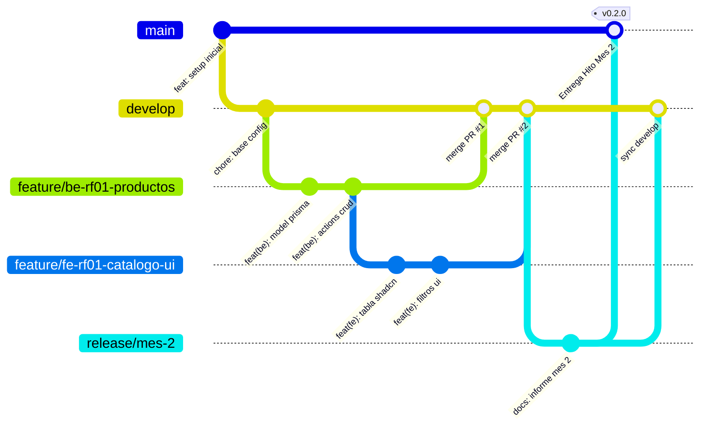
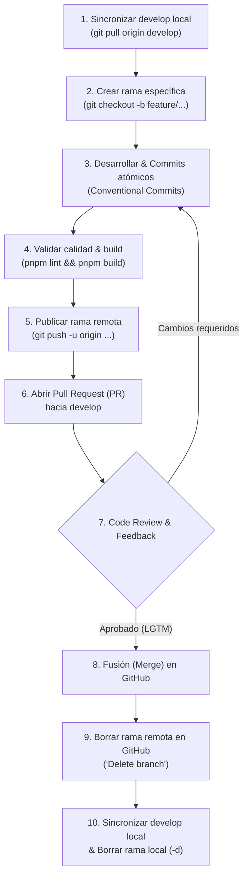

# Guía de Estrategia de Ramas (Git Flow) — Matacos Deportes
## Proyecto: Sistema Integral de Gestión, POS Offline y E-commerce
**Cátedra:** Práctica Profesional Supervisada I (PPS I) – UCP Sede Formosa  

Esta guía establece el estándar obligatorio de manejo de ramas en Git para que los 4 desarrolladores (**Dellagnolo, Fornari, Bordón y González**) trabajen en paralelo sin pisarse código ni generar conflictos.

---

## 🌳 1. Topología de Ramas del Proyecto



---

## 🏷️ 2. Tipos de Ramas y Convenciones de Nombres

| Tipo de Rama | Rama Origen | Rama Destino | Nomenclatura Obligatoria | Ejemplo |
| :--- | :---: | :---: | :--- | :--- |
| **Producción** | — | — | `main` | `main` *(Código 100% estable / Entregas a cátedra)* |
| **Desarrollo (Base)** | `main` | — | `develop` | `develop` *(Rama activa de integración de todo el equipo)* |
| **Feature Backend** | `develop` | `develop` | `feature/be-<rf>-<descripcion>` | `feature/be-rf01-crud-productos` |
| **Feature Frontend** | `develop` | `develop` | `feature/fe-<rf>-<descripcion>` | `feature/fe-rf01-tabla-productos` |
| **Corrección / Bug** | `develop` | `develop` | `fix/<descripcion>` | `fix/calculo-vuelto-negativo` |
| **Documentación** | `develop` | `develop` | `docs/<descripcion>` | `docs/actualizar-guia-arquitectura` |
| **Mantenimiento / Config** | `develop` | `develop` | `chore/<descripcion>` | `chore/actualizar-dependencias-pnpm` |
| **Release Mensual** | `develop` | `main` & `develop` | `release/mes-<numero>` | `release/mes-2` *(Cierre de mes y entrega formal)* |
| **Hotfix Urgente** | `main` | `main` & `develop` | `hotfix/<descripcion>` | `hotfix/error-critico-offline` |

---

## 🚀 3. Ciclo de Vida Completo de una Rama (Flujo End-to-End)

El ciclo de vida de cualquier funcionalidad, corrección o tarea comprende **6 fases esenciales** desde que se toma el requerimiento hasta que la rama se elimina tras integrarse a `develop`:



---

### 🔹 Fase 1: Creación y Preparación de la Rama

#### Paso 1: Actualizar tu rama `develop` local
Antes de crear cualquier rama nueva, asegurate de tener la versión más reciente del código integrado por tus compañeros:
```bash
git checkout develop
git pull origin develop
```

#### Paso 2: Crear tu rama de funcionalidad (Feature Branch)
Crea una rama con el prefijo correspondiente a tu área (`fe-`, `be-`, `fix/`, etc.) y el código de requerimiento funcional (RF):
```bash
# Si trabajas en Frontend (Bordón / González):
git checkout -b feature/fe-rf07-pos-mostrador

# Si trabajas en Backend (Dellagnolo / Fornari):
git checkout -b feature/be-rf07-busqueda-indexada

# Si es una corrección o bug:
git checkout -b fix/calculo-vuelto-negativo
```

---

### 🔹 Fase 2: Desarrollo y Validación Local

#### Paso 3: Desarrollar y realizar commits atómicos
Trabaja de manera incremental realizando commits pequeños y coherentes, respetando el estándar *Conventional Commits*:
```bash
git status
git add .
git commit -m "feat(fe): maquetar layout en 2 columnas para punto de venta"
```

#### Paso 4: Mantener tu rama sincronizada con `develop`
Si otros compañeros fusionaron cambios en `develop` mientras trabajabas en tu funcionalidad, traé esos cambios a tu rama para resolver divergencias temprano:
```bash
git checkout feature/fe-rf07-pos-mostrador
git fetch origin
git merge origin/develop
```

#### Paso 5: Validar que el código compila y cumple linters
Antes de subir cualquier código al repositorio remoto, valida que no existan errores de tipos ni de linting:
```bash
pnpm lint
pnpm build
```
> [!IMPORTANT]
> Nunca abras un Pull Request si `pnpm build` o `pnpm lint` fallan en tu máquina local.

---

### 🔹 Fase 3: Publicación y Creación del Pull Request (PR)

#### Paso 6: Subir tu rama a GitHub
Publica tu rama en el repositorio remoto configurando el upstream tracking:
```bash
git push -u origin feature/fe-rf07-pos-mostrador
```

#### Paso 7: Abrir el Pull Request (PR) en GitHub
1. Ingresa al repositorio de GitHub: `dellagnoloRA/matacos-deportes-app`.
2. Verás el banner amarillo con el botón **"Compare & pull request"** (o ve a la pestaña *Pull requests* -> *New pull request*).
3. **Rama base obligatoria:** Asegurate de que la rama destino sea **`develop`** (nunca `main` directamente):
   * `base: develop`  ←  `compare: feature/fe-rf07-pos-mostrador`
4. **Título estandarizado del PR:**
   * Formato: `[<ID-RF>][<ÁREA>] <Descripción concisa>`
   * Ejemplo: `[RF-07][FE] Layout de Mostrador y Componentes de Caja`
5. **Descripción del PR:** Detalla los cambios implementados, componentes afectados y capturas de pantalla si aplica.
6. **Asignaciones:**
   * **Reviewers:** Asigna al menos a un compañero de equipo para la revisión.
   * **Assignee:** Asignate a vos mismo como responsable.
   * **Trello:** Vincula el enlace del PR a la tarjeta de Trello correspondiente y muévela a la columna *"En Code Review"*.

---

### 🔹 Fase 4: Revisión de Código (Code Review) e Iteraciones

#### Paso 8: Atender feedback o cambios solicitados
El revisor examinará el código, evaluará buenas prácticas y dejará comentarios o solicitará cambios:
* **Si te solicitan correcciones:** No crees una nueva rama ni cierres el PR. Realiza las correcciones en tu rama local, commitea y vuelve a pushear:
  ```bash
  # En tu misma rama local:
  git add .
  git commit -m "fix(fe): ajustar espaciado y validacion en boton de cobro"
  git push origin feature/fe-rf07-pos-mostrador
  ```
  *GitHub actualizará automáticamente el Pull Request con los nuevos commits.*
* **Si el PR es aprobado (*Approved / LGTM*):** La rama queda habilitada para el merge.

---

### 🔹 Fase 5: Fusión (Merge) del Pull Request

#### Paso 9: Fusión en GitHub hacia `develop`
1. Una vez aprobado el PR y verificados los checks automáticos:
2. Haz clic en el botón verde **"Merge pull request"** (o *"Squash and merge"* según el caso) y confirma con **"Confirm merge"**.
3. En Trello, mueve la tarjeta a la columna *"Testing / Hecho"*.

---

### 🔹 Fase 6: Finalización y Limpieza de Ramas (Borrado Local y Remoto)

Para mantener el repositorio limpio y prevenir acumulación de ramas huérfanas, cada rama debe ser eliminada tras su fusión exitosa:

#### Paso 10: Borrar la rama remota en GitHub
* Inmediatamente después de hacer merge, GitHub muestra el botón **"Delete branch"**. Haz clic para eliminar la rama del servidor remoto.
* *(Alternativa por consola):*
  ```bash
  git push origin --delete feature/fe-rf07-pos-mostrador
  ```

#### Paso 11: Limpieza y sincronización en el entorno local
Una vez cerrada la tarea en GitHub, vuelve a tu rama principal local y elimina la rama de trabajo que ya está integrada:
```bash
# 1. Regresar a develop:
git checkout develop

# 2. Traer los cambios recién fusionados en remoto:
git pull origin develop

# 3. Eliminar la rama local ya integrada (flag -d seguro):
git branch -d feature/fe-rf07-pos-mostrador

# 4. Limpiar referencias remotas eliminadas en tu copia local:
git fetch --prune
```

> [!TIP]
> El flag `-d` (minúscula) es seguro: Git no te permitirá borrar la rama si contiene commits que no fueron fusionados en `develop`. Si te da un aviso de no fusión, verifica haber hecho `git pull origin develop` primero. No uses `-D` a menos que quieras descartar deliberadamente el trabajo de esa rama.

---

## ✍️ 4. Estándar de Mensajes de Commit (*Conventional Commits*)

Cada commit debe tener un tipo, un alcance opcional entre paréntesis y una descripción clara en infinitivo/presente:

```text
<tipo>(<alcance>): <descripción corta>
```

### Tipos admitidos:
* `feat`: Nueva funcionalidad para el usuario/sistema.  
  * *Ejemplo:* `feat(be): agregar server action para registrar movimiento de stock`
  * *Ejemplo:* `feat(fe): maquetar modal de cobro multi-metodo con calculo de vuelto`
* `fix`: Corrección de un error o bug.  
  * *Ejemplo:* `fix(pos): corregir apertura de cajon en ventas solo con tarjeta`
* `docs`: Cambios en la documentación o informes.  
  * *Ejemplo:* `docs: actualizar diagrama de arquitectura en informe mes 1`
* `style`: Cambios de formato visual, espaciado o CSS (sin tocar lógica).  
  * *Ejemplo:* `style(ui): ajustar color verde institucional en botones shadcn`
* `refactor`: Modificación de código que no agrega función ni arregla bug.  
  * *Ejemplo:* `refactor(lib): modularizar helper de formateo de moneda ARS`
* `test`: Agregado o corrección de pruebas unitarias/integración.  
  * *Ejemplo:* `test(offline): agregar caso de prueba para cola de sincronizacion`
* `chore`: Tareas de mantenimiento, dependencias o Docker.  
  * *Ejemplo:* `chore(deps): actualizar prisma a version 5.22`

---

## 🛡️ 5. Reglas de Oro del Repositorio (Guardrails)

1. 🚫 **PROHIBIDO hacer push directo a `main` o `develop`:** Todo cambio debe ingresar exclusivamente mediante un **Pull Request (PR)** revisado.
2. 🚫 **PROHIBIDO hacer `git push --force`:** Puede borrar el trabajo que tus compañeros subieron.
3. 🚫 **NUNCA commitear archivos `.env` con credenciales reales:** Solo se sube `.env.example` con valores de plantilla.
4. ✅ **Traer cambios de develop antes de abrir PR:** Si tu rama quedó desactualizada respecto a `develop`, actualízala con:
   ```bash
   git checkout feature/mi-tarea
   git merge develop
   ```
5. ✅ **Un PR por Requerimiento:** No mezcles código de Inventario (RF-01) en un PR de Punto de Venta (RF-07).
6. 🧹 **Borrado obligatorio post-merge:** Una vez fusionada la rama en `develop`, debe borrarse tanto en GitHub (remota) como en tu entorno local (`git branch -d` y `git fetch --prune`). No se conservan ramas ya integradas.

---

## 🆘 6. Cómo Resolver Conflictos de Fusión (Merge Conflicts)

Si al intentar unir tu rama GitHub indica que hay conflictos:

1. En tu máquina, en tu rama de trabajo:
   ```bash
   git checkout feature/tu-rama
   git merge develop
   ```
2. Git marcará los archivos con conflicto. Ábrelos en **VS Code**.
3. VS Code mostrará los botones interactivos:
   * *Accept Current Change* (Conservar lo tuyo).
   * *Accept Incoming Change* (Conservar lo que vino de develop).
   * *Accept Both Changes* (Conservar ambos).
4. Elige la combinación correcta, guarda el archivo y ejecuta:
   ```bash
   git add .
   git commit -m "fix(merge): resolver conflictos con develop"
   git push origin feature/tu-rama
   ```
