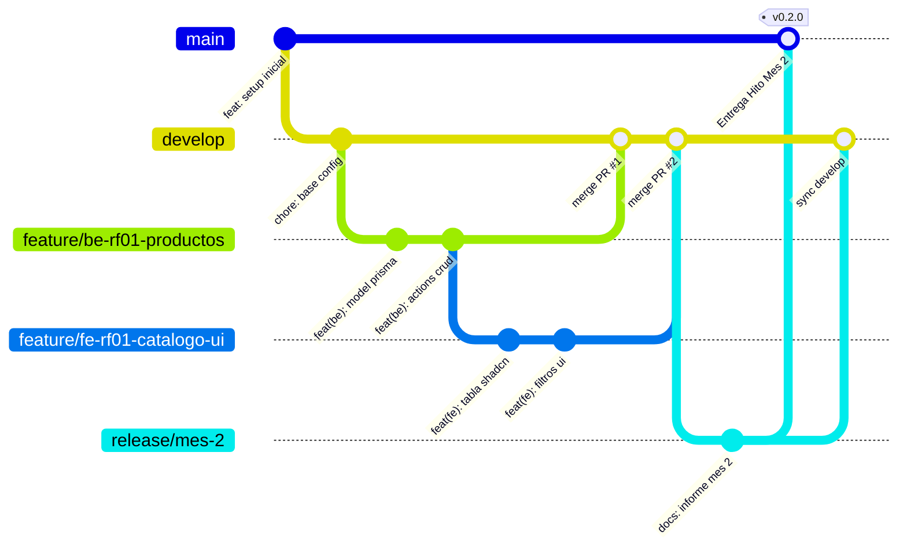

# Guía de Estrategia de Ramas (Git Flow) — Matacos Deportes
## Proyecto: Sistema Integral de Gestión, POS Offline y E-commerce
**Cátedra:** Práctica Profesional Supervisada I (PPS I) – UCP Sede Formosa  

Esta guía establece el estándar obligatorio de manejo de ramas en Git para que los 4 desarrolladores (**Dellagnolo, Fornari, Bordón y González**) trabajen en paralelo sin pisarse código ni generar conflictos.

---

## 🌳 1. Topología de Ramas del Proyecto



---

## 🏷️ 2. Tipos de Ramas y Convenciones de Nombres

| Tipo de Rama | Rama Origen | Rama Destino | Nomenclatura Obligatoria | Ejemplo |
| :--- | :---: | :---: | :--- | :--- |
| **Producción** | — | — | `main` | `main` *(Código 100% estable / Entregas a cátedra)* |
| **Desarrollo (Base)** | `main` | — | `develop` | `develop` *(Rama activa de integración de todo el equipo)* |
| **Feature Backend** | `develop` | `develop` | `feature/be-<rf>-<descripcion>` | `feature/be-rf01-crud-productos` |
| **Feature Frontend** | `develop` | `develop` | `feature/fe-<rf>-<descripcion>` | `feature/fe-rf01-tabla-productos` |
| **Corrección / Bug** | `develop` | `develop` | `fix/<descripcion>` | `fix/calculo-vuelto-negativo` |
| **Documentación** | `develop` | `develop` | `docs/<descripcion>` | `docs/actualizar-guia-arquitectura` |
| **Mantenimiento / Config** | `develop` | `develop` | `chore/<descripcion>` | `chore/actualizar-dependencias-pnpm` |
| **Release Mensual** | `develop` | `main` & `develop` | `release/mes-<numero>` | `release/mes-2` *(Cierre de mes y entrega formal)* |
| **Hotfix Urgente** | `main` | `main` & `develop` | `hotfix/<descripcion>` | `hotfix/error-critico-offline` |

---

## 🚀 3. Flujo de Trabajo Diario Paso a Paso (Día a Día del Desarrollador)

Cuando vayas a comenzar a trabajar en un Requerimiento Funcional de Trello:

### Paso 1: Actualizar tu rama `develop` local
Antes de crear cualquier rama nueva, asegúrate de tener los últimos cambios del equipo:
```bash
git checkout develop
git pull origin develop
```

### Paso 2: Crear tu rama de funcionalidad (Feature Branch)
Crea una rama con el prefijo de tu área (`fe-` o `be-`) y el número de requerimiento:
```bash
# Si trabajas en Frontend (Bordón / González):
git checkout -b feature/fe-rf07-pos-mostrador

# Si trabajas en Backend (Dellagnolo / Fornari):
git checkout -b feature/be-rf07-busqueda-indexada
```

### Paso 3: Desarrollar y realizar commits atómicos
Haz commits frecuentes y claros siguiendo el estándar *Conventional Commits*:
```bash
git add .
git commit -m "feat(fe): maquetar layout en 2 columnas para punto de venta"
```

### Paso 4: Validar que tu código compila antes de subir
Asegúrate de que no haya errores de TypeScript ni de compilación:
```bash
pnpm build
```

### Paso 5: Subir tu rama a GitHub
```bash
git push -u origin feature/fe-rf07-pos-mostrador
```

### Paso 6: Crear el Pull Request (PR) en GitHub
1. Ingresa al repositorio en GitHub.
2. Haz clic en **"Compare & pull request"**.
3. Asegúrate de que la rama base sea **`develop`** (NO `main`).
4. Título del PR: `[RF-07][FE] Layout de Mostrador y Componentes de Caja`.
5. Asigna al menos a 1 compañero del equipo como **Revisor (Reviewer)**.

---

## ✍️ 4. Estándar de Mensajes de Commit (*Conventional Commits*)

Cada commit debe tener un tipo, un alcance opcional entre paréntesis y una descripción clara en infinitivo/presente:

```text
<tipo>(<alcance>): <descripción corta>
```

### Tipos admitidos:
* `feat`: Nueva funcionalidad para el usuario/sistema.  
  * *Ejemplo:* `feat(be): agregar server action para registrar movimiento de stock`
  * *Ejemplo:* `feat(fe): maquetar modal de cobro multi-metodo con calculo de vuelto`
* `fix`: Corrección de un error o bug.  
  * *Ejemplo:* `fix(pos): corregir apertura de cajon en ventas solo con tarjeta`
* `docs`: Cambios en la documentación o informes.  
  * *Ejemplo:* `docs: actualizar diagrama de arquitectura en informe mes 1`
* `style`: Cambios de formato visual, espaciado o CSS (sin tocar lógica).  
  * *Ejemplo:* `style(ui): ajustar color verde institucional en botones shadcn`
* `refactor`: Modificación de código que no agrega función ni arregla bug.  
  * *Ejemplo:* `refactor(lib): modularizar helper de formateo de moneda ARS`
* `test`: Agregado o corrección de pruebas unitarias/integración.  
  * *Ejemplo:* `test(offline): agregar caso de prueba para cola de sincronizacion`
* `chore`: Tareas de mantenimiento, dependencias o Docker.  
  * *Ejemplo:* `chore(deps): actualizar prisma a version 5.22`

---

## 🛡️ 5. Reglas de Oro del Repositorio (Guardrails)

1. 🚫 **PROHIBIDO hacer push directo a `main` o `develop`:** Todo cambio debe ingresar exclusivamente mediante un **Pull Request (PR)** revisado.
2. 🚫 **PROHIBIDO hacer `git push --force`:** Puede borrar el trabajo que tus compañeros subieron.
3. 🚫 **NUNCA commitear archivos `.env` con credenciales reales:** Solo se sube `.env.example` con valores de plantilla.
4. ✅ **Traer cambios de develop antes de abrir PR:** Si tu rama quedó desactualizada respecto a `develop`, actualízala con:
   ```bash
   git checkout feature/mi-tarea
   git merge develop
   ```
5. ✅ **Un PR por Requerimiento:** No mezcles código de Inventario (RF-01) en un PR de Punto de Venta (RF-07).

---

## 🆘 6. Cómo Resolver Conflictos de Fusión (Merge Conflicts)

Si al intentar unir tu rama GitHub indica que hay conflictos:

1. En tu máquina, en tu rama de trabajo:
   ```bash
   git checkout feature/tu-rama
   git merge develop
   ```
2. Git marcará los archivos con conflicto. Ábrelos en **VS Code**.
3. VS Code mostrará los botones interactivos:
   * *Accept Current Change* (Conservar lo tuyo).
   * *Accept Incoming Change* (Conservar lo que vino de develop).
   * *Accept Both Changes* (Conservar ambos).
4. Elige la combinación correcta, guarda el archivo y ejecuta:
   ```bash
   git add .
   git commit -m "fix(merge): resolver conflictos con develop"
   git push origin feature/tu-rama
   ```
