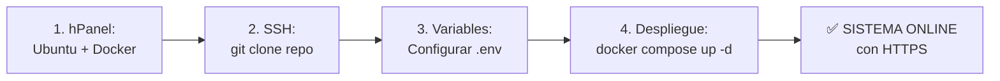
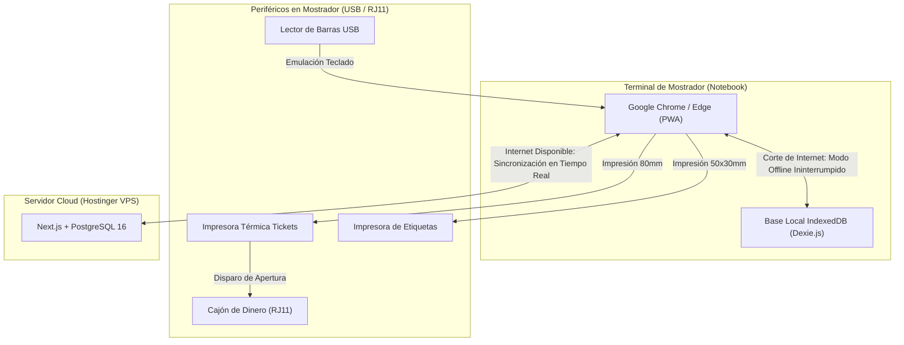

# Guía Integral de Infraestructura y Configuración de Terminales
## Servidor Cloud (Hostinger VPS KVM 2) & Puestos de Mostrador (Notebooks, Lectores e Impresoras)
**Proyecto:** Sistema Integral de Gestión, POS Offline y E-commerce — Matacos Deportes (Saavedra 241, Formosa Capital)  
**Institución:** Universidad de la Cuenca del Plata (Sede Formosa) — Práctica Profesional Supervisada I (PPS I)  
**Equipo de Desarrollo:** Dellagnolo, Ricardo / Fornari, Nahir / Bordón, Lourdes / González, Eugenia  

---

# PARTE 1: El Servidor en la Nube (Hostinger VPS KVM 2)

## 1.1. Especificaciones del Servidor Hostinger VPS (KVM 2)

Para alojar la base de datos PostgreSQL 16 y la tienda web de **Matacos Deportes**, se utiliza el plan **Hostinger VPS KVM 2**:

* **Procesador:** 2 núcleos vCPU **AMD EPYC** (procesamiento paralelo para PostgreSQL y compilación standalone de Next.js 15).
* **Memoria RAM:** **8 GB de RAM** (más que suficiente para PostgreSQL 16, Next.js y Caddy Server).
* **Almacenamiento:** **100 GB SSD NVMe** (altísima velocidad I/O para operaciones transaccionales y resguardo de backups locales).
* **Conectividad:** **8 TB de transferencia mensual**, interfaz de red simétrica a **1 Gbps** y dirección IP pública fija.
* **Seguridad y Extras:** Gestión de Firewall perimetral en hPanel, Datacenter en **São Paulo (Brasil)** para latencia óptima (<45 ms desde Formosa), y **Dominio gratis por 1 año**.

---

## 1.2. ¿Qué rol cumple Caddy Server dentro de Hostinger?

* **Hostinger:** Es el proveedor de infraestructura en la nube (hardware dedicado virtualizado, disco NVMe y enlace de fibra óptica).
* **Caddy Server:** Es el servidor web y proxy inverso ultra-liviano (<20 MB de RAM) que corre en un contenedor Docker dentro del VPS:
  1. **Certificado SSL / HTTPS 100% Automático:** Negocia directamente con *Let's Encrypt*, obtiene el candado verde para el dominio y **lo renueva automáticamente sin costo**.
  2. **Proxy Inverso Seguro:** Recibe las peticiones en el puerto estándar `443 (HTTPS)` y las redirige internamente al puerto `3000` de Next.js.
  3. **Aislamiento de la Base de Datos:** Permite que PostgreSQL (`5432`) quede completamente aislado en la red interna de Docker (`matacos_network`) sin exponer puertos vulnerables a internet.

---

## 1.3. Configuración en Hostinger (Firewall y Data Center)

1. **Ubicación del Data Center:** En el asistente de configuración de Hostinger, elegir **São Paulo, Brasil** para lograr la menor latencia de red desde Formosa.
2. **Plantilla de Sistema Operativo:** Seleccionar **Ubuntu 24.04 64bit with Docker**.
3. **Firewall en hPanel (Reglas de Entrada):**
   * Permitir puerto `22` (TCP) para administración remota por SSH.
   * Permitir puerto `80` (TCP) para HTTP y renovación SSL de Let's Encrypt.
   * Permitir puerto `443` (TCP) para tráfico seguro HTTPS.
   * **Bloquear / No abrir:** Puertos `5432` (PostgreSQL) y `3000` (Next.js) deben permanecer inaccesibles desde internet.

---

## 1.4. Paso a Paso: Cómo Desplegar el Sistema en el VPS



1. **Conexión SSH al servidor:**
   ```bash
   ssh root@IP_DE_TU_VPS
   ```

2. **Clonar el Repositorio de GitHub:**
   ```bash
   cd /opt
   git clone https://github.com/dellagnoloRA/matacos-deportes-app.git
   cd matacos-deportes-app
   ```

3. **Configurar Variables de Entorno (`.env`):**
   ```bash
   cp .env.example .env
   nano .env
   ```
   *(Asegurar `DATABASE_URL`, credenciales de PostgreSQL, `NEXTAUTH_SECRET`, `NEXTAUTH_URL` y tokens de Mercado Pago).*

4. **Configurar el Dominio en `Caddyfile`:**
   Editar `Caddyfile` y reemplazar `localhost` por el dominio real registrado en Hostinger.

5. **Levantar Todo el Sistema con Docker Compose:**
   ```bash
   docker compose up -d --build
   docker compose exec app pnpm prisma migrate deploy
   docker compose exec app pnpm prisma db seed
   ```

### Para actualizar la web cuando suban cambios a GitHub (30 segundos):
```bash
git pull origin main
docker compose up -d --build app
docker compose exec app pnpm prisma migrate deploy
```

# PARTE 2: Configuración de las Computadoras del Mostrador (Saavedra 241)

En el mostrador del local comercial de Saavedra 241, se utilizan **2 notebooks** como terminales de punto de venta y cobranza.



---

## 2.1. ¿Qué Software necesitan las Computadoras de la Tienda?

**¡No requieren instalar bases de datos, ni Docker, ni programas pesados!**  
Solo necesitan tener instalado **Google Chrome** o **Microsoft Edge**.

### Instalación de la Aplicación POS como PWA (Acceso Directo en 1 minuto):
1. Abrir Google Chrome o Edge en la notebook.
2. Ingresar a la URL del sistema: `https://app.matacosdeportes.com.ar/pos`
3. En la barra de direcciones, hacer clic en el ícono de **"Instalar aplicación"** (o en Menú -> *Guardar y compartir* -> *Instalar Matacos Deportes POS*).
4. **Resultado:** Se crea un icono en el Escritorio y en la Barra de Tareas de Windows.
5. Al abrirlo, se ejecuta en una **ventana limpia e independiente sin barra de pestañas ni distracciones**, funcionando exactamente igual a un programa nativo de Windows.

---

## 2.2. Configuración de Periféricos de Hardware

### A. Lector de Códigos de Barra USB (1D / 2D)
* **Conexión:** Conectar directamente a cualquier puerto USB de la notebook.
* **Modo de Operación:** Funciona mediante **Emulación de Teclado (HID Keyboard)** de fábrica (no requiere drivers especiales).
* **Configuración Clave:** El lector debe tener habilitado el envío automático de la tecla `Enter` (Sufijo CR/LF).  
  *(Viene activado por defecto en la gran mayoría de lectores. Si no, basta con escanear el código "Add Enter Suffix" del folleto del fabricante)*.
* **Prueba de Funcionamiento:** Abrir el Bloc de Notas en Windows y disparar a un producto. El código debe escribirse en pantalla y saltar de línea automáticamente.

---

### B. Impresora Térmica de Tickets de 80 mm
* **Conexión:** Cable USB a la notebook.
* **Driver:** Instalar el driver oficial de Windows provisto por el fabricante (Xprinter, Hasar, Epson, POS-80 o genérico).
* **Configuración en Windows:**
  1. Ir a *Configuración -> Dispositivos -> Impresoras y escáneres*.
  2. Seleccionar la impresora térmica -> *Propiedades de la impresora*.
  3. En *Preferencias de impresión*, fijar el tamaño de papel en: **`80mm x Receipt`** (o Rollo continuo).
* **Impresión Rápida sin Diálogo Emergente (Modo Kiosk en Chrome):**  
  Para que el ticket se imprima al instante en cuanto el cajero presiona `Cobrar` (sin que aparezca la ventana de vista previa de Chrome):
  1. Crear un acceso directo de Chrome en el escritorio.
  2. Clic derecho en el acceso directo -> *Propiedades*.
  3. En el campo *Destino*, agregar al final: `--kiosk-printing`  
     *(Ejemplo: `"C:\Program Files\Google\Chrome\Application\chrome.exe" --kiosk-printing https://app.matacosdeportes.com.ar/pos`)*.

---

### C. Cajón de Dinero Metálico (Apertura Automática)
* **Conexión:** El cajón de dinero no va conectado a la notebook por USB; se conecta mediante su **cable telefónico RJ11** directamente a la parte trasera de la **Impresora Térmica de Tickets**.
* **Configuración de Disparo Automático:**
  1. En las *Propiedades de la Impresora* en Windows -> pestaña *Opciones de Dispositivo* (Device Settings).
  2. Buscar la opción **Cash Drawer** (Cajón de Dinero) y seleccionar: **"Open Before Printing"** (Abrir antes de imprimir) o **"Open After Printing"**.
  3. El sistema web envía automáticamente el comando de apertura estándar ESC/POS (`\x1B\x70\x00\x19\xFA`) cuando se confirma un cobro en efectivo.

---

### D. Impresora Térmica de Etiquetas Autoadhesivas (50x30 mm)
* **Uso:** Imprimir códigos de barras numéricos internos para ropa deportiva y calzado sin código del fabricante.
* **Conexión:** Cable USB a la notebook principal de administración/depósito.
* **Configuración del Papel:**
  1. En las propiedades del driver (ej. Xprinter 365B o Zebra), crear un tamaño de etiqueta personalizado:
     * **Ancho:** `50 mm`
     * **Alto:** `30 mm`
     * **Márgenes:** `0 mm`
  2. El sistema web genera la etiqueta adaptada exactamente a este tamaño para impresión térmica directa.

---

## 2.3. ¿Cómo Funciona la Terminal si se Corta Internet en Saavedra 241?

El sistema está diseñado bajo la arquitectura **Offline-First**:

1. **Conexión Estable:** El sistema muestra un indicador en verde: **`🟢 En Línea`**. Cada venta descuenta el stock en la base de datos PostgreSQL de la nube en tiempo real.
2. **Corte de Internet o Microcorte:**
   * La pantalla cambia automáticamente el badge a color ámbar: **`🟠 Modo Local (Sin Internet)`**.
   * La notebook **no se bloquea ni muestra pantallas de error**.
   * El cajero sigue buscando productos por código de barras, cobrando en efectivo o tarjeta, abriendo el cajón de dinero e imprimiendo tickets normalmente.
   * Las ventas se guardan cifradas en la memoria local de la notebook (**IndexedDB con Dexie.js**).
3. **Restablecimiento de la Red:**
   * En cuanto la notebook detecta señal de Wi-Fi o datos, el motor en segundo plano sincroniza todas las ventas retenidas hacia el servidor en la nube y actualiza el stock central.
   * El badge vuelve a mostrar **`🟢 En Línea (Sincronizado)`** sin que el cajero tenga que reiniciar nada.

---

## 2.4. Resumen de Puesta a Punto en Mostrador (Checklist de 5 Minutos)

| Paso | Tarea | Responsable | Estado |
| :---: | :--- | :---: | :---: |
| **1** | Conectar Lector de Barras USB y probar en Bloc de Notas | Cajero / Dev | [ ] |
| **2** | Conectar Impresora Térmica de 80mm e instalar driver | Dev | [ ] |
| **3** | Conectar cable RJ11 del Cajón de Dinero a la Impresora | Dev | [ ] |
| **4** | Abrir Chrome, ingresar a la URL e instalar la PWA en el Escritorio | Dev | [ ] |
| **5** | Realizar venta de prueba de $1 en efectivo para verificar ticket y apertura de cajón | Cajero / Sandra | [ ] |
