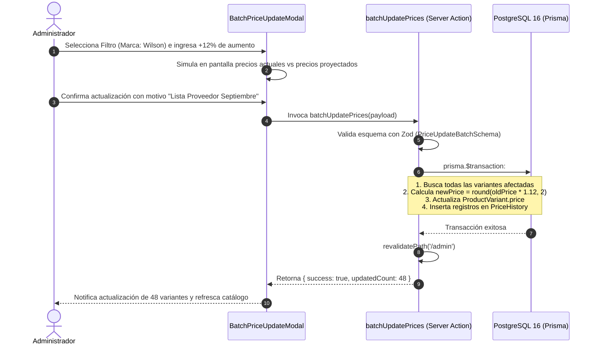

# [RF-02] Gestión de Variantes de Producto y Precios

## 1. Descripción y Objetivo
Permite modelar y administrar la matriz dimensional de variantes asociadas a cada producto de **Matacos Deportes**, reflejando la complejidad real de una tienda de indumentaria y calzado deportivo donde un mismo modelo existe en múltiples talles y colores.

El requerimiento resuelve:
1. **Matriz de Talles y Colores:** Soporte para rangos de calzado (ej: 35 al 45), indumentaria (ej: XS al XXL), pesos para entrenamiento (ej: 1kg, 2kg, 5kg) y accesorios de talle único, combinados con una paleta estandarizada de colores comerciales.
2. **Identificación Unívoca:** Asignación obligatoria de código SKU (Stock Keeping Unit) y código de barras (EAN-13 estándar o interno de circulación local).
3. **Precios Diferenciados y Sobreprecio:** Capacidad de definir un precio de venta específico por variante (útil cuando talles especiales o pesos mayores tienen costos diferenciales), tomando por defecto el precio general del producto si no se especifica.
4. **Actualización Masiva y Porcentual de Precios:** Módulo para aplicar variaciones porcentuales (ej: incremento del 8.5% en toda la marca Speedo o rubro Calzado) con redondeo automático e historial de auditoría de precios.

---

## 2. Tecnologías, Herramientas y Librerías

- **Next.js 15 (Server Actions):** [`src/server/actions/productActions.ts`](file:///C:/Proyectos/matacos-deportes-app/src/server/actions/productActions.ts) (`createVariant`, `updateVariant`, `deleteVariant`) y [`src/server/actions/priceActions.ts`](file:///C:/Proyectos/matacos-deportes-app/src/server/actions/priceActions.ts) (`batchUpdatePrices`, `getPriceHistory`).
- **PostgreSQL 16 & Prisma ORM 6:** Modelo relacional `ProductVariant` y tabla histórica `PriceHistory` con trazabilidad del usuario responsable y fecha del cambio.
- **Zod (Validación de Esquemas):** [`ProductVariantSchema`](file:///C:/Proyectos/matacos-deportes-app/src/schemas/product.ts), [`PriceUpdateBatchSchema`](file:///C:/Proyectos/matacos-deportes-app/src/schemas/priceUpdate.ts) y [`PriceUpdateRuleSchema`](file:///C:/Proyectos/matacos-deportes-app/src/schemas/priceUpdate.ts).
- **TypeScript (Matemática Determinista):** Redondeo contable a 2 decimales para importes monetarios en ARS.

---

## 3. Archivos Involucrados en el Requerimiento

### Backend & Server Actions
- [`src/server/actions/productActions.ts`](file:///C:/Proyectos/matacos-deportes-app/src/server/actions/productActions.ts): Creación, edición y baja de variantes dentro de la transacción de producto.
- [`src/server/actions/priceActions.ts`](file:///C:/Proyectos/matacos-deportes-app/src/server/actions/priceActions.ts): Actualización masiva de precios por alcance (marca, categoría, disciplina o producto) y consulta del historial.

### Esquemas de Validación (Zod)
- [`src/schemas/product.ts`](file:///C:/Proyectos/matacos-deportes-app/src/schemas/product.ts): Define `ProductVariantSchema` (talle, color, SKU, barcode, stockStore, stockWarehouse, price).
- [`src/schemas/priceUpdate.ts`](file:///C:/Proyectos/matacos-deportes-app/src/schemas/priceUpdate.ts): Reglas para actualización por porcentaje o monto fijo (`PriceUpdateRuleSchema`).

### Modelos y Persistencia (Prisma / PostgreSQL)
- [`prisma/schema.prisma`](file:///C:/Proyectos/matacos-deportes-app/prisma/schema.prisma):
  - `ProductVariant`: Atributos `id`, `productId`, `size`, `color`, `sku` (índice único), `barcode` (indexado), `price` (Decimal nullable), `stockStore`, `stockWarehouse`, `minStoreStock`, `minStock`.
  - `PriceHistory`: Auditoría histórica con `oldPrice`, `newPrice`, `percentageChange`, `reason`, `updatedBy` y `createdAt`.

### Componentes de Interfaz de Usuario (Frontend)
- [`src/components/dashboard/ProductFormModal.tsx`](file:///C:/Proyectos/matacos-deportes-app/src/components/dashboard/ProductFormModal.tsx): Grilla interactiva de definición de variantes por talle/color con autogeneración de SKUs.
- [`src/components/dashboard/BatchPriceUpdateModal.tsx`](file:///C:/Proyectos/matacos-deportes-app/src/components/dashboard/BatchPriceUpdateModal.tsx): Modal de simulación y aplicación masiva de aumentos/descuentos con vista previa del impacto financiero.
- [`src/components/dashboard/PriceHistoryModal.tsx`](file:///C:/Proyectos/matacos-deportes-app/src/components/dashboard/PriceHistoryModal.tsx): Visor cronológico de variaciones de precios para auditoría y control de márgenes.

---

## 4. Flujo de Datos y Control

### Diagrama de Secuencia de Actualización Masiva de Precios

### Detalle del Flujo de Control
1. **Generación Predictiva de SKU:** Al tipear talle y color en la interfaz, el sistema propone automáticamente un formato estandarizado (ej: `SPE-ANT-AZU-UNI`).
2. **Prioridad de Precios:** Al momento de consultar el precio de un artículo (tanto en POS como en catálogo), la regla de negocio evalúa: `variante.price ?? producto.price`.
3. **Persistencia Histórica Inmutable:** Toda modificación de precios que supere $ 0 genera un registro en `PriceHistory`, asegurando que no se pierda la trazabilidad ante aumentos inflacionarios.

---

## 5. Pruebas y Validación (QA)

1. **Precondición:** Existe un producto "Gorra Natación Silicona" con precio base de $ 12.000,00 y dos variantes: Color Negro y Color Dorado.
2. **Paso 1:** Asignar a la variante "Color Dorado" un precio específico de $ 14.500,00, dejando la variante "Color Negro" con precio vacío.
3. **Paso 2:** Verificar en el mostrador del POS que al escanear la variante Negra se cobre $ 12.000,00 y al escanear la variante Dorada se cobre $ 14.500,00.
4. **Paso 3:** Aplicar una actualización masiva del 10% sobre la categoría Natación con motivo *"Ajuste inflacionario"*.
5. **Resultado Esperado:** La variante Negra se actualiza a $ 13.200,00 y la Dorada a $ 15.950,00. El modal de historial refleja ambos movimientos con fecha y usuario responsable.
