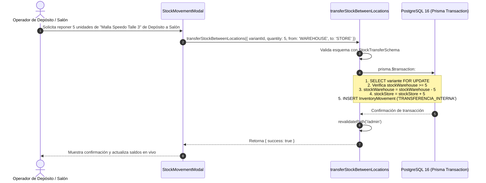

# [RF-03] Control de Stock Dual y Movimientos de Inventario

## 1. Descripción y Objetivo
Permite administrar de forma unificada, atómica y en tiempo real el inventario de **Matacos Deportes**, implementando una arquitectura de **Stock Dual Diferenciado** por ubicación física en Saavedra 241:
1. **Stock en Salón / Mostrador (`stockStore`):** Unidades físicas exhibidas en las estanterías del local listas para la venta presencial inmediata.
2. **Stock en Depósito Central (`stockWarehouse`):** Unidades almacenadas en el depósito de reserva del local, destinadas a la reposición de salón o al despacho de pedidos de e-commerce.
3. **Stock Reservado (`stockReserved`):** Unidades congeladas preventivamente durante una preventa activa de mostrador (RF-07) o un checkout web en curso, impidiendo sobreventas concurrentes.

El requerimiento proporciona un **Libro Diario de Movimientos de Inventario** inmutable (`InventoryMovement`) que audita cada modificación de stock categorizada en 9 tipos de eventos obligatorios, requiriendo justificación contable para ajustes y devoluciones, y soportando transferencias internas y cambios de talle simultáneos.

---

## 2. Tecnologías, Herramientas y Librerías

- **Next.js 15 (Server Actions):** [`src/server/actions/inventoryActions.ts`](file:///C:/Proyectos/matacos-deportes-app/src/server/actions/inventoryActions.ts) (`recordInventoryMovement`, `transferStockBetweenLocations`, `processSizeExchange`, `getInventoryMovements`).
- **PostgreSQL 16 & Prisma ORM 6:** Transacciones ACID con `prisma.$transaction` y bloqueo de registros para garantizar consistencia estricta en decrementos e incrementos cruzados.
- **Zod (Validación de Esquemas):** [`InventoryMovementSchema`](file:///C:/Proyectos/matacos-deportes-app/src/schemas/inventory.ts), [`StockTransferSchema`](file:///C:/Proyectos/matacos-deportes-app/src/schemas/inventory.ts) y [`SizeExchangeSchema`](file:///C:/Proyectos/matacos-deportes-app/src/schemas/inventory.ts).
- **Control de Concurrencia:** Verificación estricta de saldo positivo (`stockStore - quantity >= 0`) antes de confirmar cualquier egreso.

---

## 3. Archivos Involucrados en el Requerimiento

### Backend & Server Actions
- [`src/server/actions/inventoryActions.ts`](file:///C:/Proyectos/matacos-deportes-app/src/server/actions/inventoryActions.ts): Lógica de negocio para registro de movimientos manuales, transferencias de depósito a salón, cambios de talle y auditoría.

### Esquemas de Validación (Zod)
- [`src/schemas/inventory.ts`](file:///C:/Proyectos/matacos-deportes-app/src/schemas/inventory.ts):
  - `MovementTypeEnum`: Tipos de eventos admitidos (`INGRESO_INICIAL`, `INGRESO_COMPRA`, `VENTA_MOSTRADOR`, `VENTA_WEB`, `DEVOLUCION_CLIENTE`, `ANULACION_VENTA`, `AJUSTE_INGRESO`, `AJUSTE_EGRESO`, `TRANSFERENCIA_INTERNA`).
  - `InventoryMovementSchema`: Validación de cantidades enteras positivas, ubicación objetivo (`STORE` | `WAREHOUSE`) y justificación obligatoria en mermas o ajustes.
  - `StockTransferSchema`: Validación de traslados de reposición.
  - `SizeExchangeSchema`: Validación de cambios de talle (impide cambiar una variante por sí misma).

### Modelos y Persistencia (Prisma / PostgreSQL)
- [`prisma/schema.prisma`](file:///C:/Proyectos/matacos-deportes-app/prisma/schema.prisma):
  - `ProductVariant`: Campos `stockStore`, `stockWarehouse`, `stockReserved`, `minStoreStock`, `minStock`.
  - `InventoryMovement`: Tabla inmutable con `variantId`, `type`, `quantity`, `location`, `reason`, `userId`, `previousStockStore`, `newStockStore`, `previousStockWarehouse`, `newStockWarehouse`, `createdAt`.

### Componentes de Interfaz de Usuario (Frontend)
- [`src/components/dashboard/InventoryView.tsx`](file:///C:/Proyectos/matacos-deportes-app/src/components/dashboard/InventoryView.tsx): Panel integral con visualización en dos columnas de existencias (Salón vs Depósito) y totalizador.
- [`src/components/dashboard/StockMovementModal.tsx`](file:///C:/Proyectos/matacos-deportes-app/src/components/dashboard/StockMovementModal.tsx): Modal para ingresar compras o registrar mermas.
- [`src/components/dashboard/StockAdjustmentModal.tsx`](file:///C:/Proyectos/matacos-deportes-app/src/components/dashboard/StockAdjustmentModal.tsx): Modal de ajuste rápido por conteo físico con motivo obligatorio.
- [`src/components/dashboard/StockMovementHistoryView.tsx`](file:///C:/Proyectos/matacos-deportes-app/src/components/dashboard/StockMovementHistoryView.tsx): Visor cronológico del libro de auditoría de movimientos con filtros por tipo de evento y variante.

---

## 4. Flujo de Datos y Control

### Diagrama de Transferencia Interna (Depósito a Salón)

### Detalle del Flujo de Control y Reglas de Negocio
1. **Validación de Motivo:** Todo movimiento de tipo `AJUSTE_EGRESO`, `AJUSTE_INGRESO` o `DEVOLUCION_CLIENTE` exige un texto descriptivo no vacío en el campo `reason` (ej: *"Conteo de inventario quincenal"* o *"Ticket #083-00012457"*).
2. **Cambio de Talle 1 a 1:** Al procesar un cambio de talle (`processSizeExchange`), el sistema ejecuta en la misma transacción:
   - Incremento de 1 unidad en la variante devuelta (`DEVOLUCION_CLIENTE`).
   - Decremento de 1 unidad en la variante entregada (`VENTA_MOSTRADOR` o `CAMBIO_TALLE`).
   - Generación cruzada de los dos movimientos en el libro de auditoría.
3. **Cálculo de Stock Disponible:** La cantidad real disponible para la venta inmediata en mostrador se evalúa mediante:
   $$\text{Stock Disponible Mostrador} = \text{stockStore} - \text{stockReserved}$$

---

## 5. Pruebas y Validación (QA)

1. **Precondición:** Una variante tiene 2 unidades en Salón y 10 en Depósito.
2. **Paso 1:** Intentar registrar un egreso manual de 3 unidades en Salón. Verificar que el sistema rechace la operación por saldo insuficiente (`stockStore < quantity`).
3. **Paso 2:** Ejecutar una transferencia interna de 4 unidades desde Depósito hacia Salón.
4. **Resultado Esperado:** Salón pasa a 6 unidades y Depósito a 6 unidades. El historial registra un evento `TRANSFERENCIA_INTERNA` de 4 unidades.
5. **Paso 3:** Intentar hacer un ajuste manual sin escribir motivo. Verificar que Zod bloquee el botón indicando *"Debe especificar el motivo o ticket para este tipo de movimiento"*.
