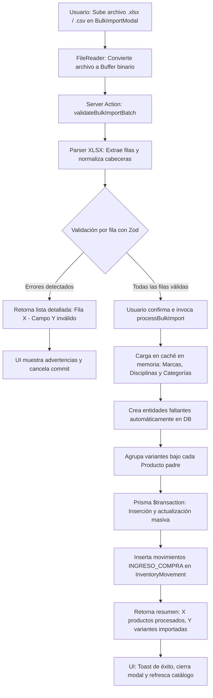

# [RF-04] Carga Masiva e Importación Progresiva de Inventario

## 1. Descripción y Objetivo
Permite la digitalización e importación masiva de artículos, variantes, precios y existencias en **Matacos Deportes** a través de planillas tabulares Excel (`.xlsx`) y archivos CSV normalizados.

El requerimiento resuelve el cuello de botella crítico de la puesta en marcha inicial del sistema y el reabastecimiento recurrente de mercadería proveniente de distribuidores oficiales (Speedo, Wilson, Arena, Topper):
1. **Resolución de Entidades al Vuelo:** Si la disciplina, marca o categoría especificada en una fila de la planilla no existe aún en la base de datos, el procesador la da de alta automáticamente con su nombre y slug canónico.
2. **Tres Modos de Ingestión Configurables:**
   - `CREATE_ONLY`: Modo seguro para altas iniciales; rechaza la fila si el producto o código de barras ya existe para prevenir duplicaciones accidentales.
   - `ACCUMULATE_STOCK`: Modo estándar para reabastecimiento periódico de mercadería; si el producto y la variante ya existen, suma el stock ingresado a las existencias existentes (`stockStore` y `stockWarehouse`) y genera el movimiento de auditoría `INGRESO_COMPRA`.
   - `OVERWRITE`: Modo de sincronización integral; actualiza nombres, descripciones y precios sobreescribiendo los valores previos.
3. **Resiliencia y Prevalidación:** Valida íntegramente el archivo antes de impactar en la base de datos, reportando los números de fila específicos que contengan inconsistencias o campos faltantes.

---

## 2. Tecnologías, Herramientas y Librerías

- **Next.js 15 (Server Actions):** [`src/server/actions/bulkImportActions.ts`](file:///C:/Proyectos/matacos-deportes-app/src/server/actions/bulkImportActions.ts) (`validateBulkImportBatch`, `processBulkImport`).
- **Librería de Ingestión Tabular (`xlsx`):** Procesamiento en memoria de buffers binarios de libros de cálculo y streams tabulares sin persistencia temporal en disco.
- **PostgreSQL 16 & Prisma ORM 6:** Inserciones en lotes optimizadas (`prisma.$transaction`) con mapeo en memoria de marcas y categorías para reducir los accesos a disco.
- **Zod (Validación de Esquemas):** [`BulkImportPayloadSchema`](file:///C:/Proyectos/matacos-deportes-app/src/schemas/bulkImport.ts), [`BulkProductItemSchema`](file:///C:/Proyectos/matacos-deportes-app/src/schemas/bulkImport.ts) y [`BulkVariantItemSchema`](file:///C:/Proyectos/matacos-deportes-app/src/schemas/bulkImport.ts).

---

## 3. Archivos Involucrados en el Requerimiento

### Backend & Server Actions
- [`src/server/actions/bulkImportActions.ts`](file:///C:/Proyectos/matacos-deportes-app/src/server/actions/bulkImportActions.ts): Orquestador de la validación por lotes, resolución taxonómica, desduplicación por SKU/barcode e ingestión atómica.

### Esquemas de Validación (Zod)
- [`src/schemas/bulkImport.ts`](file:///C:/Proyectos/matacos-deportes-app/src/schemas/bulkImport.ts):
  - `BulkImportModeEnum`: `"CREATE_ONLY"` | `"ACCUMULATE_STOCK"` | `"OVERWRITE"`.
  - `BulkProductItemSchema`: Reglas de validación para producto padre (nombre, disciplina, categoría, marca, precio de lista).
  - `BulkVariantItemSchema`: Reglas de validación para talle, color, SKU, código de barras y stock dual inicial.
  - `BulkImportResultSchema`: Contrato de respuesta con métricas de productos creados, variantes actualizadas y log de advertencias.

### Modelos y Persistencia (Prisma / PostgreSQL)
- [`prisma/schema.prisma`](file:///C:/Proyectos/matacos-deportes-app/prisma/schema.prisma): Modelos `Product`, `ProductVariant`, `Discipline`, `Category`, `Brand` e `InventoryMovement`.

### Componentes de Interfaz de Usuario y Plantillas
- [`src/components/dashboard/BulkImportModal.tsx`](file:///C:/Proyectos/matacos-deportes-app/src/components/dashboard/BulkImportModal.tsx): Interfaz de arrastrar y soltar (*drag & drop*) de archivos `.xlsx` y `.csv`, selector de modo de importación, barra de progreso y visualizador de errores.
- [`docs/rf-04-especificacion-tecnica-carga-stock.md`](file:///C:/Proyectos/matacos-deportes-app/docs/rf-04-especificacion-tecnica-carga-stock.md): Especificación técnica exhaustiva del requerimiento.
- [`docs/ESTRUCTURA_PLANTILLA_EXCEL.md`](file:///C:/Proyectos/matacos-deportes-app/docs/ESTRUCTURA_PLANTILLA_EXCEL.md): Guía de columnas y formatos requeridos para el usuario.
- [`docs/plantilla_carga_stock_matacos.xlsx`](file:///C:/Proyectos/matacos-deportes-app/docs/plantilla_carga_stock_matacos.xlsx): Plantilla oficial de carga distribuida a los encargados del local.

---

## 4. Flujo de Datos y Control

### Diagrama de Proceso de Carga Masiva

### Detalle del Flujo de Control y Desduplicación
1. **Normalización de Texto:** Los nombres de marcas y disciplinas se limpian de espacios sobrantes y se capitalizan formalmente (ej: `"  speedo "` $\rightarrow$ `"Speedo"`).
2. **Generación Automática de Variantes:** Si en la planilla se repite el mismo nombre de producto con distintos talles y colores, el motor los consolida automáticamente bajo un único registro de `Product` y múltiples registros hijos en `ProductVariant`.
3. **Trazabilidad de Movimientos:** En modo `ACCUMULATE_STOCK`, cada fila que incrementa existencias genera de forma automática un registro en `InventoryMovement` con el tipo `INGRESO_COMPRA` y motivo *"Carga masiva por planilla Excel"*.

---

## 5. Pruebas y Validación (QA)

1. **Precondición:** Descargar la plantilla oficial [`docs/plantilla_carga_stock_matacos.xlsx`](file:///C:/Proyectos/matacos-deportes-app/docs/plantilla_carga_stock_matacos.xlsx).
2. **Paso 1:** Completar 3 filas con una disciplina nueva no existente en el sistema (ej: "Crossfit") y una marca nueva (ej: "Reebok"), con 2 talles distintos del mismo modelo.
3. **Paso 2:** Arrastrar el archivo en el modal de importación seleccionando el modo *"Acumular Stock"*.
4. **Resultado Esperado:** El sistema valida la estructura sin errores, da de alta la disciplina "Crossfit" y la marca "Reebok", crea el producto padre con sus dos variantes y suma las existencias en `stockStore`. El panel de inventario refleja los nuevos artículos inmediatamente.
