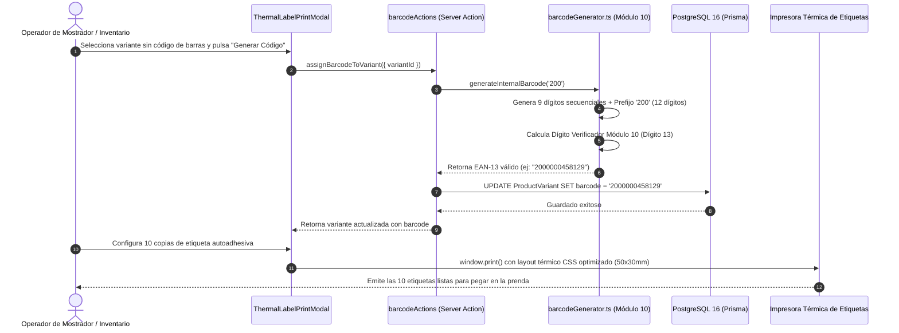

# [RF-05] Generación y Asignación de Códigos de Barra / Etiquetado Térmico

## 1. Descripción y Objetivo
Resuelve la problemática operativa detectada en **Matacos Deportes** respecto a los artículos que ingresan al comercio sin código de barras de fábrica (prendas de indumentaria textil suelta, accesorios de natación, vendas, bucales o pesas de gimnasio).

El requerimiento provee:
1. **Generador Determinista de Códigos EAN-13 Internos:** Emplea el estándar internacional **GS1 con prefijo `200`** (reservado mundialmente para circulación interna dentro de comercios / *Restricted Circulation Numbers*), garantizando que los códigos generados jamás colisionen con artículos comerciales de marcas internacionales ni requieran compra de rangos GS1 adicionales.
2. **Cálculo Oficial Módulo 10:** Calcula el dígito verificador número 13 mediante el algoritmo oficial ponderado de GS1:
   $$\text{Check Digit} = \left(10 - \left(\sum \text{impares}\times 1 + \sum \text{pares}\times 3 \pmod{10}\right)\right) \pmod{10}$$
3. **Módulo de Renderizado SVG:** Dibuja los patrones de barras normalizados en pantalla y en formatos vectoriales sin pérdida de calidad.
4. **Impresión Térmica de Etiquetas Autoadhesivas:** Formato optimizado para impresoras térmicas de etiquetas (50x30mm o rollos continuos de 80mm) con nombre del producto, marca, disciplina, talle, color, SKU, precio formateado en ARS y código de barras legible con escáner USB.

---

## 2. Tecnologías, Herramientas y Librerías

- **Algoritmo GS1 Módulo 10 Puro:** Módulo matemático TypeScript en [`src/lib/barcodeGenerator.ts`](file:///C:/Proyectos/matacos-deportes-app/src/lib/barcodeGenerator.ts) (`calculateEan13CheckDigit`, `validateEan13`).
- **Next.js 15 (Server Actions):** [`src/server/actions/barcodeActions.ts`](file:///C:/Proyectos/matacos-deportes-app/src/server/actions/barcodeActions.ts) (`generateInternalBarcode`, `generateBarcodeBatch`, `assignBarcodeToVariant`, `getPrintLabelsPayload`).
- **Zod (Validación de Esquemas):** [`GenerateBarcodesSchema`](file:///C:/Proyectos/matacos-deportes-app/src/schemas/barcode.ts), [`AssignBarcodeToVariantSchema`](file:///C:/Proyectos/matacos-deportes-app/src/schemas/barcode.ts) y [`PrintLabelsPayloadSchema`](file:///C:/Proyectos/matacos-deportes-app/src/schemas/barcode.ts).
- **PostgreSQL 16 & Prisma ORM 6:** Campo indexado `ProductVariant.barcode` con verificación de unicidad para evitar duplicados en el mostrador.

---

## 3. Archivos Involucrados en el Requerimiento

### Lógica Pura y Generador
- [`src/lib/barcodeGenerator.ts`](file:///C:/Proyectos/matacos-deportes-app/src/lib/barcodeGenerator.ts): Algoritmo de cálculo de dígito verificador, formateo de etiquetas térmicas y constante `GS1_INTERNAL_PREFIX = "200"`.

### Backend & Server Actions
- [`src/server/actions/barcodeActions.ts`](file:///C:/Proyectos/matacos-deportes-app/src/server/actions/barcodeActions.ts): Server Actions para asignación directa a variantes, creación de lotes no asignados y preparación de cargas de impresión.

### Esquemas de Validación (Zod)
- [`src/schemas/barcode.ts`](file:///C:/Proyectos/matacos-deportes-app/src/schemas/barcode.ts): Esquemas de validación de cantidad de copias de etiquetas (1 a 100), prefijos numéricos de 3 dígitos y validación estricta de códigos EAN-13 o Code-128.

### Modelos y Persistencia (Prisma / PostgreSQL)
- [`prisma/schema.prisma`](file:///C:/Proyectos/matacos-deportes-app/prisma/schema.prisma): `ProductVariant.barcode` (tipo String, indexado para búsquedas rápidas en POS).

### Componentes de Interfaz de Usuario (Frontend)
- [`src/components/dashboard/BarcodeSvg.tsx`](file:///C:/Proyectos/matacos-deportes-app/src/components/dashboard/BarcodeSvg.tsx): Componente visual que renderiza las barras y números del código en pantalla con alta nitidez.
- [`src/components/dashboard/ThermalLabelPrintModal.tsx`](file:///C:/Proyectos/matacos-deportes-app/src/components/dashboard/ThermalLabelPrintModal.tsx): Modal de configuración de impresión de etiquetas con vista previa en vivo, selección de número de copias por talle/color y disparo a impresora de etiquetas.

---

## 4. Flujo de Datos y Control

### Diagrama de Secuencia de Asignación e Impresión de Etiquetas

### Detalle del Flujo de Control y Compatibilidad con Hardware
1. **Garantía Anticolisión:** El generador verifica en la base de datos que el código numérico de 13 dígitos resultante no esté ya asignado a otra variante antes de confirmarlo.
2. **Compatibilidad con Lectores USB:** Al cumplir con el estándar EAN-13, cualquier lector de pistola láser o escáner omnidireccional USB decodifica instantáneamente el código emulando teclado sin requerir configuración adicional de firmware.
3. **Formato Térmico Compacto:** El layout CSS `@media print` oculta encabezados del navegador, suprime márgenes y ajusta el tamaño a las dimensiones de etiquetas estándar de poliamida o papel térmico autoadhesivo.

---

## 5. Pruebas y Validación (QA)

1. **Precondición:** Tener una variante creada sin código de barras asociado.
2. **Paso 1:** En la tabla de inventario, presionar el botón *"Generar Etiqueta"* sobre la variante.
3. **Paso 2:** Verificar que se genere un código de 13 dígitos que comience con `200` y cuyo último dígito satisfaga el algoritmo Módulo 10.
4. **Paso 3:** Abrir el modal de impresión, seleccionar 2 copias y disparar la vista previa de impresión.
5. **Resultado Esperado:** La etiqueta muestra el nombre del producto, talle, color, precio con formato `$ XX.XXX,XX` y el código de barras legible. Al escanear con la pistola USB en el buscador del POS (RF-07), el producto se carga de forma inmediata (< 50ms).
