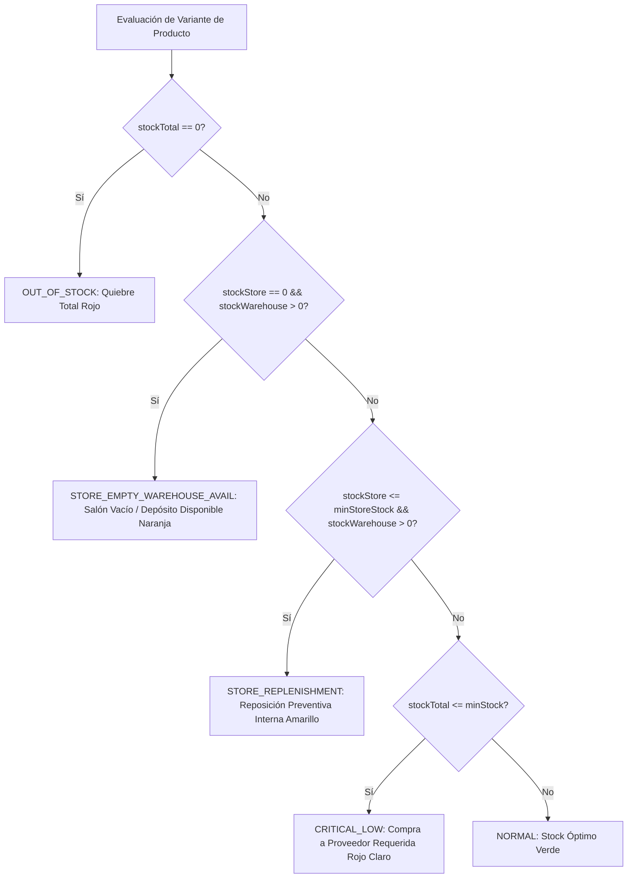

# [RF-06] Alertas de Stock Crítico y Umbrales Mínimos Inteligentes

## 1. Descripción y Objetivo
Permite a los administradores y encargados de **Matacos Deportes** monitorear en tiempo real los niveles de existencias del inventario comercial para prevenir quiebres de stock en el salón de Saavedra 241 y optimizar la planificación de compras a proveedores.

El requerimiento resuelve:
1. **Clasificación Semántica en 5 Niveles de Alerta:**
   - `OUT_OF_STOCK`: Stock total igual a cero (agotado total en salón y depósito; quiebre inminente).
   - `CRITICAL_LOW`: Stock total menor o igual al umbral mínimo global (`minStock`); alerta prioritaria para emisión de orden de compra a proveedores.
   - `STORE_EMPTY_WAREHOUSE_AVAIL`: Salón de ventas con stock cero (`stockStore == 0`), pero con existencias disponibles en depósito central (`stockWarehouse > 0`); alerta crítica de **reposición inmediata a mostrador**.
   - `STORE_REPLENISHMENT`: Salón de ventas por debajo del umbral mínimo (`stockStore <= minStoreStock`), pero con unidades en depósito; alerta preventiva de reposición interna.
   - `NORMAL`: Existencias suficientes tanto en mostrador como en depósito.
2. **Supresión de Falsas Alarmas:** Algoritmo que discrimina si una prenda que falta en la estantería del salón realmente requiere una compra externa o si simplemente amerita un traslado interno desde el depósito (RF-03).
3. **Umbrales Configurables por Alcance:** Permite fijar mínimos globales (`minStock`) y de mostrador (`minStoreStock`) a nivel de Categoría, Producto o individualmente por Variante.

---

## 2. Tecnologías, Herramientas y Librerías

- **Next.js 15 (Server Actions & Route Handlers):**
  - Server Actions en [`src/server/actions/stockAlertActions.ts`](file:///C:/Proyectos/matacos-deportes-app/src/server/actions/stockAlertActions.ts) (`getStockAlertsSummary`, `getStockAlertsList`, `configureStockThresholds`).
  - Endpoint REST [`GET /api/stock/alerts`](file:///C:/Proyectos/matacos-deportes-app/src/app/api/stock/alerts/route.ts) para polling ligero o paneles informativos secundarios.
- **PostgreSQL 16 & Prisma ORM 6:** Consultas optimizadas con filtros de agregación y conteos en memoria para mantener tiempos de respuesta `< 50ms`.
- **Zod (Validación de Esquemas):** [`StockAlertsQuerySchema`](file:///C:/Proyectos/matacos-deportes-app/src/schemas/stockAlerts.ts) y [`ConfigureStockThresholdSchema`](file:///C:/Proyectos/matacos-deportes-app/src/schemas/stockAlerts.ts).
- **Zustand & Lucide Icons:** Notificaciones dinámicas en el panel de control con indicadores visuales de colores (Rojo: Crítico / Naranja: Reposición / Verde: Óptimo).

---

## 3. Archivos Involucrados en el Requerimiento

### Backend & Server Actions
- [`src/server/actions/stockAlertActions.ts`](file:///C:/Proyectos/matacos-deportes-app/src/server/actions/stockAlertActions.ts): Server Actions para cálculo en tiempo real de métricas, clasificación semántica de variantes y ajuste de umbrales en cascada.
- [`src/app/api/stock/alerts/route.ts`](file:///C:/Proyectos/matacos-deportes-app/src/app/api/stock/alerts/route.ts): Endpoint Route Handler para consulta pública o sincronización ligera.

### Esquemas de Validación (Zod)
- [`src/schemas/stockAlerts.ts`](file:///C:/Proyectos/matacos-deportes-app/src/schemas/stockAlerts.ts):
  - `StockAlertLevelEnum`: Definición exhaustiva de los 5 estados de alerta.
  - `StockAlertFilterEnum`: Filtros de panel (`ALL`, `OUT_OF_STOCK`, `CRITICAL_LOW`, `STORE_REPLENISHMENT`).
  - `ConfigureStockThresholdSchema`: Reglas para actualizar `minStock` y `minStoreStock` por alcance (`CATEGORY`, `PRODUCT`, `VARIANT`).

### Modelos y Persistencia (Prisma / PostgreSQL)
- [`prisma/schema.prisma`](file:///C:/Proyectos/matacos-deportes-app/prisma/schema.prisma):
  - `ProductVariant`: Campos `minStoreStock` (mínimo salón, default 1) y `minStock` (mínimo total, default 2).

### Componentes de Interfaz de Usuario (Frontend)
- [`src/components/dashboard/StockAlertsDrawer.tsx`](file:///C:/Proyectos/matacos-deportes-app/src/components/dashboard/StockAlertsDrawer.tsx): Panel lateral desplegable (*Drawer*) accesible desde la barra superior, con lista de artículos en riesgo, botón de "Reponer a Salón" directo y selector de filtros rápidos.
- [`src/components/dashboard/KpiCard.tsx`](file:///C:/Proyectos/matacos-deportes-app/src/components/dashboard/KpiCard.tsx): Tarjetas métricas superiores con badges de conteo en tiempo real (ej: *"4 variantes críticas"*).

---

## 4. Flujo de Datos y Control

### Diagrama de Decisión del Algoritmo de Alertas

### Detalle del Flujo de Control y Acción Directa
1. **Acción en un Clic desde el Drawer:** Cuando una variante cae en `STORE_EMPTY_WAREHOUSE_AVAIL` o `STORE_REPLENISHMENT`, el panel lateral ofrece un botón directo que abre el modal de transferencia interna (RF-03), precargando la cantidad sugerida para llenar el salón hasta el umbral de seguridad.
2. **Propagación en Cascada de Umbrales:** Si un administrador ajusta el stock mínimo a nivel de "Categoría: Calzado" a 3 unidades, el sistema actualiza en un único lote todas las variantes pertenecientes a dicha categoría que no tengan una configuración específica previa.

---

## 5. Pruebas y Validación (QA)

1. **Precondición:** Existe una variante con `stockStore = 0`, `stockWarehouse = 8`, `minStoreStock = 2` y `minStock = 4`.
2. **Paso 1:** Abrir el panel de control y pulsar el ícono de campana en el encabezado para desplegar el `StockAlertsDrawer`.
3. **Paso 2:** Verificar que la variante se clasifique con la etiqueta *"Reposición a Salón Urgente"* (`STORE_EMPTY_WAREHOUSE_AVAIL`) y no como *"Agotado Total"*.
4. **Paso 3:** Pulsar el botón de acción rápida *"Reponer a Salón"*, transferir 3 unidades desde el modal y volver al panel.
5. **Resultado Esperado:** La variante pasa a tener 3 unidades en salón y 5 en depósito, cambiando su estado a `NORMAL` y desapareciendo de la lista de reposición urgente.
