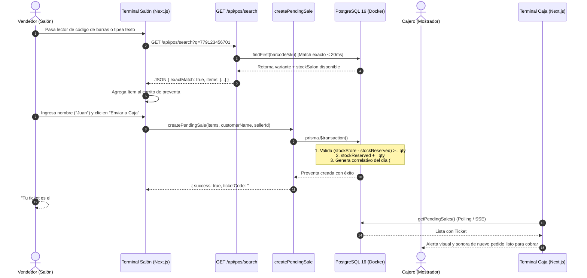

# [RF-07] Búsqueda Ágil en Mostrador y Circuito de Preventa

## 1. Descripción y Objetivo
Permite al vendedor en el salón de ventas (Terminal 1) y al cajero en el mostrador (Terminal 2) buscar y cargar productos de forma ultrarrápida (tiempo de respuesta < 50 ms), soportando tanto la lectura instantánea de códigos de barras mediante lectores USB (emulación teclado) como la búsqueda predictiva por texto (nombre de producto, marca, categoría, SKU, talle o color).

El objetivo principal es eliminar los cuellos de botella en la atención física de Saavedra 241: el vendedor escanea las prendas mientras el cliente se las prueba y congela el pedido como preventa (**Ticket #042 - Juan**), reservando el stock de forma preventiva (`stockReserved`) en la base de datos para impedir sobreventas con la web o con otra terminal.

---

## 2. Tecnologías, Herramientas y Librerías

- **Next.js 15 (Route Handlers & Server Actions):** Endpoint liviano `GET /api/pos/search` para lecturas de alta frecuencia y Server Action `createPendingSale` para transacciones atómicas de reserva.
- **PostgreSQL 16 & Prisma ORM 6:** Consultas optimizadas con proyección estricta (`select` acotado de campos esenciales) evitando joins innecesarios; transacciones ACID (`prisma.$transaction`) con incremento atómico de reservas.
- **Zod (Validación de Esquemas):** Esquema `CreatePendingSaleSchema` para garantizar la integridad y no negatividad de los datos ingresados en el carrito de preventa.
- **Performance API (Nativa de Node.js / Web):** Medición de latencia en milisegundos inyectada en las cabeceras HTTP `Server-Timing` para auditar el cumplimiento del RNF de respuesta ágil.

---

## 3. Archivos Involucrados en el Requerimiento

### Backend & Endpoints (Next.js 15)
- [`src/app/api/pos/search/route.ts`](file:///C:/Proyectos/matacos-deportes-app/src/app/api/pos/search/route.ts): Endpoint GET optimizado para escaneo de códigos de barra USB y búsqueda predictiva con respuesta JSON mínima.
- [`src/server/actions/posSaleActions.ts`](file:///C:/Proyectos/matacos-deportes-app/src/server/actions/posSaleActions.ts): Server Actions para la creación de preventas (`createPendingSale`), consulta de cola de espera en caja (`getPendingSales`) y cancelación con liberación de reservas (`cancelPendingSale`).

### Esquemas y Validaciones (Zod)
- [`src/schemas/sale.ts`](file:///C:/Proyectos/matacos-deportes-app/src/schemas/sale.ts): Define `CreatePendingSaleSchema`, `SaleItemSchema`, tipos de descuentos y enums de estado de venta (`PENDIENTE_PAGO`, `COMPLETADA`, `CANCELADA`).
- [`src/schemas/cashShift.ts`](file:///C:/Proyectos/matacos-deportes-app/src/schemas/cashShift.ts): Esquemas para el ciclo de turnos y arqueo de caja vinculado a las ventas.

### Modelos y Persistencia (Prisma / PostgreSQL)
- [`prisma/schema.prisma`](file:///C:/Proyectos/matacos-deportes-app/prisma/schema.prisma):
  - `ProductVariant`: Campos `barcode`, `sku`, `stockStore`, `stockWarehouse` y `stockReserved`.
  - `Sale`: Campos `ticketCode` (ej: `#042`), `status` (`PENDIENTE_PAGO`), `customerName`, `sellerId`, `subtotalGross`, `discount` y `total`.
  - `SaleItem`: Registro de prendas con precio original, descuentos aplicados y subtotal.
  - `CashShift` y `CashMovement`: Control de turnos y arqueo de caja.

---

## 4. Flujo de Datos y Control

### Diagrama de Flujo del Requerimiento

### Detalle del Flujo de Control
1. **Detección USB o Predictiva:** El lector USB emula teclado y envía el código de barras seguido de un `Enter`. El endpoint `/api/pos/search` evalúa si hay coincidencia unívoca en `barcode` o `sku`. Si existe, devuelve el ítem en menos de 20 ms con el cálculo `stockAvailable = stockStore - stockReserved`.
2. **Validación de Disponibilidad:** `createPendingSale` comprueba que la cantidad solicitada no supere el stock real en mostrador disponible en ese instante.
3. **Reserva Atómica:** Se incrementa el contador `stockReserved` de cada variante dentro de una transacción PostgreSQL, bloqueando que el stock sea vendido concurrentemente por la tienda web o por otra notebook.
4. **Generación de Ticket Corto:** Se cuenta la cantidad de preventas generadas en el día en curso para emitir un identificador amigable correlativo (ej: `#001`, `#002`... `#042`).
5. **Visibilidad Inmediata:** La terminal de caja consulta las ventas con `status: "PENDIENTE_PAGO"` ordenadas por antigüedad (FIFO), permitiendo al cajero abrir directamente el pedido escaneando o ingresando el número `#042`.

---

## 5. Pruebas y Validación (QA)

### Prueba 1: Búsqueda Ágil y Respuesta en < 50ms
1. **Precondición:** Servidor Next.js y base de datos PostgreSQL activos con catálogo cargado.
2. **Paso 1:** Enviar petición `GET /api/pos/search?q=Crocs` y verificar tiempo de respuesta en encabezado `Server-Timing`.
3. **Paso 2:** Enviar petición con código de barras exacto `GET /api/pos/search?q=779123456701`.
4. **Resultado Esperado:** Retorno en formato JSON ultraliviano con `exactMatch: true` para código de barras en menos de 30 ms, y lista de hasta 20 resultados con orden de stock para texto libre.

### Prueba 2: Reserva Preventiva de Stock
1. **Precondición:** Identificar un producto con `stockStore = 8` y `stockReserved = 0`.
2. **Paso 1:** Invocar `createPendingSale` solicitando 1 unidad para el cliente "Juan Test".
3. **Resultado Esperado:** 
   - La venta se crea con estado `PENDIENTE_PAGO` y código correlativo (ej: `#001`).
   - La variante en la base de datos pasa a tener `stockReserved = 1`.
   - La búsqueda ágil subsiguiente muestra `stockAvailable = 7`.

### Prueba 3: Cola de Espera en Caja y Cancelación
1. **Paso 1:** Ejecutar `getPendingSales()` y verificar que el ticket `#001` figure en la lista con su detalle completo.
2. **Paso 2:** Invocar `cancelPendingSale(saleId)`.
3. **Resultado Esperado:**
   - La venta pasa a estado `CANCELADA`.
   - El stock reservado vuelve a `stockReserved = 0`, quedando inmediatamente disponible nuevamente para salón.
