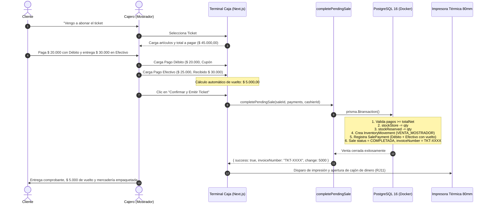

# [RF-09] Cobro con varios Métodos de Pago y Cálculo de Vuelto

## 1. Descripción y Objetivo
Permite al operador de la caja (Terminal 2 en Saavedra 241) concretar la venta cobrando el importe neto total mediante la combinación simultánea de múltiples medios de pago admitidos en el comercio:
- **Efectivo:** Con ingreso del monto abonado por el cliente y cálculo automático e instantáneo del vuelto a entregar.
- **Tarjetas de Débito y Crédito (Posnet):** Con registro del nombre de la tarjeta, número de cupón de la terminal y cantidad de cuotas.
- **QR Mercado Pago y Transferencias Bancarias:** Con captura del número de comprobante o código de referencia de la operación.

El objetivo es agilizar la atención en mostrador eliminando errores humanos de cálculo manual de vuelto y dotar al negocio de una conciliación financiera fidedigna para el arqueo de caja (RF-11), vinculando cada cobro de forma atómica con la baja definitiva del stock en salón de ventas y la liberación de la reserva preventiva.

---

## 2. Tecnologías, Herramientas y Librerías

- **Next.js 15 (Server Actions):** [`completePendingSale`](file:///C:/Proyectos/matacos-deportes-app/src/server/actions/posSaleActions.ts) (para cerrar preventas de salón) y `createDirectSale` (para ventas express de mostrador).
- **PostgreSQL 16 & Prisma ORM 6:** Transacción ACID (`prisma.$transaction`) que descuenta definitivamente `stockStore`, libera `stockReserved`, registra la auditoría en `InventoryMovement` (`VENTA_MOSTRADOR`) y crea los renglones en `SalePayment`.
- **Zod (Validación de Pagos):** [`CompletePendingSaleSchema`](file:///C:/Proyectos/matacos-deportes-app/src/schemas/sale.ts) y `SalePaymentSchema` para asegurar que los importes ingresados cubran exactamente el total de la venta (tolerancia estricta de $ 0,05 por redondeo decimal) y que los billetes entregados en efectivo cubran el monto a imputar.

---

## 3. Archivos Involucrados en el Requerimiento

### Backend & Server Actions
- [`src/server/actions/posSaleActions.ts`](file:///C:/Proyectos/matacos-deportes-app/src/server/actions/posSaleActions.ts): Funciones `completePendingSale` (cobro de preventa en caja) y `createDirectSale` (cobro directo de mostrador).

### Esquemas de Validación (Zod)
- [`src/schemas/sale.ts`](file:///C:/Proyectos/matacos-deportes-app/src/schemas/sale.ts):
  - `PaymentMethodEnum`: `"EFECTIVO"` | `"DEBITO"` | `"CREDITO"` | `"TRANSFERENCIA"` | `"QR_MERCADOPAGO"`.
  - `SalePaymentSchema`: Validación de montos, monto entregado (`receivedAmount`), vuelto (`change`), marca de tarjeta (`cardBrand`), cupón (`cardVoucher`) y referencia (`referenceCode`).
  - `CompletePendingSaleSchema`: Validación del payload de confirmación de cobranza.

### Persistencia y Modelos (Prisma)
- [`prisma/schema.prisma`](file:///C:/Proyectos/matacos-deportes-app/prisma/schema.prisma):
  - `Sale`: Cambio de estado a `COMPLETADA`, asignación de `cashierId`, `cashShiftId` y generación de `invoiceNumber` (ej: `TKT-98034586`).
  - `SalePayment`: Registro discriminado de cada medio de pago asociado a la venta.
  - `ProductVariant`: Actualización atómica de `stockStore` y `stockReserved`.
  - `InventoryMovement`: Creación del movimiento `VENTA_MOSTRADOR`.

---

## 4. Flujo de Datos y Control

### Diagrama de Secuencia del Cobro en Caja

### Detalle del Flujo de Control
1. **Validación de Pagos:** El sistema suma el importe de todos los medios de pago ingresados. Si la suma es inferior al total neto de la venta (fuera del margen de tolerancia de $ 0,05), rechaza la operación informando la diferencia faltante.
2. **Cálculo de Vuelto en Efectivo:** Si el método es `EFECTIVO` y se especifica `receivedAmount`, el backend calcula:
   $$\text{change} = \max(0, \text{receivedAmount} - \text{amount})$$
   Este valor queda registrado en la base de datos para la posterior conciliación de efectivo en el arqueo de caja (RF-11).
3. **Transacción Atómica de Inventario:**
   - Se descuenta definitivamente la cantidad física del salón: `stockStore -= quantity`.
   - Se libera la reserva preventiva que se había congelado en la preventa: `stockReserved -= quantity`.
   - Se inserta un registro en `InventoryMovement` con tipo `"VENTA_MOSTRADOR"`, garantizando la trazabilidad histórica del stock.
4. **Cierre de Venta:** La venta cambia su estado de `"PENDIENTE_PAGO"` a `"COMPLETADA"`, se le asigna el cajero responsable y el número definitivo de comprobante, saliendo automáticamente de la cola de pedidos pendientes de la caja.

---

## 5. Pruebas y Validación (QA)

### Prueba 1: Rechazo por Fondos Insuficientes
1. **Precondición:** Venta pendiente con total neto de `$ 104.400,00`.
2. **Paso 1:** Intentar cobrar ingresando un único pago en efectivo por `$ 52.200,00`.
3. **Resultado Esperado:** La Server Action rechaza la operación con el mensaje explicativo: *"Los pagos ingresados ($ 52200.00) no cubren el total de la venta ($ 104400.00)"*. El stock permanece reservado y la venta sigue pendiente.

### Prueba 2: Cobro Mixto y Cálculo Automático de Vuelto
1. **Paso 1:** Registrar Pago 1: Débito por `$ 52.200,00` con tarjeta "Visa Débito" y cupón "009841".
2. **Paso 2:** Registrar Pago 2: Efectivo por `$ 52.200,00`, ingresando un billete entregado de `$ 57.200,00`.
3. **Resultado Esperado:**
   - La venta se completa exitosamente.
   - Se genera el comprobante (ej: `TKT-98034586`).
   - El vuelto de `$ 5.000,00` queda registrado en la tabla `SalePayment`.

### Prueba 3: Integridad Atómica del Stock
1. **Paso 1:** Inspeccionar la variante en PostgreSQL antes del cobro (`stockStore: 5`, `stockReserved: 2`).
2. **Paso 2:** Ejecutar `completePendingSale`.
3. **Resultado Esperado:** 
   - La variante pasa a tener `stockStore: 3` y `stockReserved: 0`.
   - Se genera el movimiento de inventario `VENTA_MOSTRADOR` con `quantity: 2` y `stockAfter: 3 + depósito`.
