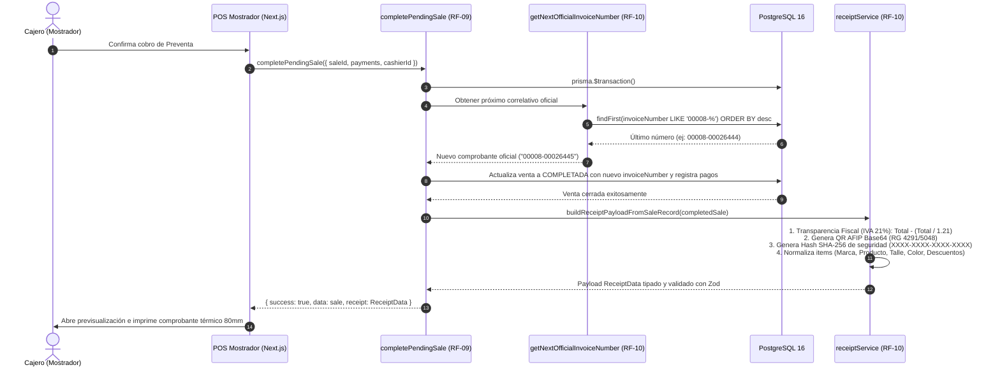

# [RF-10] Emisión e Impresión de Tickets de Venta (Térmica 80mm / Comandera)

## 1. Descripción y Objetivo
Permite estructurar, generar y emitir los datos de comprobantes de venta tanto en el punto de cobro definitivo (Terminal 2 - Caja Mostrador) como en el circuito de preventa (Terminal 1 - Salón de Ventas) en el local físico de Saavedra 241:
- **Estructuración Oficial del Comprobante:** Provee los datos impositivos completos del comercio (Razón Social: *Mujica Sandra Isabel*, CUIT: *27-18036080-3*, Ingresos Brutos DGR Formosa: *01-2718036080-3*, Inicio de Actividades: *25/07/2007*, IVA Responsable Inscripto, Saavedra 241, Formosa Capital, CP 3600).
- **Numeración Oficial Secuencial:** Formato reglamentario `PPPPP-NNNNNNNN` (ej. `00008-00026445`) correspondiente a `Cód. 083 - TIQUE`, con Punto de Venta desacoplado y configurable mediante variables de entorno (`POS_POINT_OF_SALE`) para permitir la transición fluida a nuevos puntos de venta de Facturación Electrónica (WSFEv1 / ARCA).
- **Desglose Exhaustivo de Variantes y Descuentos:** Detalle pormenorizado por renglón con Marca, Nombre del Producto, Talle, Color, Precio de Lista, Descuentos aplicados (RF-08) y Subtotales.
- **Trazabilidad de Roles y Auditoría:** Identificación simultánea del Vendedor de Salón (preventa `#042`) y del Cajero de Mostrador interviniente en la cobranza.
- **Transparencia Fiscal (RG AFIP 5003):** Cálculo y deducción matemática precisa del IVA contenido al 21% para el consumidor final:
  $$\text{IVA Contenido} = \text{Total Neto} - \left(\frac{\text{Total Neto}}{1.21}\right)$$
- **Código QR Interoperable AFIP (RG 4291 / 5048):** Generación de la URL canónica de AFIP con metadatos impositivos codificados en Base64 (`https://www.afip.gob.ar/fe/qr/?p={BASE64}`) y hash SHA-256 de seguridad para antifraude y verificación rápida con lector de código de barras USB.
- **Desglose de Medios de Pago y Vuelto (RF-09):** Imputación de importes abonados, vuelto entregado en efectivo, cupones de tarjetas y códigos de referencia.
- **Políticas Comerciales y Canales Oficiales al Pie:** Impresión de la política de cambios de Matacos Deportes (*Indispensable presentar comprobante; producto sin uso, sin daños y con etiquetas adheridas*) y canales de contacto oficial (`WhatsApp: +54 9 370 4000000`, `Instagram: @matacosdeportes`, `Dirección: Saavedra 241, Formosa`).

### 1.1. Reglas de Negocio Operativas para Cambios y Devoluciones
1. **Condiciones de Admisión:** Ticket de compra obligatorio, producto sin daño ni signos de uso, etiquetas originales adheridas. Las prendas íntimas (ropa interior deportiva, calzas íntimas), mallas y medias están estrictamente excluidas de cambio por razones higiénico-sanitarias.
2. **Cambio 1 a 1:** Por el mismo producto (talle o color) u otro artículo del mismo valor, el cambio se realiza directo sin costo. **Si el precio del producto subió en el catálogo desde la compra original, se le respeta el valor y no se cobra diferencia.**
3. **Cambio por Mayor Valor:** El cliente abona únicamente la diferencia neta.
4. **Devoluciones / Vales de Compra:** No se realizan devoluciones de dinero en efectivo; se emite un **"Vale de Compra" / Saldo a Favor** para compras futuras en el local.

---

## 2. Tecnologías, Herramientas y Librerías

- **Next.js 15 (Server Actions & Route Handlers):**
  - Server Action [`getReceiptData(saleId)`](file:///C:/Proyectos/matacos-deportes-app/src/server/actions/posReceiptActions.ts) para invocación directa desde componentes React en caja.
  - Server Action [`getReceiptByTicketCode(ticketCode)`](file:///C:/Proyectos/matacos-deportes-app/src/server/actions/posReceiptActions.ts) para consultar preventas de salón.
  - Route Handler `GET /api/pos/receipt/[saleId]` para interoperabilidad con microservicios o demonios de impresión en red local.
- **PostgreSQL 16 & Prisma ORM 6:** Consulta relacional de la venta, variantes de productos, marcas, medios de pago y usuarios con correlatividad atómica secuencial por Punto de Venta dentro de `prisma.$transaction`.
- **Node.js Crypto API (`crypto.createHash`):** Generación de firma criptográfica SHA-256 de 16 caracteres (`XXXX-XXXX-XXXX-XXXX`) para antifraude y verificación rápida con lector de código de barras.
- **Zod 3 & TypeScript 5 (Modo Estricto):** Esquemas de validación y tipado formal del contrato de datos de tickets ([`src/schemas/receipt.ts`](file:///C:/Proyectos/matacos-deportes-app/src/schemas/receipt.ts)).
- **Configuración Desacoplada y Segura:** Parametrización en [`src/config/company.ts`](file:///C:/Proyectos/matacos-deportes-app/src/config/company.ts) mediante variables de entorno protegidas en `.gitignore` ([`.env`](file:///C:/Proyectos/matacos-deportes-app/.env) y documentadas en [`.env.example`](file:///C:/Proyectos/matacos-deportes-app/.env.example)).
- **Helpers de Formato y Zona Horaria:** `formatCurrency(amount)` en Pesos Argentinos (ARS) y zona horaria `America/Argentina/Buenos_Aires`.

---

## 3. Archivos Involucrados en el Requerimiento

### Backend, Servicios y Acciones
- [`src/config/company.ts`](file:///C:/Proyectos/matacos-deportes-app/src/config/company.ts): Parametrización centralizada de datos fiscales, comerciales, punto de venta dinámico, canales y políticas de cambio.
- [`.env.example`](file:///C:/Proyectos/matacos-deportes-app/.env.example): Plantilla de variables de entorno seguras para desarrollo y producción.
- [`src/server/services/receiptService.ts`](file:///C:/Proyectos/matacos-deportes-app/src/server/services/receiptService.ts): Núcleo de formateo de tickets, cálculo de IVA al 21%, hash de seguridad SHA-256, QR oficial AFIP en Base64 y correlatividad oficial `PPPPP-NNNNNNNN`.
- [`src/server/actions/posReceiptActions.ts`](file:///C:/Proyectos/matacos-deportes-app/src/server/actions/posReceiptActions.ts): Server Actions para consultar tickets por `saleId` o `ticketCode`.
- [`src/server/actions/posSaleActions.ts`](file:///C:/Proyectos/matacos-deportes-app/src/server/actions/posSaleActions.ts): Integración de numeración secuencial oficial en `completePendingSale` y `createDirectSale`, retornando el payload `receipt` listo para impresión inmediata.
- [`src/app/api/pos/receipt/[saleId]/route.ts`](file:///C:/Proyectos/matacos-deportes-app/src/app/api/pos/receipt/%5BsaleId%5D/route.ts): Endpoint REST para consumo de herramientas externas de impresión comandera.

### Esquemas y Tipado
- [`src/schemas/receipt.ts`](file:///C:/Proyectos/matacos-deportes-app/src/schemas/receipt.ts): Contrato de datos Zod y tipos TypeScript (`ReceiptData`, `ReceiptItem`, `ReceiptPayment`, `ReceiptTotals`, `ReceiptFiscal`, `ReceiptFooter`).

### Pruebas Automatizadas (QA)
- [`scripts/test-rf10-receipts.ts`](file:///C:/Proyectos/matacos-deportes-app/scripts/test-rf10-receipts.ts): Banco integral de 30 pruebas automatizadas para validar Transparencia Fiscal, hash SHA-256, QR AFIP, zona horaria y contratos Zod.

---

## 4. Flujo de Datos y Control

### Diagrama de Secuencia de Emisión del Comprobante

### Detalle del Flujo de Control y Lógica de Negocio
1. **Asignación del Correlativo Oficial:**
   Al cerrarse la venta, el backend determina el Punto de Venta activo (`POS_POINT_OF_SALE`, ej. `8` formateado a `00008`). Busca la venta previa con ese prefijo para incrementar correlativamente el contador a 8 dígitos (`00026445`). Si se crea un nuevo punto de venta en el futuro, reinicia automáticamente en 1.
2. **Construcción del Bloque de Transparencia Fiscal (RG 5003):**
   Con alícuota general del 21%, se determina la base imponible y el impuesto:
   $$\text{baseNeta} = \frac{\text{Total Neto}}{1.21}, \quad \text{ivaContenido} = \text{Total Neto} - \text{baseNeta}$$
   *(Ejemplo: Total de $ 4.800,00 genera exactamente $ 833,06 de IVA contenido y $ 3.966,94 de base neta).*
3. **Construcción del Código QR AFIP Oficial:**
   Se ensambla el objeto impositivo reglamentario con CUIT limpio de Sandra Isabel Mujica (`27180360803`), Punto de Venta (`8`), Tipo de Comprobante (`83`), Número (`26445`) e Importe. Se serializa a Base64 y se genera la URL oficial de consulta:
   `https://www.afip.gob.ar/fe/qr/?p={BASE64}`.
4. **Firma Criptográfica de Seguridad (Hash SHA-256):**
   Se obtiene el digest SHA-256 de la cadena canónica del comprobante (`${cuit}|${ptoVta}|${nroCmp}|${total}|${fecha}`), extrayendo un token de 16 caracteres hexadecimales formateado en 4 bloques (`XXXX-XXXX-XXXX-XXXX`) para verificación rápida contra fraudes con lector USB.
5. **Estructura Desacoplada para Frontend:**
   Se entrega el contrato `ReceiptData` completo, permitiendo al equipo de frontend diagramar el diseño visual libremente para bobina de 80mm continua sin depender de la lógica del servidor.

---

## 5. Pruebas y Validación (QA)

Se desarrolló la suite automatizada [`scripts/test-rf10-receipts.ts`](file:///C:/Proyectos/matacos-deportes-app/scripts/test-rf10-receipts.ts) con 54 pruebas unitarias que cubren el 100% de la lógica impositiva, de datos y fidelidad visual con el ticket físico:

### Prueba 1: Deducción Matemática de Transparencia Fiscal
1. **Precondición:** Venta de `$ 4.800,00` correspondiente al ticket físico de muestra de Saavedra 241 (`contexto/Ticket-Factura Matacos.jpeg`).
2. **Paso:** Ejecutar `calculateVatBreakdown(4800.0)`.
3. **Resultado Esperado:** 
   - `vatAmount` es exactamente `$ 833,06`.
   - `netBaseAmount` es exactamente `$ 3.966,94`.
   - `formattedVatAmount` formatea `$ 833,06` en moneda argentina (ARS).

### Prueba 2: Correlatividad Secuencial de Comprobantes Oficiales
1. **Paso:** Ejecutar `getNextOfficialInvoiceNumber(tx, 8)`.
2. **Resultado Esperado:**
   - Si la última venta registrada es `00008-00026444`, la siguiente venta recibe estrictamente `00008-00026445`.
   - Si se cambia el punto de venta a `9`, inicia en `00009-00000001`.

### Prueba 3: Inviolabilidad del Hash Criptográfico SHA-256
1. **Paso 1:** Generar el hash de una venta con total `$ 4.800,00`.
2. **Paso 2:** Modificar el importe en $ 0,01 (`$ 4.800,01`) manteniendo idénticos los demás campos.
3. **Resultado Esperado:** 
   - El hash resultante es completamente diferente, detectando cualquier intento de adulteración en el ticket físico.

### Prueba 4: Generación y Decodificación del QR Oficial AFIP
1. **Paso:** Invocar `generateAfipQrPayload` y decodificar el Base64 del parámetro `p` de la URL generada.
2. **Resultado Esperado:**
   - La URL inicia con `https://www.afip.gob.ar/fe/qr/?p=`.
   - El payload decodificado contiene `ver: 1`, `cuit: 27180360803`, `ptoVta: 8`, `tipoCmp: 83`, `nroCmp: 26445` e `importe: 4800.00`.

### Prueba 5: Validación Estricta con Esquema Zod (ReceiptDataSchema)
1. **Paso:** Construir el comprobante mock con variantes deportivas (Crocs Classic Talle 41 Negro), descuentos de RF-08, pagos mixtos con vuelto de RF-09 y política de cambios oficial.
2. **Resultado Esperado:** 
   - `ReceiptDataSchema.safeParse` retorna `success: true`.
   - El cliente no especificado aplica fallback automático a `"CONSUMIDOR FINAL"`.

### Prueba 6: Fidelidad Visual con el Ticket Físico Real (Saavedra 241)
1. **Paso:** Ejecutar `formatTicketToPlainText(receipt, 40)` sobre la venta idéntica a la fotografía de muestra.
2. **Resultado Esperado:**
   - Encabezado con letras espaciadas centrado: `M A T A C O S` y `D E P O R T E S`.
   - Bloque emisor: `MUJICA SANDRA ISABEL`, CUIT `27-18036080-3`, IIBB `01-2718036080-3`, Dirección `SAAVEDRA 241`, Localidad `FORMOSA - CAPITAL`, `C.P.3600`, Inicio `25/07/2007`, `IVA RESPONSABLE INSCRIPTO`, `A CONSUMIDOR FINAL`.
   - Comprobante: `Cód. 083 - TIQUE`, `P.V. Nro. 00008 - Nro. T. 00026445`, `Fecha 22/09/2026           Hora 10:34:01`.
   - Renglones: `ACCESORIOS                            $4800,00`.
   - Totales: `TOTAL                                 $4800,00`.
   - Pagos: `RECIBI(MOS)` y `EFECTIVO                              $4800,00`.
   - Transparencia Fiscal: `TRANSPARENCIA FISCAL`, `IVA contenido:                         $833,06` y cajero `CAJERO01`.
   - Código QR oficial AFIP escaneable y visualmente adaptado.
   - Pie: `CF SESHRA000022252                    V: 1.02`.
   - Ancho térmico: Ninguna línea supera las 40 columnas de la bobina de 80mm.

---

## 6. Scripts de Utilidad y Previsualización
- [`scripts/test-rf10-receipts.ts`](file:///C:/Proyectos/matacos-deportes-app/scripts/test-rf10-receipts.ts): Banco integral de 54 pruebas unitarias automáticas (`pnpm exec tsx scripts/test-rf10-receipts.ts`).
- [`scripts/preview-ticket-fidelity.ts`](file:///C:/Proyectos/matacos-deportes-app/scripts/preview-ticket-fidelity.ts): Generador visual interactivo que renderiza el ticket en consola con el código QR escaneable por smartphones (`pnpm exec tsx scripts/preview-ticket-fidelity.ts`).

