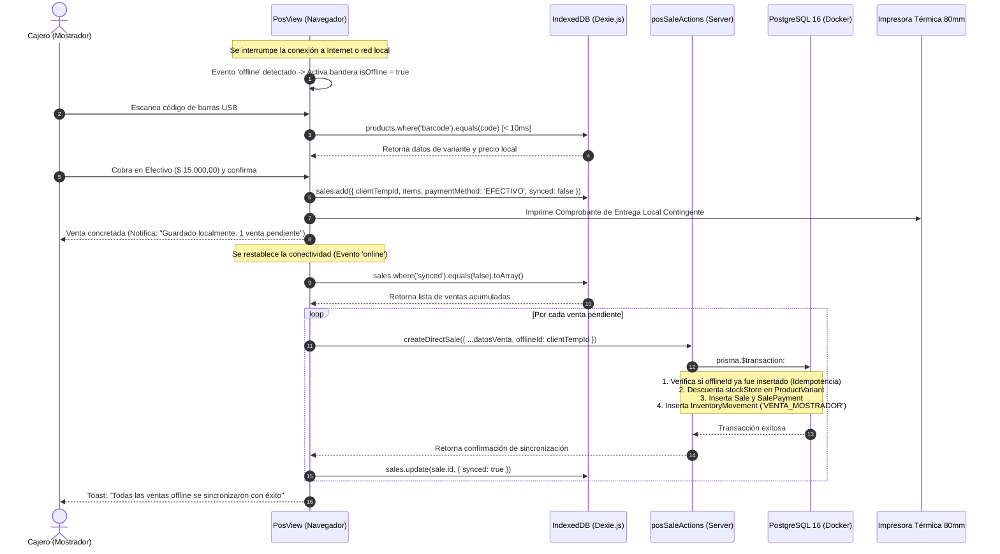

# [RF-12] Operación Offline del Mostrador y Sincronización en Segundo Plano

## 1. Descripción y Objetivo
Garantiza la **continuidad operativa ininterrumpida** del Punto de Venta (POS) en el mostrador de **Matacos Deportes** (Saavedra 241, Formosa) ante caídas de internet, microcortes o fallas temporales de enlace con la nube o la red local.

Bajo la filosofía **Offline-First**, el mostrador jamás bloquea una venta presencial:
1. **Catálogo Local Espejo en IndexedDB:** Mantiene una réplica sincronizada en el almacenamiento persistente del navegador con el catálogo de artículos, variantes, códigos de barra, talles, colores y precios vigentes.
2. **Cobro y Registro Desconectado:** Permite registrar cobros en mostrador (especialmente pagos en efectivo), calcular vuelto de forma instantánea y generar identificadores universales únicos temporales (`clientTempId` / `offlineId`).
3. **Emisión de Tickets Locales Contingentes:** Permite imprimir el comprobante térmico de control y entrega al cliente de forma inmediata utilizando el renderizador del navegador sin depender de respuestas de APIs remotas.
4. **Cola de Sincronización Idempotente en Background:** Las ventas concretadas sin conexión se encolan con el estado `synced: false`. Al restablecerse la red, un despachador asíncrono envía las transacciones al servidor PostgreSQL central mediante transacciones atómicas (`prisma.$transaction`), descontando el stock físico real y actualizando `synced: true` sin duplicar operaciones.

---

## 2. Tecnologías, Herramientas y Librerías

- **IndexedDB & Dexie.js 4:** Módulo de base de datos local en el navegador [`src/lib/dexie.ts`](file:///C:/Proyectos/matacos-deportes-app/src/lib/dexie.ts) que implementa `MatacosOfflineDatabase` con tablas indexadas `products` y `sales`.
- **Next.js 15 (Server Actions):** [`src/server/actions/posSaleActions.ts`](file:///C:/Proyectos/matacos-deportes-app/src/server/actions/posSaleActions.ts) con soporte para ingestión atómica de ventas con `offlineId`.
- **PostgreSQL 16 & Prisma ORM 6:** Campo indexado `Sale.offlineId` con restricción de unicidad para garantizar **idempotencia estricta** (si un paquete se reintenta por microcortes, no genera doble cobro ni doble baja de stock).
- **Zod (Validación de Esquemas):** [`SaleSchema`](file:///C:/Proyectos/matacos-deportes-app/src/schemas/sale.ts) con validación del atributo opcional `offlineId`.
- **Web Connection APIs:** `navigator.onLine`, `window.addEventListener('online')` y `window.addEventListener('offline')` con monitoreo reactivo de latencia.

---

## 3. Archivos Involucrados en el Requerimiento

### Persistencia Local y Cliente (IndexedDB)
- [`src/lib/dexie.ts`](file:///C:/Proyectos/matacos-deportes-app/src/lib/dexie.ts): Base de datos Dexie con contratos tipados `LocalProduct`, `LocalSale`, `LocalSaleItem` e índices de búsqueda por `barcode`, `variantId` y estado `synced`.

### Backend & Server Actions (Sincronización Idempotente)
- [`src/server/actions/posSaleActions.ts`](file:///C:/Proyectos/matacos-deportes-app/src/server/actions/posSaleActions.ts): Server Actions `createDirectSale` y `completePendingSale` preparadas para recibir `offlineId` y ejecutar la baja de stock en `prisma.$transaction`.

### Esquemas de Validación (Zod)
- [`src/schemas/sale.ts`](file:///C:/Proyectos/matacos-deportes-app/src/schemas/sale.ts): Define el identificador `offlineId: z.string().uuid().optional().nullable()`.

### Modelos y Persistencia Central (Prisma / PostgreSQL)
- [`prisma/schema.prisma`](file:///C:/Proyectos/matacos-deportes-app/prisma/schema.prisma):
  - `Sale`: Atributos `offlineId` (UUID indexado único) y `createdAt` original de la transacción desconectada.
  - `ProductVariant`: Descuento atómico de existencias físicas (`stockStore`) al consolidar la venta offline.
  - `InventoryMovement`: Creación del movimiento `VENTA_MOSTRADOR` con fecha histórica de la venta real.

### Componentes de Interfaz de Usuario (Frontend)
- [`src/components/dashboard/PosView.tsx`](file:///C:/Proyectos/matacos-deportes-app/src/components/dashboard/PosView.tsx): Selector automático de motor (API Online vs IndexedDB Local) según el estado de red, banner de alerta de modo offline y contador de ventas pendientes de sincronización.
- [`src/components/dashboard/SidebarRight.tsx`](file:///C:/Proyectos/matacos-deportes-app/src/components/dashboard/SidebarRight.tsx): Indicador global de estado de red (*Online / Offline*).

---

## 4. Flujo de Datos y Control

### Diagrama de Flujo: Venta Desconectada y Sincronización en Background

### Detalle de Reglas Críticas de Sincronización
1. **Idempotencia Garantizada:** Si el navegador envía la venta offline, la red sufre un microcorte antes de recibir la confirmación y el navegador vuelve a reintentar el envío, PostgreSQL detecta el `offlineId` ya existente y retorna éxito sin duplicar los cobros ni descontar doble stock.
2. **Preservación Temporal Fidedigna:** La venta sincronizada preserva en el campo `createdAt` la fecha y hora exacta en la que se cobró físicamente en el mostrador, garantizando que el arqueo de caja de dicho turno (RF-11) compute el dinero en el momento en que efectivamente ingresó al cajón.
3. **Consistencia de Stock Negativo:** Si durante el período offline se vendió una prenda cuyo stock físico era la última unidad en salón, la transacción de sincronización actualiza el stock a 0 e inserta la auditoría correspondiente sin interrumpir el lote.

---

## 5. Pruebas y Validación (QA)

1. **Precondición:** Cargar el Punto de Venta (POS) con catálogo sincronizado.
2. **Paso 1 (Simulación Desconectada):** En las herramientas de desarrollador del navegador (DevTools -> pestaña *Network*), seleccionar el perfil *"Offline"*.
3. **Paso 2:** Verificar que en la interfaz aparezca el indicador ámbar *"Modo Offline Activo (Operando sobre almacenamiento local)"*.
4. **Paso 3:** Escanear un producto de muestra mediante código de barras o buscador omnibox. Verificar que la búsqueda responda en menos de 20ms desde IndexedDB.
5. **Paso 4:** Cobrar una venta en efectivo por `$ 10.000,00` con `$ 12.000,00` entregados. Verificar el cálculo de `$ 2.000,00` de vuelto y la emisión del ticket local de contingencia.
6. **Paso 5 (Reconexión):** En DevTools, volver a seleccionar *"No throttling"* (restablecer conexión).
7. **Resultado Esperado:** El sistema detecta el evento de reconexión, dispara la sincronización en segundo plano, la venta impacta en PostgreSQL con su `offlineId`, la tabla local marca `synced = true` y el contador de ventas pendientes vuelve a 0.
