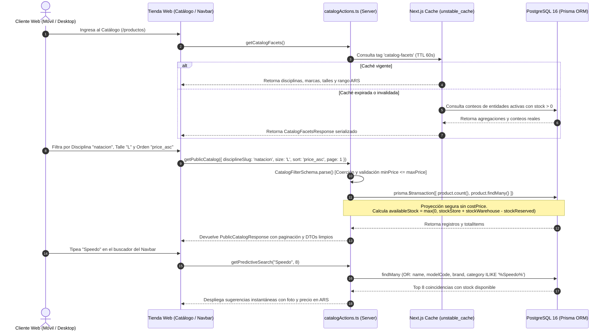

# [RF-13] Navegación, Catálogo Digital Público y Búsqueda Predictiva

## 1. Descripción y Objetivo
Permite exponer el catálogo digital público y responsive de **Matacos Deportes** (Saavedra 241, Formosa) las 24 horas del día, resolviendo la limitación geográfica y horaria detectada en la etapa de elicitación, donde las ventas dependían exclusivamente de la apertura presencial del local físico.

El requerimiento provee una experiencia de exploración e-commerce rápida, segura y orientada a la conversión:
1. **Filtrado Multidimensional Facetado:** Permite filtrar artículos simultáneamente por **Disciplina Deportiva** (`disciplineSlug`: Natación, Vóley, Crocs/Urbano, Fitness, Running), **Categoría** (`categorySlug`), **Marca Comercial** (`brandSlug`), **Talle** (`size`), **Color** (`color`) y **Rango de Precios** (`minPrice` / `maxPrice` en ARS).
2. **Ordenamiento Configurable y Paginación Atómica:** Soporta ordenamiento por menor precio (`price_asc`), mayor precio (`price_desc`), orden alfabético (`name_asc`) y más recientes (`newest`), resolviendo el listado y el conteo total de páginas en una única transacción Prisma.
3. **Filtrado Estricto de Existencias y Disponibilidad Neta:** Expone únicamente artículos activos (`active: true`) que cuenten con stock físico positivo en salón o depósito, calculando la disponibilidad neta real tras descontar las unidades comprometidas en preventas o checkouts en curso:
   $$\text{availableStock} = \max(0, (\text{stockStore} + \text{stockWarehouse}) - \text{stockReserved})$$
4. **Búsqueda Predictiva Instantánea (`< 50ms`):** Motor de autocompletado para la barra de navegación superior con coincidencia parcial insensible a mayúsculas/minúsculas sobre nombre del producto, código de modelo (`modelCode`), marca y categoría.
5. **Contadores de Facetas en Tiempo Real:** Calcula dinámicamente cuántos productos con stock existen por cada disciplina, categoría, marca y talle, junto con los topes mínimo y máximo de precios vigentes.
6. **Seguridad y Confidencialidad Comercial (*Zero-Leakage*):** Excluye de raíz el campo `costPrice` (precio de costo de fábrica) y datos internos de proveedores en las proyecciones `select` de Prisma, garantizando que jamás viajen al navegador del cliente público.

---

## 2. Tecnologías, Herramientas y Librerías

- **Next.js 15 (Server Actions & Cache API):** [`src/server/actions/ecommerce/catalogActions.ts`](file:///C:/Proyectos/matacos-deportes-app/src/server/actions/ecommerce/catalogActions.ts) con soporte de caché incremental mediante `unstable_cache` (revalidación SWR de 60 segundos bajo las etiquetas `ecommerce-catalog` y `catalog-facets`) e invalidación bajo demanda (`revalidateTag` / `revalidatePath`).
- **PostgreSQL 16 & Prisma ORM 6:** Consultas relacionales optimizadas con `prisma.$transaction` para conteo y paginación simultánea (`skip` / `take`) y agregaciones matemáticas (`prisma.product.aggregate`) para rangos de precios.
- **Zod (Validación y Coerción de Parámetros URL):** [`CatalogFilterSchema`](file:///C:/Proyectos/matacos-deportes-app/src/schemas/ecommerce.ts) y [`PredictiveSearchSchema`](file:///C:/Proyectos/matacos-deportes-app/src/schemas/ecommerce.ts) con coerción automática de query strings a números enteros/decimales y validación cruzada (`minPrice <= maxPrice`).
- **TypeScript 5 (Modo Estricto):** Contratos DTO públicos en [`src/types/ecommerce.ts`](file:///C:/Proyectos/matacos-deportes-app/src/types/ecommerce.ts) (`PublicProductItem`, `PublicCatalogResponse`, `PredictiveSearchItem`, `CatalogFacetsResponse`) libres de `any`.

---

## 3. Archivos Involucrados en el Requerimiento

### Backend & Server Actions
- [`src/server/actions/ecommerce/catalogActions.ts`](file:///C:/Proyectos/matacos-deportes-app/src/server/actions/ecommerce/catalogActions.ts):
  - `getPublicCatalog`: Consulta paginada con filtros combinados, ordenamiento y cálculo de stock neto por variante.
  - `getPredictiveSearch`: Búsqueda rápida de autocompletado para el buscador de cabecera.
  - `getCatalogFacets`: Obtención cacheada de disciplinas, categorías, marcas, talles y rango de precios con stock activo.
  - `revalidateEcommerceCatalogCache`: Invalidación instantánea de la caché tras ventas o ajustes de stock/precios.

### Esquemas de Validación (Zod) y Tipado (TypeScript)
- [`src/schemas/ecommerce.ts`](file:///C:/Proyectos/matacos-deportes-app/src/schemas/ecommerce.ts): Define `CatalogSortEnum`, `CatalogFilterSchema` y `PredictiveSearchSchema`.
- [`src/types/ecommerce.ts`](file:///C:/Proyectos/matacos-deportes-app/src/types/ecommerce.ts): Define las interfaces públicas seguras sin exposición de costos.

### Modelos y Persistencia (Prisma / PostgreSQL)
- [`prisma/schema.prisma`](file:///C:/Proyectos/matacos-deportes-app/prisma/schema.prisma): Modelos `Product`, `ProductVariant`, `ProductImage`, `Discipline`, `Category` y `Brand`.

### Pruebas Automatizadas (QA)
- [`scripts/test-rf13-ecommerce-catalog.ts`](file:///C:/Proyectos/matacos-deportes-app/scripts/test-rf13-ecommerce-catalog.ts): Suite automatizada con 24 casos de prueba que verifican coerción Zod, paginación, facetas, búsqueda predictiva y ausencia total de `costPrice`.

---

## 4. Flujo de Datos y Control

### Diagrama de Flujo del Catálogo Público y Búsqueda Predictiva

### Detalle del Flujo de Control
1. **Coerción y Validación de Parámetros:** Cuando el cliente aplica filtros en la URL, `CatalogFilterSchema` convierte automáticamente cadenas de texto (`"12"`, `"45000"`) en números nativos y verifica que el precio mínimo no supere al precio máximo.
2. **Consulta Transaccional Paginada:** Se ejecuta en simultáneo el conteo de artículos coincidentes (`prisma.product.count`) y la lectura de la página solicitada (`prisma.product.findMany`), calculando `totalPages`, `hasNextPage` y `hasPrevPage`.
3. **Cálculo de Rango de Precios por Producto:** Si un producto posee variantes con precios diferenciales (RF-02), el mapeador calcula `minPrice` y `maxPrice` efectivos para su correcta exposición en la tarjeta del catálogo.
4. **Revalidación Reactiva:** Cualquier modificación de precios o stock dispara `revalidateEcommerceCatalogCache()`, purgando las etiquetas `ecommerce-catalog` y `catalog-facets` para mantener consistencia inmediata.

---

## 5. Pruebas y Validación (QA)

1. **Precondición:** Base de datos con productos activos e inactivos, y variantes con stock en salón/depósito.
2. **Paso 1 (Validación de Filtros Inválidos):** Invocar `getPublicCatalog({ minPrice: 50000, maxPrice: 10000 })`. Verificar que el esquema Zod rechace la consulta con el mensaje *"El precio mínimo no puede ser mayor al precio máximo"*.
3. **Paso 2 (Seguridad Zero-Leakage):** Ejecutar `getPublicCatalog({ page: 1, limit: 6 })` e inspeccionar las claves del objeto devuelto. Verificar que ningún producto ni variante contenga la propiedad `costPrice`.
4. **Paso 3 (Búsqueda Predictiva):** Ejecutar `getPredictiveSearch("Crocs")`. Verificar que retorne en menos de 50ms únicamente artículos activos de la marca o nombre coincidente con su `availableStock` neto calculado.
5. **Paso 4 (Ejecución de Suite Automatizada):** Ejecutar `pnpm tsx scripts/test-rf13-ecommerce-catalog.ts`.
6. **Resultado Esperado:** Las **24 pruebas automatizadas** finalizan con estado `PASS` (`0 fallidas`), confirmando paginación exacta, ordenamiento numérico de talles y protección de costos.
