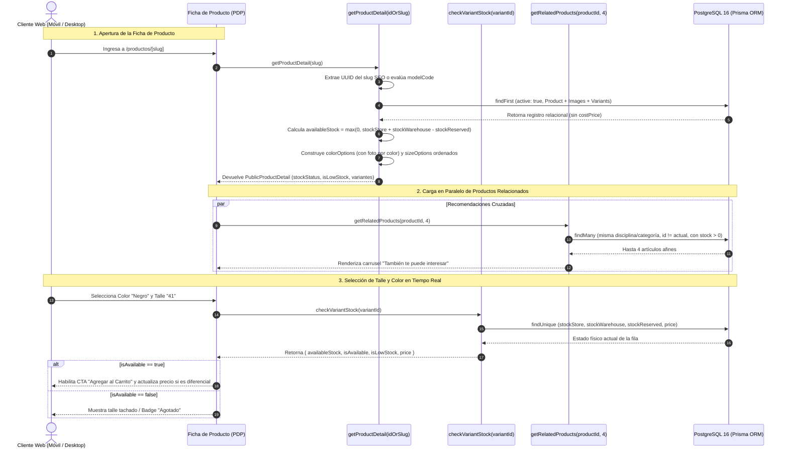

# [RF-14] Ficha de Detalle de Producto (PDP), Selector de Variantes y Stock en Tiempo Real

## 1. Descripción y Objetivo
Provee la lógica transaccional y de presentación de datos para la **Ficha de Detalle de Producto (*Product Detail Page* - PDP)** de la tienda online de **Matacos Deportes**, permitiendo al comprador inspeccionar las características técnicas de cada artículo, visualizar fotografías asociadas a cada color y verificar en tiempo real la existencia de su talle antes de añadirlo al carrito.

El requerimiento resuelve:
1. **Resolución Dual de Identificadores y Slugs SEO:** Soporta la búsqueda de productos tanto por su identificador `UUID` directo como mediante URLs amigables para buscadores (ej. `/productos/malla-speedo-endurance-97201724-...` o código de modelo `modelCode`), extrayendo el identificador automáticamente.
2. **Visibilidad Informativa de Variantes Agotadas:** Siguiendo las mejores prácticas relevadas en el benchmarking (SoloDeportes / Adidas), las variantes sin stock **no se eliminan ni ocultan** del selector; se devuelven con `inStock: false` y `availableStock: 0` para que la interfaz las muestre deshabilitadas o tachadas, indicando al cliente que el talle existe en la curva del producto pero se encuentra momentáneamente agotado.
3. **Matrices Auxiliares de Color y Talle (`colorOptions` y `sizeOptions`):** Agrupa automáticamente los colores disponibles vinculándolos con la fotografía principal de ese color (`ProductImage.color`), y ordena los talles de manera inteligente (numéricamente para calzado como `38, 39, 40` y alfabéticamente para indumentaria).
4. **Indicadores de Escasez y Estado de Stock:** Clasifica el estado global del artículo en `"IN_STOCK"`, `"LOW_STOCK"` (cuando quedan $\le 3$ unidades disponibles, incentivando la decisión de compra) o `"OUT_OF_STOCK"`.
5. **Verificación Atómica Instantánea (`checkVariantStock`):** Consulta ultraligera (`< 20ms`) ejecutada al cambiar de talle/color o justo antes de agregar al carrito, garantizando el precio vigente (base o diferencial de variante) y el stock neto real.
6. **Motor de Recomendaciones Cruzadas (`getRelatedProducts`):** Sugiere hasta 4 productos activos y con stock pertenecientes a la misma disciplina o categoría, excluyendo el artículo actual (*cross-selling*).

---

## 2. Tecnologías, Herramientas y Librerías

- **Next.js 15 (Server Actions):** [`src/server/actions/ecommerce/productDetailActions.ts`](file:///C:/Proyectos/matacos-deportes-app/src/server/actions/ecommerce/productDetailActions.ts) (`getProductDetail`, `checkVariantStock`, `getRelatedProducts`).
- **PostgreSQL 16 & Prisma ORM 6:** Consultas relacionales con inclusión de galería ordenada (`images: { orderBy: { order: "asc" } }`) y variantes ordenadas por talle y color, aplicando proyección segura sin `costPrice`.
- **Zod (Validación de Esquemas):** [`CheckVariantStockSchema`](file:///C:/Proyectos/matacos-deportes-app/src/schemas/ecommerce.ts) y [`RelatedProductsSchema`](file:///C:/Proyectos/matacos-deportes-app/src/schemas/ecommerce.ts).
- **TypeScript 5 (Modo Estricto):** Interfaces `PublicProductDetail`, `ColorOption`, `SizeOption`, `ProductStockStatus` y `VariantStockCheckResult` en [`src/types/ecommerce.ts`](file:///C:/Proyectos/matacos-deportes-app/src/types/ecommerce.ts).

---

## 3. Archivos Involucrados en el Requerimiento

### Backend & Server Actions
- [`src/server/actions/ecommerce/productDetailActions.ts`](file:///C:/Proyectos/matacos-deportes-app/src/server/actions/ecommerce/productDetailActions.ts):
  - `getProductDetail(identifier)`: Carga completa de la ficha técnica, galería, variantes y matrices de selección por UUID, slug SEO o `modelCode`.
  - `checkVariantStock(variantId)`: Chequeo puntual en tiempo real de disponibilidad neta y precio efectivo de una variante.
  - `getRelatedProducts(productId, limit)`: Recomendación de productos afines por disciplina y categoría.

### Esquemas de Validación (Zod) y Tipado (TypeScript)
- [`src/schemas/ecommerce.ts`](file:///C:/Proyectos/matacos-deportes-app/src/schemas/ecommerce.ts): Define `CheckVariantStockSchema` y `RelatedProductsSchema`.
- [`src/types/ecommerce.ts`](file:///C:/Proyectos/matacos-deportes-app/src/types/ecommerce.ts): Define `PublicProductDetail`, `ColorOption`, `SizeOption` y `VariantStockCheckResult`.

### Documentación de Arquitectura y Pruebas (QA)
- [`docs/DIAGRAMA_INTERACCION_PDP_RF14.md`](file:///C:/Proyectos/matacos-deportes-app/docs/DIAGRAMA_INTERACCION_PDP_RF14.md): Especificación de secuencia e interacción de la PDP.
- [`scripts/test-rf14-ecommerce-pdp.ts`](file:///C:/Proyectos/matacos-deportes-app/scripts/test-rf14-ecommerce-pdp.ts): Suite automatizada con 25 pruebas de integración sobre PostgreSQL.

---

## 4. Flujo de Datos y Control

### Diagrama de Secuencia de la Ficha de Producto (PDP)

### Detalle del Flujo de Control
1. **Resolución Inteligente del Identificador:** La expresión regular `UUID_TRAILING_REGEX` detecta el UUID al final de cualquier slug amigable (`zapatillas-topper-fast-550e8400-e29b...`). Si no es un UUID, busca coincidencia exacta por `modelCode`.
2. **Asociación Color-Imagen:** Al construir `colorOptions`, el servidor busca en la galería (`product.images`) la primera imagen etiquetada con ese mismo color para que el frontend cambie automáticamente la foto exhibida cuando el comprador hace clic en un color.
3. **Determinación del Precio Efectivo:** En `checkVariantStock`, si la variante tiene un precio diferencial cargado (`variant.price !== null`), prevalece sobre el precio base del producto (`product.price`).

---

## 5. Pruebas y Validación (QA)

1. **Precondición:** Contar con al menos un producto activo con múltiples variantes y fotografías cargadas en PostgreSQL.
2. **Paso 1 (Resolución por Slug SEO):** Invocar `getProductDetail("articulo-deportivo-test-" + sampleProduct.id)`. Verificar que resuelva el mismo objeto que al consultar por UUID puro.
3. **Paso 2 (Verificación de Stock en Tiempo Real):** Invocar `checkVariantStock(variantId)` sobre una variante activa. Comprobar que el `availableStock` coincida exactamente con `(stockStore + stockWarehouse) - stockReserved`.
4. **Paso 3 (Productos Relacionados):** Invocar `getRelatedProducts(sampleProduct.id, 4)`. Verificar que la lista devuelta no incluya el `sampleProduct.id` original y que todos los sugeridos tengan stock disponible.
5. **Paso 4 (Ejecución de Suite Automatizada):** Ejecutar `pnpm tsx scripts/test-rf14-ecommerce-pdp.ts`.
6. **Resultado Esperado:** Las **25 pruebas automatizadas** finalizan con estado `PASS` (`0 fallidas`).
