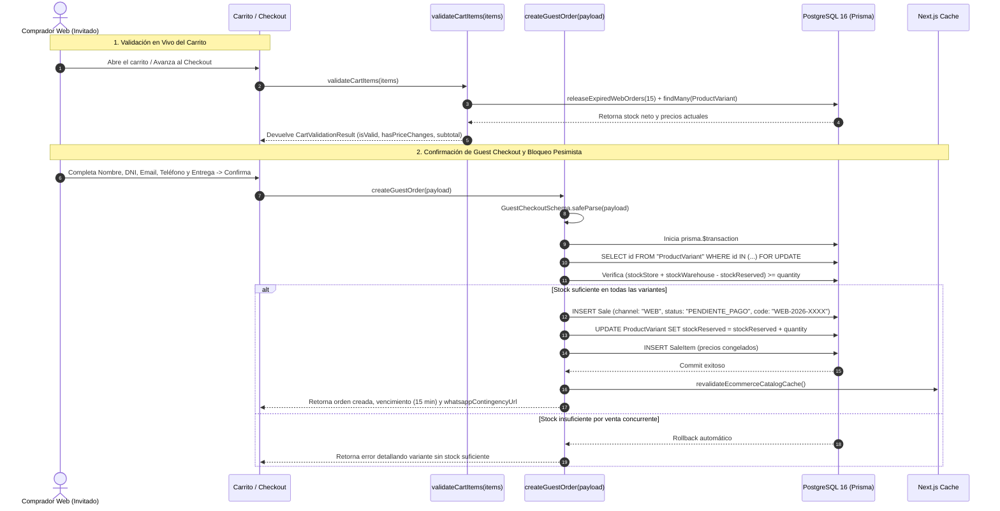

# [RF-15] Carrito de Compras, Guest Checkout (Compra como Invitado) y Reserva Atómica de Stock

## 1. Descripción y Objetivo
Implementa la capa de orquestación transaccional para la validación del carrito de compras y el proceso de **Compra como Invitado (*Guest Checkout*)** en la tienda online de **Matacos Deportes**, eliminando la obligación de crear una cuenta o recordar contraseñas para reducir drásticamente la tasa de abandono de carrito (**Mitigación Riesgo R-04**).

Asimismo, resuelve la concurrencia crítica de stock entre el salón físico de Saavedra 241 y la tienda online (**Mitigación Riesgo R-01**) mediante:
1. **Separación entre Carrito Local y Orden con Reserva:** Mientras el cliente navega y suma artículos al carrito en su navegador, no se bloquea inventario físico en la base de datos. Recién al confirmar el pedido para avanzar al pago se bloquea temporalmente el stock (`stockReserved`).
2. **Validación en Vivo del Carrito (`validateCartItems`):** Contrasta cada ítem contra PostgreSQL verificando vigencia del artículo (`active: true`), stock neto real disponible y posibles cambios de precios ocurridos durante la sesión (`hasPriceChanges`).
3. **Creación Transaccional con Bloqueo Pesimista (`createGuestOrder`):** Ejecuta `SELECT ... FOR UPDATE` dentro de `prisma.$transaction`, incrementando `stockReserved`, congelando precios unitarios en `SaleItem` y emitiendo numeración correlativa anual (`WEB-2026-0001`).
4. **Expiración y Liberación Automática tras 15 Minutos (`releaseExpiredWebOrders`):** Si una orden web permanece en estado `PENDIENTE_PAGO` por más de **15 minutos**, pasa automáticamente a `CANCELADA` y restituye las unidades reservadas al stock disponible.

---

## 2. Tecnologías, Herramientas y Librerías

- **Next.js 15 (Server Actions & Route Handlers):** [`src/server/actions/ecommerce/checkoutActions.ts`](file:///C:/Proyectos/matacos-deportes-app/src/server/actions/ecommerce/checkoutActions.ts) y endpoint programado [`src/app/api/ecommerce/cron/release-expired/route.ts`](file:///C:/Proyectos/matacos-deportes-app/src/app/api/ecommerce/cron/release-expired/route.ts).
- **PostgreSQL 16 & Prisma ORM 6:** Transacciones ACID (`prisma.$transaction`) combinadas con bloqueo de fila pesimista SQL (`SELECT id FROM "ProductVariant" WHERE id IN (...) FOR UPDATE`).
- **Zod (Validación de Esquemas):** [`CartItemSchema`](file:///C:/Proyectos/matacos-deportes-app/src/schemas/ecommerce.ts), [`ValidateCartItemsSchema`](file:///C:/Proyectos/matacos-deportes-app/src/schemas/ecommerce.ts) y [`GuestCheckoutSchema`](file:///C:/Proyectos/matacos-deportes-app/src/schemas/ecommerce.ts).
- **Formateo y Zona Horaria:** `formatCurrency(amount)` en ARS y numeración anual regida por `America/Argentina/Buenos_Aires`.

---

## 3. Archivos Involucrados en el Requerimiento

### Backend, Server Actions y Cron API
- [`src/server/actions/ecommerce/checkoutActions.ts`](file:///C:/Proyectos/matacos-deportes-app/src/server/actions/ecommerce/checkoutActions.ts):
  - `validateCartItems`: Validación reactiva de existencias y precios del carrito.
  - `createGuestOrder`: Creación atómica de la orden `WEB-YYYY-XXXX` con bloqueo `FOR UPDATE` y reserva en `stockReserved`.
  - `releaseExpiredWebOrders`: Liberación automática de reservas vencidas (> 15 min).
  - `cancelGuestOrder`: Cancelación manual de orden pendiente con restitución de stock.
- [`src/app/api/ecommerce/cron/release-expired/route.ts`](file:///C:/Proyectos/matacos-deportes-app/src/app/api/ecommerce/cron/release-expired/route.ts): Route Handler HTTP (`GET` / `POST`) para barrido periódico de reservas expiradas.

### Esquemas de Validación (Zod)
- [`src/schemas/ecommerce.ts`](file:///C:/Proyectos/matacos-deportes-app/src/schemas/ecommerce.ts): Define `ShippingMethodEnum`, `CartItemSchema`, `ValidateCartItemsSchema` y `GuestCheckoutSchema`.

### Modelos y Persistencia (Prisma / PostgreSQL)
- [`prisma/schema.prisma`](file:///C:/Proyectos/matacos-deportes-app/prisma/schema.prisma):
  - `Sale`: Campos `channel: "WEB"`, `status: "PENDIENTE_PAGO"`, `customerId` (nullable para invitados), snapshot de contacto (`customerName`, `customerDni`, `customerEmail`, `customerPhone`) y logística (`shippingMethod`, `shippingCost`, `shippingAddress`).
  - `ProductVariant`: Atributo `stockReserved` incrementado/decrementado atómicamente.

### Pruebas Automatizadas (QA)
- [`scripts/test-rf15-guest-checkout.ts`](file:///C:/Proyectos/matacos-deportes-app/scripts/test-rf15-guest-checkout.ts): Suite con 22 pruebas automatizadas de validación, bloqueo concurrente y expiración.

---

## 4. Flujo de Datos y Control

### Diagrama de Secuencia de Guest Checkout y Reserva Atómica

### Detalle del Flujo de Control
1. **Limpieza Proactiva (*Lazy Cleanup*):** Antes de validar el carrito o crear una nueva orden, el servidor ejecuta `releaseExpiredWebOrders(15)` para liberar cualquier unidad que haya quedado retenida en órdenes abandonadas.
2. **Bloqueo de Fila (`FOR UPDATE`):** Durante `createGuestOrder`, PostgreSQL bloquea las filas de las variantes solicitadas hasta que termine la transacción, impidiendo que dos compradores simultáneos consuman la última unidad disponible.
3. **Snapshot Contable:** Los datos del comprador invitado (`customerId: null`) y el precio unitario de cada artículo quedan grabados de forma inmutable en `Sale` y `SaleItem`.

---

## 5. Pruebas y Validación (QA)

1. **Precondición:** Contar con una variante activa con `stockStore >= 4`.
2. **Paso 1 (Validación de Carrito y Cambio de Precio):** Invocar `validateCartItems` enviando un `expectedUnitPrice` distinto al precio real de la base de datos. Verificar que `hasPriceChanges` sea `true` y actualice el subtotal al valor real vigente.
3. **Paso 2 (Creación de Orden y Reserva):** Ejecutar `createGuestOrder` por 2 unidades. Verificar que se cree la orden `WEB-2026-XXXX` en estado `PENDIENTE_PAGO` y que `stockReserved` de la variante aumente exactamente en `+2`.
4. **Paso 3 (Prevención de Sobreventa):** Intentar crear una segunda orden solicitando más unidades que el stock neto restante. Verificar que la transacción sea rechazada sin alterar `stockReserved`.
5. **Paso 4 (Expiración a los 15 Minutos):** Simular una orden cuya antigüedad supere los 15 minutos e invocar `releaseExpiredWebOrders(15)`. Verificar que la orden pase a `CANCELADA` y `stockReserved` vuelva a su valor inicial.
6. **Resultado Esperado:** Al ejecutar `pnpm tsx scripts/test-rf15-guest-checkout.ts`, las **22 pruebas automatizadas** finalizan en `PASS` (`0 fallidas`).
