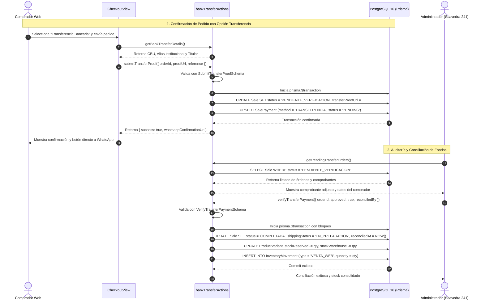

# [RF-17] Pago por Transferencia Bancaria Directa, Carga de Comprobantes y Conciliación Administrativa

## 1. Descripción y Objetivo
Permite a los clientes de la tienda online de **Matacos Deportes** optar por el pago mediante **transferencia bancaria directa** (CBU / Alias), una de las modalidades comerciales de mayor demanda relevadas durante la elicitación (Bloque 2 y Bloque 5). Esta opción evita recargos financieros, permite al comercio liquidar fondos inmediatamente y brinda una alternativa robusta para compradores provinciales y nacionales que no operan con tarjetas de crédito o pasarelas de pago externas.

El requerimiento resuelve tres aspectos operativos críticos del negocio:
1. **Transparencia en el Checkout y Reserva Temporal de Stock:** Al seleccionar «Transferencia Bancaria» durante el checkout ([RF-15](file:///C:/Users/della/matacos-deportes-app/docs/RF-15_Carrito_Guest_Checkout_Reserva_Stock.md)), el sistema exhibe de manera segura los datos institucionales de cuenta de Matacos Deportes (Banco, CBU, Alias, CUIT y Titular de cuenta), congelando las unidades adquiridas bajo el contador `stockReserved` durante una ventana de cortesía de 15 minutos para impedir sobreventas concurrentes ([RNF-03](file:///C:/Users/della/matacos-deportes-app/contexto/Informe_Mensual_Mes_1_Matacos_Deportes.md#L543)).
2. **Carga y Notificación de Comprobante de Pago:** El comprador puede ingresar el código de comprobante u operación bancaria emitido por su entidad financiera (`referenceCode`) o adjuntar una captura / PDF del comprobante (`proofUrl`). Al registrarse el pago, la orden transiciona automáticamente a estado `PENDIENTE_VERIFICACION`, generando en simultáneo un enlace contextual de WhatsApp ([RF-18](file:///C:/Users/della/matacos-deportes-app/docs/RF-18_Boton_Contextual_WhatsApp_Contingencia.md)) para respaldo inmediato con el personal de Saavedra 241.
3. **Módulo de Auditoría y Conciliación para Administración:** El panel de gestión comercial expone las órdenes pendientes de acreditación. Los usuarios con rol `ADMIN` pueden contrastar los fondos ingresados en el extracto bancario y ejecutar dos acciones atómicas:
   - **Aprobación de Conciliación:** Pasa la orden a `COMPLETADA` y `shippingStatus` a `EN_PREPARACION`, libera el `stockReserved`, descuenta físicamente el stock de salón o depósito (`stockWarehouse`), registra un movimiento de inventario de tipo `VENTA_WEB` y asienta formalmente la auditoría con fecha (`reconciledAt`) y usuario conciliador (`reconciledBy`).
   - **Rechazo con Salvaguarda:** Si el importe no coincide o el comprobante es ilegible, el administrador puede rechazar temporalmente la transacción para solicitar corrección al cliente manteniendo la reserva activa, o cancelar la orden definitivamente reintegrando el stock reservado al catálogo público.

---

## 2. Tecnologías, Herramientas y Librerías

- **Next.js 15 (Server Actions):** Lógica transaccional ejecutada del lado del servidor en [`src/server/actions/ecommerce/bankTransferActions.ts`](file:///C:/Users/della/matacos-deportes-app/src/server/actions/ecommerce/bankTransferActions.ts) garantizando atomicidad y consistencia en la verificación.
- **PostgreSQL 16 & Prisma ORM 6:**
  - Persistencia de comprobantes y metadatos en la tabla `Sale` (`transferProofUrl`, `transferProofUploadedAt`, `reconciledAt`, `reconciledBy`, `reconciliationNotes`).
  - Registro de pagos auditables en la tabla `SalePayment` bajo el enumerado `method: "TRANSFERENCIA"`.
  - Control estricto de concurrencia y actualización de stock dual mediante transacciones seguras `prisma.$transaction`.
- **Zod (Validación de Esquemas):** Esquemas fuertemente tipados [`SubmitTransferProofSchema`](file:///C:/Users/della/matacos-deportes-app/src/schemas/ecommerce.ts#L43) y [`VerifyTransferPaymentSchema`](file:///C:/Users/della/matacos-deportes-app/src/schemas/ecommerce.ts#L61) sin uso de tipo `any`.
- **Configuración Institucional Centralizada:** Datos bancarios institucionalmente auditados en [`src/config/company.ts`](file:///C:/Users/della/matacos-deportes-app/src/config/company.ts) vinculados a variables de entorno para alta seguridad y flexibilidad ante cambios de cuenta comercial.
- **Formateo Monetario:** Estandarización obligatoria de importes en Pesos Argentinos (ARS) mediante `formatCurrency`.

---

## 3. Archivos Involucrados en el Requerimiento

### Frontend & Experiencia de Usuario
- [`src/components/ecommerce/checkout/CheckoutView.tsx`](file:///C:/Users/della/matacos-deportes-app/src/components/ecommerce/checkout/CheckoutView.tsx): Selector interactivo del método «Transferencia Bancaria», presentación de datos oficiales de cuenta (Banco, CBU, Alias, Titular), campo para ingresar el número de operación/comprobante e instrucciones claras de acreditación con botón de WhatsApp.
- [`src/components/ecommerce/tracking/OrderTrackingView.tsx`](file:///C:/Users/della/matacos-deportes-app/src/components/ecommerce/tracking/OrderTrackingView.tsx): Línea de tiempo visual para el cliente donde se refleja el estado `PENDIENTE_VERIFICACION` y las notas de auditoría bancaria.

### Backend, Server Actions y Configuración
- [`src/server/actions/ecommerce/bankTransferActions.ts`](file:///C:/Users/della/matacos-deportes-app/src/server/actions/ecommerce/bankTransferActions.ts):
  - `getBankTransferDetails`: Provee de forma segura y centralizada los datos bancarios del comercio.
  - `submitTransferProof`: Procesa la carga del comprobante o referencia bancaria por parte del comprador y actualiza la orden a `PENDIENTE_VERIFICACION`.
  - `verifyTransferPayment`: Acción transaccional administrativa para aprobar o rechazar comprobantes de transferencia con consolidación de inventario.
  - `getPendingTransferOrders`: Consulta y filtrado de órdenes pendientes de conciliación bancaria para el personal administrativo.
- [`src/config/company.ts`](file:///C:/Users/della/matacos-deportes-app/src/config/company.ts): Contiene los datos oficiales de la cuenta bancaria de Matacos Deportes (`bankName`, `bankAccountType`, `bankAccountHolder`, `bankCbu`, `bankAlias`, `cuit`).

### Esquemas de Validación y Persistencia
- [`src/schemas/ecommerce.ts`](file:///C:/Users/della/matacos-deportes-app/src/schemas/ecommerce.ts): Define los contratos `SubmitTransferProofSchema`, `VerifyTransferPaymentSchema` y sus tipos TypeScript inferidos.
- [`prisma/schema.prisma`](file:///C:/Users/della/matacos-deportes-app/prisma/schema.prisma): Modelos `Sale`, `SalePayment`, `ProductVariant` y `InventoryMovement`.

### Pruebas Automatizadas (QA)
- [`scripts/test-rf17-bank-transfer.ts`](file:///C:/Users/della/matacos-deportes-app/scripts/test-rf17-bank-transfer.ts): Suite completa de integración de extremo a extremo que evalúa datos bancarios, esquemas Zod, flujo transaccional con BD y consolidación de stock.

---

## 4. Flujo de Datos y Control

### Diagrama de Secuencia: Pago por Transferencia y Conciliación Administrativa

### Detalle del Flujo de Control Transaccional
1. **Resguardo de Datos Bancarios:** La Server Action `getBankTransferDetails` lee los atributos estandarizados de `companyConfig`. No se exponen claves privadas ni credenciales bancarias sensibles; únicamente CBU, Alias, CUIT y Razón Social autorizados para transferencias entrantes.
2. **Validación Zod Estricta:** `SubmitTransferProofSchema` valida que `orderId` sea un identificador no vacío y que `proofUrl` o `reference` cumplan los formatos permitidos (URLs absolutas o relativas `/uploads/comprobantes/...`).
3. **Flujo de Conciliación Positiva (Aprobación):** Al ejecutarse `verifyTransferPayment` con `approved: true`, dentro de una única transacción atómica (`prisma.$transaction`):
   - Se actualiza el estado de la venta a `status: "COMPLETADA"` y el estado logístico a `shippingStatus: "EN_PREPARACION"`.
   - Se registran la marca temporal `reconciledAt` y el nombre del usuario fiscalizador `reconciledBy`.
   - Se descuentan las unidades reservadas (`stockReserved -= item.quantity`) y se aplica la baja definitiva del stock del salón o depósito (`stockWarehouse -= item.quantity`).
   - Se crea una entrada inmutable en `InventoryMovement` con `type: "VENTA_WEB"`.
4. **Flujo de Rechazo de Comprobante:** Si el comprobante no es válido:
   - Con `cancelOrderOnReject: false`: La orden regresa a `PENDIENTE_PAGO` y preserva el stock reservado para que el cliente pueda reintentar la carga.
   - Con `cancelOrderOnReject: true`: La orden pasa a `CANCELADA`, liberando inmediatamente las reservas en el inventario.

---

## 5. Pruebas y Validación (QA)

1. **Precondición:** Contar con el contenedor Docker de PostgreSQL en ejecución (`pnpm db:up`), migraciones aplicadas (`pnpm prisma db push`) y variantes con disponibilidad de stock.
2. **Paso 1 (Lectura de Datos Institucionales):** Invocar `getBankTransferDetails()` y comprobar que devuelva CBU de 22 dígitos, Alias oficial, CUIT y Titular coincidente con la configuración centralizada de Matacos Deportes.
3. **Paso 2 (Validación de Esquemas):** Enviar cargas válidas e inválidas a `SubmitTransferProofSchema` (rechazo de protocolos inseguros como `ftp://` y URLs malformadas) y a `VerifyTransferPaymentSchema` (exigencia de motivo de rechazo si `approved: false`).
4. **Paso 3 (Carga de Comprobante):** Crear una venta web de prueba en estado `PENDIENTE_PAGO`. Invocar `submitTransferProof` con ruta de comprobante y constatar en base de datos que `status` transicione a `PENDIENTE_VERIFICACION`, `transferProofUrl` quede almacenado y se cree el registro en `SalePayment`.
5. **Paso 4 (Rechazo Temporal y Conservación de Reserva):** Ejecutar `verifyTransferPayment` con `approved: false` y `cancelOrderOnReject: false`. Verificar que la orden regrese a `PENDIENTE_PAGO` y el contador `stockReserved` permanezca intacto.
6. **Paso 5 (Aprobación, Consolidación de Stock y Auditoría):** Reenviar el comprobante y ejecutar `verifyTransferPayment` con `approved: true`. Constatar que la orden pase a `COMPLETADA`, `shippingStatus` pase a `EN_PREPARACION`, `stockReserved` se libere a 0, el inventario físico descuente las unidades correspondientes y se asienten `reconciledAt` y `reconciledBy`.
7. **Resultado Esperado:** Al ejecutar `pnpm tsx scripts/test-rf17-bank-transfer.ts`, la totalidad de las pruebas de integración finalizan con éxito (`0 fallidas`).
