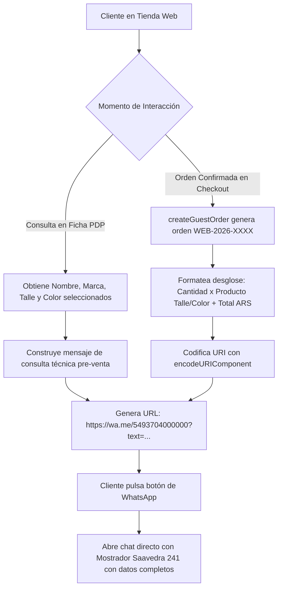

# [RF-18] Canal de Asistencia Contextual y Enlace de Contingencia por WhatsApp

## 1. Descripción y Objetivo
Permite vincular de manera fluida la experiencia digital de la tienda online con la **atención personalizada de los dueños y vendedores de Matacos Deportes** (Saavedra 241, Formosa), rasgo distintivo central relevado en la entrevista de elicitación (Bloque 0 y Bloque 5).

El requerimiento abarca dos puntos estratégicos de contacto directo hacia la línea oficial del comercio (`+54 9 370 4000000`):
1. **Asistencia Contextual por Producto / Variante:** Generación de enlaces profundos (`https://wa.me/5493704000000?text=...`) que incluyen automáticamente el nombre exacto del artículo, marca, talle, color y código de modelo que el cliente está visualizando.
2. **Enlace Automático de Contingencia en Checkout (`whatsappContingencyUrl`):** Al confirmar un pedido web (`createGuestOrder`), el backend construye y retorna una URL de WhatsApp precargada con el código oficial de la orden (`WEB-2026-XXXX`), nombre completo, DNI/CUIT del comprador, importe total formateado en ARS (`$ 45.000,00`) y el desglose de cantidades, talles y colores solicitados (**Mitigación Riesgo R-04**). Esto permite al cliente enviar el comprobante de transferencia bancaria o coordinar el retiro inmediato en sucursal con un solo clic.

---

## 2. Tecnologías, Herramientas y Librerías

- **WhatsApp Click-to-Chat API (`wa.me`) & `encodeURIComponent`:** Codificación estándar URI de mensajes prearmados compatibles con WhatsApp Web y aplicaciones móviles (iOS / Android).
- **Configuración Institucional Centralizada:** [`src/config/company.ts`](file:///C:/Proyectos/matacos-deportes-app/src/config/company.ts) que parametriza el número oficial de WhatsApp comercial de Matacos Deportes mediante variables de entorno (`COMPANY_WHATSAPP`).
- **Next.js 15 (Server Actions):** Integrado nativamente en [`createGuestOrder`](file:///C:/Proyectos/matacos-deportes-app/src/server/actions/ecommerce/checkoutActions.ts) y en los metadatos de contacto de [`receiptService.ts`](file:///C:/Proyectos/matacos-deportes-app/src/server/services/receiptService.ts).

---

## 3. Archivos Involucrados en el Requerimiento

### Configuración y Backend
- [`src/config/company.ts`](file:///C:/Proyectos/matacos-deportes-app/src/config/company.ts): Define el canal oficial de WhatsApp (`+54 9 370 4000000`) e Instagram (`@matacosdeportes`) del comercio.
- [`src/server/actions/ecommerce/checkoutActions.ts`](file:///C:/Proyectos/matacos-deportes-app/src/server/actions/ecommerce/checkoutActions.ts): Construye dinámicamente el atributo `whatsappContingencyUrl` dentro del contrato `GuestOrderCreatedResult`.
- [`src/server/actions/ecommerce/productDetailActions.ts`](file:///C:/Proyectos/matacos-deportes-app/src/server/actions/ecommerce/productDetailActions.ts): Provee los metadatos exactos de producto y variante (`productName`, `size`, `color`, `modelCode`) para consultas pre-venta.

### Pruebas Automatizadas (QA)
- [`scripts/test-rf15-guest-checkout.ts`](file:///C:/Proyectos/matacos-deportes-app/scripts/test-rf15-guest-checkout.ts): Valida la generación, formato `https://wa.me/` y contenido codificado del enlace de WhatsApp al crear una orden web.

---

## 4. Flujo de Datos y Control

### Diagrama de Flujo del Enlace Contextual de WhatsApp

### Detalle del Flujo de Control
1. **Recolección de Contexto:** Al generarse la orden en `createGuestOrder`, el servidor concatena la lista de ítems confirmados (`2x Antiparras Speedo (Único/Azul)`) junto con el código `WEB-2026-XXXX`, nombre del cliente, DNI y el monto total formateado con `formatCurrency`.
2. **Sanitización URI:** Se aplica `encodeURIComponent` sobre la plantilla del mensaje para asegurar que acentos, símbolos de moneda (`$`), espacios y asteriscos de formato en negrita de WhatsApp (`*WEB-2026-0001*`) se transmitan íntegros en cualquier navegador móvil o de escritorio.

---

## 5. Pruebas y Validación (QA)

1. **Precondición:** Crear una orden de prueba como invitado invocando `createGuestOrder`.
2. **Paso 1:** Inspeccionar el campo `data.whatsappContingencyUrl` en la respuesta del servidor.
3. **Paso 2:** Decodificar el parámetro `text` de la URL con `decodeURIComponent`.
4. **Resultado Esperado:** La URL comienza estrictamente con `https://wa.me/5493704000000?text=` y el texto decodificado incluye el código `WEB-2026-XXXX`, el nombre y DNI del comprador, el total en formato ARS y el detalle de talles/colores reservados.
