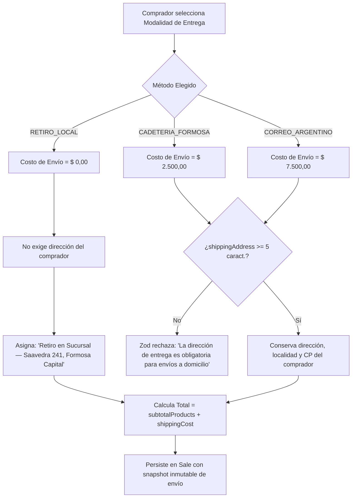

# [RF-19] Gestión de Opciones de Envío y Tarifas Logísticas

## 1. Descripción y Objetivo
Permite al comprador de la tienda online seleccionar entre las tres modalidades de entrega acordadas con los propietarios de **Matacos Deportes** durante el relevamiento (Bloque 4.4), calculando automáticamente el costo logístico, validando de forma condicional la dirección postal y registrando los datos de despacho de manera inmutable en la orden de venta:

1. **Retiro Gratuito en el Local (`RETIRO_LOCAL`):** Sin costo de envío (`$ 0,00`). No exige que el comprador complete calle ni altura, asignando automáticamente la leyenda *"Retiro en Sucursal — Saavedra 241, Formosa Capital"*.
2. **Cadetería / Moto-Mensajería en Formosa Capital (`CADETERIA_FORMOSA`):** Tarifa plana local (`$ 2.500,00`) para entregas rápidas dentro del ejido urbano de la ciudad de Formosa (CP 3600). Exige obligatoriamente calle, altura y referencias de domicilio.
3. **Envío Provincial y Nacional por Correo Argentino (`CORREO_ARGENTINO`):** Tarifa nacional de referencia (`$ 7.500,00`) para despachos al interior de la provincia de Formosa y resto del país. Exige obligatoriamente dirección postal completa, localidad (`shippingCity`) y código postal (`shippingPostalCode`).

---

## 2. Tecnologías, Herramientas y Librerías

- **Zod (Validación Condicional con `.refine()`):** [`ShippingMethodEnum`](file:///C:/Proyectos/matacos-deportes-app/src/schemas/ecommerce.ts) y [`GuestCheckoutSchema`](file:///C:/Proyectos/matacos-deportes-app/src/schemas/ecommerce.ts) que validan dinámicamente la obligatoriedad de `shippingAddress` (mínimo 5 caracteres) únicamente cuando el método seleccionado es `CADETERIA_FORMOSA` o `CORREO_ARGENTINO`.
- **Next.js 15 (Server Actions):** [`src/server/actions/ecommerce/checkoutActions.ts`](file:///C:/Proyectos/matacos-deportes-app/src/server/actions/ecommerce/checkoutActions.ts) con cuadro tarifario `DEFAULT_SHIPPING_COSTS` y consolidación del total (`totalOrder = subtotalProducts + shippingCost`).
- **PostgreSQL 16 & Prisma ORM 6:** Persistencia de `shippingMethod`, `shippingCost`, `shippingAddress`, `shippingCity` y `shippingPostalCode` en el modelo `Sale`.

---

## 3. Archivos Involucrados en el Requerimiento

### Esquemas de Validación (Zod)
- [`src/schemas/ecommerce.ts`](file:///C:/Proyectos/matacos-deportes-app/src/schemas/ecommerce.ts): Define `ShippingMethodEnum` (`"RETIRO_LOCAL" | "CADETERIA_FORMOSA" | "CORREO_ARGENTINO"`) y la regla `.refine()` de domicilio obligatorio en `GuestCheckoutSchema`.

### Backend & Server Actions
- [`src/server/actions/ecommerce/checkoutActions.ts`](file:///C:/Proyectos/matacos-deportes-app/src/server/actions/ecommerce/checkoutActions.ts): Calcula el costo de envío, resuelve la dirección efectiva y suma el cargo logístico al total de la orden en `createGuestOrder`.

### Modelos y Persistencia (Prisma / PostgreSQL)
- [`prisma/schema.prisma`](file:///C:/Proyectos/matacos-deportes-app/prisma/schema.prisma): Columnas logísticas en la tabla `Sale`.

### Pruebas Automatizadas (QA)
- [`scripts/test-rf15-guest-checkout.ts`](file:///C:/Proyectos/matacos-deportes-app/scripts/test-rf15-guest-checkout.ts): Pruebas específicas de validación de `RETIRO_LOCAL` sin dirección vs rechazo de `CADETERIA_FORMOSA` y `CORREO_ARGENTINO` sin domicilio.

---

## 4. Flujo de Datos y Control

### Diagrama de Decisión y Validación Logística

### Detalle del Flujo de Control
1. **Validación Condicional Inteligente:** El cliente que retira en el local de calle Saavedra 241 no sufre fricción completando campos postales innecesarios. En cambio, si solicita cadetería o correo, la regla `.refine()` de `GuestCheckoutSchema` impide confirmar el pedido sin una calle y número válidos.
2. **Cálculo Transparente de Totales:** El servidor desglosa explícitamente `subtotalProducts`, `shippingCost` y `total` dentro del objeto `totals` devuelto al frontend, cumpliendo con la pauta de claridad de costos antes del pago.

---

## 5. Pruebas y Validación (QA)

1. **Paso 1 (Retiro en Local):** Enviar un payload a `GuestCheckoutSchema.safeParse` con `shippingMethod: "RETIRO_LOCAL"` y sin `shippingAddress`. Verificar que sea aceptado (`success: true`) y que el costo de envío sea `$ 0,00`.
2. **Paso 2 (Bloqueo de Envío sin Dirección):** Enviar `shippingMethod: "CADETERIA_FORMOSA"` con `shippingAddress: ""`. Verificar que Zod rechace la operación indicando el error en el campo `shippingAddress`.
3. **Paso 3 (Cálculo con Correo Argentino):** Crear una orden con `shippingMethod: "CORREO_ARGENTINO"` y dirección `"Av. 25 de Mayo 850"`.
4. **Resultado Esperado:** La orden se registra con `shippingCost: 7500` y el total general de la venta refleja exactamente la suma de los productos más `$ 7.500,00`.
