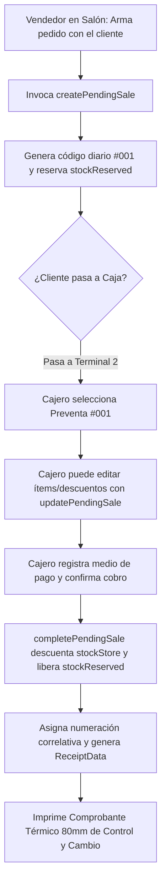

# [RF-21] Emisión de Comprobantes Internos de Control (Ticket X) y Preventas de Salón

## 1. Descripción y Objetivo
Permite al personal de **Matacos Deportes** emitir comprobantes internos de control operativo (Tickets X / Presupuestos de Preventa `#001` y Comprobantes de Entrega) en bobina térmica de 80mm, garantizando la continuidad comercial del local ante la contingencia de los servicios externos de AFIP / ARCA (**Mitigación Riesgo R-01 del Informe Mensual Mes 3**).

El requerimiento cubre dos circuitos operativos:
1. **Talón de Preventa de Salón (Terminal 1):** Emitido por el Vendedor de Salón al asesorar al cliente (`ticketCode` diario correlativo como `#042`, `invoiceNumber: PRE-XXXXXXXX`). Reserva preventivamente las prendas en `stockReserved` y permite al cliente pasar directamente por la Caja Mostrador a abonar.
2. **Comprobante de Control de Venta y Entrega (Terminal 2):** Emitido al confirmar el cobro en caja o en modo contingencia. Descuenta el stock físico (`stockStore`), registra la trazabilidad de cajero/vendedor, discrimina descuentos e imprime las condiciones de cambio por 30 días de Saavedra 241.

---

## 2. Tecnologías, Herramientas y Librerías

- **Next.js 15 (Server Actions & Route Handlers):** [`src/server/actions/posReceiptActions.ts`](file:///C:/Proyectos/matacos-deportes-app/src/server/actions/posReceiptActions.ts), [`src/server/actions/posSaleActions.ts`](file:///C:/Proyectos/matacos-deportes-app/src/server/actions/posSaleActions.ts) y vista de impresión dedicada [`src/app/(dashboard)/pos/tickets/[saleId]/print/TicketPrintClient.tsx`](file:///C:/Proyectos/matacos-deportes-app/src/app/(dashboard)/pos/tickets/%5BsaleId%5D/print/TicketPrintClient.tsx).
- **Motor de Formateo Térmico:** [`src/server/services/receiptService.ts`](file:///C:/Proyectos/matacos-deportes-app/src/server/services/receiptService.ts) con soporte para comprobantes en estado `PENDIENTE_PAGO` (preventa) y `COMPLETADA` (venta cobrada), y renderizado en texto plano de 40 columnas (`formatTicketToPlainText`).
- **Zod (Validación de Contratos):** [`ReceiptDataSchema`](file:///C:/Proyectos/matacos-deportes-app/src/schemas/receipt.ts).

---

## 3. Archivos Involucrados en el Requerimiento

### Backend, Servicios y Rutas de Impresión
- [`src/server/services/receiptService.ts`](file:///C:/Proyectos/matacos-deportes-app/src/server/services/receiptService.ts): Construye el payload `ReceiptData` adaptando encabezados y leyendas según si se trata de una preventa pendiente o un comprobante final de venta.
- [`src/server/actions/posReceiptActions.ts`](file:///C:/Proyectos/matacos-deportes-app/src/server/actions/posReceiptActions.ts): Acciones `getReceiptData(saleId)` y `getReceiptByTicketCode(ticketCode)`.
- [`src/app/(dashboard)/pos/tickets/[saleId]/print/page.tsx`](file:///C:/Proyectos/matacos-deportes-app/src/app/(dashboard)/pos/tickets/%5BsaleId%5D/print/page.tsx) y [`TicketPrintClient.tsx`](file:///C:/Proyectos/matacos-deportes-app/src/app/(dashboard)/pos/tickets/%5BsaleId%5D/print/TicketPrintClient.tsx): Vista optimizada con reglas CSS `@media print` para bobina térmica de 80mm sin márgenes de navegador.

### Componentes del Mostrador (Frontend)
- [`src/components/dashboard/PosView.tsx`](file:///C:/Proyectos/matacos-deportes-app/src/components/dashboard/PosView.tsx): Emisión de preventas en pestaña *"Preventa (Salón)"* y cobro con impresión en pestaña *"Caja (Cobrar)"*.
- [`src/components/dashboard/PosTransactionHistoryView.tsx`](file:///C:/Proyectos/matacos-deportes-app/src/components/dashboard/PosTransactionHistoryView.tsx): Reimpresión bajo demanda de cualquier comprobante emitido (requiere permiso `caja.reimprimir_ticket`).

---

## 4. Flujo de Datos y Control

### Diagrama de Flujo: Circuito de Preventa y Comprobante de Control

### Detalle del Flujo de Control
1. **Generación de Preventa (`createPendingSale`):** Calcula el número correlativo diario de tickets (`#001`, `#002`) y bloquea las prendas en `stockReserved` sin exigir turno de caja abierto en la terminal de salón.
2. **Edición Previa al Cobro (`updatePendingSale`):** Si el cliente en la fila de caja decide agregar unas medias o cambiar de talle, el cajero modifica la preventa rebalanceando automáticamente las unidades reservadas.
3. **Emisión y Reimpresión:** Una vez cobrada la operación, se genera el comprobante térmico con firma SHA-256 e instrucciones de postventa, quedando disponible en el historial de transacciones para eventuales reimpresiones.

---

## 5. Pruebas y Validación (QA)

1. **Paso 1 (Emisión de Preventa):** En la vista *"Preventa (Salón)"*, agregar un artículo y pulsar *"Enviar a Caja"*. Verificar que se genere el código `#001` en estado `PENDIENTE_PAGO` y aumente `stockReserved`.
2. **Paso 2 (Modificación en Caja):** En la vista *"Caja (Cobrar)"*, abrir la preventa `#001`, modificar la cantidad con `EditPendingTicketModal` y guardar. Verificar el recálculo del total y de la reserva.
3. **Paso 3 (Cobro e Impresión):** Cobrar la preventa en efectivo y abrir la vista de impresión `/pos/tickets/[saleId]/print`.
4. **Resultado Esperado:** Se visualiza e imprime el ticket en formato continuo de 80mm con todos los renglones, medio de pago, vuelto y leyenda de validez para cambios en Saavedra 241.
