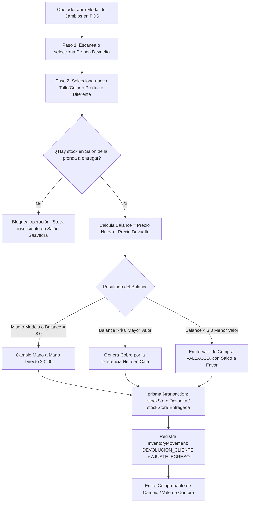

# [RF-22] Gestión de Cambios de Mercadería, Liquidación de Diferencias y Vales de Compra

## 1. Descripción y Objetivo
Permite gestionar de forma integral, auditable y en una sola transacción atómica los **cambios de talle, color o modelo y las devoluciones de clientes** en el mostrador de **Matacos Deportes** (Saavedra 241, Formosa), instrumentando las políticas comerciales de postventa relevadas con los dueños en el Bloque 4.5 de la elicitación:

1. **Cambio Mano a Mano (`EQUAL` - Respeto de Precio frente a Inflación):** Cuando el cliente cambia una prenda por otro talle o color del mismo modelo (o por otro artículo del mismo valor), el cambio se realiza directo (`$ 0,00` de diferencia). Incluso si el artículo subió de precio por inflación desde la fecha de compra original, se respeta el cambio 1 a 1 sin cobrar recargo.
2. **Cambio por Artículo de Mayor Valor (`PAY_DIFFERENCE`):** Si el cliente elige un producto de precio superior, el sistema calcula automáticamente la diferencia neta a abonar (`totalExchange - totalReturn`), pudiendo enviarse como ticket pendiente de cambio a la Caja (`createPendingExchangeSale`) o cobrarse en el acto imputando el medio de pago al turno activo (`processPosProductExchange`).
3. **Emisión de Vale de Compra / Nota de Crédito Interna (`STORE_CREDIT_VOUCHER`):** Si el cliente realiza un cambio por un artículo de menor valor, el comercio no reintegra efectivo por defecto, sino que emite un **Vale de Compra** nominativo sin vencimiento (`VALE-XXXX-XXXX`) con el saldo a favor del comprador.
4. **Reajuste Dual y Trazabilidad de Stock:** En un único bloque `prisma.$transaction`, reingresa la prenda devuelta al stock del salón (`DEVOLUCION_CLIENTE`, `+qty` en `stockStore`) y descuenta la prenda entregada (`AJUSTE_EGRESO` / venta, `-qty` en `stockStore`).

---

## 2. Tecnologías, Herramientas y Librerías

- **Next.js 15 (Server Actions):** [`createPendingExchangeSale`](file:///C:/Proyectos/matacos-deportes-app/src/server/actions/posSaleActions.ts) y [`processPosProductExchange`](file:///C:/Proyectos/matacos-deportes-app/src/server/actions/posSaleActions.ts) en [`src/server/actions/posSaleActions.ts`](file:///C:/Proyectos/matacos-deportes-app/src/server/actions/posSaleActions.ts).
- **PostgreSQL 16 & Prisma ORM 6:** Actualización simultánea de `ProductVariant`, creación de registros de auditoría en `InventoryMovement` (`DEVOLUCION_CLIENTE` y `AJUSTE_EGRESO`), e imputación contable en `Sale`, `SaleItem`, `SalePayment` y `CashMovement`.
- **Zod (Validación de Esquemas):** [`CreatePendingExchangeSaleSchema`](file:///C:/Proyectos/matacos-deportes-app/src/schemas/sale.ts).
- **React 19 & Tailwind CSS / Lucide Icons:** Asistente interactivo de 3 pasos [`src/components/dashboard/PosExchangeModal.tsx`](file:///C:/Proyectos/matacos-deportes-app/src/components/dashboard/PosExchangeModal.tsx) con detección automática de pistola lectora de códigos de barra USB.

---

## 3. Archivos Involucrados en el Requerimiento

### Backend & Server Actions
- [`src/server/actions/posSaleActions.ts`](file:///C:/Proyectos/matacos-deportes-app/src/server/actions/posSaleActions.ts):
  - `createPendingExchangeSale`: Registra el cambio desde el salón y, si existe diferencia a pagar, genera un ticket `CAMBIO` en la cola de caja.
  - `processPosProductExchange`: Ejecuta el cambio directo en caja con liquidación económica (`EQUAL`, `PAY_DIFFERENCE`, `STORE_CREDIT_VOUCHER`, `CASH_REFUND`).

### Esquemas de Validación (Zod)
- [`src/schemas/sale.ts`](file:///C:/Proyectos/matacos-deportes-app/src/schemas/sale.ts): Define `CreatePendingExchangeSaleSchema` validando que la variante devuelta y la entregada sean distintas y que la cantidad sea entera positiva.

### Componentes de Interfaz de Usuario (Frontend)
- [`src/components/dashboard/PosExchangeModal.tsx`](file:///C:/Proyectos/matacos-deportes-app/src/components/dashboard/PosExchangeModal.tsx): Modal paso a paso (1. Prenda que devuelve el cliente $\rightarrow$ 2. Prenda que se lleva $\rightarrow$ 3. Balance económico y confirmación) con filtros facetados por talle/color y soporte de escaneo USB.
- [`src/components/dashboard/PosView.tsx`](file:///C:/Proyectos/matacos-deportes-app/src/components/dashboard/PosView.tsx): Botón disparador *"Cambios / Devoluciones"* protegido por el permiso `pos.cambios_devoluciones`.

---

## 4. Flujo de Datos y Control

### Diagrama de Flujo del Proceso de Cambio y Liquidación

### Detalle del Flujo de Control
1. **Validación de Identidad y Existencias:** El sistema verifica que la variante devuelta no sea idéntica a la variante solicitada y comprueba que `exchangeVariant.stockStore >= quantity`.
2. **Movimientos Espejo en Inventario:** En una única transacción ACID, la variante que el cliente devuelve incrementa su stock en salón (`+qty`) dejando asentado un movimiento `DEVOLUCION_CLIENTE`, mientras que la variante nueva descuenta su stock (`-qty`).
3. **Resolución Financiera:** Si es cambio mano a mano del mismo producto (`!isDifferentProduct`), no altera la recaudación de caja. Si hay diferencia a favor del local, genera el comprobante por el saldo diferencial; si es a favor del cliente, emite el Vale de Compra nominativo.

---

## 5. Pruebas y Validación (QA)

1. **Precondición:** Contar con un producto con al menos dos talles (ej. Talle M con stock 2 y Talle L con stock 3) y un usuario con permiso `pos.cambios_devoluciones`.
2. **Paso 1 (Cambio Mano a Mano de Talle):** Abrir *"Cambios"*, seleccionar Talle M como prenda devuelta y Talle L del mismo producto como prenda a entregar. Confirmar.
3. **Paso 2 (Verificación de Stock):** Comprobar que el Talle M aumentó a `3` unidades, el Talle L disminuyó a `2` unidades y el monto a cobrar fue `$ 0,00`.
4. **Paso 3 (Cambio por Mayor Valor):** Seleccionar como prenda devuelta un artículo de `$ 25.000,00` y como prenda a entregar uno de `$ 35.000,00`.
5. **Resultado Esperado:** El sistema calcula exactamente una diferencia a abonar de `$ 10.000,00`, genera el ticket de diferencia para cobro en caja y asienta ambos movimientos en el historial de trazabilidad.
