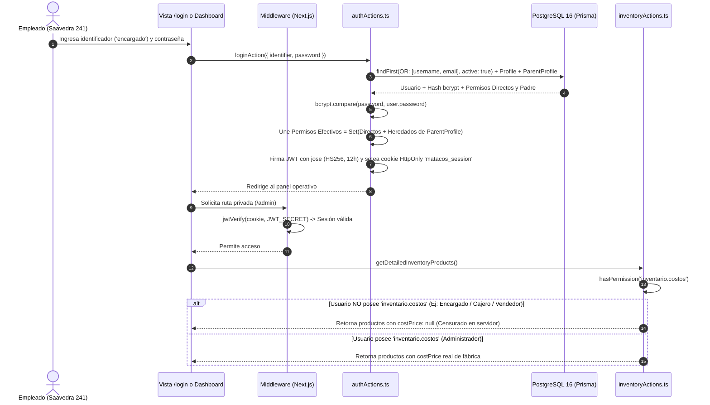

# [RF-23] Autenticación con Identificador Dual, Hash Criptográfico y Control de Accesos por Roles Dinámicos (RBAC)

## 1. Descripción y Objetivo
Sustituye el esquema preliminar de roles estáticos en código (`enum Role`) por una arquitectura integral de **Seguridad, Autenticación Ágil y Control de Acceso Basado en Perfiles Dinámicos y Permisos Atómicos (RBAC)** con soporte de herencia jerárquica reflexiva para el personal de **Matacos Deportes** (Saavedra 241, Formosa).

El requerimiento resuelve:
1. **Autenticación con Identificador Dual:** Permite al personal iniciar sesión en menos de 5 segundos ingresando indistintamente su **nombre de usuario corto** (`admin`, `encargado`, `cajero1`, `mostrador`, `vendedor`) o su **correo electrónico**, junto con su contraseña.
2. **Hash Criptográfico Irreversible:** Almacenamiento de contraseñas mediante **`bcryptjs`** (10 salt rounds), protegiendo las credenciales ante eventuales accesos físicos a la base de datos.
3. **Catálogo Maestro de 29 Permisos Atómicos en 6 Módulos:** Unidades técnicas de autorización divididas en `POS` (3), `CAJA` (7), `INVENTARIO` (11), `ECOMMERCE` (4), `REPORTES` (2) y `ADMIN` (2).
4. **Perfiles Dinámicos y Herencia Jerárquica Reflexiva (`parentProfileId`):** Permite al Administrador crear nuevos perfiles y tildar casillas de permisos sin tocar el código fuente. Soporta herencia reflexiva para que un perfil supervisor (ej. *Encargado de Local*) herede automáticamente los permisos operativos de su perfil base (*Cajero Mostrador*).
5. **Enmascaramiento en Servidor de Datos Confidenciales (*Zero Trust*):** Si el usuario autenticado no posee el permiso `inventario.costos`, el servidor censura de raíz el campo `costPrice: null` antes de enviar la respuesta al cliente.
6. **Aislamiento Físico y Lógico de Clientes Web (`Customer`):** Las cuentas de compradores de la tienda online residen en una tabla independiente (`Customer`) sin vínculo alguno con `Profile` ni `Permission`, impidiendo que un cliente web se autentique en el POS o en el panel administrativo.

---

## 2. Tecnologías, Herramientas y Librerías

- **`bcryptjs`:** Hashing criptográfico de contraseñas con sal aleatoria (10 rondas) y verificación segura con `bcrypt.compare`.
- **`jose` (JSON Web Tokens en Edge Runtime):** Firma y verificación de sesiones JWT (`HS256`, vigencia de 12 horas) en [`src/lib/session.ts`](file:///C:/Proyectos/matacos-deportes-app/src/lib/session.ts), encapsuladas en la cookie `matacos_session` (`HttpOnly`, `SameSite=Lax`).
- **Next.js 15 Middleware & Server Actions:**
  - [`src/middleware.ts`](file:///C:/Proyectos/matacos-deportes-app/src/middleware.ts): Protección de rutas privadas (`/admin/*`, `/pos/*`, `/`) y redirección automática a `/login`.
  - [`src/server/actions/authActions.ts`](file:///C:/Proyectos/matacos-deportes-app/src/server/actions/authActions.ts) y [`src/server/actions/userManagementActions.ts`](file:///C:/Proyectos/matacos-deportes-app/src/server/actions/userManagementActions.ts).
- **PostgreSQL 16 & Prisma ORM 6:** Modelos relacionales `User`, `Profile`, `Permission`, `ProfilePermission` y `Customer`.
- **Zod (Validación de Esquemas):** [`LoginSchema`](file:///C:/Proyectos/matacos-deportes-app/src/schemas/auth.ts), `CreateUserSchema`, `CreateProfileSchema` y `UpdateProfilePermissionsSchema`.

---

## 3. Archivos Involucrados en el Requerimiento

### Seguridad, Sesión y Middleware
- [`src/lib/session.ts`](file:///C:/Proyectos/matacos-deportes-app/src/lib/session.ts): Funciones `encryptSession`, `decryptSession`, `createSessionCookie`, `getSession` y helper `hasPermission(permissionCode)`.
- [`src/lib/authConfig.ts`](file:///C:/Proyectos/matacos-deportes-app/src/lib/authConfig.ts): Catálogo maestro de los 29 permisos atómicos y definición de perfiles base.
- [`src/middleware.ts`](file:///C:/Proyectos/matacos-deportes-app/src/middleware.ts): Guardián de rutas en Edge Runtime con auto-limpieza de cookies expiradas o inválidas.

### Backend & Server Actions
- [`src/server/actions/authActions.ts`](file:///C:/Proyectos/matacos-deportes-app/src/server/actions/authActions.ts): Acciones `loginAction`, `logoutAction` y `getCurrentUserAction`.
- [`src/server/actions/userManagementActions.ts`](file:///C:/Proyectos/matacos-deportes-app/src/server/actions/userManagementActions.ts): ABM de empleados (`createUserAction`, `toggleUserActiveAction`, `resetUserPasswordAction`) y ABM de perfiles y matriz de permisos (`createProfileAction`, `deleteCustomProfileAction`, `updateProfilePermissionsAction`).
- [`src/server/actions/inventoryActions.ts`](file:///C:/Proyectos/matacos-deportes-app/src/server/actions/inventoryActions.ts) y [`src/server/actions/cashShiftActions.ts`](file:///C:/Proyectos/matacos-deportes-app/src/server/actions/cashShiftActions.ts): Verificación de permisos en servidor (`inventario.costos`, `caja.auditoria_historial`, `caja.ver_teorico`).

### Componentes de Interfaz de Usuario (Frontend)
- [`src/app/login/page.tsx`](file:///C:/Proyectos/matacos-deportes-app/src/app/login/page.tsx): Pantalla de inicio de sesión minimalista y de rápido acceso por usuario o correo.
- [`src/components/dashboard/UsersManagementView.tsx`](file:///C:/Proyectos/matacos-deportes-app/src/components/dashboard/UsersManagementView.tsx): Panel administrativo de gestión de personal (`/admin/usuarios`).
- [`src/components/dashboard/ProfilesManagementView.tsx`](file:///C:/Proyectos/matacos-deportes-app/src/components/dashboard/ProfilesManagementView.tsx): Matriz interactiva de perfiles, herencia y casillas de verificación (`/admin/perfiles`).

### Pruebas Automatizadas (QA)
- [`scripts/test-rf23-rbac.ts`](file:///C:/Proyectos/matacos-deportes-app/scripts/test-rf23-rbac.ts): Suite con 14 pruebas automatizadas de autenticación dual, `bcryptjs`, herencia reflexiva y tokens JWT.

---

## 4. Flujo de Datos y Control

### Diagrama de Secuencia de Autenticación, Herencia y Guardia de Permisos

### Detalle de Perfiles Base Inicializados (`prisma/seed.ts`)
1. **Administrador (*Acceso Total*, `isSystem: true`):** Posee los **29 permisos** atómicos, incluyendo `inventario.costos`, `admin.usuarios` y `admin.perfiles`.
2. **Encargado de Local (*Supervisión*, `isSystem: true`):** Hereda los **9 permisos** de *Cajero Mostrador* vía `parentProfileId` y suma **7 permisos** de supervisión (`caja.auditoria_historial`, `caja.ver_teorico`, `inventario.ajuste_stock`, `inventario.etiquetas_codigos`, `inventario.alertas_stock`, `ecommerce.pedidos`, `reportes.ver_kpis`) = **16 permisos efectivos**.
3. **Cajero Mostrador (*Caja y Cobro*, `isSystem: true`):** **9 permisos** directos de venta, cobro, arqueo ciego y reimpresión de tickets.
4. **Vendedor Salón (*Salón de Ventas*, `isSystem: true`):** **3 permisos** directos (`pos.vender`, `caja.modificar_preventa`, `inventario.ver`).

---

## 5. Pruebas y Validación (QA)

1. **Paso 1 (Login por Usuario Corto y por Email):** Iniciar sesión en `/login` ingresando `cajero1` y luego `cajero.1@matacos.local` con la clave `Caja241Saavedra!`. Verificar que ambos identificadores autentiquen correctamente al mismo empleado.
2. **Paso 2 (Herencia Reflexiva del Encargado):** Iniciar sesión con `encargado` (`Encargado241!`). Verificar que puede cobrar en mostrador (permiso heredado de Cajero) y ver el saldo esperado en el arqueo de caja (`caja.ver_teorico`), pero no puede ver el precio de costo (`costPrice`) en inventario.
3. **Paso 3 (Matriz Dinámica de Perfiles):** Con el usuario `admin`, ingresar a `/admin/perfiles`, crear un perfil personalizado *"Refuerzo Fin de Semana"* heredando de *Vendedor Salón* y guardar.
4. **Paso 4 (Suite Automatizada):** Ejecutar `pnpm tsx scripts/test-rf23-rbac.ts`.
5. **Resultado Esperado:** Las **14 pruebas automatizadas** finalizan con estado `PASS` (`0 fallidas`).
