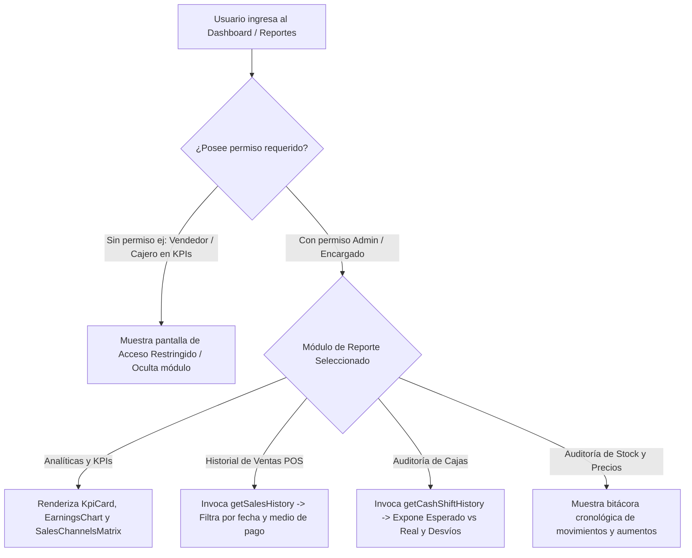

# [RF-24] Reportes Gerenciales, Analíticas Financieras y Auditoría de Operaciones

## 1. Descripción y Objetivo
Provee a la Dirección General y al Encargado de **Matacos Deportes** un centro unificado de visualización de indicadores clave de rendimiento (**KPIs**), evolución de ingresos, distribución por canales de venta y auditoría detallada de transacciones, reemplazando el control manual en cuadernos por información gerencial en tiempo real.

El requerimiento comprende:
1. **Panel Principal de KPIs y Gráficos (`DashboardView`):** Tarjetas de indicadores estratégicos (Ventas Totales, Pedidos Online, Clientes y Ganancias con variación porcentual), gráfico de evolución de ingresos (`EarningsChart`), matriz comparativa de canales Mostrador vs. E-commerce (`SalesChannelsMatrix`) y distribución geográfica de tráfico provincial/nacional (`ProvinceTrafficChart`, `WebTrafficChart`).
2. **Historial y Auditoría de Transacciones POS (`PosTransactionHistoryView`):** Consulta filtrada de todas las ventas e intercambios realizados, detallando código de comprobante, fecha y hora en zona horaria argentina, vendedor/cajero interviniente, desglose de medios de pago (`EFECTIVO`, `DEBITO`, `CREDITO`, `TRANSFERENCIA`, `QR_MERCADOPAGO`) y reimpresión directa de tickets.
3. **Auditoría Histórica de Arqueos de Caja (`CashShiftHistoryView`):** Reporte consolidado de todos los turnos cerrados con comparativa entre Efectivo Esperado vs. Efectivo Real Declarado, diferencias de arqueo (`differenceCash`), justificaciones de desvíos y reimpresión del tique térmico de cierre de 80mm.
4. **Bitácora de Variaciones de Precios y Movimientos de Stock (`PriceHistoryView` y `StockMovementHistoryView`):** Trazabilidad completa de aumentos porcentuales aplicados y movimientos de inventario por compra, venta, traslado interno o merma.
5. **Protección por Permisos (`reportes.ver_kpis` y `caja.auditoria_historial`):** Restringe el acceso a métricas financieras e historiales contables exclusivamente a los perfiles autorizados (Administrador y Encargado).

---

## 2. Tecnologías, Herramientas y Librerías

- **Next.js 15 & React 19:** Componentes interactivos de visualización en `src/components/dashboard/` sincronizados con parámetros de URL (`?tab=inicio`, `?tab=pos&seccion=historial`, `?tab=pos&seccion=arqueo`).
- **Server Actions de Consulta y Reportes:** [`getSalesHistory`](file:///C:/Proyectos/matacos-deportes-app/src/server/actions/posSaleActions.ts), [`getCashShiftHistory`](file:///C:/Proyectos/matacos-deportes-app/src/server/actions/cashShiftActions.ts), [`getCashShiftReport`](file:///C:/Proyectos/matacos-deportes-app/src/server/actions/cashShiftActions.ts) y [`getGlobalMovementsHistory`](file:///C:/Proyectos/matacos-deportes-app/src/server/actions/inventoryActions.ts).
- **Control de Acceso RBAC:** Verificación reactiva y en servidor de los permisos `reportes.ver_kpis`, `caja.auditoria_historial` e `inventario.historial_precios`.
- **Formateo Estándar:** `formatCurrency(amount)` en Pesos Argentinos (ARS) y zona horaria `America/Argentina/Buenos_Aires`.

---

## 3. Archivos Involucrados en el Requerimiento

### Componentes de Reportes y Analíticas (Frontend)
- [`src/components/dashboard/DashboardView.tsx`](file:///C:/Proyectos/matacos-deportes-app/src/components/dashboard/DashboardView.tsx): Contenedor principal con selector de período temporal (*Hoy*, *Esta semana*, *Este mes*, *Año actual*) y guardia de permiso `reportes.ver_kpis`.
- [`src/components/dashboard/KpiCard.tsx`](file:///C:/Proyectos/matacos-deportes-app/src/components/dashboard/KpiCard.tsx): Tarjetas de métricas clave con indicadores de tendencia.
- [`src/components/dashboard/EarningsChart.tsx`](file:///C:/Proyectos/matacos-deportes-app/src/components/dashboard/EarningsChart.tsx) y [`SalesChannelsMatrix.tsx`](file:///C:/Proyectos/matacos-deportes-app/src/components/dashboard/SalesChannelsMatrix.tsx): Gráficos comparativos de recaudación y participación por canal.
- [`src/components/dashboard/PosTransactionHistoryView.tsx`](file:///C:/Proyectos/matacos-deportes-app/src/components/dashboard/PosTransactionHistoryView.tsx): Visor de ventas completadas, filtros por medio de pago y reimpresión de tickets.
- [`src/components/dashboard/CashShiftHistoryView.tsx`](file:///C:/Proyectos/matacos-deportes-app/src/components/dashboard/CashShiftHistoryView.tsx): Auditoría de cierres de caja, diferencias de arqueo ciego y comprobantes de turno.
- [`src/components/dashboard/StockMovementHistoryView.tsx`](file:///C:/Proyectos/matacos-deportes-app/src/components/dashboard/StockMovementHistoryView.tsx) y [`PriceHistoryView.tsx`](file:///C:/Proyectos/matacos-deportes-app/src/components/dashboard/PriceHistoryView.tsx): Reportes históricos de stock y remarcaciones de precios.

### Backend & Server Actions
- [`src/server/actions/posSaleActions.ts`](file:///C:/Proyectos/matacos-deportes-app/src/server/actions/posSaleActions.ts): Consultas de historial de transacciones con inclusión de pagos y variantes.
- [`src/server/actions/cashShiftActions.ts`](file:///C:/Proyectos/matacos-deportes-app/src/server/actions/cashShiftActions.ts): Consultas `getCashShiftHistory` y `getCashShiftReport` protegidas con `hasPermission("caja.auditoria_historial")`.

---

## 4. Flujo de Datos y Control

### Diagrama de Flujo de Consulta de Reportes y Auditoría

### Detalle del Flujo de Control
1. **Verificación de Autorización:** Al seleccionar la pestaña de Analíticas (`?tab=inicio`), `DashboardView` comprueba `hasPerm("reportes.ver_kpis")`. Si un usuario sin permiso intenta acceder por URL directa, se bloquea la visualización mostrando un aviso de seguridad.
2. **Consolidación por Medio de Pago:** En `PosTransactionHistoryView` y `CashShiftHistoryView`, los importes se desglosan por cada método (`EFECTIVO`, `DEBITO`, `CREDITO`, `TRANSFERENCIA`, `QR_MERCADOPAGO`), permitiendo conciliar rápidamente los cupones del Posnet y el efectivo físico del cajón.

---

## 5. Pruebas y Validación (QA)

1. **Paso 1 (Acceso con Administrador):** Iniciar sesión como `admin` y navegar a la pestaña *"Analíticas"*. Verificar la correcta visualización de las tarjetas KPI, gráficos de ingresos y canales de venta.
2. **Paso 2 (Restricción a Rol Operativo):** Iniciar sesión como `vendedor` e intentar acceder a `/?tab=inicio` o al historial de arqueos de caja. Verificar que el sistema bloquee la vista por falta de permisos (`reportes.ver_kpis` / `caja.auditoria_historial`).
3. **Paso 3 (Auditoría de Turnos y Ventas):** Con el usuario `encargado`, ingresar a *"POS -> Cajas y Arqueo"* y *"POS -> Historial"*.
4. **Resultado Esperado:** Se listan las ventas y los cierres de turno con sus importes en formato ARS (`$ 45.000,00`), diferencias de arqueo coloreadas según superávit/faltante y botón funcional para reimprimir cualquier comprobante térmico de 80mm.
