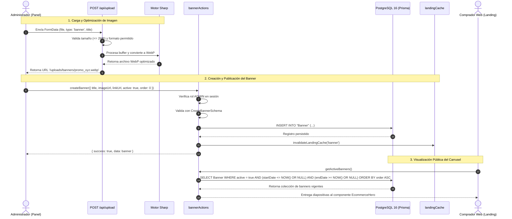

# [RF-26] Gestión y Publicación de Banners Promocionales y Carrusel de Landing

## 1. Descripción y Objetivo
Provee una herramienta integral de administración de contenido visual (Mini-CMS) para promocionar campañas estacionales, disciplinas destacadas (Natación, Vóley, Calzado Urbano, Crocs, etc.) y avisos comerciales en la portada de la tienda online de **Matacos Deportes**.

El requerimiento resuelve las necesidades de dinamismo comercial identificadas en el relevamiento:
1. **Autonomía Operativa de Administración:** Los propietarios y administradores pueden publicar, editar, reordenar y despublicar banners promocionales directamente desde el panel de control administrativo sin requerir la intervención técnica del equipo de desarrollo de software ni despliegues de código adicionales.
2. **Procesamiento y Optimización Multimedia Automática:** Permite la carga de imágenes en formatos PNG, JPEG y WebP con un límite estricto de seguridad de 2 MB. Mediante la librería **Sharp**, las imágenes se transforman automáticamente a formato **WebP** de alta compresión visual y bajo peso de transferencia. Adicionalmente, admite URLs diferenciadas para dispositivos móviles (`mobileUrl`) y videos promocionales ligeros en bucle (`videoUrl` en MP4 / WebM).
3. **Programación Temporal y Vigencia de Campañas:** Cada banner puede configurarse con fechas límite (`startDate` y `endDate`). El motor público evalúa la fecha y hora de la consulta (en huso horario de Argentina `America/Argentina/Buenos_Aires`), mostrando únicamente las campañas activas y vigentes en el carrusel principal (*hero slider*) de la landing page.
4. **Reordenamiento Atómico y Control de Acceso por Roles (RBAC):** La gestión administrativa está blindada bajo el rol `ADMIN`, bloqueando intentos de acceso por parte de cajeros, vendedores u operadores de despacho. Al reorganizar el orden visual de los banners en la interfaz, el sistema ejecuta una actualización atómica en PostgreSQL e invalida inmediatamente la caché de la landing page ([RF-28](file:///C:/Users/della/matacos-deportes-app/src/lib/landingCache.ts)) para reflejar los cambios en tiempo real a los compradores.

---

## 2. Tecnologías, Herramientas y Librerías

- **Next.js 15 (Server Actions y Route Handlers):** Acciones de mutación en [`src/server/actions/bannerActions.ts`](file:///C:/Users/della/matacos-deportes-app/src/server/actions/bannerActions.ts) y endpoint de subida en [`src/app/api/upload/route.ts`](file:///C:/Users/della/matacos-deportes-app/src/app/api/upload/route.ts).
- **Sharp:** Procesamiento eficiente y conversión en memoria de imágenes a formato WebP optimizado para la web.
- **PostgreSQL 16 & Prisma ORM 6:**
  - Modelo `Banner` (`id`, `title`, `subtitle`, `imageUrl`, `mobileUrl`, `videoUrl`, `linkUrl`, `order`, `active`, `startDate`, `endDate`, `createdAt`, `updatedAt`).
  - Índices sobre el orden y estado para consultas con latencia inferior a 50 milisegundos.
- **Zod (Validación Estricta de Esquemas):** Esquemas fuertemente tipados [`CreateBannerSchema`](file:///C:/Users/della/matacos-deportes-app/src/schemas/banner.ts#L18), [`UpdateBannerSchema`](file:///C:/Users/della/matacos-deportes-app/src/schemas/banner.ts#L46) y [`ReorderBannersSchema`](file:///C:/Users/della/matacos-deportes-app/src/schemas/banner.ts#L79), garantizando la integridad de fechas, enlaces y tipado estricto.
- **Motor de Caché e Invalidación Reactiva:** Integración con [`src/lib/landingCache.ts`](file:///C:/Users/della/matacos-deportes-app/src/lib/landingCache.ts) mediante `invalidateLandingCache('banner')` y `revalidatePath("/")`.
- **Componentes de UI y Diseño:** Lucide Icons, Tailwind CSS y componentes de `shadcn/ui` para una experiencia ergonómica en el panel administrativo.

---

## 3. Archivos Involucrados en el Requerimiento

### Frontend y Paneles de Control
- [`src/components/dashboard/BannersManagementView.tsx`](file:///C:/Users/della/matacos-deportes-app/src/components/dashboard/BannersManagementView.tsx): Panel administrativo para administradores que incluye previsualización en vivo, carga de archivos mediante drag-and-drop, formulario modal con validaciones y reordenamiento de banners.
- [`src/components/ecommerce/EcommerceHero.tsx`](file:///C:/Users/della/matacos-deportes-app/src/components/ecommerce/EcommerceHero.tsx): Carrusel dinámico (*hero slider*) de la tienda online con soporte para imágenes de alta resolución, botones de navegación táctil y redirección contextual a categorías o productos promocionados.
- [`src/components/ecommerce/EcommerceHomeView.tsx`](file:///C:/Users/della/matacos-deportes-app/src/components/ecommerce/EcommerceHomeView.tsx): Vista principal de la tienda online que integra el carrusel de banners y las vitrinas de productos destacados.

### Backend, Server Actions y Procesamiento Multimedia
- [`src/server/actions/bannerActions.ts`](file:///C:/Users/della/matacos-deportes-app/src/server/actions/bannerActions.ts):
  - `getActiveBanners`: Server Action pública que retorna los banners activos y vigentes para el carrusel de la tienda.
  - `getAllBannersAdmin`: Server Action protegida (`ADMIN`) para auditar la totalidad de banners registrados.
  - `createBanner` / `updateBanner` / `deleteBanner`: Operaciones ABM protegidas con invalidación de caché.
  - `reorderBanners`: Reordenamiento posicional atómico de banners en el carrusel.
- [`src/server/services/bannerService.ts`](file:///C:/Users/della/matacos-deportes-app/src/server/services/bannerService.ts): Capa de servicios que aplica reglas de negocio, verificación de roles del personal y persistencia con Prisma.
- [`src/app/api/upload/route.ts`](file:///C:/Users/della/matacos-deportes-app/src/app/api/upload/route.ts): Endpoint `POST /api/upload` con validación MIME, control de cuota (máx 2MB), optimización con Sharp hacia `/public/uploads/banners/` y persistencia en disco.
- [`src/lib/landingCache.ts`](file:///C:/Users/della/matacos-deportes-app/src/lib/landingCache.ts): Gestor de invalidación de caché en memoria de la portada.

### Esquemas de Validación y Persistencia
- [`src/schemas/banner.ts`](file:///C:/Users/della/matacos-deportes-app/src/schemas/banner.ts): Define esquemas de validación Zod y tipos inferidos para altas, bajas, modificaciones y reordenamientos.
- [`prisma/schema.prisma`](file:///C:/Users/della/matacos-deportes-app/prisma/schema.prisma): Entidad relacional `Banner`.

### Documentación y Manuales
- [`docs/MANUAL_MANEJO_BANNER_IMAGENES.md`](file:///C:/Users/della/matacos-deportes-app/docs/MANUAL_MANEJO_BANNER_IMAGENES.md): Manual operativo paso a paso para el usuario final sobre dimensiones recomendadas y gestión de imágenes.
- [`docs/GUIA_GALERIA_IMAGENES_Y_CARRUSEL.md`](file:///C:/Users/della/matacos-deportes-app/docs/GUIA_GALERIA_IMAGENES_Y_CARRUSEL.md): Guía de integración de la galería visual y componentes de carrusel.

### Pruebas Automatizadas (QA)
- [`scripts/test-rf26-banners.ts`](file:///C:/Users/della/matacos-deportes-app/scripts/test-rf26-banners.ts): Suite automatizada de pruebas exhaustivas que valida validaciones Zod, procesamiento Sharp en `/api/upload`, aislamiento RBAC (ADMIN vs CAJERO), filtrado por fechas de vigencia y reordenamiento atómico.

---

## 4. Flujo de Datos y Control

### Diagrama de Secuencia: Publicación de Banners y Consumo en Landing Page

### Detalle del Flujo de Control
1. **Subida Segura de Archivos:** El endpoint `/api/upload` verifica el tamaño de la carga útil antes de volcarlo en memoria. Si el archivo supera 2 MB o no pertenece a la lista blanca de imágenes (`image/png`, `image/jpeg`, `image/webp`) o videos (`video/mp4`, `video/webm`), se interrumpe la petición con código HTTP 400. Las imágenes se procesan con Sharp a 85% de calidad WebP para minimizar el consumo de datos móviles en la provincia de Formosa.
2. **Normalización Zod y URLs Seguras:** `CreateBannerSchema` rechaza URLs relativas al protocolo sin esquema seguro (ej. `//evil.com`), garantiza que si se definen `startDate` y `endDate`, la fecha de fin sea cronológicamente posterior al inicio, y normaliza strings vacíos a `null`.
3. **Aislamiento Estricto por Rol (RBAC):** `getAllBannersAdmin`, `createBanner`, `updateBanner`, `deleteBanner` y `reorderBanners` comprueban la presencia del token de sesión de personal interno y exigen que `user.role === "ADMIN"`. Si un usuario con rol `CAJERO` o un cliente web intenta invocar estas acciones, el sistema deniega el acceso (`success: false`, `error: "No autorizado"`).
4. **Invalidación Inmediata de Caché:** Al mutar un banner, se invoca `invalidateLandingCache('banner')`. Esto garantiza que los clientes que naveguen la portada obtengan el carrusel renovado en su siguiente consulta sin necesidad de reiniciar el servidor.

---

## 5. Pruebas y Validación (QA)

1. **Precondición:** Contar con el entorno Docker de base de datos activo (`pnpm db:up`), Prisma sincronizado (`pnpm prisma db push`) y una cuenta de usuario con rol `ADMIN` en la tabla `User`.
2. **Paso 1 (Esquemas Zod):** Enviar objetos a `CreateBannerSchema` verificando la normalización de textos, la conversión de campos vacíos a `null`, el rechazo de URLs inseguras y la validación de ventanas de fechas invertidas. Probar que `ReorderBannersSchema` impida IDs duplicados o listas vacías.
3. **Paso 2 (Endpoint /api/upload):** Enviar un archivo PNG menor a 2MB con `type: "banner"` y verificar que responda con código HTTP 200, formato `image/webp` y que el archivo se haya escrito en la carpeta `public/uploads/banners/`. Repetir con un archivo superior a 2MB y verificar rechazo con HTTP 400.
4. **Paso 3 (Aislamiento de Seguridad RBAC):** Invocar las Server Actions administrativas de banners sin sesión activa y verificar que devuelvan `success: false`. Repetir la invocación con un usuario que posea rol `CAJERO` y constatar el rechazo por falta de privilegios.
5. **Paso 4 (Vigencia y Filtrado Público):** Crear banners con cuatro configuraciones de vigencia: permanente, vigente hoy, expirado en el pasado y programado a futuro. Invocar `getActiveBanners` y comprobar que únicamente se retornen los dos primeros, ordenados según su atributo `order`.
6. **Paso 5 (Reordenamiento Atómico):** Invocar `reorderBanners` intercambiando las posiciones relativas y verificar que la consulta pública devuelva el nuevo orden de forma inmediata.
7. **Resultado Esperado:** Al ejecutar `pnpm tsx scripts/test-rf26-banners.ts`, la totalidad de las pruebas de integración finalizan con éxito (`0 fallidas`).
