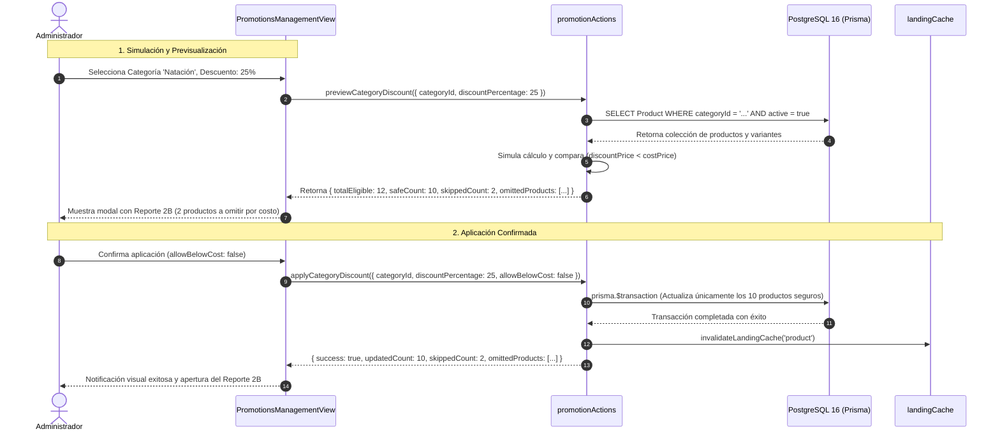
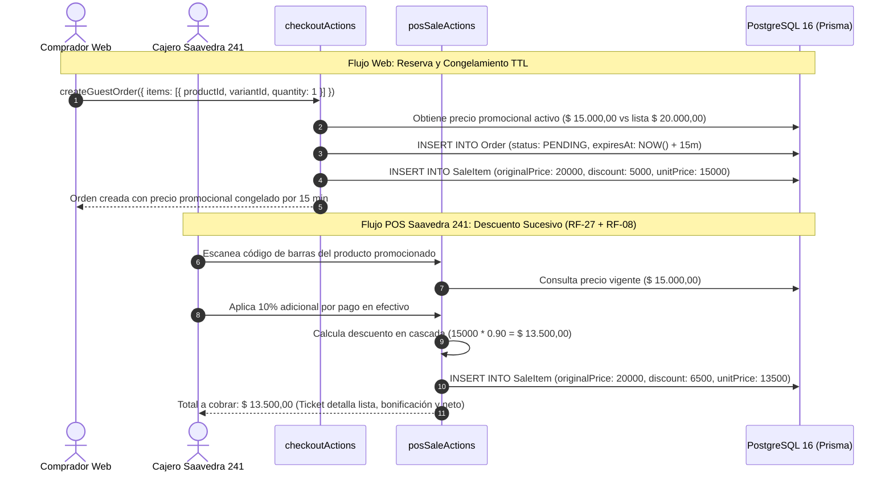

# [RF-27] Gestión de Descuentos Promocionales, Ofertas por Rubro y Salvaguarda de Costos

## 1. Descripción y Objetivo

Provee un sistema integral de **gestión y aplicación de descuentos promocionales, ofertas estacionales y liquidaciones** con alcance omnicanal, sincronizado en tiempo real entre la tienda online y el salón de ventas físico de **Matacos Deportes** (Saavedra 241, Formosa Capital).

El requerimiento resuelve las problemáticas operativas y financieras identificadas durante el relevamiento y elicitación del negocio:

1. **Dinamismo Comercial y Liquidación de Temporada:** Permite configurar descuentos porcentuales (del 1% al 90%) tanto de forma individual por artículo como de forma masiva por Categoría o Disciplina deportiva (ej. toda la línea de Natación, indumentaria de Vóley o calzado urbano), permitiendo lanzar campañas relámpago con un solo clic.
2. **Salvaguarda Financiera contra Venta Bajo Costo:** Incorpora una regla de protección contable que impide que el precio promocional bonificado resulte inferior al costo de reposición (`costPrice`). Si un descuento masivo vulnera el costo de algún producto, el sistema aplica la bonificación a los productos seguros y genera de manera transparente el **Reporte 2B de Productos Omitidos**, informando la lista detallada de exclusiones.
3. **Control de Acceso y Autorización Excepcional (RBAC):** Protege la autorización de ventas por debajo del costo mediante el permiso atómico `productos.descuento_bajo_costo`. Únicamente los administradores o supervisores habilitados pueden forzar liquidaciones a pérdida de prendas discontinuadas o fuera de curva de talles.
4. **Programación Temporal en Huso Horario de Argentina (`America/Argentina/Buenos_Aires`):** Posibilita definir ventanas de vigencia exactas con fecha y hora de inicio (`discountStartDate`) y fin (`discountEndDate`), como también promociones permanentes/indefinidas sin fecha de caducidad.
5. **Garantía Omnicanal y Congelamiento de Precio Web (TTL 15 Minutos):** En la tienda virtual, si el comprador inicia el proceso de compra durante la vigencia de la oferta, el precio bonificado queda resguardado durante los 15 minutos de la reserva de stock ([RF-15](file:///C:/Users/della/matacos-deportes-app/docs/RF-15_Carrito_Guest_Checkout_Reserva_Stock.md)), evitando incrementos imprevistos mientras el usuario completa el pago en la pasarela.
6. **Descuentos Sucesivos en Punto de Venta Físico ([RF-27](file:///C:/Users/della/matacos-deportes-app/docs/RF-27_Descuentos_Promocionales_Liquidaciones.md) + [RF-08](file:///C:/Users/della/matacos-deportes-app/docs/RF-08_Descuentos_Manuales_POS.md)):** En las terminales de mostrador de Saavedra 241, los lectores USB capturan automáticamente el precio promocional vigente. Si el cajero aplica un descuento manual por pago en efectivo o fidelidad, el cálculo se realiza en cascada sucesiva sobre el precio bonificado, persistiendo el precio de lista original en `SaleItem.originalPrice` para auditoría y arqueo de caja ([RF-11](file:///C:/Users/della/matacos-deportes-app/docs/RF-11_Apertura_Arqueo_Cierre_Caja.md)).
7. **Visibilidad Comercial y Conversión UI:** Expone en el catálogo digital, vitrina de productos destacados, ficha de producto (PDP) y modal de vista rápida los precios de lista tachados, badges porcentuales de oferta (`-25% OFF`) y un bloque destacado de ahorro total en el carrito y checkout (`¡Estás ahorrando $ X en esta compra!`).

---

## 2. Tecnologías, Herramientas y Librerías

- **Next.js 15 (Server Actions y App Router):**
  - Módulo central de Server Actions en [`src/server/actions/ecommerce/promotionActions.ts`](file:///C:/Users/della/matacos-deportes-app/src/server/actions/ecommerce/promotionActions.ts) para la creación, actualización, pausado/reanudación y reversión masiva de ofertas.
  - Vistas y modales en el panel de control administrativo y componentes de tienda bajo React 19.
- **PostgreSQL 16 & Prisma ORM 6:**
  - Persistencia de promociones en el modelo `Product`:
    - `discountActive: Boolean @default(false)`
    - `discountPercentage: Decimal? @db.Decimal(5, 2)`
    - `discountPrice: Decimal? @db.Decimal(12, 2)`
    - `discountStartDate: DateTime?`
    - `discountEndDate: DateTime?`
    - Índice optimizado `Product_active_discountActive_idx` para consultas de alto rendimiento en el catálogo público.
  - Persistencia contable en el modelo `SaleItem`:
    - `originalPrice: Decimal @db.Decimal(12, 2)`
    - `discount: Decimal @default(0) @db.Decimal(12, 2)`
    - `unitPrice: Decimal @db.Decimal(12, 2)`
- **Zod (Validación Estricta de Esquemas):**
  - [`ProductDiscountSchema`](file:///C:/Users/della/matacos-deportes-app/src/schemas/productDiscount.ts): Validación de porcentajes (1% a 90%), coherencia cronológica de fechas de vigencia y bandera de anulación de salvaguarda (`allowBelowCost`).
  - [`CategoryDiscountSchema`](file:///C:/Users/della/matacos-deportes-app/src/schemas/productDiscount.ts): Parámetros para aplicación masiva por rubro o disciplina deportiva con informe preliminar.
  - [`BulkRevertSchema`](file:///C:/Users/della/matacos-deportes-app/src/schemas/productDiscount.ts): Reversión atómica de campañas por categoría o disciplina.
- **Manejo de Zona Horaria y Redondeo Financiero Determinista:**
  - `America/Argentina/Buenos_Aires` para todas las evaluaciones temporales de vigencia.
  - Redondeo aritmético a dos decimales (`Math.round(val * 100) / 100`) para garantizar 0 centavos de desviación entre catálogo, variantes, carrito, pasarela de pago y ticket fiscal/no fiscal.
- **Seguridad y Control de Acceso (RBAC):**
  - Permiso atómico `productos.descuento_bajo_costo` registrado en la tabla `Permission` (Módulo `PRODUCTOS`) para autorizar rebajas por debajo del costo de reposición.
  - Verificación de sesión de usuario administrativo nivel `>= 100` o rol `ADMIN`.
- **Motor de Caché e Invalidación Reactiva:**
  - Integración con [`src/lib/landingCache.ts`](file:///C:/Users/della/matacos-deportes-app/src/lib/landingCache.ts) mediante `invalidateLandingCache('product')` y `revalidatePath("/")` para actualizar instantáneamente las ofertas en la portada.

---

## 3. Archivos Involucrados en el Requerimiento

### Frontend & Paneles de Control
- [`src/components/dashboard/PromotionManagementView.tsx`](file:///C:/Users/della/matacos-deportes-app/src/components/dashboard/PromotionManagementView.tsx): Panel administrativo integral (`/admin?tab=promociones`) organizado en pestañas (*Activas*, *Programadas*, *Historial*), con métricas de margen de ganancia estimado, alertas visuales (<10%), botones de pausado/reanudación rápida, modal de aplicación masiva y visualizador del Reporte 2B.
- [`src/components/dashboard/SidebarLeft.tsx`](file:///C:/Users/della/matacos-deportes-app/src/components/dashboard/SidebarLeft.tsx): Acceso directo a "Promociones" dentro de la sección *Catálogo & Stock*.
- [`src/components/dashboard/DashboardView.tsx`](file:///C:/Users/della/matacos-deportes-app/src/components/dashboard/DashboardView.tsx): Enrutador visual del panel administrativo para renderizar `PromotionManagementView`.
- [`src/components/ecommerce/pdp/ProductDetailView.tsx`](file:///C:/Users/della/matacos-deportes-app/src/components/ecommerce/pdp/ProductDetailView.tsx): Ficha técnica del producto (PDP) con actualización reactiva de precios promocionales, precio tachado y badge de descuento adaptado a la variante de talle/color seleccionada.
- [`src/components/ecommerce/catalog/CatalogView.tsx`](file:///C:/Users/della/matacos-deportes-app/src/components/ecommerce/catalog/CatalogView.tsx): Grilla del catálogo digital con visualización destacada de ofertas, precio regular tachado y etiquetas `-X% OFF`.
- [`src/components/ecommerce/EcommerceCartDrawer.tsx`](file:///C:/Users/della/matacos-deportes-app/src/components/ecommerce/EcommerceCartDrawer.tsx): Cajón lateral de carrito de compras con desglose por ítem (precio unitario regular tachado vs. promocional) y banner consolidado de ahorro total.
- [`src/components/ecommerce/checkout/CheckoutView.tsx`](file:///C:/Users/della/matacos-deportes-app/src/components/ecommerce/checkout/CheckoutView.tsx): Resumen final de compra con detalle de ahorros aplicados antes de derivar a la pasarela de pago o transferencia bancaria.

### Backend, Server Actions y Mappers
- [`src/server/actions/ecommerce/promotionActions.ts`](file:///C:/Users/della/matacos-deportes-app/src/server/actions/ecommerce/promotionActions.ts):
  - `setProductDiscount`: Aplica o actualiza el descuento individual con salvaguarda de costos y verificación RBAC.
  - `removeProductDiscount`: Quita el descuento de un producto individual restaurando su precio normal.
  - `toggleProductDiscountStatus`: Pausa o reanuda una promoción activa sin perder sus porcentajes o fechas programadas.
  - `previewCategoryDiscount`: Previsualiza el impacto de un descuento masivo y genera el Reporte 2B de artículos en riesgo.
  - `applyCategoryDiscount`: Ejecuta la asignación masiva de descuentos sobre productos que cumplen la salvaguarda de costos.
  - `revertCategoryDiscount`: Reversión masiva atómica por categoría o disciplina.
  - `getPromotionsAdminList`: Consulta paginada y filtrada para el panel de administración con cálculo dinámico de márgenes.
- [`src/server/actions/ecommerce/catalogActions.ts`](file:///C:/Users/della/matacos-deportes-app/src/server/actions/ecommerce/catalogActions.ts): Expone el listado público del catálogo y carruseles resolviendo precios efectivos vigentes.
- [`src/server/actions/ecommerce/productDetailActions.ts`](file:///C:/Users/della/matacos-deportes-app/src/server/actions/ecommerce/productDetailActions.ts): Recupera los detalles de producto para el PDP, evaluando la vigencia temporal y computando precios de variantes en tiempo real.
- [`src/server/actions/ecommerce/checkoutActions.ts`](file:///C:/Users/della/matacos-deportes-app/src/server/actions/ecommerce/checkoutActions.ts): Genera la orden web congelando el precio promocional durante el TTL de reserva (15 minutos) e imputando `originalPrice` y `discount` en cada `SaleItem`.
- [`src/server/actions/posSaleActions.ts`](file:///C:/Users/della/matacos-deportes-app/src/server/actions/posSaleActions.ts): Admite el cobro omnicanal en mostrador físico, utilizando el precio promocional como base y permitiendo descuentos sucesivos de caja ([RF-08](file:///C:/Users/della/matacos-deportes-app/docs/RF-08_Descuentos_Manuales_POS.md)).
- [`src/lib/ecommerceProductMapper.ts`](file:///C:/Users/della/matacos-deportes-app/src/lib/ecommerceProductMapper.ts): Mapper bidireccional que traduce entidades relacionales de Prisma a modelos públicos de e-commerce evaluando la vigencia temporal de descuentos.

### Esquemas de Validación y Base de Datos
- [`src/schemas/productDiscount.ts`](file:///C:/Users/della/matacos-deportes-app/src/schemas/productDiscount.ts): Definición Zod de esquemas y tipos inferidos para el módulo de promociones.
- [`src/types/ecommerce.ts`](file:///C:/Users/della/matacos-deportes-app/src/types/ecommerce.ts): Tipos públicos para variantes, carrito de compras y cotizaciones de compra.
- [`prisma/schema.prisma`](file:///C:/Users/della/matacos-deportes-app/prisma/schema.prisma): Entidades `Product`, `ProductVariant`, `Sale` y `SaleItem`.
- [`prisma/seed.ts`](file:///C:/Users/della/matacos-deportes-app/prisma/seed.ts): Declaración del permiso `productos.descuento_bajo_costo`.

### Pruebas Automatizadas (QA)
- [`scripts/test-rf27-promotional-discounts.ts`](file:///C:/Users/della/matacos-deportes-app/scripts/test-rf27-promotional-discounts.ts): Suite integral de 13 pruebas automatizadas de integración para validaciones Zod, bloqueo bajo costo, permisos RBAC, descuentos masivos con Reporte 2B, reversión masiva, congelamiento TTL de reserva web y cascada en mostrador físico POS.

---

## 4. Flujo de Datos y Control

### Diagrama de Secuencia 1: Aplicación Masiva por Categoría con Reporte 2B y Salvaguarda de Costos


### Diagrama de Secuencia 2: Compra Web Omnicanal y Descuento Sucesivo en Mostrador POS


### Detalle del Flujo de Control

1. **Cálculo Determinista por Variante:**
   - La bonificación no se calcula de forma aproximada; para cada variante se aplica la fórmula matemática:
     $$\text{montoDescuento} = \text{round}\left( \frac{\text{precioLista} \times \text{porcentaje}}{100}, 2 \right)$$
     $$\text{precioFinal} = \max\left(0, \text{round}(\text{precioLista} - \text{montoDescuento}, 2)\right)$$
2. **Evaluación de la Salvaguarda de Costos:**
   - Si $\text{precioFinal} < \text{costPrice}$, la operación se categoriza como venta bajo costo.
   - En descuentos individuales, la acción devuelve un error `DISCOUNT_BELOW_COST` a menos que se incluya `allowBelowCost: true` y el usuario posea el permiso `productos.descuento_bajo_costo` o rol de Administrador.
   - En descuentos masivos por rubro o disciplina, los productos que quebrantan su costo son omitidos automáticamente sin cancelar la operación general, conformando el **Reporte 2B de Productos Omitidos**.
3. **Vigencia Temporal Estricta:**
   - Para toda consulta pública, un descuento se considera activo únicamente si:
     - `discountActive === true`
     - `discountPercentage > 0`
     - `discountStartDate === null || discountStartDate <= now`
     - `discountEndDate === null || discountEndDate >= now`
   - Las fechas se procesan siempre en el huso horario oficial de la República Argentina (`America/Argentina/Buenos_Aires`).
4. **Reserva y Liquidación en Carrito:**
   - Al crear una reserva de stock web ([RF-15](file:///C:/Users/della/matacos-deportes-app/docs/RF-15_Carrito_Guest_Checkout_Reserva_Stock.md)), el precio promocional se persiste en la orden con una ventana TTL de 15 minutos. Si la campaña promocional caduca mientras el cliente está en Mercado Pago completando el pago de esa reserva, se respeta el precio promocional congelado original.
5. **Auditoría e Imputación Contable:**
   - Toda línea de venta (`SaleItem`) registra `originalPrice` (precio de lista), `discount` (monto total deducido) y `unitPrice` (precio neto cobrado), asegurando un arqueo transparente de caja y estadísticas gerenciales fidedignas ([RF-24](file:///C:/Users/della/matacos-deportes-app/docs/RF-24_Reportes_Gerenciales_Estadisticas_KPIs.md)).

---

## 5. Pruebas y Validación (QA)

### Precondiciones
1. Base de datos PostgreSQL en ejecución con el esquema migrado y seed de permisos aplicado (`productos.descuento_bajo_costo`).
2. Existencia de productos con costo asignado (`costPrice: 10000`, `price: 12000`) y productos con margen holgado (`costPrice: 5000`, `price: 15000`).
3. Usuario administrador autenticado en el panel de control.

### Casos de Prueba Paso a Paso

#### Caso 1: Rechazo de Descuento Bajo Costo sin Autorización
1. **Paso:** Dirigirse a la ficha de edición de un producto cuyo precio sea $ 10.000 y su costo sea $ 8.000.
2. **Paso:** Intentar aplicar un descuento del 40% (precio resultante $ 6.000) sin marcar "Permitir venta bajo costo".
3. **Resultado Esperado:** La acción es rechazada inmediatamente con el código `DISCOUNT_BELOW_COST`, impidiendo que el producto se comercialice a pérdida.

#### Caso 2: Aprobación de Venta Bajo Costo con Permiso RBAC
1. **Paso:** Con un usuario con el permiso `productos.descuento_bajo_costo`, repetir la operación del Caso 1 marcando la casilla de autorización explícita.
2. **Resultado Esperado:** El sistema persiste la promoción correctamente, registrando `discountActive: true`, `discountPrice: 6000.00` y `discountPercentage: 40.00`.

#### Caso 3: Descuento Masivo por Categoría con Reporte 2B
1. **Paso:** Desde `/admin?tab=promociones`, presionar "Descuento Masivo", seleccionar la categoría "Natación" y un porcentaje del 30%.
2. **Paso:** Ejecutar la simulación previa.
3. **Resultado Esperado:** El sistema identifica los productos donde el 30% cae por debajo de su respectivo `costPrice`. Al confirmar, aplica el descuento únicamente a los artículos seguros y despliega el **Reporte 2B** enumerando los artículos omitidos y sus márgenes resultantes.

#### Caso 4: Programación Temporal en `America/Argentina/Buenos_Aires`
1. **Paso:** Programar una oferta con fecha de inicio para dentro de 2 horas.
2. **Resultado Esperado:** En la tienda web, el producto se exhibe a su precio normal. Al alcanzarse la hora programada, la tienda expone automáticamente el precio promocional, el precio tachado y la etiqueta `-X% OFF` sin necesidad de reiniciar la aplicación.

#### Caso 5: Congelamiento de Precio en Carrito y Checkout
1. **Paso:** Agregar un producto en promoción al carrito de compras.
2. **Paso:** Verificar que el cajón del carrito informe el precio unitario regular tachado, el precio promocional y el banner de ahorro: `¡Estás ahorrando $ X en esta compra!`.
3. **Paso:** Avanzar al checkout y confirmar la reserva de stock.
4. **Resultado Esperado:** El pedido web persiste la bonificación durante el TTL de 15 minutos, garantizando que el cobro final en Mercado Pago o transferencia coincida exactamente con el importe promocionado.

#### Caso 6: Descuento Sucesivo en Punto de Venta (POS)
1. **Paso:** En la pantalla de ventas de mostrador de Saavedra 241, escanear el producto promocionado.
2. **Paso:** Aplicar un 10% adicional por pago en efectivo en mostrador.
3. **Resultado Esperado:** El sistema descuenta el 10% sobre el precio de oferta preexistente. El ticket generado desglosa el precio de lista original, los descuentos acumulados y el total final neto.

---

### Verificación de Suites Automatizadas
La implementación fue validada contra la suite integral de pruebas automatizadas:

```bash
pnpm test:rf27
```

**Resultado:**
- `test-rf27-promotional-discounts.ts`: **13/13 pruebas exitosas (PASS)**.
- Validación completa de la suite de regresión del backend (`pnpm test:backend`): **12/12 suites aprobadas** sin regresiones en módulos preexistentes.
