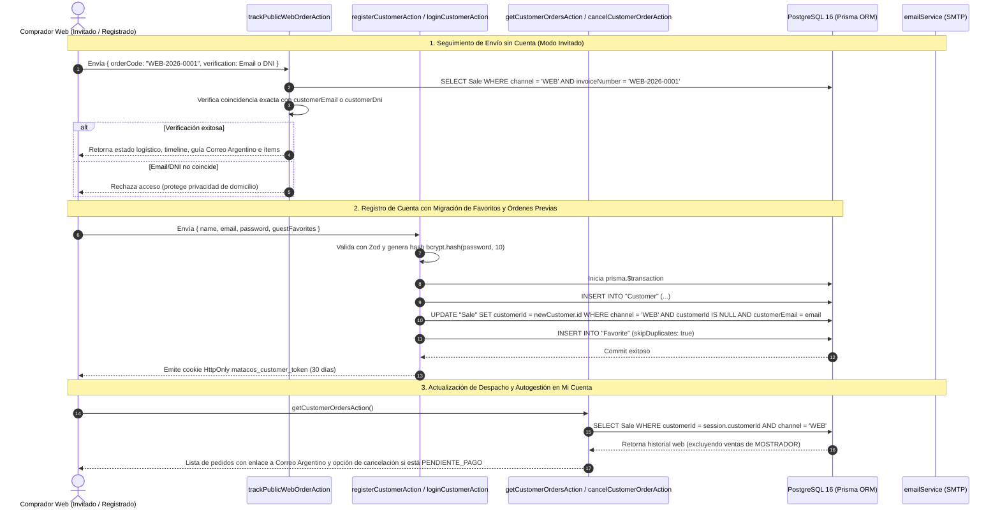

# [RF-29] Portal de Clientes, Autenticación Web, Lista de Favoritos y Seguimiento de Pedidos

## 1. Descripción y Objetivo
Implementa la capa integral de identidad, fidelización y trazabilidad posventa para los compradores de la tienda online de **Matacos Deportes**, complementando la modalidad de compra anónima (*Guest Checkout* — RF-15) con un backend de autogestión de clientes (**«Mi Cuenta»**) y un motor de seguimiento público de envíos.

El requerimiento resuelve cuatro necesidades críticas del canal digital:
1. **Aislamiento Físico y Lógico de Seguridad (`Customer` vs `User`):** Los compradores web se almacenan en la entidad independiente `Customer` y operan con un token JWT exclusivo (`matacos_customer_token`, validez de 30 días), completamente separado de la tabla `User`, los perfiles RBAC y la cookie `matacos_session` del personal interno de Saavedra 241. Un cliente web posee **cero privilegios** sobre las rutas o Server Actions de mostrador (`/pos`) y administración (`/admin`).
2. **Autenticación Híbrida (Credenciales + Google OAuth 2.0):** Soporta registro e inicio de sesión mediante correo electrónico y contraseña cifrada con `bcryptjs` (10 rondas de salt), además de autenticación federada en un clic con Google OAuth 2.0.
3. **Lista de Favoritos (*Wishlist*) y Vinculación Retroactiva:** Permite guardar productos base (`Product`) en la tabla relacional `Favorite` con restricción única compuesta `@@unique([customerId, productId])`, migrando atómicamente los favoritos guardados como visitante y vinculando retroactivamente todas las órdenes web previas (`channel: "WEB"`, `customerId: null`) que coincidan con el correo electrónico del cliente al registrarse o iniciar sesión.
4. **Centro de Seguimiento Logístico (Con Cuenta y Público para Invitados):**
   - **Clientes Registrados (`getCustomerOrdersAction`):** Consultan su historial de compras filtrando estrictamente `channel === "WEB"` (excluyendo ventas presenciales de `"MOSTRADOR"`), visualizan el estado logístico (`PENDIENTE`, `EN_PREPARACION`, `LISTO_RETIRO`, `EN_CAMINO`, `ENTREGADO`, `CANCELADO`), el código de guía de Correo Argentino con enlace directo al portal oficial (`https://www.correoargentino.com.ar/formularios/ondt`) y pueden autogestionar la cancelación de pedidos en estado `PENDIENTE_PAGO` liberando el `stockReserved`.
   - **Clientes Invitados (`trackPublicWebOrderAction` + Notificaciones por Correo):** Reciben su código de orden (`WEB-2026-XXXX`) y actualizaciones de despacho por correo electrónico, pudiendo consultar el estado del envío sin necesidad de cuenta ingresando su **Código de Pedido + Email o DNI del comprador** (segundo factor de verificación para impedir la enumeración de órdenes de terceros).

---

## 2. Tecnologías, Herramientas y Librerías

- **Next.js 15 (Server Actions & Route Handlers):** Lógica transaccional en [`src/server/actions/ecommerce/customerActions.ts`](file:///C:/Proyectos/matacos-deportes-app/src/server/actions/ecommerce/customerActions.ts) y flujo OAuth 2.0 en [`src/app/api/auth/customer/google/route.ts`](file:///C:/Proyectos/matacos-deportes-app/src/app/api/auth/customer/google/route.ts) y [`src/app/api/auth/customer/google/callback/route.ts`](file:///C:/Proyectos/matacos-deportes-app/src/app/api/auth/customer/google/callback/route.ts).
- **PostgreSQL 16 & Prisma ORM 6:**
  - Ampliación del modelo `Customer` (`password` opcional para cuentas OAuth, `googleId @unique`, `avatarUrl`, libreta de dirección postal predeterminada y relación `favorites`).
  - Nueva tabla `Favorite` con clave foránea en cascada hacia `Customer` y `Product` e índice único compuesto `@@unique([customerId, productId])`.
  - Ampliación del modelo `Sale` con el enumerado `ShippingStatus` (`PENDIENTE`, `EN_PREPARACION`, `LISTO_RETIRO`, `EN_CAMINO`, `ENTREGADO`, `CANCELADO`) y la columna `shippingTrackingCode`.
- **`bcryptjs`:** Hashing criptográfico irreversible de contraseñas de clientes (10 salt rounds).
- **`jose` (JSON Web Tokens HS256):** Firma y verificación de sesiones de clientes en [`src/lib/customerSession.ts`](file:///C:/Proyectos/matacos-deportes-app/src/lib/customerSession.ts) mediante cookies `HttpOnly`, `SameSite=Lax` y clave secreta aislada (`CUSTOMER_JWT_SECRET`).
- **Zod (Validación Estricta de Contratos):** Esquemas declarativos en [`src/schemas/customer.ts`](file:///C:/Proyectos/matacos-deportes-app/src/schemas/customer.ts) sin uso de `any`.
- **Motor de Correo Transaccional SMTP:** Servicio [`src/lib/emailService.ts`](file:///C:/Proyectos/matacos-deportes-app/src/lib/emailService.ts) parametrizado vía variables de entorno (`SMTP_HOST`, `SMTP_PORT`, `SMTP_USER`, `SMTP_PASS`, `SMTP_FROM`) con simulación segura en entorno de desarrollo/testing.

---

## 3. Archivos Involucrados en el Requerimiento

### Backend, Server Actions y Servicios de Sesión
- [`src/server/actions/ecommerce/customerActions.ts`](file:///C:/Proyectos/matacos-deportes-app/src/server/actions/ecommerce/customerActions.ts):
  - `registerCustomerAction`: Alta de cliente, hashing `bcryptjs`, vinculación retroactiva de órdenes web invitadas y migración de favoritos locales.
  - `loginCustomerAction`: Validación de credenciales, fusión de favoritos de visitante y emisión de sesión JWT.
  - `loginOrRegisterGoogleCustomer`: Aprovisionamiento e inicio de sesión federado con Google OAuth.
  - `logoutCustomerAction` / `getCurrentCustomerAction` / `updateCustomerProfileAction`: Gestión de ciclo de vida de sesión y libreta de dirección predeterminada.
  - `toggleCustomerFavoriteAction` / `syncGuestFavoritesAction` / `getCustomerFavoritesDetailsAction`: ABM de lista de deseos y consulta de disponibilidad en tiempo real (con regla *Zero-Leakage* que jamás selecciona `costPrice`).
  - `getCustomerOrdersAction`: Historial y seguimiento de órdenes del cliente autenticado (estrictamente `channel === "WEB"`).
  - `trackPublicWebOrderAction`: Buscador público de seguimiento de envíos sin cuenta validando `orderCode` (`WEB-2026-XXXX`) + `Email` o `DNI`.
  - `cancelCustomerOrderAction`: Autogestión de cancelación de órdenes en `PENDIENTE_PAGO` con restitución atómica de `stockReserved`.
  - `updateWebOrderShippingStatusAction`: Actualización logística del envío, carga de guía de Correo Argentino y disparo de notificación por correo.
- [`src/lib/customerSession.ts`](file:///C:/Proyectos/matacos-deportes-app/src/lib/customerSession.ts): Cifrado, descifrado y administración de la cookie `matacos_customer_token` (30 días).
- [`src/lib/emailService.ts`](file:///C:/Proyectos/matacos-deportes-app/src/lib/emailService.ts): Despacho de correos transaccionales de confirmación de orden (`sendOrderConfirmationEmail`) y actualización de estado logístico (`sendOrderShippingUpdateEmail`).

### Route Handlers (Google OAuth 2.0)
- [`src/app/api/auth/customer/google/route.ts`](file:///C:/Proyectos/matacos-deportes-app/src/app/api/auth/customer/google/route.ts): Construcción de la URL de autorización OAuth 2.0 de Google preservando el estado de redirección y favoritos locales.
- [`src/app/api/auth/customer/google/callback/route.ts`](file:///C:/Proyectos/matacos-deportes-app/src/app/api/auth/customer/google/callback/route.ts): Intercambio del código de autorización por token, obtención del perfil verificado de Google, vinculación en PostgreSQL y sellado de cookie `matacos_customer_token`.

### Esquemas de Validación y Modelo de Datos
- [`src/schemas/customer.ts`](file:///C:/Proyectos/matacos-deportes-app/src/schemas/customer.ts): Define `CustomerRegisterSchema`, `CustomerLoginSchema`, `CustomerProfileUpdateSchema`, `ToggleFavoriteSchema`, `SyncGuestFavoritesSchema`, `PublicOrderTrackSchema` y `UpdateOrderShippingStatusSchema`.
- [`prisma/schema.prisma`](file:///C:/Proyectos/matacos-deportes-app/prisma/schema.prisma): Modelos `Customer`, `Favorite`, `Sale` y enum `ShippingStatus`.

### Pruebas Automatizadas (QA)
- [`scripts/test-rf29-customer-portal.ts`](file:///C:/Proyectos/matacos-deportes-app/scripts/test-rf29-customer-portal.ts): Suite de integración de extremo a extremo con 25 pruebas automatizadas sobre PostgreSQL.

---

## 4. Flujo de Datos y Control

### Diagrama de Secuencia: Registro, Vinculación Retroactiva y Seguimiento Logístico

### Detalle del Flujo de Control
1. **Aislamiento Criptográfico de Sesiones:** La firma de `matacos_customer_token` emplea `CUSTOMER_JWT_SECRET` e inyecta el claim `role: "CUSTOMER"`. Si dicho token se presenta ante el verificador de personal interno (`decryptSession` / `hasPermission`), es rechazado inmediatamente.
2. **Asociación Retroactiva Transparente:** En cada registro (`registerCustomerAction`), inicio de sesión tradicional (`loginCustomerAction`) o acceso con Google (`loginOrRegisterGoogleCustomer`), una sentencia dentro de `prisma.$transaction` busca órdenes con `channel: "WEB"`, `customerId: null` y `customerEmail` coincidente (insensible a mayúsculas/minúsculas), asignándolas al `Customer.id`.
3. **Separación Estricta de Canales:** `getCustomerOrdersAction` aplica la cláusula `where: { customerId: session.customerId, channel: "WEB" }`, garantizando que las compras presenciales de mostrador (`channel: "MOSTRADOR"`, respaldadas por ticket térmico físico) no se mezclen con la operatoria de envíos online.
4. **Autogestión de Cancelación con Restitución de Stock:** `cancelCustomerOrderAction` comprueba que la orden pertenezca al cliente autenticado y permanezca en `status === "PENDIENTE_PAGO"`. Dentro de `prisma.$transaction`, decrementa `stockReserved` en cada `ProductVariant` y actualiza la venta a `status: "CANCELADA"` y `shippingStatus: "CANCELADO"`.

---

## 5. Pruebas y Validación (QA)

1. **Precondición:** Contar con el contenedor PostgreSQL activo (`pnpm db:up`), esquema sincronizado (`pnpm prisma db push`) y productos activos con stock en base de datos.
2. **Paso 1 (Registro, Unicidad y Hashing):** Ejecutar `registerCustomerAction` con un cliente nuevo. Verificar que la contraseña en PostgreSQL sea un hash `bcryptjs` (`$2...`) y que un segundo intento con el mismo email sea rechazado.
3. **Paso 2 (Ciclo de Vida de Sesión y Aislamiento RBAC):** Cifrar un token con `encryptCustomerSession`, comprobar su lectura con `decryptCustomerSession`, verificar el rechazo de tokens expirados y confirmar que `decryptSession` (personal interno) y `hasPermission("pos.vender")` devuelvan `null` y `false`.
4. **Paso 3 (Favoritos y Migración desde Invitado):** Alternar un producto con `toggleCustomerFavoriteAction` (alta y baja), comprobar la restricción `@@unique([customerId, productId])` y verificar que `loginCustomerAction` migre una lista de `guestFavorites` a la tabla `Favorite`.
5. **Paso 4 (Seguimiento Público sin Cuenta y Vinculación Retroactiva):** Crear una orden como invitado (`createGuestOrder`), consultarla sin sesión mediante `trackPublicWebOrderAction` con **Código + Email** y **Código + DNI**, verificar el bloqueo ante un Email/DNI incorrecto, y comprobar que al registrar una cuenta con ese correo la orden quede vinculada automáticamente al nuevo `Customer.id`.
6. **Paso 5 (Filtro de Canal Web, Guía de Correo Argentino y Autogestión de Cancelación):** Actualizar el envío con `updateWebOrderShippingStatusAction` (`EN_CAMINO`, guía `CA987654321AR`), verificar que `getCustomerOrdersAction` excluya ventas de `MOSTRADOR`, y confirmar que `cancelCustomerOrderAction` libere `stockReserved` en órdenes `PENDIENTE_PAGO` pero rechace cancelar órdenes ya pagadas (`COMPLETADA`).
7. **Resultado Esperado:** Al ejecutar `pnpm test:rf29` (`pnpm tsx scripts/test-rf29-customer-portal.ts`), las **25 pruebas automatizadas** finalizan en estado `PASS` (`0 fallidas`).
