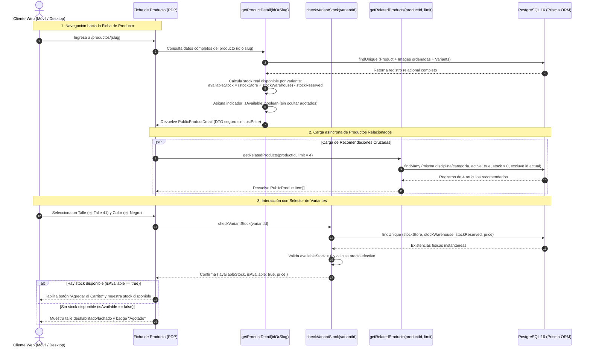

# Diagrama de Interacción: Ficha de Detalle de Producto (PDP) y Stock en Tiempo Real
## Requerimiento Funcional: RF-14 — Módulo E-commerce
**Cliente:** Matacos Deportes (Saavedra 241, Formosa Capital)  
**Proyecto:** Sistema Integral de Gestión, POS Offline y E-commerce  

---

### Descripción del Flujo
Este diagrama ilustra la secuencia de interacciones entre el cliente en el navegador web (móvil o desktop), los componentes visuales de la Ficha de Detalle de Producto (PDP), las Server Actions de Next.js 15 y la base de datos PostgreSQL/Prisma.

Garantiza:
1. **Carga completa y segura del artículo:** Visualización de ficha técnica, fotos ordenadas por variante y discriminación de disponibilidad sin exponer precios de costo ni proveedores.
2. **Carga en paralelo de recomendaciones:** Productos relacionados de la misma disciplina para venta cruzada (*cross-selling*).
3. **Validación atómica de existencias:** Chequeo en milisegundos del stock físico disponible $(\text{Salón} + \text{Depósito} - \text{Reservado})$ al interactuar con el selector de talles antes de agregar al carrito.

---

### Diagrama de Secuencia (Mermaid)

---

### Reglas de Negocio Vinculadas
* **Fórmula de Stock Neto:** $\text{Stock Disponible} = \max(0, (\text{stockStore} + \text{stockWarehouse}) - \text{stockReserved})$.
* **Variantes Agotadas Visibles:** No se ocultan los talles sin existencias para evitar que el cliente asuma que el comercio no comercializa ese número/medida. Se presentan deshabilitados.
* **Seguridad (Zero-Leakage):** Bajo ninguna condición se transmite el campo `costPrice` ni los márgenes del comercio a la capa pública.
