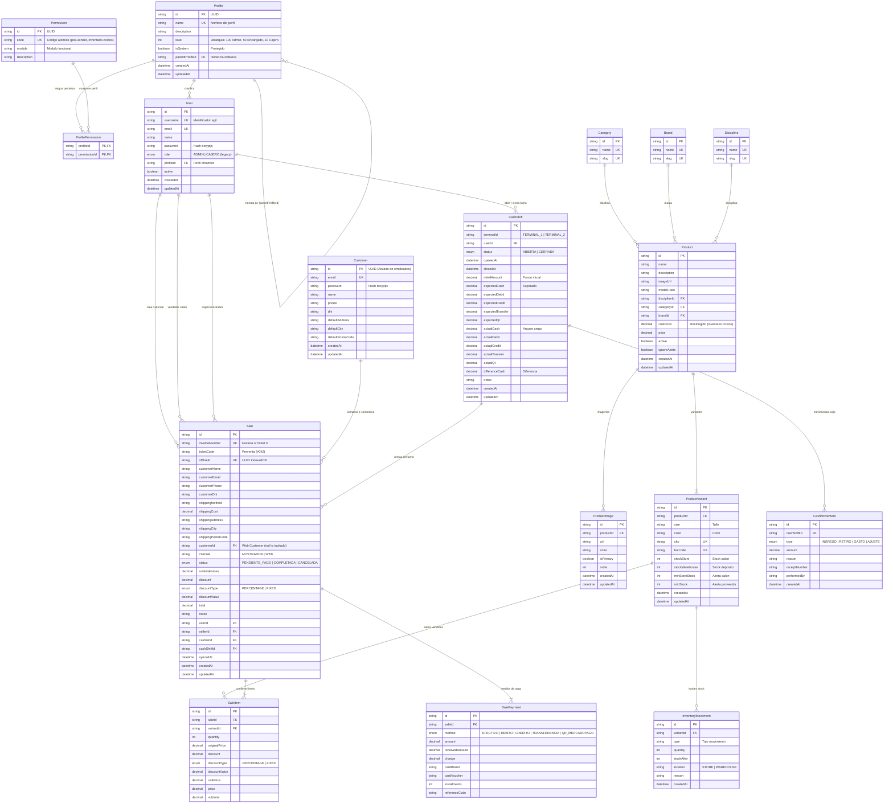

# Diagrama del Modelo Relacional — Matacos Deportes
**Esquema:** [`prisma/schema.prisma`](file:///C:/Users/della/matacos-deportes-app/prisma/schema.prisma)  
**Motor:** PostgreSQL 16 / Prisma ORM 6  
**Visor interactivo (navegador):** [`docs/diagrama_modelo_relacional.html`](file:///C:/Users/della/matacos-deportes-app/docs/diagrama_modelo_relacional.html)

---

