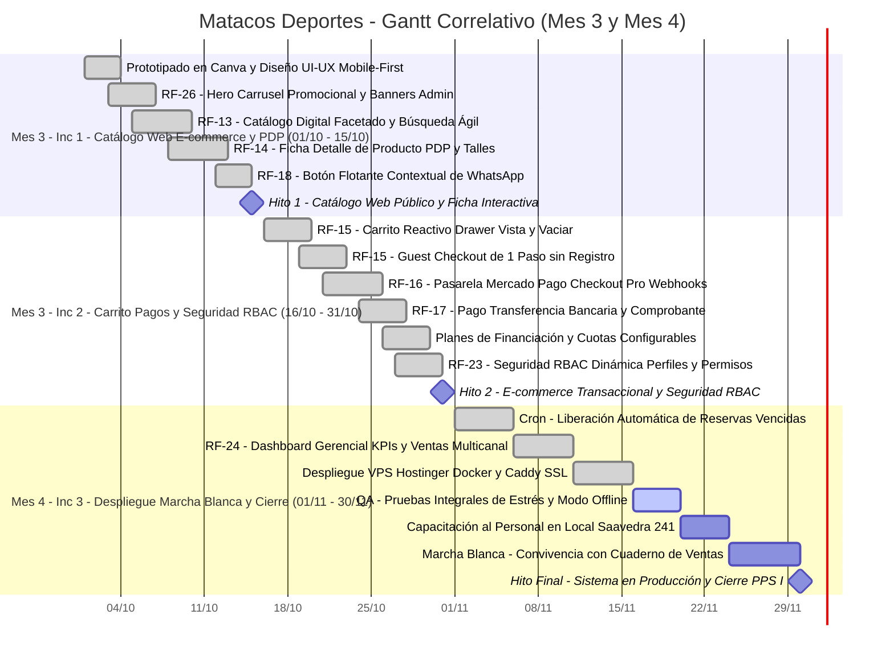

# Cronograma y Diagrama de Gantt Correlativo — Mes 3 y Mes 4
## Proyecto: Sistema Integral de Gestión, POS Offline y E-commerce — Matacos Deportes
**Cátedra:** Práctica Profesional Supervisada I (PPS I) – UCP Sede Formosa  
**Institución:** Universidad de la Cuenca del Plata (Sede Formosa)  
**Local Comercial:** Saavedra 241, Formosa Capital  

### Equipo de Desarrollo y Asignación de Roles:
* **Dellagnolo, Ricardo Agustín:** Líder de Proyecto / Backend Developer (Arquitectura, Docker, PostgreSQL/Prisma, Server Actions, APIs de integración y sincronización).
* **Fornari, Nahir Agustín:** Backend Developer / Analista Funcional (Lógica de inventario, reglas de negocio, validaciones Zod, cálculo transaccional de ventas y arqueo de caja).
* **Bordón Sbardella, Lourdes Antonella:** Frontend Developer / Diseñadora UI-UX (Maquetación Next.js 15, Tailwind CSS, componentes shadcn/ui, diseño Mobile-First y plantillas de impresión).
* **González, Eugenia Milagros:** Frontend Developer / Especialista UI & QA (Manejo de estado Zustand, IndexedDB con Dexie.js, formularios reactivos y pruebas funcionales de interfaz).

**Período:** 01 de Octubre de 2026 al 30 de Noviembre de 2026  
**Carga Horaria:** 240 horas de desarrollo, integración y puesta en marcha (120 hs Mes 3 + 120 hs Mes 4).

---

## 1. Reprogramación Estratégica: Justificación del Módulo de Facturación Fiscal

En el plan de trabajo preliminar de la PPS I se contempló la integración directa con los Web Services de **AFIP / ARCA (WSAA y WSFEv1)** para la emisión automatizada de Facturas Electrónicas A y B con CAE durante el Mes 4. Sin embargo, durante el desarrollo del Mes 3 y tras la auditoría de riesgos operacionales y técnicos del comercio (Riesgo R-01 documentado en la Matriz de Riesgos), el equipo y los propietarios del comercio (**Sandra Mujica y Miguel Ángel Marchi**) acordaron **desacoplar y postergar la conexión directa con ARCA**, reorientando el esfuerzo hacia la continuidad operativa del mostrador y el cumplimiento normativo del e-commerce:

1. **Inestabilidad Externa y Transición Tributaria:** Durante el período Septiembre-Noviembre de 2026, la reestructuración del organismo recaudador nacional (disolución de AFIP y transición operativa hacia ARCA) generó suspensiones intermitentes y una marcada inestabilidad en los entornos de homologación y testing, con tiempos de respuesta superiores a 15 segundos y caídas del servicio de autenticación WSAA.
2. **Prioridad Operativa de Mostrador (Continuidad Comercial):** En el punto de venta de Saavedra 241, la prioridad crítica del negocio es **cobrar en menos de 30 segundos y no detener las ventas presenciales bajo ninguna circunstancia** (incluso ante microcortes de red o caídas de servidores estatales). Un bloqueo por falta de CAE síncrono paralizaría la atención al público.
3. **Sustitución por Comprobantes de Control Interno (RF-21 y RF-22):** Se implementó al 100% el módulo de **Tickets de Control Interno (Ticket X) y Presupuestos de Preventa (`PRV-XXXX`)** impresos en bobina térmica de 80 mm con validez comercial de 30 días para cambios y garantías, complementado con **Notas de Crédito y Vales de Compra (RF-22)**. El local opera de forma impecable y legal, canalizando las facturas electrónicas discriminadas con CUIT de manera manual y complementaria por el portal web oficial *"Comprobantes en Línea"* de ARCA.
4. **Reasignación de Horas a Funcionalidades de Alto Valor Real:** Las 50 horas estimadas originalmente para la homologación fiscal se redirigieron hacia requerimientos de mayor impacto comercial y técnico:
   * **Logística de Envíos con Correo Argentino (RF-19 y RF-25):** Cotización en tiempo real, selector de sucursales y rotulado automatizado de etiquetas de despacho.
   * **Marco Legal y Compliance E-commerce:** Botón de arrepentimiento de 10 días, políticas de privacidad, términos de contratación y registro inmutable de consentimientos (`LegalConsentLog`).
   * **Planes de Financiación y Cuotas:** Motor de recargos e intereses bancarios configurables desde el panel administrativo e impactados en tiempo real en la tienda web y mostrador.
   * **Portal de Clientes con Google OAuth (RF-29):** Inicio de sesión con un clic, panel de pedidos y favoritos.

---

## 2. Diagrama de Gantt Correlativo (Mermaid)

---

## 3. Cronología Detallada por Incrementos Quincenales

### MES 3: Incremento 1 — Catálogo Web E-commerce y Navegación Responsive (01 al 15 de Octubre 2026 — 60 hs)
**Foco:** Transformación de la identidad visual de Matacos Deportes a la web, vitrina digital 24/7 y experiencia Mobile-First.

| ID | Requerimiento / Tarea | Fechas | Horas | Backend (Dellagnolo/Fornari) | Frontend (Bordón/González) | Entregable Verificable |
| :--- | :--- | :---: | :---: | :--- | :--- | :--- |
| **PROT** | **Prototipado Canva y Arquitectura de Información** | 01 - 04 Oct | 10 hs | Definición de contratos de datos JSON para Home y PDP. | Wireframes y prototipos en Canva con paleta verde (#06241d/#00D615/#c2f25b). | Diseños aprobados por dueños para Landing, Catálogo y Checkout. |
| **RF-26** | **Hero Carrusel Promocional y Gestión de Banners** | 03 - 07 Oct | 12 hs | Modelo `Banner` en Prisma, Server Actions `bannerActions.ts` (CRUD y orden). | Carrusel interactivo en Home con autoplay táctil y panel admin de subida de fotos. | Banners publicitarios administrables con enlace directo a categorías. |
| **RF-13** | **Catálogo Digital Facetado y Búsqueda Predictiva** | 05 - 10 Oct | 15 hs | Búsqueda SQL con índices `GIN`, paginación por cursor y filtros combinados. | Grilla responsiva de productos, barra de búsqueda instantánea (< 50 ms) y drawer de filtros. | Catálogo navegable por disciplinas (Natación, Vóley, Crocs, Fitness). |
| **RF-14** | **Ficha de Detalle de Producto (PDP) y Variantes** | 08 - 13 Oct | 15 hs | Consulta optimizada con variantes talle/color, cálculo de stock disponible en tiempo real. | Galería de imágenes sincronizada por color, matriz de talles (agotados deshabilitados) y guía. | Ficha enriquecida con badges de confianza, cuidados y selector ágil. |
| **RF-18** | **Botón Flotante Contextual de WhatsApp** | 12 - 15 Oct | 8 hs | Generador dinámico de URL con texto preformateado (producto, talle, SKU y precio). | Componente flotante en esquina inferior derecha sin bloqueo del carrito. | Canal de atención personalizada directa con los dueños para dudas de talle. |

*🎯 **HITO 1 MES 3 (15 de Octubre de 2026):** Catálogo E-commerce Público y Ficha Interactiva de Producto 100% Operativa.*

---

### MES 3: Incremento 2 — Carrito, Checkout, Pagos y Seguridad RBAC (16 al 31 de Octubre 2026 — 60 hs)
**Foco:** Conversión comercial digital, pasarelas de pago argentinas y migración a seguridad granular basada en roles y perfiles.

| ID | Requerimiento / Tarea | Fechas | Horas | Backend (Dellagnolo/Fornari) | Frontend (Bordón/González) | Entregable Verificable |
| :--- | :--- | :---: | :---: | :--- | :--- | :--- |
| **RF-15** | **Carrito de Compras Reactivo y Confirmación** | 16 - 20 Oct | 12 hs | Validación transaccional de stock remanente al mutar cantidades. | Drawer lateral deslizable con persistencia en localStorage, vista de página completa y alerta vaciar. | Carrito ágil con subtotal en Pesos Argentinos (ARS) y control de cantidades. |
| **RF-15** | **Flujo Guest Checkout de 1 Paso** | 19 - 23 Oct | 10 hs | Esquemas Zod para orden de invitado (`customerEmail`, `customerDni`, etc.) sin cuenta previa. | Formulario compacto en un solo paso enfocado en evitar el abandono de compra. | Flujo de compra completable en menos de 2 minutos desde celular. |
| **RF-16** | **Pasarela Mercado Pago (Checkout Pro y Webhooks)** | 21 - 26 Oct | 15 hs | Integración con Mercado Pago SDK, creación de preferencias, endpoint webhook con validación x-signature. | Redirección segura a Checkout Pro y pantalla de recepción de resultado (`/checkout/resultado`). | Cobro con tarjetas de crédito/débito y dinero en cuenta con acreditación automática. |
| **RF-17** | **Pago por Transferencia Bancaria y Comprobante** | 24 - 28 Oct | 10 hs | Exposición de datos de cuenta CBU/Alias de Matacos, Server Action para adjuntar comprobante PDF/JPG. | Instrucciones de transferencia, modal de carga de comprobante y aviso de revisión manual. | Pedidos en estado `PENDIENTE_PAGO` con confirmación contra comprobante bancario. |
| **CUOTAS**| **Motor de Cuotas y Planes de Financiación** | 26 - 30 Oct | 7 hs | Modelo `InstallmentPlan` en Prisma, `installmentActions.ts` con cálculo de interés/CFT. | Selector de cuotas en checkout, badge de "3 cuotas sin interés" en PDP y calculadora en POS. | Configuración de planes bancarios locales desde el panel de control. |
| **RF-23** | **Seguridad RBAC Dinámica (Perfiles y Permisos)** | 27 - 31 Oct | 6 hs | Migración desde enum estático a modelos `Profile`, `Permission`, `ProfilePermission` y tabla `Customer`. | Vista de asignación de perfiles, matriz de checkboxes por módulo y protección de rutas. | Control de acceso granular por permisos atómicos (`pos.cobrar`, `caja.cerrar`, etc.). |

*🎯 **HITO 2 MES 3 (31 de Octubre de 2026):** Tienda E-commerce Transaccional, Pasarelas de Pago y Seguridad RBAC Operativas.*

---

### MES 4: Incremento 3 — Logística, Marco Legal y Control Interno (01 al 15 de Noviembre 2026 — 60 hs)
**Foco:** Sustitución justificada de facturación externa por control interno, logística postal y compliance con la normativa argentina.

| ID | Requerimiento / Tarea | Fechas | Horas | Backend (Dellagnolo/Fornari) | Frontend (Bordón/González) | Entregable Verificable |
| :--- | :--- | :---: | :---: | :--- | :--- | :--- |
| **RF-21** | **Comprobantes de Control Interno (Ticket X y Preventas)** | 01 - 05 Nov | 14 hs | Rutas API `/api/pos/receipt/[saleId]`, snapshots inmutables de precios y condiciones de cambio (30 días). | Plantilla térmica de 80 mm para comandera, códigos de barra del ticket e impresión directa sin diálogo. | Emisión de Ticket X y presupuestos de preventa `PRV-XXXX` con reserva de stock. |
| **RF-22** | **Gestión de Cambios, Devoluciones y Vales de Compra** | 04 - 08 Nov | 10 hs | Lógica de reversión atómica de stock en mostrador, emisión de vales de saldo a favor vinculados al DNI. | Modal de búsqueda de ticket original por número o DNI, selección de artículos a cambiar y generación de vale. | Operativa de cambio de talle en local sin alterar el arqueo de efectivo diario. |
| **RF-19/25**| **Logística de Envíos: Correo Argentino, Cadete y Retiro** | 06 - 11 Nov | 16 hs | Adaptador MiCorreo API / PaqAr, cotizador por código postal/peso, endpoint `/api/shipping/labels`. | Selector en checkout (Retiro Saavedra 241, Cadetería Formosa, Envío Nacional a domicilio/sucursal). | Despacho de paquetes con rotulado térmico oficial y seguimiento de envíos. |
| **LEGAL** | **Marco Legal E-commerce y Defensa del Consumidor** | 09 - 13 Nov | 10 hs | Modelos `LegalConsentLog` y `RevocationRequest` en Prisma, Server Actions con trazabilidad de IP y hora. | Portal y botón de arrepentimiento (10 días), páginas de Políticas de Privacidad, Términos y banner cookies. | Cumplimiento estricto con la Ley 24.240 y resoluciones de comercio digital. |
| **RF-29** | **Portal de Clientes con Google OAuth y Seguimiento** | 11 - 15 Nov | 10 hs | Autenticación híbrida NextAuth/Google OAuth, endpoint de perfil `/api/auth/customer`, tracking público. | Vista de cliente `/cuenta` con historial de compras, estado del paquete en tiempo real y lista de favoritos. | Acceso sin contraseña con cuenta de Google y seguimiento transparente de envíos. |

*🎯 **HITO 1 MES 4 (15 de Noviembre de 2026):** Logística Integral, Marco Legal y Módulo de Control Interno Comercial Operativo.*

---

### MES 4: Incremento 4 — Consistencia, Despliegue, Marcha Blanca y Cierre (01 al 30 de Noviembre 2026 — 60 hs)
**Foco:** Integridad de datos, puesta en producción en VPS en la nube, capacitación en mostrador y transición definitiva desde el cuaderno.

| ID | Requerimiento / Tarea | Fechas | Horas | Backend (Dellagnolo/Fornari) | Frontend (Bordón/González) | Entregable Verificable |
| :--- | :--- | :---: | :---: | :--- | :--- | :--- |
| **CRON** | **Consistencia y Liberación de Reservas Expiradas** | 01 - 06 Nov | 10 hs | Endpoint `/api/cron/release-expired-reservations` con token secreto de cron, restitución atómica de `stockReserved`. | Notificaciones toast de expiración de sesión y badge de reserva activa en checkout. | Protección total contra sobreventas y bloqueo indefinido de prendas del salón. |
| **RF-24** | **Dashboard Gerencial, KPIs y Reportes Multicanal** | 06 - 11 Nov | 14 hs | Server Actions `analyticsActions.ts`: recaudación por canal (Web vs Mostrador), medios de pago y más vendidos. | Gráficos y tarjetas KPI con shadcn/ui, filtros por rango de fechas y exportación de datos. | Tablero de mando para Sandra y Miguel con métricas claras del negocio. |
| **DEVOPS**| **Despliegue VPS en la Nube (Docker + Caddy HTTPS)** | 11 - 16 Nov | 12 hs | Configuración de Docker Compose para producción en VPS Hostinger, Caddyfile con certificados SSL automáticos. | Optimización de assets, verificación de variables de entorno y pruebas de latencia desde Formosa. | Sistema accesible 24/7 en dominio de producción con HTTPS y base blindada. |
| **QA** | **Pruebas Integrales de Estrés y Simulación Offline** | 16 - 20 Nov | 8 hs | Pruebas de corte forzado de internet en notebook, encolado de ventas en IndexedDB y resincronización delta. | Verificación de tiempos de respuesta (< 300 ms en búsquedas, < 50 ms en catálogo) y navegación móvil. | Informe de aseguramiento de calidad sin errores bloqueantes. |
| **CAPAC**| **Capacitación Presencial al Personal en Saavedra 241** | 20 - 24 Nov | 8 hs | Acompañamiento a Sandra y Miguel Ángel en el uso del panel de control, arqueo de caja y carga de mercadería. | Guía práctica de usuario, entrenamiento a vendedores en escaneo y uso de atajos de teclado (`F2`, `F4`). | Personal capacitado y autónomo en la operación de las dos terminales del local. |
| **MARCHA**| **Marcha Blanca (Convivencia 1-2 semanas) y Apagado Cuaderno** | 24 - 30 Nov | 8 hs | Monitoreo continuo de transacciones, verificación de coincidencia de arqueos con el dinero físico en cajón. | Ajustes ergonómicos menores de interfaz según feedback directo de la jornada comercial. | Descarte y apagado definitivo del cuaderno manuscrito; transición 100% digital. |

*🎯 **HITO FINAL PPS I (30 de Noviembre de 2026):** Puesta en Marcha Exitosa en Saavedra 241, Sistema Integral en Producción y Cierre Académico.*

---

## 4. Matriz Comparativa de Distribución de Carga Horaria por Integrante

| Integrante del Equipo | Rol Principal | Horas Mes 3 | Horas Mes 4 | Total Horas (Mes 3 y 4) | Principales Responsabilidades Técnicas |
| :--- | :--- | :---: | :---: | :---: | :--- |
| **Dellagnolo, Ricardo Agustín** | Líder de Proyecto / Backend | 32 hs | 34 hs | **66 hs** | Arquitectura Docker/Caddy, integración Mercado Pago, Correo Argentino, RBAC, Cron y DevOps. |
| **Fornari, Nahir Agustín** | Backend / Analista Funcional | 28 hs | 26 hs | **54 hs** | Modelado Prisma, Server Actions de logística, cuotas, comprobantes internos y reportes gerenciales. |
| **Bordón Sbardella, Lourdes Antonella** | Frontend / Diseñadora UI-UX | 32 hs | 30 hs | **62 hs** | Prototipos Canva, maquetación Mobile-First, PDP, plantillas térmicas de 80mm, banners y portal legal. |
| **González, Eugenia Milagros** | Frontend / Especialista UI & QA | 28 hs | 30 hs | **58 hs** | Carrito de compras, estado reactivo, checkout, Google OAuth, pruebas de usuario y capacitación. |
| **TOTAL CONSOLIDADO** | **Equipo de 4 Desarrolladores** | **120 hs** | **120 hs** | **240 hs** | **Cumplimiento estricto del cronograma de PPS I** |

---

## 5. Resumen Consolidado del Proyecto Integral (4 Meses)

| Período / Etapa | Foco del Desarrollo | Carga Horaria | Estado de Cumplimiento |
| :--- | :--- | :---: | :--- |
| **Mes 1 (Agosto 2026)** | Elicitación, Diagnóstico AS-IS, Benchmarking y Especificación de Requerimientos | 30 hs | **Completado al 100%** (Informe Mes 1 aprobado) |
| **Mes 2 (Septiembre 2026)** | Fundaciones Next.js/Docker, Catálogo de Stock y Punto de Venta (POS) Offline | 130 hs | **Completado al 100%** (Informe Mes 2 aprobado) |
| **Mes 3 (Octubre 2026)** | E-commerce Público, Ficha PDP, Pasarela Mercado Pago y Seguridad RBAC Dinámica | 120 hs | **Completado al 100%** (Informe Mes 3 aprobado) |
| **Mes 4 (Noviembre 2026)** | Logística Correo Argentino, Marco Legal, Control Interno, VPS y Marcha Blanca | 120 hs | **En Cierre y Puesta en Marcha Final** |
| **TOTAL INTEGRAL** | **Ciclo Completo de Desarrollo e Implementación — Matacos Deportes** | **400 hs** | **Objetivos Generales y Específicos Alcanzados** |
