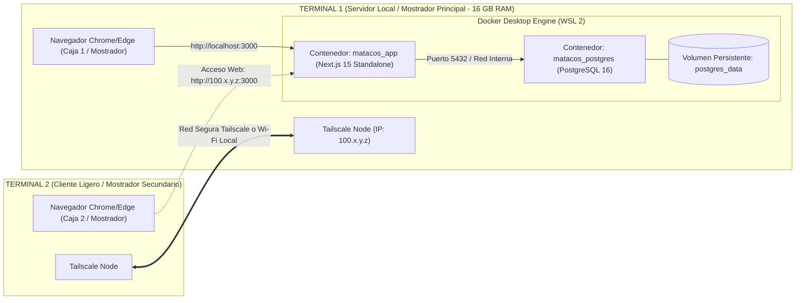

# Guía de Despliegue Multi-Terminal con Docker (Método Pendrive / 100% Offline)
## Matacos Deportes — Saavedra 241, Formosa Capital
**Incremento 1:** Gestión Integral de Stock, Catálogo y Variantes  
**Institución:** Universidad de la Cuenca del Plata — Práctica Profesional Supervisada I (PPS I)  
**Entorno de Hardware:** Notebooks de Mostrador con 16 GB de RAM — Windows 11 / WSL 2  
**Medio de Distribución:** Pendrive USB `E:\` (RICKY)  

---

## 1. Justificación y Arquitectura de la Solución

Al contar las notebooks de mostrador con **16 GB de RAM**, la contenerización con Docker mediante el **Método Pendrive** es la estrategia más segura, confiable e inmune a problemas de internet en Saavedra 241:

1. **Protección Total del Código Fuente (Propiedad Intelectual):**  
   No se clona el repositorio de Git ni se guardan archivos `.ts`, `.tsx` o código de backend en la notebook del mostrador. En la máquina del local solo residen la imagen compilada y los archivos de orquestación (`docker-compose.yml` y `.env`).
2. **Cero Nubes, Tokens ni Cuentas Externas:**  
   No dependes de registros remotos (Docker Hub / GitHub Packages) ni de tener buena conexión a internet en el comercio para descargar gigabytes. Todo el software viaja empaquetado y listo para instalar en el pendrive.
3. **Cero Dependencias en Windows:**  
   No se instala Git, Node.js ni PNPM en la notebook del local. El sistema operativo queda limpio y sin conflictos de versiones.

### Diagrama de Arquitectura en Red



---

## 2. Requisitos de Software Previos

### En Terminal 1 (Servidor Local - 16 GB RAM):
1. **[Docker Desktop para Windows](https://www.docker.com/products/docker-desktop/):** Motor de ejecución para PostgreSQL y la app Next.js.
   * *Asegurarse de marcar la casilla "Use WSL 2 instead of Hyper-V" durante la instalación.*
2. **WSL 2 (Windows Subsystem for Linux 2):**
   * Abrir PowerShell como Administrador y ejecutar:
     ```powershell
     wsl --install
     ```
   * Si ya estaba instalado: `wsl --update`. Requiere reiniciar la PC si es la primera instalación.
3. **[Tailscale para Windows](https://tailscale.com/download/windows):** Enlace de red privada entre ambas terminales.
4. **Google Chrome o Microsoft Edge:** Para operar el mostrador.

### En Terminal 2 (Cliente Ligero):
1. **[Tailscale para Windows](https://tailscale.com/download/windows):** Para comunicarse con la Terminal 1.
2. **Google Chrome o Microsoft Edge:** Único software necesario.
> [!NOTE]
> La **Terminal 2 es 100% cliente web**. No requiere Docker, ni pendrive, ni dependencias de ningún tipo.

---

## 3. Estado de Preparación en Desarrollo (Pendrive `E:\`)

### 3.1. Estado Actual del Proyecto
* En el archivo `next.config.ts` del repositorio ya se encuentra activada la opción obligatoria:
  ```typescript
  output: "standalone", // Genera la versión autónoma para el contenedor Docker
  ```
* En el pendrive **`E:\` (RICKY)** ya se crearon todos los archivos necesarios:
  * `docker-compose.yml`
  * `.env`
  * `instalar.bat`
  * `iniciar-sistema.bat`
  * `detener-sistema.bat`
  * `actualizar-sistema.bat`
  * `iniciar-en-segundo-plano.vbs`
  * `LEEME_INSTRUCCIONES.txt`

### 3.2. Paso de Preparación en Desarrollo (Completado):
En la computadora de desarrollo, se ejecutó:

```powershell
# 1. Construir la imagen local de producción
docker build -t matacos-app:latest .

# 2. Guardar la imagen directamente en el pendrive E:\
docker save -o E:\matacos-app.tar matacos-app:latest
```
* **Estado:** Completado exitosamente. Archivo `E:\matacos-app.tar` generado con un tamaño optimizado de **~181 MB**.
* **Ajustes de robustez resueltos durante el proceso:**
  1. Se incluyó `pnpm-workspace.yaml` en la etapa de dependencias de Docker para que PNPM autorice las compilaciones nativas requeridas (`allowBuilds`).
  2. Se integró `openssl` y `libc6-compat` en el runner Alpine de producción para garantizar compatibilidad con el motor de Prisma.
  3. Se incluyó el CLI global de Prisma (`prisma@6.19.3`) y se copiaron los esquemas y migraciones (`/app/prisma`) en la imagen final, asegurando que `npx prisma migrate deploy` se ejecute de forma **100% offline** sin requerir conexión a internet al inicializar el local.
  4. Se asignaron los permisos de usuario `nextjs:nodejs` a los directorios de subidas y estáticos para evitar errores de permisos.


---

## 4. Análisis Detallado del Script `instalar.bat`

### ¿Para qué sirve?
`instalar.bat` es el **script de aprovisionamiento e inicialización automatizada**. Se encarga de transformar una notebook limpia con Docker en un servidor de mostrador totalmente operativo con un solo clic, sin que el operador deba escribir comandos de Docker o de consola.

### ¿Cuándo debe ejecutarse?
* **SÍ debe ejecutarse:** **Únicamente la PRIMERA VEZ** que se lleva el sistema a la Terminal 1 del local, o en caso de formateo completo de la notebook.
* **NO debe ejecutarse:** En el uso diario (para el día a día se usa `iniciar-sistema.bat` o el lanzador en segundo plano). Tampoco se usa para actualizaciones (para eso se usa `actualizar-sistema.bat`).

### Explicación Línea por Línea del Código

```batch
@echo off
title Matacos Deportes - Instalador Inicial desde Pendrive
color 0B

echo =======================================================================
echo     MATACOS DEPORTES - INSTALACION INICIAL EN MOSTRADOR
echo =======================================================================
echo.

:: Define la ruta fija de instalación en el disco C: de la notebook
set DESTINO=C:\Matacos-POS
:: Captura automáticamente la letra del pendrive desde donde se ejecuta el script (ej: E:\)
set ORIGEN=%~dp0

:: PASO 1: Creación del directorio de trabajo en la máquina local
echo [1/4] Creando carpeta de trabajo en %DESTINO%...
if not exist "%DESTINO%" mkdir "%DESTINO%"

:: PASO 2: Copia de archivos de configuración indispensables
echo [2/4] Copiando archivos de configuracion y scripts al equipo...
copy /y "%ORIGEN%docker-compose.yml" "%DESTINO%\" >nul
copy /y "%ORIGEN%.env" "%DESTINO%\" >nul
copy /y "%ORIGEN%iniciar-sistema.bat" "%DESTINO%\" >nul
copy /y "%ORIGEN%detener-sistema.bat" "%DESTINO%\" >nul
copy /y "%ORIGEN%iniciar-en-segundo-plano.vbs" "%DESTINO%\" >nul
echo       Archivos copiados con exito.

:: PASO 3: Importación de la imagen Docker desde el pendrive
echo.
echo [3/4] Cargando imagen Docker (matacos-app.tar) al sistema...
if not exist "%ORIGEN%matacos-app.tar" (
    echo.
    echo [ADVERTENCIA] No se encontro matacos-app.tar en el pendrive.
    echo Asegurese de haber copiado matacos-app.tar a la raiz del pendrive.
    echo.
    pause
    exit /b 1
)
:: 'docker load' descomprime e inyecta la imagen precompilada en el motor local de Docker
echo       Importando capas de la aplicacion (esto puede demorar unos minutos)...
docker load -i "%ORIGEN%matacos-app.tar"

:: PASO 4: Puesta en marcha de los contenedores
echo.
echo [4/4] Iniciando contenedores por primera vez...
cd /d "%DESTINO%"
:: Levanta PostgreSQL 16 y matacos-app en segundo plano (-d)
docker compose up -d

echo.
echo Esperando inicializacion de la base de datos...
:: Da un margen de 8 segundos para que PostgreSQL complete su arranque interno
timeout /t 8 /nobreak >nul

:: PASO 5: Despliegue de estructura de tablas (Prisma Migrations)
echo Aplicando esquema y migraciones de base de datos...
docker compose exec app npx prisma migrate deploy

echo.
echo =======================================================================
echo  INSTALACION FINALIZADA CON EXITO.
echo =======================================================================
pause
```

---

## 5. Configuración de Red con Tailscale: ¿Qué tan difícil es?

### Grado de Dificultad: **Muy Fácil (1 sobre 5)**

Configurar Tailscale es **significativamente más sencillo** que cualquier otra opción de red tradicional:
* ❌ **NO requiere:** Abrir puertos en el módem/router del local.
* ❌ **NO requiere:** Saber configurar NAT, DMZ ni redirección de puertos.
* ❌ **NO requiere:** Contratar una IP pública fija con el proveedor de internet.
* ❌ **NO requiere:** Configurar certificados SSL complejos ni DNS externos.
* ✔️ **SÍ funciona:** A través de cualquier router Wi-Fi, datos móviles o contingencias, creando una red privada encriptada directa de máquina a máquina mediante WireGuard.

### Guía Paso a Paso para Configurar Tailscale

#### Paso 1: Instalación (en ambas notebooks)
1. Descarga el instalador oficial en ambas máquinas: [tailscale.com/download/windows](https://tailscale.com/download/windows).
2. Ejecuta el instalador `tailscale-setup.exe` y sigue el asistente estándar (Siguiente -> Instalar).
3. Al finalizar, aparecerá el ícono de Tailscale en la barra de tareas (cerca del reloj de Windows).

#### Paso 2: Inicio de Sesión Unificado
> **Regla de oro:** Ambas notebooks deben iniciar sesión con la **misma cuenta**.

1. Haz clic derecho sobre el ícono de Tailscale en la barra de tareas de la **Terminal 1** y pulsa **"Log in..."**.
2. Se abrirá el navegador pidiéndote autenticarte (puedes usar una cuenta de Google, Microsoft o GitHub, por ejemplo la cuenta de desarrollo de Matacos).
3. Tras aceptar los permisos en el navegador, la máquina dirá *"Connected"*.
4. **Repite exactamente el mismo inicio de sesión en la Terminal 2** usando la misma cuenta de correo.

#### Paso 3: Obtener la Dirección IP de la Terminal 1
1. En la **Terminal 1 (Servidor)**, haz clic izquierdo sobre el ícono de Tailscale en la barra de tareas.
2. Verás arriba tu dirección IP de Tailscale (siempre empieza con `100.x.y.z`, por ejemplo `100.85.12.34`).
3. Haz clic sobre ella para copiarla al portapapeles.

#### Paso 4: Probar la Comunicación (Desde Terminal 2)
1. En la **Terminal 2**, presiona la tecla `Windows + R`, escribe `powershell` y pulsa Enter.
2. Ejecuta un ping a la IP obtenida:
   ```powershell
   ping 100.85.12.34
   ```
   *(Reemplaza por la IP real de tu Terminal 1).*
3. Deberás ver 4 respuestas inmediatas con tiempos menores a 5 ms:
   ```text
   Respuesta desde 100.85.12.34: bytes=32 tiempo=2ms TTL=64
   ```

#### Paso 5: Activar Inicio Automático con Windows
Para que el personal del comercio nunca tenga que abrir Tailscale a mano:
1. Clic derecho en el ícono de Tailscale cerca del reloj.
2. Ir a **Preferences** (o Configuración).
3. Verificar que esté tildada la opción **"Run on startup"** (Ejecutar al iniciar Windows).
4. De este modo, en cuanto se prende la notebook, la red privada ya está enlazada silenciosamente.

#### Opcional: Nombre Amigable con MagicDNS
Tailscale incluye la función **MagicDNS** automáticamente. Si tu Terminal 1 se llama en Windows `matacos-host`, desde la Terminal 2 puedes entrar escribiendo directamente:
```text
http://matacos-host:3000
```
sin necesidad de memorizar los números de la IP.

---

## 6. Puesta en Marcha en Terminal 1 (Servidor en Saavedra 241)

1. Conectar el pendrive `E:\` a la **Terminal 1**.
2. Abrir el explorador de archivos, entrar al pendrive y hacer clic derecho sobre `instalar.bat` -> **"Ejecutar como Administrador"**.
3. Aguardar a que el script finalice (crea `C:\Matacos-POS`, importa la imagen y levanta los contenedores).
4. **Crear el acceso directo para el personal:**
   * Abrir la carpeta `C:\Matacos-POS\`.
   * Hacer clic derecho sobre `iniciar-en-segundo-plano.vbs`.
   * Seleccionar **"Mostrar más opciones"** -> **"Enviar a"** -> **"Escritorio (crear acceso directo)"**.
   * En el Escritorio, renombrar el acceso a: `Iniciar Matacos Deportes`.
   * *(Opcional)* En Propiedades -> **Cambiar ícono**, asignar el logo de Matacos.

> [!IMPORTANT]
> **Base de Datos Oficial Limpia:** **NO ejecutar semillas de datos (seeds)**. La base de datos debe permanecer con su esquema limpio para realizar la importación masiva oficial del catálogo mediante el archivo Excel (`plantilla_carga_stock_matacos.xlsx`).

---

## 7. Configuración de Terminal 2 (Mostrador 2)

1. Asegurarse de que Tailscale esté conectado en la Terminal 2.
2. Abrir Google Chrome o Microsoft Edge.
3. Ingresar en la barra de direcciones:
   ```text
   http://100.85.12.34:3000
   ```
4. **Instalar como Ventana de Aplicación (Aspecto nativo):**
   * Clic en los 3 puntos superiores `...` del navegador.
   * Seleccionar **"Transmitir, guardar y compartir"** -> **"Crear acceso directo..."** (o **"Instalar esta página como aplicación"**).
   * Marcar la casilla *"Abrir como ventana"*.
   * Nombrarla: `Matacos Deportes - Mostrador 2`.
5. Ahora la Terminal 2 tiene un ícono en el escritorio que abre la app a pantalla limpia, sin barra de direcciones, simulando un sistema de escritorio nativo.

---

## 8. Plan de Contingencia: ¿Qué hacer si se corta Internet en el Local?

Si se corta el proveedor de internet de la calle en Saavedra 241:
1. Las dos notebooks deben estar conectadas al mismo router Wi-Fi o switch del local (aunque el router no tenga internet).
2. En la **Terminal 1**, abrir PowerShell y consultar la IP local con `ipconfig` (ejemplo: `192.168.1.50`).
3. En la **Terminal 2**, ingresar en Chrome usando esa IP local:
   ```text
   http://192.168.1.50:3000
   ```
*El sistema seguirá operando al 100% de velocidad sin depender de internet exterior.*

---

## 9. Rutina de Uso Cotidiano para el Personal de Mostrador

* **Por la mañana (Apertura):**
  1. Prender la Terminal 1 y hacer doble clic en `Iniciar Matacos Deportes`. En 15 segundos se abre la pantalla de cobro.
  2. Prender la Terminal 2 y hacer doble clic en `Matacos Deportes - Mostrador 2`.
* **Por la noche (Cierre):**
  * Pueden hacer doble clic en `detener-sistema.bat` o simplemente suspender o apagar la notebook. Todos los datos de stock, ventas y arqueo residen protegidos en el volumen `postgres_data`.

---

## 10. Actualización Futura de Software (Desde Pendrive)

Cuando desarrolles nuevas funcionalidades en tu computadora de desarrollo:
1. En tu PC:
   ```powershell
   docker build -t matacos-app:latest .
   docker save -o E:\matacos-app.tar matacos-app:latest
   ```
2. Vas al local, conectas el pendrive en la Terminal 1 y haces doble clic en `actualizar-sistema.bat` (que está en el pendrive).
3. El script reemplaza el contenedor con la versión nueva en 30 segundos **sin reiniciar PostgreSQL ni perder ningún registro de stock**.
