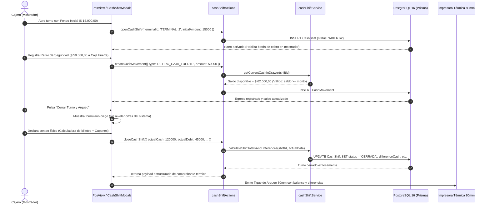

# [RF-11] Apertura, Arqueo Ciego y Cierre de Caja

## 1. Descripción y Objetivo
Permite gestionar de manera digital, segura e inmutable el ciclo de vida de los turnos de caja en el mostrador de **Matacos Deportes** (Saavedra 241, Formosa), reemplazando el tradicional cuaderno manuscrito de caja por un subsistema integrado al Punto de Venta (POS).

El requerimiento resuelve:
1. **Apertura de Turno con Fondo Inicial:** Registro formal de la apertura de caja vinculada a una terminal física (`terminalId`), un cajero responsable y un monto de cambio inicial en efectivo (`initialAmount`) para dar vuelto a los clientes.
2. **Bloqueo Estricto de Ventas sin Turno Abierto:** Impide procesar cobros en el mostrador si la terminal no cuenta con un turno activo en estado `ABIERTA`, blindando la recaudación contra ingresos no custodiados. *(Las preventas de salón en Terminal 1 continúan operando libremente sin requerir caja abierta).*
3. **Movimientos Intermedios de Caja:** Registro en tiempo real de ingresos extraordinarios y egresos (gastos menores de librería/limpieza, fletes o retiros de seguridad a caja fuerte), exigiendo motivo obligatorio, comprobante analógico de respaldo y **validación estricta de saldo de efectivo en cajón** para evitar balances negativos irreales.
4. **Consolidación Multimétodo Automática:** Agrupación atómica de todas las ventas del turno imputadas por Efectivo, Débito, Crédito, Transferencia Bancaria y QR Mercado Pago.
5. **Arqueo Ciego (*Blind Audit*):** Al finalizar la jornada o turno, el cajero declara los montos reales contados físicamente en el cajón (asistido opcionalmente por una calculadora de billetes de denominaciones argentinas: $20.000, $10.000, $2.000, $1.000, etc.) y los cupones de tarjetas/transferencias **sin ver en pantalla las cifras esperadas por el sistema**. Al confirmar, el sistema calcula automáticamente las diferencias (sobrante/faltante) y exige justificación obligatoria ante desvíos mayores a la tolerancia ($ 5.000,00).
6. **Comprobante Térmico de Arqueo (80mm):** Emisión instantánea del ticket de cierre de turno listo para imprimir en la comandera térmica y grapar al sobre físico de recaudación.
7. **Historial y Auditoría:** Visor administrativo para consulta, reimpresión y control de turnos históricos con filtros por fecha, terminal y cajero.

---

## 2. Tecnologías, Herramientas y Librerías

- **Next.js 15 (Server Actions):** [`src/server/actions/cashShiftActions.ts`](file:///C:/Proyectos/matacos-deportes-app/src/server/actions/cashShiftActions.ts) (`openCashShift`, `closeCashShift`, `createCashMovement`, `getActiveCashShift`, `getCashShiftHistory`, `getCashShiftReport`).
- **Servicio de Consolidación Matemática Pura:** [`src/server/services/cashShiftService.ts`](file:///C:/Proyectos/matacos-deportes-app/src/server/services/cashShiftService.ts) con cálculo determinista de efectivo esperado:
  $$\text{expectedCash} = \text{initialAmount} + \sum \text{Efectivo Cobrado} + \sum \text{Ingresos} - \sum \text{Egresos}$$
  $$\text{differenceCash} = \text{actualCash} - \text{expectedCash}$$
- **PostgreSQL 16 & Prisma ORM 6:** Modelos relacionales `CashShift` y `CashMovement`, relaciones foráneas con `User` y `Sale` bajo transacciones ACID (`prisma.$transaction`).
- **Zod (Validación de Esquemas):** [`OpenCashShiftSchema`](file:///C:/Proyectos/matacos-deportes-app/src/schemas/cashShift.ts), [`CreateCashMovementSchema`](file:///C:/Proyectos/matacos-deportes-app/src/schemas/cashShift.ts) y [`CloseCashShiftSchema`](file:///C:/Proyectos/matacos-deportes-app/src/schemas/cashShift.ts).
- **Formateo y Zona Horaria:** Moneda ARS (`$ 45.000,00`) y zona horaria `America/Argentina/Buenos_Aires`.

---

## 3. Archivos Involucrados en el Requerimiento

### Backend & Servicios
- [`src/server/actions/cashShiftActions.ts`](file:///C:/Proyectos/matacos-deportes-app/src/server/actions/cashShiftActions.ts): Server Actions para apertura, cierre, auditoría, consulta y validaciones de caja.
- [`src/server/services/cashShiftService.ts`](file:///C:/Proyectos/matacos-deportes-app/src/server/services/cashShiftService.ts): Motor de consolidación de ventas, arqueo ciego, validación de retiros y generación de ticket térmico.
- [`src/server/actions/posSaleActions.ts`](file:///C:/Proyectos/matacos-deportes-app/src/server/actions/posSaleActions.ts): Validación de turno abierto antes de concretar cobros (`completePendingSale`, `createDirectSale`) y vinculación atómica con `cashShiftId`.

### Esquemas de Validación (Zod)
- [`src/schemas/cashShift.ts`](file:///C:/Proyectos/matacos-deportes-app/src/schemas/cashShift.ts): Contratos para apertura (`OpenCashShiftSchema`), movimientos de caja (`CreateCashMovementSchema`) y arqueo ciego (`CloseCashShiftSchema`).

### Modelos y Persistencia (Prisma / PostgreSQL)
- [`prisma/schema.prisma`](file:///C:/Proyectos/matacos-deportes-app/prisma/schema.prisma):
  - `CashShift`: Atributos `terminalId`, `userId`, `status` (`ABIERTA` | `CERRADA`), `initialAmount`, `expectedCash`, `actualCash`, `differenceCash`, `expectedDebit`, `actualDebit`, `openedAt`, `closedAt`, `notes`.
  - `CashMovement`: Atributos `cashShiftId`, `type` (`INGRESO_EXTRAORDINARIO`, `RETIRO_CAJA_FUERTE`, `GASTO_MENOR`, `AJUSTE_ARQUEO`), `amount`, `reason`, `receiptNumber`, `performedBy`.
  - `Sale`: Campo `cashShiftId` que vincula de manera obligatoria cada venta completada a su turno activo.

### Componentes de Interfaz de Usuario (Frontend)
- [`src/components/dashboard/CashShiftModals.tsx`](file:///C:/Proyectos/matacos-deportes-app/src/components/dashboard/CashShiftModals.tsx):
  - `OpenCashShiftModal`: Apertura de caja con selección rápida de cajero y fondo inicial.
  - `CloseCashShiftModal`: Arqueo ciego con calculadora interactiva de denominaciones de billetes argentinos.
  - `CashMovementModal`: Registro de ingresos y egresos con indicador de saldo actual disponible.
  - `CashShiftReceiptModal`: Visualizador e impresión de ticket térmico de cierre de 80mm.
- [`src/components/dashboard/PosView.tsx`](file:///C:/Proyectos/matacos-deportes-app/src/components/dashboard/PosView.tsx): Encabezado con estado del turno en tiempo real (abierta/cerrada, cajero, duración), alertas visuales y bloqueo reactivo de cobro.
- [`src/components/dashboard/CashShiftHistoryView.tsx`](file:///C:/Proyectos/matacos-deportes-app/src/components/dashboard/CashShiftHistoryView.tsx): Panel administrativo de auditoría histórica de turnos y reimpresión de comprobantes.

### Pruebas Automatizadas (QA)
- [`scripts/test-rf11-cash-shifts.ts`](file:///C:/Proyectos/matacos-deportes-app/scripts/test-rf11-cash-shifts.ts): Suite integral con 38 casos de prueba automatizados que validan apertura, bloqueo de ventas, retiro con saldo, consolidación multimétodo y arqueo ciego.

---

## 4. Flujo de Datos y Control

### Diagrama de Secuencia del Ciclo de Vida de Caja

---

## 5. Pruebas y Validación (QA)

1. **Precondición:** Terminal 2 sin turno de caja abierto (caja cerrada).
2. **Paso 1 (Bloqueo de Cobro):** Intentar completar una venta en el mostrador. Verificar que el sistema muestre la advertencia: *"Debe abrir la caja antes de registrar cobros en mostrador"* y deshabilite la confirmación.
3. **Paso 2 (Apertura):** Abrir caja con un fondo inicial de `$ 10.000,00` a nombre del cajero "Nahir Fornari".
4. **Paso 3 (Validación de Retiro):** Intentar registrar un retiro por `$ 15.000,00`. Verificar que el sistema rechace la operación indicando *"Saldo de efectivo insuficiente en cajón ($ 10.000,00 disponible)"*.
5. **Paso 4 (Venta y Cobro):** Procesar una venta cobrando `$ 20.000,00` en efectivo.
6. **Paso 5 (Arqueo Ciego):** Iniciar el cierre de turno. Declarar `$ 24.000,00` en efectivo en la calculadora de billetes.
7. **Resultado Esperado:** El sistema calcula un faltante de `$ 6.000,00` (Esperado: $ 30.000,00 vs Real: $ 24.000,00), exige nota justificativa por superar el límite de tolerancia de $ 5.000,00, cierra el turno tras asentar la observación e imprime el comprobante térmico de arqueo de 80mm con el balance desglosado.
