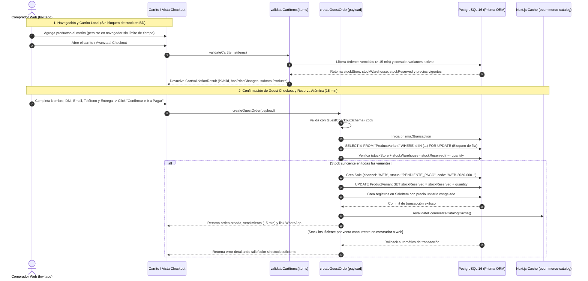
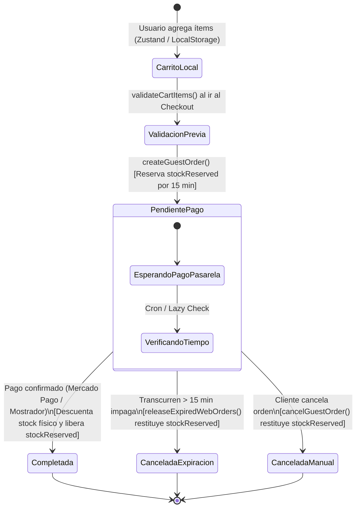

# [RF-15] Carrito de Compras, Guest Checkout (Compra como Invitado) y Reserva Atómica de Stock

**Proyecto:** Sistema Integral de Gestión, POS Offline y E-commerce — Matacos Deportes  
**Cliente:** Matacos Deportes (Saavedra 241, Formosa Capital, Argentina)  
**Institución:** Universidad de la Cuenca del Plata (Sede Formosa) — Práctica Profesional Supervisada I (PPS I)  
**Estado:** **Implementado y Verificado** (22/22 tests pasando)  
**Rama:** `feature/be-rf15-guest-checkout`  

---

## 1. Descripción y Objetivos del Requerimiento

El requerimiento **RF-15** implementa la capa de orquestación transaccional para el carrito de compras y el proceso de **Compra como Invitado (*Guest Checkout*)** de la tienda online de Matacos Deportes, sin exigir creación obligatoria de cuenta ni contraseña previa.

### Objetivos Cumplidos
1. **Separación Estricta entre Carrito Persistente y Orden con Reserva:**
   - **Carrito en Cliente (Duración Ilimitada):** Mientras el comprador navega y agrega productos a su carrito, los ítems permanecen en su navegador (`Zustand` / `localStorage`) sin vencer ni bloquear inventario físico en PostgreSQL (evitando el acaparamiento o bloqueo artificial de stock).
   - **Validación en Vivo (`validateCartItems`):** Al abrir el carrito o iniciar el checkout, el servidor contrasta en tiempo real la existencia de cada variante, los precios vigentes en base de datos y la disponibilidad neta actual.
   - **Reserva al Confirmar Pedido (`createGuestOrder`):** Recién cuando el cliente completa sus datos de contacto/envío y confirma la orden para pasar al pago, se genera la venta en estado `PENDIENTE_PAGO` y se bloquea temporalmente el stock (`stockReserved`).
2. **Esquema Zod de Guest Checkout (`GuestCheckoutSchema`):** Validación estricta de Nombre y Apellido, DNI/CUIT, Correo Electrónico, Teléfono, Modalidad de Entrega (`RETIRO_LOCAL` gratis en Saavedra 241, `CADETERIA_FORMOSA` o `CORREO_ARGENTINO`), exigiendo dirección postal únicamente cuando corresponde a envío a domicilio.
3. **Transacción Atómica con Bloqueo Pesimista (`SELECT ... FOR UPDATE`):** Prevención absoluta de sobreventas concurrentes entre el mostrador físico de Saavedra 241 y la tienda online (**Mitigación Riesgo R-01**).
4. **Numeración Correlativa Oficial Web (`WEB-2026-XXXX`):** Generación automática de código único de seguimiento para órdenes del canal `"WEB"`.
5. **Congelamiento Contable en `SaleItem`:** Registro inmutable del precio unitario vigente al momento de la compra (`originalPrice`, `unitPrice`, `price`) y subtotales calculados en servidor.
6. **Expiración y Liberación Automática tras 15 Minutos (`releaseExpiredWebOrders`):** Si una orden `PENDIENTE_PAGO` supera los **15 minutos** sin confirmación de pago en la pasarela, pasa automáticamente a `CANCELADA` y restituye las unidades reservadas (`stockReserved`) al inventario disponible.

---

## 2. Diagramas de Arquitectura y Flujos

### Diagrama 1: Secuencia de Validación de Carrito, Guest Checkout y Bloqueo Atómico (Mermaid)



---

### Diagrama 2: Ciclo de Vida de la Orden Web y Reserva de Stock (`stockReserved`)



---

## 3. Mitigación de Riesgos del Proyecto (Informe Mensual Mes 3)

| ID Riesgo | Riesgo Identificado | Medida de Mitigación Implementada en RF-15 |
| :---: | :--- | :--- |
| **R-01** | **Sobreventas concurrentes y quiebre de stock dual (Mostrador Saavedra 241 vs. Web)** | 1. Bloqueo pesimista de fila (`SELECT ... FOR UPDATE`) dentro de `prisma.$transaction`.<br/>2. Incremento inmediato de `stockReserved` al crear la orden.<br/>3. Expiración automática de reservas impagas a los **15 minutos** (`WEB_ORDER_RESERVATION_MINUTES = 15`).<br/>4. Invalidación instantánea de caché (`revalidateEcommerceCatalogCache`). |
| **R-04** | **Abandono de carritos por fricción en registro y desconfianza en pagos** | 1. Patrón **Guest Checkout** sin registro obligatorio (`customerId = null` en `Sale`).<br/>2. Solicitud de solo 4 datos de contacto esenciales (Nombre, DNI/CUIT, Email, Teléfono).<br/>3. Generación automática de `whatsappContingencyUrl` con el código `WEB-2026-XXXX` precargado para asistencia inmediata con un vendedor del local. |

---

## 4. Especificación de Contratos y Server Actions

### 4.1. Esquemas de Validación ([`src/schemas/ecommerce.ts`](file:///C:/Proyectos/matacos-deportes-app/src/schemas/ecommerce.ts))
- **`ShippingMethodEnum`:** `"RETIRO_LOCAL"` (Costo `$ 0,00` en Saavedra 241) | `"CADETERIA_FORMOSA"` (`$ 2.500,00`) | `"CORREO_ARGENTINO"` (`$ 7.500,00`).
- **`CartItemSchema`:** Valida `variantId` (UUID), `quantity` (entero positivo) y `expectedUnitPrice` opcional.
- **`GuestCheckoutSchema`:** Valida datos del comprador, exige `shippingAddress` cuando la modalidad de entrega es envío a domicilio y valida la lista de ítems.

### 4.2. Server Actions ([`src/server/actions/ecommerce/checkoutActions.ts`](file:///C:/Proyectos/matacos-deportes-app/src/server/actions/ecommerce/checkoutActions.ts))
- **`validateCartItems(items: CartItemInput[])`:** Verifica existencia, estado activo del artículo, precios vigentes en PostgreSQL y stock neto disponible por variante.
- **`createGuestOrder(payload: GuestCheckoutInput)`:** Crea la orden `WEB-YYYY-XXXX` en estado `PENDIENTE_PAGO`, incrementa `stockReserved` y congela los precios en `SaleItem`.
- **`releaseExpiredWebOrders(expirationMinutes = 15)`:** Cancela órdenes web impagas que hayan superado los 15 minutos y restituye `stockReserved`.
- **`cancelGuestOrder(orderIdOrCode, reason)`:** Cancela manualmente una orden pendiente y libera su reserva.

### 4.3. Endpoint para Tarea Programada / Cron ([`src/app/api/ecommerce/cron/release-expired/route.ts`](file:///C:/Proyectos/matacos-deportes-app/src/app/api/ecommerce/cron/release-expired/route.ts))
- **`GET` / `POST /api/ecommerce/cron/release-expired`:** Permite que un planificador externo o contenedor Docker ejecute periódicamente la limpieza de reservas vencidas.

---

## 5. Pruebas Automatizadas y Verificación de Calidad

Se ejecutó la suite [`scripts/test-rf15-guest-checkout.ts`](file:///C:/Proyectos/matacos-deportes-app/scripts/test-rf15-guest-checkout.ts) contra PostgreSQL 16:

```bash
pnpm tsx scripts/test-rf15-guest-checkout.ts
```

- **Resultados:** `22 pasados, 0 fallidos`.
- **Verificación de Tipos (`pnpm tsc --noEmit`):** `0 errores`.
