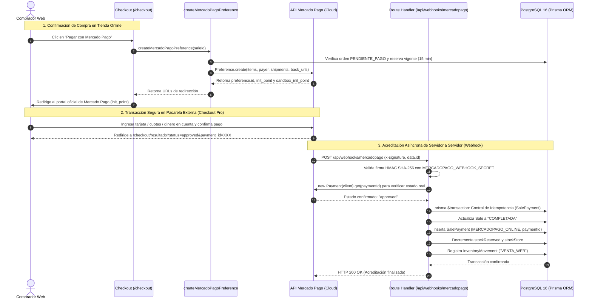
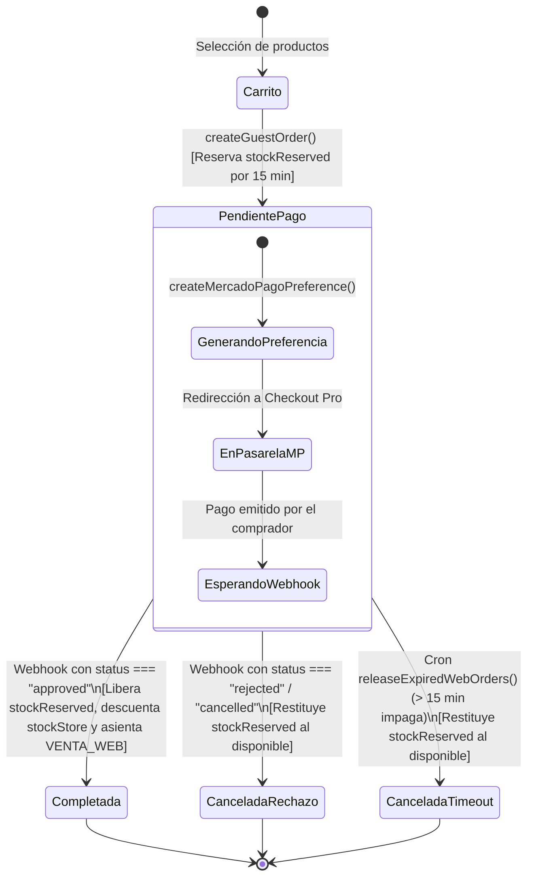

# [RF-16] Pasarela de Pagos Online con Mercado Pago (Checkout Pro), Webhooks de Confirmación y Envíos Parametrizables

**Proyecto:** Sistema Integral de Gestión, POS Offline y E-commerce — Matacos Deportes  
**Cliente:** Matacos Deportes (Saavedra 241, Formosa Capital, Argentina)  
**Institución:** Universidad de la Cuenca del Plata (Sede Formosa) — Práctica Profesional Supervisada I (PPS I)  
**Estado:** **Implementado y Verificado** (26/26 tests pasando)  
**Rama:** `feature/be-rf16-pasarela-mercadopago`  

---

## 1. Descripción y Objetivos del Requerimiento

El requerimiento **RF-16** implementa la infraestructura transaccional de pagos electrónicos para la tienda web de Matacos Deportes mediante la pasarela oficial de **Mercado Pago (Checkout Pro)**, acompañada de un endpoint para **Webhooks asíncronos**, pantallas de compra reactivas y la regla comercial de **Envío Gratis General parametrizable**.

### Objetivos Cumplidos

1. **Pasarela Oficial Mercado Pago Checkout Pro (Cero Riesgo PCI-DSS):**
   - El cliente es redirigido de manera segura a la interfaz oficial de Mercado Pago (`init_point` / `sandbox_init_point`).
   - El comercio no captura, procesa ni almacena números de tarjeta, CVVs ni vencimientos en sus propios servidores o componentes web.
   - Las cuotas sin interés y planes de financiamiento bancario se configuran de forma desatendida directamente en el panel de Mercado Pago del titular.

2. **Server Action `createMercadoPagoPreference`:**
   - Valida la existencia de la orden en PostgreSQL (`Sale` en estado `PENDIENTE_PAGO`) y verifica que la reserva temporal de 15 minutos se encuentre vigente.
   - Construye el payload de preferencia con ítems, variantes, datos del comprador (`payer`), fletes y URLs de retorno absolutas (`back_urls`).

3. **Route Handler de Webhooks (`POST /api/webhooks/mercadopago`):**
   - Recibe notificaciones automáticas de servidor a servidor enviadas por Mercado Pago.
   - Valida la autenticidad del remitente mediante **firmas criptográficas HMAC SHA-256** sobre el encabezado `x-signature` utilizando el `MERCADOPAGO_WEBHOOK_SECRET`.
   - Responde inmediatamente con HTTP 200 para evitar tormentas de reintentos por parte de Mercado Pago.

4. **Procesamiento Atómico e Idempotente (`processMercadoPagoPayment`):**
   - **Control de Idempotencia:** Si una notificación llega duplicada, el sistema verifica `SalePayment.referenceCode == paymentId` y responde con éxito sin duplicar cobros ni descontar stock dos veces.
   - **Pago Aprobado (`approved`):**
     - Actualiza `Sale.status` a `COMPLETADA`.
     - Registra el comprobante en `SalePayment` con el método contable **`MERCADOPAGO_ONLINE`**.
     - **Doble baja de inventario:** Libera el `stockReserved` y decrementa el stock físico real (`stockStore`).
     - Asienta el movimiento de auditoría en `InventoryMovement` con tipo `"VENTA_WEB"`.
   - **Pago Rechazado o Cancelado (`rejected` / `cancelled`):**
     - Transiciona la orden a `CANCELADA`.
     - Restituye las unidades reservadas (`stockReserved`), devolviéndolas inmediatamente al catálogo disponible para otros clientes.
   - Invalida la memoria caché del catálogo público (`revalidateEcommerceCatalogCache`).

5. **Regla de Envío Gratis General y Fletes Dinámicos:**
   - Centralizada en [`src/config/company.ts`](file:///c:/Users/della/matacos-deportes-app/src/config/company.ts) y parametrizable por variables de entorno (`FREE_SHIPPING_THRESHOLD`, `CADETERIA_BASE_FEE`, `CORREO_ARGENTINO_BASE_FEE`).
   - Si el subtotal de artículos en el carrito alcanza o supera el umbral general (por defecto: `$ 100.000,00`), el costo de envío se bonifica automáticamente al 100% (`$ 0,00`).

6. **Pantallas de Compra Funcionales:**
   - **One-Page Checkout ([`/checkout`](file:///c:/Users/della/matacos-deportes-app/src/app/(ecommerce)/checkout/page.tsx)):** Vista rápida estructurada en Bloque de Contacto (Guest Checkout), Modalidad de Entrega (Retiro en Saavedra 241, Cadetería Formosa, Correo Argentino), Selector de Pago y Resumen de Totales.
   - **Página de Resultado Post-Pago ([`/checkout/resultado`](file:///c:/Users/della/matacos-deportes-app/src/app/(ecommerce)/checkout/resultado/page.tsx)):** Procesa los parámetros de retorno de la pasarela y muestra el estado final de la compra (Aprobado, Pendiente o Rechazado).

---

## 2. Diagramas de Arquitectura y Flujos

### Diagrama 1: Flujo de Checkout Pro, Redirección y Acreditación por Webhook (Mermaid)



---

### Diagrama 2: Máquina de Estados del Pedido y Stock Físico vs. Reservado



---

## 3. Mitigación de Riesgos del Proyecto (Informe Mensual Mes 3)

| ID Riesgo | Riesgo Identificado | Medida de Mitigación Implementada en RF-16 |
| :---: | :--- | :--- |
| **R-01** | **Sobreventas concurrentes entre Salón Saavedra 241 y Tienda Web** | 1. El stock se mantiene protegido bajo `stockReserved` durante los 15 minutos de la pasarela.<br/>2. La acreditación por webhook descuenta `stockStore` de forma atómica bajo `prisma.$transaction`.<br/>3. Si el pago es rechazado, las unidades regresan automáticamente al stock disponible. |
| **R-04** | **Abandono de carrito por desconfianza o rechazo de tarjeta** | 1. Integración con Checkout Pro reconocido por el público argentino.<br/>2. Pantalla `/checkout/resultado` que explica el motivo de rechazo y permite reintentar sin perder los datos del carrito.<br/>3. Posibilidad de optar por transferencia bancaria o efectivo en local como alternativas. |
| **R-05** | **Inconsistencias contables en arqueos de caja y liquidaciones** | 1. Creación del valor de enum **`MERCADOPAGO_ONLINE`** en `PaymentMethod`.<br/>2. Segregación contable estricta entre los cobros online de la tienda web y los cobros físicos por mostrador (`QR_MERCADOPAGO`). |

---

## 4. Estructura de Componentes y Código Desarrollado

### 4.1. Base de Datos y Modelos ([`prisma/schema.prisma`](file:///c:/Users/della/matacos-deportes-app/prisma/schema.prisma))
- **`PaymentMethod.MERCADOPAGO_ONLINE`:** Identificador exclusivo para los pagos acreditados a través de la pasarela web.

### 4.2. Cliente SDK y Helpers de Seguridad ([`src/lib/mercadopago.ts`](file:///c:/Users/della/matacos-deportes-app/src/lib/mercadopago.ts))
- **`mpClient`:** Instancia singleton configurada de `MercadoPagoConfig`.
- **`verifyWebhookSignature(...)`:** Validador HMAC SHA-256 utilizando `WebhookSignatureValidator` del SDK oficial para proteger el endpoint contra ataques de spoofing.
- **`getAppBaseUrl()`:** Resolución dinámica de la URL base para componer retornos y webhooks absolutos.

### 4.3. Configuración Comercial y Fletes Dinámicos ([`src/config/company.ts`](file:///c:/Users/della/matacos-deportes-app/src/config/company.ts))
- **`getShippingConfig()`:** Lectura de umbral de envío gratis y tarifas de flete base desde variables de entorno.
- **`calculateShippingFee(method, subtotal)`:** Función pura que computa el costo final y aplica la bonificación al 100% si `subtotal >= threshold`.

### 4.4. Server Actions de Pasarela ([`src/server/actions/ecommerce/mercadopagoActions.ts`](file:///c:/Users/della/matacos-deportes-app/src/server/actions/ecommerce/mercadopagoActions.ts))
- **`createMercadoPagoPreference(orderIdOrCode)`:** Generación de la preferencia oficial con ítems, flete, comprador y expiración de 15 minutos.
- **`processMercadoPagoPayment(paymentId)`:** Procesador transaccional con control de idempotencia, doble decremento de stock y auditoría en `InventoryMovement`.

### 4.5. Endpoint de Notificaciones Webhook ([`src/app/api/webhooks/mercadopago/route.ts`](file:///c:/Users/della/matacos-deportes-app/src/app/api/webhooks/mercadopago/route.ts))
- **`POST /api/webhooks/mercadopago`:** Route Handler Next.js 15 que valida firma, filtra eventos `payment` y dispara la acreditación.

### 4.6. Interfaz de Usuario
- **[`src/app/(ecommerce)/checkout/page.tsx`](file:///c:/Users/della/matacos-deportes-app/src/app/(ecommerce)/checkout/page.tsx)** y **[`CheckoutClient.tsx`](file:///c:/Users/della/matacos-deportes-app/src/app/(ecommerce)/checkout/CheckoutClient.tsx):** One-Page Checkout reactivo con precarga de datos y cálculo dinámico de envíos.
- **[`src/app/(ecommerce)/checkout/resultado/page.tsx`](file:///c:/Users/della/matacos-deportes-app/src/app/(ecommerce)/checkout/resultado/page.tsx):** Pantalla unificada post-pago con vouchers de éxito, instrucciones diferidas y reintentos.

---

## 5. Configuración de Entornos y Servidor MCP Oficial

### Variables de Entorno Requeridas (`.env`)
```env
# URL base de la aplicación web
NEXT_PUBLIC_APP_URL=http://localhost:3000

# Credenciales de Mercado Pago (Sandbox en desarrollo, Producción en despliegue)
MERCADOPAGO_ACCESS_TOKEN=APP_USR-6382986052956974-102809-e4d81b4b3189b2c7d3dc9bb188008b3d-3800441556
MERCADOPAGO_PUBLIC_KEY=APP_USR-1aecc40e-49e1-476a-af54-47cce78f24d5
MERCADOPAGO_WEBHOOK_SECRET=your_webhook_secret_here

# Fletes y Tarifas de Envío Dinámicas
FREE_SHIPPING_THRESHOLD=100000
CADETERIA_BASE_FEE=2500
CORREO_ARGENTINO_BASE_FEE=7500
```

### Servidor Oficial Mercado Pago MCP (Model Context Protocol)
El entorno de desarrollo cuenta con el servidor MCP oficial conectado y autenticado (`~/.gemini/config/mcp_config.json` y comando `agy mcp`):
- Endpoint: `https://mcp.mercadopago.com/mcp`
- Herramientas disponibles: `create_test_user`, `add_money_test_user`, `quality_checklist`, `save_webhook`, `search_documentation`.

---

## 6. Pruebas Automatizadas y Verificación de Calidad

Se diseñó y ejecutó la suite de pruebas unitarias y de integración end-to-end en [`scripts/test-rf16-mercadopago-checkout.ts`](file:///c:/Users/della/matacos-deportes-app/scripts/test-rf16-mercadopago-checkout.ts):

```bash
pnpm run test:rf16
```

### Resultados de Ejecución
```text
================================================================================
🧪 TEST SUITE: RF-16 PASARELA MERCADO PAGO CHECKOUT PRO Y WEBHOOKS ATÓMICOS
================================================================================

📦 Variante para pruebas: Crocband (Talle 10/12 (42) - Blanco/marino)
   Stock Salón: 24 | Stock Reservado: 0

🔹 1. Generación de Preferencia Checkout Pro (Server Action)
  ✅ [PASS] Creación de Orden previa para pasarela
  ✅ [PASS] Llamada exitosa a createMercadoPagoPreference
  ✅ [PASS] Preferencia generada con ID: 3800441556-d2d4cd72-6f6a-45b5-b5d5-1de67f34d8cf
  ✅ [PASS] URL de redirección Checkout Pro generada (init_point)
  ✅ [PASS] URL Sandbox Checkout Pro generada (sandbox_init_point)

🔹 2. Validación de Orden Inválida en createMercadoPagoPreference
  ✅ [PASS] Rechazo adecuado de orden inexistente

🔹 3. Validación de Firmas HMAC en verifyWebhookSignature
  ✅ [PASS] Validación exitosa de firma legítima con secreto y timestamp
  ✅ [PASS] Rechazo estricto de firma manipulada

🔹 4. Procesamiento Atómico de Pago Aprobado (approved)
  ✅ [PASS] processMercadoPagoPayment ejecutado con éxito
  ✅ [PASS] Estado devuelto es 'approved'
  ✅ [PASS] Venta transicionó a COMPLETADA
  ✅ [PASS] Registro de pago insertado en SalePayment
  ✅ [PASS] Método de pago registrado como MERCADOPAGO_ONLINE
  ✅ [PASS] Código de referencia de MP almacenado correctamente
  ✅ [PASS] stockReserved decrementado correctamente (0)
  ✅ [PASS] stockStore físico decrementado correctamente (23)
  ✅ [PASS] Movimiento de inventario auditado en InventoryMovement con tipo VENTA_WEB

🔹 5. Control de Idempotencia (Notificaciones Duplicadas)
  ✅ [PASS] Llamada duplicada respondida con éxito (HTTP 200)
  ✅ [PASS] Detector de idempotencia activado (alreadyProcessed: true)
  ✅ [PASS] No se crearon pagos duplicados en la base de datos
  ✅ [PASS] El stock físico NO se descontó una segunda vez

🔹 6. Procesamiento de Pago Rechazado (rejected) y Restitución de Stock
  ✅ [PASS] Pago rechazado procesado con éxito
  ✅ [PASS] Estado informado como rejected
  ✅ [PASS] La venta transicionó a CANCELADA
  ✅ [PASS] stockReserved fue restituido inmediatamente al stock disponible
  ✅ [PASS] El stock físico permanece intacto tras el rechazo

================================================================================
📊 RESULTADOS RF-16: 26 Pasados | 0 Fallidos (100% Exitoso)
================================================================================
```

* **Chequeo de Tipos TypeScript (`pnpm tsc --noEmit`):** 0 errores.
* **Integración al Runner Maestro:** Registrado en `scripts/run-all-backend-tests.ts`.
