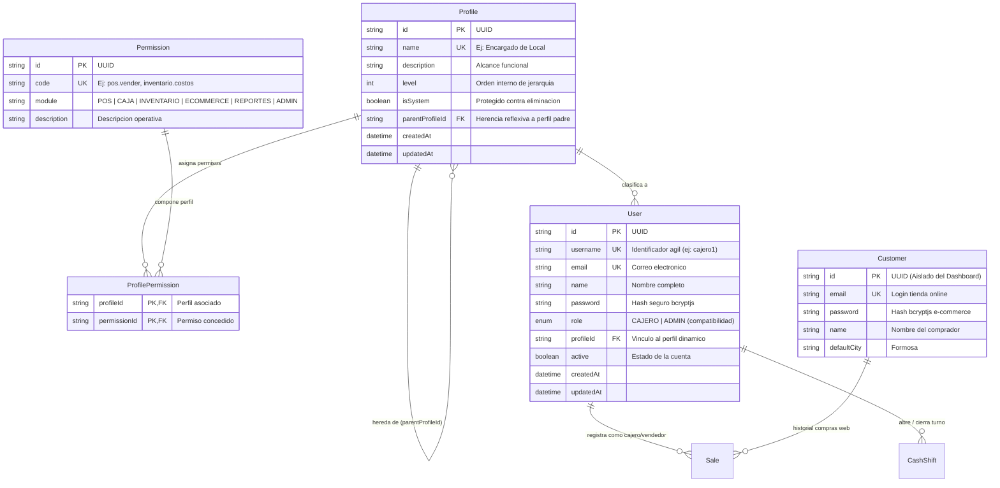
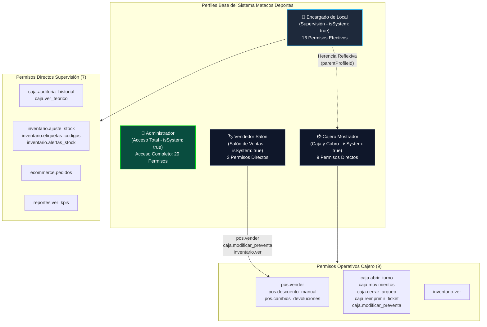
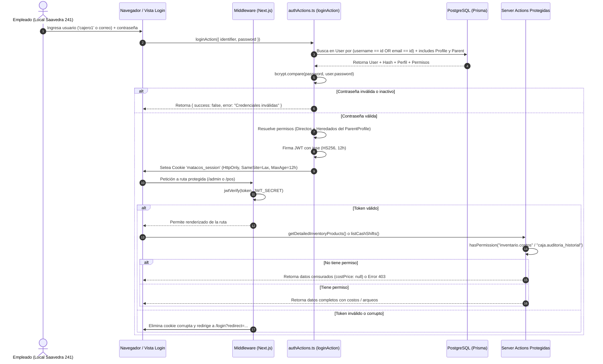

# [RF-23] Autenticación, Identificador Dual, Hash Criptográfico y Control de Acceso por Roles (RBAC Dinámico)

**Proyecto:** Sistema Integral de Gestión, POS Offline y E-commerce — Matacos Deportes  
**Cliente:** Matacos Deportes (Saavedra 241, Formosa Capital, Argentina)  
**Institución:** Universidad de la Cuenca del Plata (Sede Formosa) — Práctica Profesional Supervisada I (PPS I)  
**Estado:** **Implementado y Verificado** (14/14 tests pasando)  
**Rama:** `feature/be-rf23-control-acceso-roles`  

---

## 1. Descripción y Objetivos del Requerimiento

El requerimiento **RF-23** sustituye el esquema preliminar de roles estáticos en código (`enum Role`) por una arquitectura integral de **Seguridad, Autenticación Flexible y Control de Acceso Basado en Perfiles Dinámicos y Permisos Atómicos (RBAC)** con soporte de herencia jerárquica reflexiva.

### Objetivos Cumplidos
1. **Identificador Dual en Mostrador:** Permite al personal del local Saavedra 241 iniciar sesión rápidamente mediante su **nombre de usuario corto** (ej: `admin`, `cajero1`, `mostrador`) o su correo electrónico corporativo, reduciendo la fricción y tiempos de espera en mostrador.
2. **Criptografía de Contraseñas:** Almacenamiento irreversible de claves mediante **`bcryptjs`** (10 salt rounds), protegiendo la base de datos contra filtraciones o ataques de fuerza bruta.
3. **Catálogo Maestro de 29 Permisos Atómicos:** Unidades técnicas mínimas de autorización divididas en 6 módulos (`POS`, `CAJA`, `INVENTARIO`, `ECOMMERCE`, `REPORTES`, `ADMIN`).
4. **Perfiles Dinámicos y Herencia Jerárquica:** El administrador puede crear perfiles personalizados y configurar casillas de verificación. Se implementó una relación reflexiva (`parentProfileId`) para que roles supervisores (ej. *Encargado de Local*) hereden automáticamente las capacidades del rol operativo (*Cajero Mostrador*).
5. **Sesiones Seguras de 12 Horas:** Sesiones encapsuladas en cookies `HttpOnly`, `SameSite=Lax` y tokens JWT firmados con **`jose`** (`HS256`), con una duración de 12 horas ajustada a la jornada comercial completa en Formosa.
6. **Middleware de Protección de Rutas:** Interceptación estricta de `/admin/*`, `/pos/*` y la raíz `/`, con auto-limpieza de cookies corruptas o expiradas.
7. **Doble Guardia a Nivel Servidor (Zero Trust):** Enmascaramiento automático de información sensible (`costPrice: null` para usuarios sin `inventario.costos`) y denegación de auditorías de turnos sin `caja.auditoria_historial`.
8. **Aislamiento Total del E-commerce:** Desacoplamiento lógico y físico entre los empleados del local (`User`) y los compradores de la tienda web (`Customer`), asegurando que ningún cliente web pueda operar rutas de gestión.
9. **Eliminación de Rótulos Informales ("Niveles"):** Sustitución del término de "Nivel" por **distintivos profesionales de alcance operativo** (*Acceso Total*, *Supervisión*, *Caja y Cobro*, *Salón de Ventas*).
10. **Paneles de Control Administrativos y Botón Único de Guardado:** Interfaces dedicadas para la administración de personal y personalización de perfiles con experiencia de guardado clara y unificada.

---

## 2. Diagramas de Arquitectura y Flujos

### Diagrama 1: Modelo Entidad-Relación de Seguridad y RBAC (Mermaid ERD)



---

### Diagrama 2: Jerarquía Reflexiva de Perfiles y Herencia de Permisos



---

### Diagrama 3: Flujo de Autenticación, Middleware y Validación de Sesión



---

## 3. Catálogo Maestro de los 29 Permisos Atómicos

Los permisos se encuentran gobernados en código fuente e insertados en la base de datos a través de `prisma/seed.ts`, clasificados en 6 módulos funcionales:

| Módulo | Código de Permiso | Descripción Funcional Operativa |
| :--- | :--- | :--- |
| **POS** | `pos.vender` | Crear tickets de mostrador, agregar productos, cobrar y emitir comprobantes. |
| **POS** | `pos.descuento_manual` | Aplicar bonificaciones o descuentos manuales en la línea de cajas. |
| **POS** | `pos.cambios_devoluciones` | Procesar cambios de prenda/talle y devoluciones con saldos a favor. |
| **CAJA** | `caja.abrir_turno` | Abrir turno de terminal registrando el fondo inicial en efectivo. |
| **CAJA** | `caja.movimientos` | Registrar ingresos y egresos de caja chica o retiros de seguridad. |
| **CAJA** | `caja.cerrar_arqueo` | Ejecutar conteo de billetes y cierre de jornada de la terminal. |
| **CAJA** | `caja.auditoria_historial`| Consultar historial consolidado de turnos, arqueos y justificaciones de desvíos. |
| **CAJA** | `caja.ver_teorico` | Visualizar el saldo esperado del sistema antes de cerrar (supervisión de arqueo ciego). |
| **CAJA** | `caja.reimprimir_ticket` | Reimprimir tickets y comprobantes térmicos de 80mm desde el historial. |
| **CAJA** | `caja.modificar_preventa`| Modificar o cancelar preventas pendientes antes de su cobro definitivo en caja. |
| **INVENTARIO** | `inventario.ver` | Consultar catálogo de productos y existencias en Salón y Depósito. |
| **INVENTARIO** | `inventario.crear_producto` | Dar de alta, editar y desactivar artículos y variantes de talles/colores. |
| **INVENTARIO** | `inventario.precios` | Modificar individualmente el precio de venta al público (PVP). |
| **INVENTARIO** | `inventario.actualizacion_lote` | Actualización masiva de precios por porcentaje, marca o categoría. |
| **INVENTARIO** | `inventario.costos` | Visualizar precio de costo de fábrica (`costPrice`) y márgenes comerciales. |
| **INVENTARIO** | `inventario.ajuste_stock` | Realizar ajustes manuales de existencias, roturas y transferencias salón-depósito. |
| **INVENTARIO** | `inventario.importar_excel` | Carga e importación masiva de catálogo mediante planillas Excel (.xlsx / .csv). |
| **INVENTARIO** | `inventario.maestros` | Administrar tablas maestras de Marcas, Categorías y Disciplinas deportivas. |
| **INVENTARIO** | `inventario.historial_precios`| Consultar auditoría histórica de variaciones de precios y responsables. |
| **INVENTARIO** | `inventario.alertas_stock` | Configurar umbrales de stock crítico en salón y depósito. |
| **INVENTARIO** | `inventario.etiquetas_codigos`| Generación e impresión de etiquetas térmicas con códigos de barra Code128. |
| **ECOMMERCE** | `ecommerce.pedidos` | Gestionar estados de pedidos web entrantes (preparación, empaquetado y despacho). |
| **ECOMMERCE** | `ecommerce.banners` | Administrar banners del carrusel principal hero y vitrinas destacadas. |
| **ECOMMERCE** | `ecommerce.cupones` | Crear y gestionar cupones de descuento y promociones de la tienda online. |
| **ECOMMERCE** | `ecommerce.clientes` | Consultar la cartera de clientes registrados en la tienda online. |
| **REPORTES** | `reportes.ver_kpis` | Consultar facturación total, ticket promedio, gráficos y analíticas de ventas. |
| **REPORTES** | `reportes.exportar` | Exportar reportes contables, arqueos de caja y stock a formatos Excel y PDF. |
| **ADMIN** | `admin.usuarios` | Gestionar altas, bajas, reseteo de contraseñas y asignación de perfiles al personal. |
| **ADMIN** | `admin.perfiles` | Crear perfiles de acceso y configurar casillas de verificación de permisos. |

---

## 4. Matriz de Perfiles Base del Sistema

| Perfil | Alcance Operativo | Herencia (`parentProfileId`) | Permisos Directos | Permisos Heredados | Total Permisos Efectivos |
| :--- | :--- | :---: | :---: | :---: | :---: |
| **Administrador** | **Acceso Total** | Ninguno (`isSystem: true`) | 29 | - | **29 (Pase Total)** |
| **Encargado de Local** | **Supervisión** | *Cajero Mostrador* (`isSystem: true`) | 7 de supervisión | 9 de Cajero | **16 Permisos** |
| **Cajero Mostrador** | **Caja y Cobro** | Ninguno (`isSystem: true`) | 9 de mostrador y caja | - | **9 Permisos** |
| **Vendedor Salón** | **Salón de Ventas** | Ninguno (`isSystem: true`) | 3 de salón y preventa | - | **3 Permisos** |

---

## 5. Credenciales Base para el Equipo de Desarrollo

Estas cuentas se encuentran inicializadas en la base de datos PostgreSQL mediante `pnpm prisma db seed`:

| Usuario (`username`) | Correo Alternativo (`email`) | Contraseña | Perfil Asignado | Alcance Principal |
| :--- | :--- | :--- | :--- | :--- |
| **`admin`** | `admin@matacosdeportes.com.ar` | `MatacosAdmin2026!` | Administrador General | Gobierno total del sistema y costos |
| **`encargado`** | `encargado@matacosdeportes.com.ar` | `Encargado241!` | Encargado de Local | Supervisión, arqueo ciego y stock |
| **`cajero1`** | `cajero.1@matacos.local` | `Caja241Saavedra!` | Cajero Mostrador | Apertura, cobros y cierre de caja |
| **`mostrador`** | `cajero.mostrador@matacos.local` | `Caja241Saavedra!` | Cajero Mostrador | Terminal de cobro secundaria |
| **`vendedor`** | `vendedor@matacosdeportes.com.ar` | `Vendedor241!` | Vendedor Salón | Catálogo de salón y preventas |

---

## 6. Módulos de Gestión Administrativa (Frontend y Backend)

### A. Gestión de Personal (`/admin/usuarios` / `UsersManagementView.tsx`)
* **Listado del Personal:** Tabla con nombre completo, usuario de mostrador, correo, perfil asignado y estado (Activo / Suspendido).
* **Modal de Alta Asistido:** Formulario Zod para registrar nuevos empleados validando nombre, usuario (sin espacios, mín. 3 caracteres), correo único y contraseña cifrada con `bcryptjs`.
* **Suspensión / Reactivación:** Botón directo para alternar el acceso del personal. Protege al Administrador General activo contra auto-desactivación accidental.
* **Restablecimiento de Contraseñas:** Modal para fijar una nueva clave a cualquier empleado sin revelar la contraseña anterior.

### B. Gestión de Perfiles y Matriz de Permisos (`/admin/perfiles` / `ProfilesManagementView.tsx`)
* **Creación de Nuevos Perfiles:** Modal accesible con el botón `+ Nuevo` que permite indicar nombre, descripción y perfil base de herencia reflexiva.
* **Eliminación Segura de Perfiles Personalizados:** Botón de papelera para perfiles no nativos (`isSystem: false`), protegido si tienen empleados asignados o perfiles dependientes.
* **Matriz de Casillas de Verificación:** 29 permisos categorizados por módulo con opción de marcado/desmarcado por lote (*"Marcar todos"* / *"Desmarcar módulo"*).
* **Botón Único de Guardado:** Ubicado prominentemente en la cabecera del perfil activo, eliminando duplicidad visual y persistiendo en transacción atómica (`updateProfilePermissionsAction`).
* **Salvaguarda de Acceso:** El perfil `Administrador` conserva inalterables `admin.usuarios` y `admin.perfiles` para prevenir el bloqueo involuntario del panel.

### C. Server Actions Dedicadas (`src/server/actions/userManagementActions.ts`)
* `getUsersListAction`: Lectura de personal con datos de perfil.
* `createUserAction`: Alta de usuario con hash `bcrypt` (10 salt rounds).
* `toggleUserActiveAction`: Modificación de estado activo/inactivo.
* `resetUserPasswordAction`: Cambio forzado de clave cifrada.
* `getProfilesListAction`: Lista de perfiles con conteo de usuarios y permisos directos.
* `getAllPermissionsAction`: Catálogo maestro de los 29 permisos agrupados.
* `createProfileAction`: Alta de perfil personalizado con herencia reflexiva.
* `deleteCustomProfileAction`: Baja de perfil personalizado con validación referencial.
* `updateProfilePermissionsAction`: Persistencia atómica de casillas en `ProfilePermission`.

---

## 7. Verificación Automatizada (Suite de Tests)

Se implementó el script ejecutable [`scripts/test-rf23-rbac.ts`](file:///C:/Users/della/matacos-deportes-app/scripts/test-rf23-rbac.ts) para validar de manera desatendida la seguridad del sistema:

```bash
pnpm tsx scripts/test-rf23-rbac.ts
```

### Casos de Prueba Verificados (14/14 PASS):
1. Búsqueda y autenticación por nombre de usuario (`username`).
2. Búsqueda y autenticación por correo electrónico (`email`).
3. Validación criptográfica de contraseña correcta con `bcryptjs`.
4. Rechazo de contraseñas incorrectas.
5. Existencia de usuarios jerárquicos en base de datos.
6. Asignación directa de permisos de supervisión a Encargado (`caja.ver_teorico`).
7. Herencia reflexiva de permisos operativos a Encargado (`pos.vender` de Cajero Mostrador).
8. Resolución consolidada de permisos efectivos directos + heredados.
9. Bloqueo de visualización de precios de costo de fábrica (`inventario.costos`) a Encargado.
10. Concesión de permisos de turno y cobro a Cajero Mostrador.
11. Ocultamiento del saldo teórico a Cajero Mostrador (`caja.ver_teorico`).
12. Bloqueo de módulos de gobierno (`admin.usuarios`, `admin.perfiles`) a Cajero Mostrador.
13. Generación y sellado criptográfico del token de sesión JWT (`jose`).
14. Descifrado, validación de integridad y expiración del token JWT.
