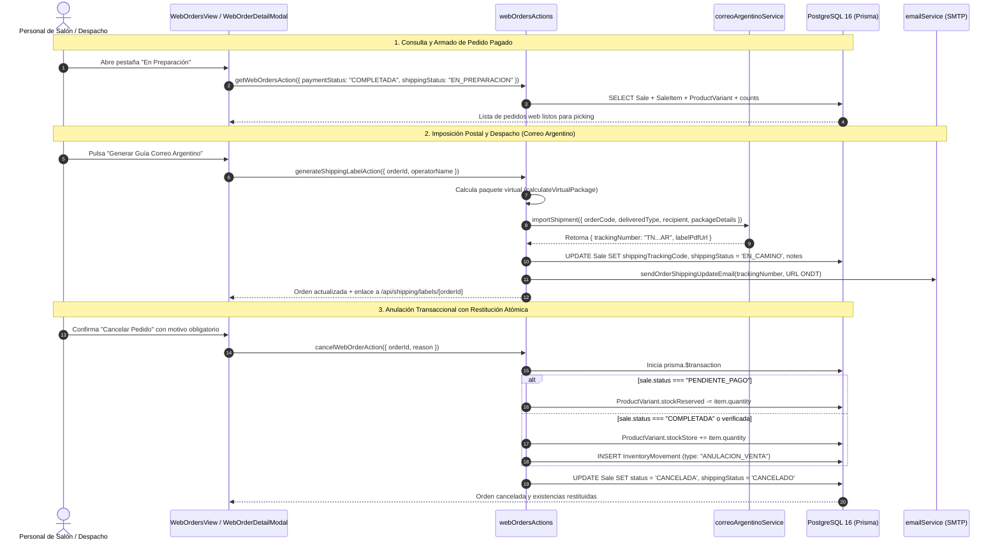

# [RF-25] Gestión de Estados de Pedidos Web, Despacho Logístico y Anulación Atómica

## 1. Descripción y Objetivo
Provee al personal de salón y administración de **Matacos Deportes** (Saavedra 241, Formosa Capital) un centro operativo unificado para gestionar el ciclo de vida completo de los pedidos recibidos a través de la tienda online (`channel: "WEB"`), desde la verificación del pago y el armado físico (*picking*) hasta el despacho por cadetería o Correo Argentino, el seguimiento postal y la eventual anulación con restitución de inventario.

El requerimiento resuelve las necesidades operativas y de trazabilidad relevadas para articular la venta digital con el inventario físico del local:
1. **Arquitectura de Estados Duales (Comercial vs. Logístico):** Separa el estado transaccional de cobro (`SaleStatus`: `PENDIENTE_PAGO`, `PENDIENTE_VERIFICACION`, `COMPLETADA`, `CANCELADA`) del progreso físico de preparación y entrega (`ShippingStatus`: `PENDIENTE`, `EN_PREPARACION`, `LISTO_RETIRO`, `EN_CAMINO`, `ENTREGADO`, `CANCELADO`), impidiendo avanzar el despacho de pedidos cuyo pago no haya sido acreditado o verificado.
2. **Panel Operativo Centralizado (`WebOrdersView`):** Agrupa los pedidos web por pestañas con conteos globales en tiempo real, buscador multicampo (código `WEB-YYYY-XXXX`, cliente, DNI, teléfono, email o guía) y filtros combinados por modalidad logística (`RETIRO_LOCAL`, `CADETERIA_FORMOSA`, `CORREO_ARGENTINO_DOMICILIO`, `CORREO_ARGENTINO_SUCURSAL`).
3. **Picking, Conciliación de Transferencias y Asistencia por WhatsApp:** Permite consultar en detalle las variantes solicitadas (talle, color, SKU y disponibilidad en salón/depósito), aprobar o rechazar comprobantes de transferencia bancaria ([RF-17](file:///C:/Proyectos/matacos-deportes-app/docs/RF-17_Pago_Transferencia_Bancaria_Conciliacion.md)) y abrir conversación directa de WhatsApp con el comprador con contexto del pedido.
4. **Imposición Postal Desacoplada y Rótulo Imprimible:** Una vez embalado el paquete, el operador genera la guía ante Correo Argentino (vía API MiCorreo o motor de simulación inteligente en [`correoArgentinoService.ts`](file:///C:/Proyectos/matacos-deportes-app/src/server/services/correoArgentinoService.ts)), asigna el código de seguimiento (`shippingTrackingCode`), dispara la notificación automática por correo electrónico y habilita la impresión del remito de embalaje (80mm / A4) y del rótulo postal (`100mm x 150mm`).
5. **Anulación Segura con Restitución Atómica:** Si una orden web debe anularse, el servidor distingue automáticamente su estado: si estaba `PENDIENTE_PAGO`, libera el `stockReserved`; si ya estaba `COMPLETADA` o en preparación, reincorpora las unidades a `stockStore` y registra un movimiento auditable `ANULACION_VENTA` en `InventoryMovement`.

---

## 2. Tecnologías, Herramientas y Librerías

- **Next.js 15 (Server Actions & Route Handlers):**
  - Orquestación transaccional en [`src/server/actions/ecommerce/webOrdersActions.ts`](file:///C:/Proyectos/matacos-deportes-app/src/server/actions/ecommerce/webOrdersActions.ts) (`getWebOrdersAction`, `getWebOrderDetailAction`, `updateWebOrderShippingStatusAction`, `generateShippingLabelAction`, `setOrderTrackingInfoAction`, `cancelWebOrderAction`, `verifyWebOrderTransferPaymentAction`).
  - Endpoint HTML imprimible de rótulo postal en [`src/app/api/shipping/labels/[orderId]/route.ts`](file:///C:/Proyectos/matacos-deportes-app/src/app/api/shipping/labels/%5BorderId%5D/route.ts).
- **Servicio Nativo Correo Argentino (MiCorreo API / Mock):** [`src/server/services/correoArgentinoService.ts`](file:///C:/Proyectos/matacos-deportes-app/src/server/services/correoArgentinoService.ts) implementado con `fetch` nativo y cálculo heurístico de paquete virtual (`calculateVirtualPackage`).
- **PostgreSQL 16 & Prisma ORM 6:**
  - Modelo `Sale` con columnas `status`, `shippingStatus`, `shippingMethod`, `shippingTrackingCode`, `shippingBranchCode`, `shippingBranchName`, `notes` y `reservedUntil`.
  - Modelo `InventoryMovement` para auditoría inmutable de restitución (`ANULACION_VENTA`).
- **Zod (Validación Estricta de Contratos):** [`WebOrdersFilterSchema`](file:///C:/Proyectos/matacos-deportes-app/src/schemas/webOrders.ts), [`UpdateWebOrderShippingSchema`](file:///C:/Proyectos/matacos-deportes-app/src/schemas/webOrders.ts), [`SetOrderTrackingInfoSchema`](file:///C:/Proyectos/matacos-deportes-app/src/schemas/shipping.ts) y [`CancelWebOrderSchema`](file:///C:/Proyectos/matacos-deportes-app/src/schemas/shipping.ts).
- **Notificaciones Multicanal:** [`src/lib/emailService.ts`](file:///C:/Proyectos/matacos-deportes-app/src/lib/emailService.ts) (`sendOrderShippingUpdateEmail` con enlace directo a `CORREO_ARGENTINO_TRACKING_URL`) y [`src/lib/whatsapp.ts`](file:///C:/Proyectos/matacos-deportes-app/src/lib/whatsapp.ts) (`formatStaffToCustomerWhatsAppUrl`).
- **Seguridad y RBAC:** Permiso atómico `ecommerce.pedidos` en el catálogo de permisos ([`prisma/seed.ts`](file:///C:/Proyectos/matacos-deportes-app/prisma/seed.ts)) para habilitar la gestión a Administradores y Encargados.
- **Formateo y Zona Horaria:** `formatCurrency(amount)` en ARS y marcas de auditoría en `America/Argentina/Buenos_Aires`.

---

## 3. Archivos Involucrados en el Requerimiento

### Frontend & Panel Operativo
- [`src/components/dashboard/WebOrdersView.tsx`](file:///C:/Proyectos/matacos-deportes-app/src/components/dashboard/WebOrdersView.tsx): Panel principal de órdenes web con pestañas por estado, contadores, buscador y paginación.
- [`src/components/dashboard/WebOrderDetailModal.tsx`](file:///C:/Proyectos/matacos-deportes-app/src/components/dashboard/WebOrderDetailModal.tsx): Modal de detalle completo para picking, verificación de transferencias, transición logística, generación de guía postal, anulación y contacto WhatsApp.
- [`src/components/dashboard/WebOrderPackingSlipModal.tsx`](file:///C:/Proyectos/matacos-deportes-app/src/components/dashboard/WebOrderPackingSlipModal.tsx): Vista imprimible del remito de embalaje (compatible con bobina térmica de 80mm y hoja A4).
- [`src/components/dashboard/DashboardView.tsx`](file:///C:/Proyectos/matacos-deportes-app/src/components/dashboard/DashboardView.tsx) y [`src/components/dashboard/SidebarLeft.tsx`](file:///C:/Proyectos/matacos-deportes-app/src/components/dashboard/SidebarLeft.tsx): Acceso a la pestaña `?tab=ecommerce` (*Órdenes Web — Despacho*).

### Backend, Server Actions, Servicios y APIs
- [`src/server/actions/ecommerce/webOrdersActions.ts`](file:///C:/Proyectos/matacos-deportes-app/src/server/actions/ecommerce/webOrdersActions.ts): Acciones de consulta, actualización logística, imposición en Correo Argentino, carga manual de tracking, conciliación de transferencias y anulación con restitución atómica.
- [`src/server/services/correoArgentinoService.ts`](file:///C:/Proyectos/matacos-deportes-app/src/server/services/correoArgentinoService.ts): Integración con MiCorreo (`/token`, `/rates`, `/agencies`, `/shipping/import`, `/shipping/tracking`) y modo Mock inteligente.
- [`src/app/api/shipping/labels/[orderId]/route.ts`](file:///C:/Proyectos/matacos-deportes-app/src/app/api/shipping/labels/%5BorderId%5D/route.ts): Route Handler `GET` que renderiza el rótulo postal imprimible (`100mm x 150mm`) con remitente Saavedra 241, destinatario y código de guía.
- [`src/lib/emailService.ts`](file:///C:/Proyectos/matacos-deportes-app/src/lib/emailService.ts) y [`src/lib/whatsapp.ts`](file:///C:/Proyectos/matacos-deportes-app/src/lib/whatsapp.ts): Despacho de correos transaccionales y enlaces contextuales de seguimiento.

### Esquemas de Validación, Persistencia y Pruebas (QA)
- [`src/schemas/webOrders.ts`](file:///C:/Proyectos/matacos-deportes-app/src/schemas/webOrders.ts) y [`src/schemas/shipping.ts`](file:///C:/Proyectos/matacos-deportes-app/src/schemas/shipping.ts): Contratos Zod y algoritmo `calculateVirtualPackage`.
- [`prisma/schema.prisma`](file:///C:/Proyectos/matacos-deportes-app/prisma/schema.prisma): Modelos `Sale`, `SaleItem`, `ProductVariant`, `InventoryMovement` y enumerados `SaleStatus` y `ShippingStatus`.
- [`scripts/test-rf19-rf25-shipping-logistics.ts`](file:///C:/Proyectos/matacos-deportes-app/scripts/test-rf19-rf25-shipping-logistics.ts): Suite automatizada integral de logística, generación de guías y restitución atómica (`pnpm test:rf19-rf25`).
- [`scripts/test-ticket03-web-orders-dashboard.ts`](file:///C:/Proyectos/matacos-deportes-app/scripts/test-ticket03-web-orders-dashboard.ts): Suite específica de filtros del panel, cambios de estado, WhatsApp y cancelaciones manuales.

---

## 4. Flujo de Datos y Control

### Diagrama de Secuencia: Despacho Postal y Anulación con Restitución de Stock

### Detalle del Flujo de Control
1. **Guardia de Pago Previa al Despacho:** En [`WebOrderDetailModal.tsx`](file:///C:/Proyectos/matacos-deportes-app/src/components/dashboard/WebOrderDetailModal.tsx), el sistema bloquea la transición a estados logísticos avanzados (`EN_PREPARACION`, `LISTO_RETIRO`, `EN_CAMINO`, `ENTREGADO`) si `order.status !== "COMPLETADA"`, obligando a acreditar o verificar previamente el pago.
2. **Transiciones y Trazabilidad en `notes`:** Cada cambio ejecutado por `updateWebOrderShippingStatusAction`, `generateShippingLabelAction`, `setOrderTrackingInfoAction` o `cancelWebOrderAction` agrega una nota auditada en `Sale.notes` con la acción, guía o motivo y el horario de `America/Argentina/Buenos_Aires`.
3. **Imposición Postal y Notificación:** `generateShippingLabelAction` calcula el volumen y peso consolidado con `calculateVirtualPackage`, registra la imposición en `correoArgentinoService.importShipment()`, persiste `shippingTrackingCode`, cambia `shippingStatus` a `EN_CAMINO` y envía el correo con el enlace de seguimiento oficial de Correo Argentino.
4. **Restitución Diferenciada en Cancelaciones:** `cancelWebOrderAction` evita inconsistencias contables y de stock diferenciando entre reservas impagas (donde solo decrementa `stockReserved`) y órdenes ya descontadas del inventario físico (donde reingresa el stock a `stockStore` dejando registro inmutable `ANULACION_VENTA` en `InventoryMovement`).

---

## 5. Pruebas y Validación (QA)

### Precondiciones
1. Contenedor PostgreSQL activo (`pnpm db:up`), esquema sincronizado (`pnpm prisma db push`) y catálogo con variantes en stock.
2. Existencia de órdenes web en estados `PENDIENTE_PAGO`, `PENDIENTE_VERIFICACION` y `COMPLETADA` (`EN_PREPARACION`).

### Casos de Validación Operativa
1. **Paso 1 (Filtros y Contadores del Panel):** Ingresar a `/admin?tab=ecommerce` y alternar entre las pestañas *Por Verificar*, *En Preparación*, *Listos para Retiro*, *En Camino* y *Canceladas*. Verificar que los contadores coincidan con los registros filtrados y que la búsqueda por código `WEB-2026-XXXX` devuelva la orden exacta.
2. **Paso 2 (Bloqueo de Despacho sin Pago):** Abrir una orden en `PENDIENTE_PAGO` e intentar pasar `shippingStatus` a `EN_PREPARACION`. Verificar que la interfaz impida el cambio hasta que el pago sea `COMPLETADA`.
3. **Paso 3 (Generación de Guía y Rótulo):** Seleccionar una orden pagada con envío por Correo Argentino, ejecutar la generación de guía y abrir `/api/shipping/labels/[orderId]`. Verificar que `shippingTrackingCode` quede guardado, `shippingStatus` pase a `EN_CAMINO` y el rótulo muestre origen Saavedra 241, destino y código de barras.
4. **Paso 4 (Remito de Embalaje y WhatsApp):** Abrir el remito desde `WebOrderPackingSlipModal` y verificar la vista limpia de impresión y el enlace `wa.me` hacia el teléfono del comprador.
5. **Paso 5 (Anulación y Restitución Atómica):** Anular una orden `COMPLETADA` ingresando un motivo válido (`>= 3` caracteres). Verificar que la orden pase a `status: "CANCELADA"`, `shippingStatus: "CANCELADO"`, se incrementen las unidades en `ProductVariant.stockStore` y se genere el registro `ANULACION_VENTA` en `InventoryMovement`.

### Suites Automatizadas Disponibles
- `pnpm test:rf19-rf25` ([`scripts/test-rf19-rf25-shipping-logistics.ts`](file:///C:/Proyectos/matacos-deportes-app/scripts/test-rf19-rf25-shipping-logistics.ts)): Valida heurística de paquete virtual, generación de guías, filtros de `getWebOrdersAction` y restitución atómica al cancelar órdenes pendientes y completadas.
- `pnpm tsx scripts/test-ticket03-web-orders-dashboard.ts` ([`scripts/test-ticket03-web-orders-dashboard.ts`](file:///C:/Proyectos/matacos-deportes-app/scripts/test-ticket03-web-orders-dashboard.ts)): Valida consultas paginadas, transiciones de estado logístico, enlaces WhatsApp y cancelaciones manuales.
