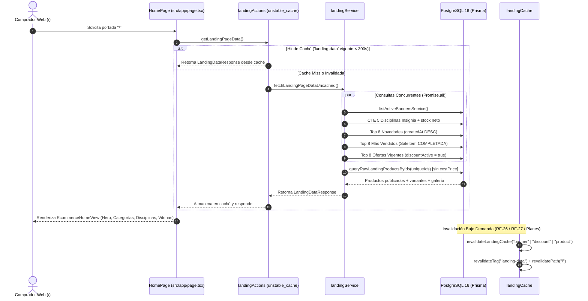

# [RF-28] Landing Page Pública de Alto Rendimiento, Portada Comercial y Caché ISR

## 1. Descripción y Objetivo
Implementa la portada principal pública (`/`) de la tienda online de **Matacos Deportes**, consolidando en una única vista rápida, *mobile-first* y visualmente atractiva toda la propuesta comercial del negocio (banners de campañas, categorías, disciplinas insignia, novedades, más vendidos y ofertas promocionales) sin comprometer el rendimiento en conexiones móviles de Formosa y el país.

El requerimiento resuelve cuatro objetivos técnicos y comerciales clave:
1. **Agregación Concurrente en Servidor (`Promise.all`):** Centraliza en [`fetchLandingPageDataUncached`](file:///C:/Proyectos/matacos-deportes-app/src/server/services/landingService.ts) la obtención paralela de los 5 bloques dinámicos de la portada —banners activos vigentes, 5 disciplinas insignia con conteo real de stock, últimos 8 ingresos (`newArrivals`), top 8 más vendidos según `SaleItem` en ventas `COMPLETADA` (`bestSellers`) y hasta 8 artículos en promoción vigente (`promoProducts`)— hidratando los productos en un único batch SQL.
2. **Exhibición Fidedigna de Stock Neto y Disciplinas Estratégicas:** Garantiza que la portada solo exhiba productos activos (`active: true`, `status: "PUBLISHED"`) con disponibilidad neta positiva `(stockStore + stockWarehouse - stockReserved) > 0`, excluyendo automáticamente artículos agotados o totalmente reservados y presentando las 5 disciplinas estratégicas (*Natación*, *Vóley*, *Crocs / Urbano*, *Gimnasio / Fitness* y *Calzado*) en orden canónico.
3. **Caché Incremental (ISR) e Invalidación Reactiva bajo Demanda:** Combina `export const revalidate = 300` en [`src/app/page.tsx`](file:///C:/Proyectos/matacos-deportes-app/src/app/page.tsx) con `unstable_cache` (etiqueta `landing-data`, TTL de 300 segundos) y una caché de respaldo en memoria, permitiendo tiempos de respuesta inferiores a 150 ms e invalidación instantánea ante cambios en banners ([RF-26](file:///C:/Proyectos/matacos-deportes-app/docs/RF-26_Gestion_Banners_Carrusel_Promocional.md)), descuentos ([RF-27](file:///C:/Proyectos/matacos-deportes-app/docs/RF-27_Descuentos_Promocionales_Liquidaciones.md)) o inventario.
4. **Confidencialidad Comercial (*Zero-Leakage*):** Utiliza la proyección estricta `PUBLIC_LANDING_PRODUCT_SELECT` para asegurar que datos internos como el precio de costo (`costPrice`) jamás sean consultados ni transferidos en la respuesta pública de la portada.

---

## 2. Tecnologías, Herramientas y Librerías

- **Next.js 15 App Router (RSC, ISR & Cache API):**
  - Página raíz SSR/ISR en [`src/app/page.tsx`](file:///C:/Proyectos/matacos-deportes-app/src/app/page.tsx) con `revalidate = 300`.
  - Server Actions [`getLandingPageData`](file:///C:/Proyectos/matacos-deportes-app/src/server/actions/ecommerce/landingActions.ts) y [`revalidateLandingPageData`](file:///C:/Proyectos/matacos-deportes-app/src/server/actions/ecommerce/landingActions.ts) apoyadas en `unstable_cache`, `revalidateTag` y `revalidatePath`.
- **PostgreSQL 16 & Prisma ORM 6:** Consultas SQL nativas parametrizadas (`$queryRaw` con CTE para disciplinas, ranking por `SaleItem` y filtrado temporal de promociones) combinadas con proyección tipada `Prisma.validator<Prisma.ProductSelect>()`.
- **Motor de Caché Desacoplado:** [`src/lib/landingCache.ts`](file:///C:/Proyectos/matacos-deportes-app/src/lib/landingCache.ts) con etiqueta `LANDING_CACHE_TAG = "landing-data"`, TTL `LANDING_CACHE_TTL_SECONDS = 300`, contador monotónico `cacheGeneration` e invalidación cruzada selectiva según origen (`banner`, `discount`, `product`, `manual`).
- **Mappers y Tipado Estricto TypeScript:** [`src/lib/ecommerceProductMapper.ts`](file:///C:/Proyectos/matacos-deportes-app/src/lib/ecommerceProductMapper.ts) (`mapPublicProductToEcommerce`) y contratos en [`src/types/ecommerce.ts`](file:///C:/Proyectos/matacos-deportes-app/src/types/ecommerce.ts) (`LandingDataResponse`, `LandingProductItem`, `FeaturedDisciplineItem`).
- **Formateo Estándar:** `formatCurrency` en Pesos Argentinos (ARS) y evaluación de vigencia promocional (`resolveEffectiveProductPromo`) alineada a la fecha/hora de referencia.

---

## 3. Archivos Involucrados en el Requerimiento

### Frontend y Vistas Públicas
- [`src/app/page.tsx`](file:///C:/Proyectos/matacos-deportes-app/src/app/page.tsx): Entry point raíz (`/`) con ISR de 300s que consume `getLandingPageData()`, desduplica productos por prioridad (promos, más vendidos, novedades) y alimenta la vista pública.
- [`src/components/ecommerce/EcommerceHomeView.tsx`](file:///C:/Proyectos/matacos-deportes-app/src/components/ecommerce/EcommerceHomeView.tsx): Contenedor principal de la portada con filtrado interactivo en cliente por búsqueda y disciplina.
- [`src/components/ecommerce/EcommerceHero.tsx`](file:///C:/Proyectos/matacos-deportes-app/src/components/ecommerce/EcommerceHero.tsx): Carrusel *hero* conectado a los banners vigentes.
- [`src/components/ecommerce/CategoryGrid.tsx`](file:///C:/Proyectos/matacos-deportes-app/src/components/ecommerce/CategoryGrid.tsx) y [`src/components/ecommerce/DisciplineGrid.tsx`](file:///C:/Proyectos/matacos-deportes-app/src/components/ecommerce/DisciplineGrid.tsx): Grillas de acceso rápido por categoría y disciplina deportiva.
- [`src/components/ecommerce/FeaturedProductsSection.tsx`](file:///C:/Proyectos/matacos-deportes-app/src/components/ecommerce/FeaturedProductsSection.tsx) y [`src/components/ecommerce/EcommerceOfferBanner.tsx`](file:///C:/Proyectos/matacos-deportes-app/src/components/ecommerce/EcommerceOfferBanner.tsx): Vitrinas de productos destacados y bloque promocional de ofertas.

### Backend, Servicios y Caché
- [`src/server/actions/ecommerce/landingActions.ts`](file:///C:/Proyectos/matacos-deportes-app/src/server/actions/ecommerce/landingActions.ts): Server Actions públicas de lectura cacheada y revalidación.
- [`src/server/services/landingService.ts`](file:///C:/Proyectos/matacos-deportes-app/src/server/services/landingService.ts): Motor SQL/Prisma de agregación concurrente, cálculo de promociones vigentes (`resolveEffectiveProductPromo`) y construcción de DTOs públicos.
- [`src/lib/landingCache.ts`](file:///C:/Proyectos/matacos-deportes-app/src/lib/landingCache.ts): Gestión de tags de caché, TTL de 300s, fallback en memoria y `invalidateLandingCache`.
- [`src/lib/ecommerceProductMapper.ts`](file:///C:/Proyectos/matacos-deportes-app/src/lib/ecommerceProductMapper.ts): Adaptador entre contratos de backend (`LandingProductItem` / `PublicProductItem`) y tarjetas UI (`EcommerceProduct`).

### Pruebas Automatizadas (QA)
- [`scripts/test-rf28-landing-page.ts`](file:///C:/Proyectos/matacos-deportes-app/scripts/test-rf28-landing-page.ts): Suite de pruebas automatizadas (`pnpm test:rf28`) que verifica SLA `< 150ms`, confidencialidad *Zero-Leakage*, 5 disciplinas insignia, exclusión de stock reservado/ventas canceladas, vigencia de promociones e invalidación automática desde RF-26 y RF-27.

---

## 4. Flujo de Datos y Control

### Diagrama de Secuencia: Carga Cacheada de Portada e Invalidación Reactiva

### Detalle del Flujo de Control
1. **Resolución de Disciplinas Insignia (`fetchFeaturedDisciplinesSection`):** Ejecuta un CTE SQL único que filtra productos publicados y activos con stock neto mayor a cero, devolviendo el conteo exacto y la imagen representativa (de la entidad o de un producto de muestra) para `natacion`, `voley`, `crocs`, `fitness` y `calzado`.
2. **Criterio de Más Vendidos y Promociones:** `fetchBestSellerIds` contabiliza únicamente órdenes con `Sale.status = 'COMPLETADA'`, evitando que ventas canceladas alteren el ranking; `fetchPromoProductIds` filtra vigencia por `discountStartDate` y `discountEndDate`.
3. **Resolución de Precio Efectivo y Redondeo:** `resolveEffectiveProductPromo` calcula al centavo (`Math.round(val * 100) / 100`) el precio final promocional cuando existe `discountPrice` explícito o `discountPercentage` válido, y `mapRawToLandingProductItem` computa el rango `minPrice` / `maxPrice` considerando variantes con precio diferencial.
4. **Invalidación Selectiva:** Cuando se crea/edita/elimina un banner en `bannerService.ts` o se modifica una campaña promocional en `promotionActions.ts`, se dispara `invalidateLandingCache()`, incrementando `cacheGeneration`, limpiando la caché en memoria y revalidando `landing-data` y `/` de inmediato.

---

## 5. Pruebas y Validación (QA)

### Precondiciones
1. Base de datos PostgreSQL activa (`pnpm db:up`) con esquema aplicado y datos maestros sembrados (`pnpm db:seed`, incluyendo las disciplinas insignia).
2. Al menos productos activos publicados con variantes que tengan stock neto disponible y banners vigentes.

### Casos de Validación
1. **Paso 1 (Rendimiento y Caché):** Invocar `fetchLandingPageDataUncached()` y luego dos veces consecutivas `getLandingPageData()`. Verificar que el tiempo de ejecución se mantenga por debajo de `150 ms` y que la etiqueta de caché configurada sea `landing-data` con TTL de `300` segundos.
2. **Paso 2 (Confidencialidad *Zero-Leakage*):** Inspeccionar los objetos devueltos en `newArrivals`, `bestSellers` y `promoProducts` verificando que ninguno exponga la propiedad `costPrice`.
3. **Paso 3 (Reglas de Stock y Ventas):** Crear un producto con 100% de su stock comprometido en `stockReserved` y registrar una orden `CANCELADA` masiva sobre otro artículo. Comprobar que el artículo sin stock neto no aparezca en las vitrinas y que las ventas canceladas no afecten el ranking `bestSellers`.
4. **Paso 4 (Invalidación Automática):** Crear o eliminar un banner mediante `bannerService` o actualizar una promoción y consultar `getLandingPageData()`. Comprobar que `getLandingCacheGeneration()` se incremente y los cambios se reflejen de inmediato sin esperar los 300 segundos del TTL.

### Suite Automatizada Disponible
- `pnpm test:rf28` ([`scripts/test-rf28-landing-page.ts`](file:///C:/Proyectos/matacos-deportes-app/scripts/test-rf28-landing-page.ts)): Ejecuta los 19 casos de verificación automatizados de contrato, latencia, disciplinas, stock neto, promos e invalidación integrada con RF-26.
