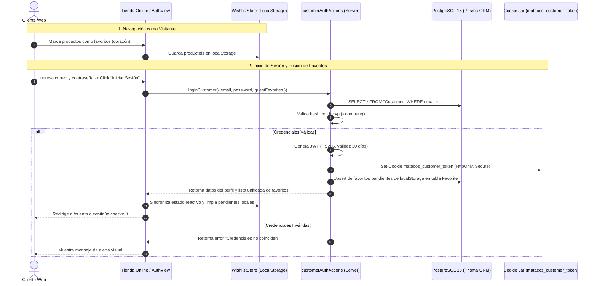
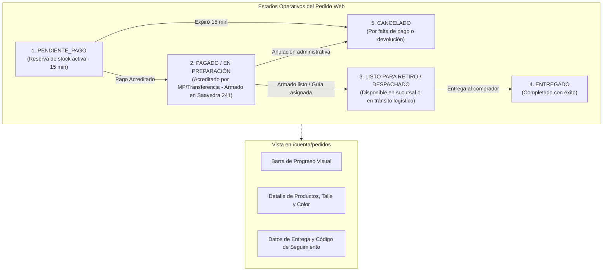

# [RF-29] Portal de Clientes, Autenticación Web, Lista de Favoritos y Seguimiento de Pedidos

**Proyecto:** Sistema Integral de Gestión, POS Offline y E-commerce — Matacos Deportes  
**Cliente:** Matacos Deportes (Saavedra 241, Formosa Capital, Argentina)  
**Institución:** Universidad de la Cuenca del Plata (Sede Formosa) — Práctica Profesional Supervisada I (PPS I)  
**Equipo:** Dellagnolo, Ricardo Agustín; Fornari, Nahir Agustín; Bordón Sbardella, Lourdes Antonella; González, Eugenia Milagros  
**Docente Tutor:** Prof. Dr. Cerquand, Cristian Fernando  
**Estado:** **Especificación de Ingeniería de Software y Diseño de Arquitectura**  
**Rama Base:** `develop`  

---

## 1. Descripción y Objetivos del Requerimiento

El requerimiento **RF-29** consolida la experiencia del cliente final en la tienda online de Matacos Deportes, complementando el canal de compra anónima (*Guest Checkout* — RF-15) con una **plataforma de autogestión y fidelización personalizada («Mi Cuenta»)**.

### Objetivos Principales
1. **Autenticación e Identidad de Clientes (Customer Auth):**
   - Registro de clientes con correo electrónico único, validación de contraseñas seguras mediante hashing unidireccional con `bcryptjs` (salt de 10 rondas), y captura opcional de datos de contacto (nombre, teléfono y DNI).
   - Inicio de sesión con emisión de token de sesión firmado con algoritmo HS256 (`jose`), protegido en cookies `HttpOnly`, `SameSite=Lax` y cifrado independiente (`matacos_customer_token`).
   - **Aislamiento de Privilegios:** Separación absoluta entre la sesión de clientes web y la sesión administrativa/mostrador (`matacos_session`), impidiendo accesos no autorizados a las vistas del panel de control o del punto de venta físico.
2. **Lista de Deseos y Productos Favoritos (Wishlist):**
   - Botón interactivo (icono de corazón) en fichas de producto (`/productos/[id]`), tarjetas de catálogo (`/catalogo`) y grilla de destacados en la portada.
   - Persistencia híbrida: soporte de guardado en navegador (`localStorage`) para usuarios no autenticados, y sincronización automática bidireccional en base de datos PostgreSQL (`model Favorite`) al iniciar sesión.
   - Indicador reactivo en tiempo real con contador en el encabezado (`EcommerceHeader`).
   - Vista de administración de favoritos (`/cuenta/favoritos`) con disponibilidad de stock en tiempo real y acceso directo a compra.
3. **Seguimiento de Pedidos en Tiempo Real (Order Tracking):**
   - Panel de trazabilidad para que el comprador consulte el estado operativo de su compra web (`PENDIENTE_PAGO`, `PAGADO / EN PREPARACIÓN`, `ENVIADO / LISTO PARA RETIRO`, `ENTREGADO`, `CANCELADO`).
   - Consulta de número de guía / código de despacho para envíos por Correo Argentino o cadetería dentro de Formosa Capital.
   - Historial histórico de compras con desglose de comprobantes, variantes adquiridas (talle, color), importes abonados y comprobante digital.
4. **Libreta de Direcciones y Checkout en un Clic:**
   - Almacenamiento de la dirección postal habitual del cliente (calle, numeración, localidad y código postal) para precargar automáticamente el formulario de pago, optimizando las tasas de conversión.

---

## 2. Diagramas de Arquitectura y Secuencia

### Diagrama 1: Flujo de Autenticación, Sincronización de Favoritos y Sesión Independiente



### Diagrama 2: Trazabilidad y Seguimiento del Pedido (Order Tracking Timeline)



---

## 3. Modelo de Datos Relacional (Prisma ORM)

```prisma
// =========================================================================
// ENTIDADES DE CLIENTES Y FAVORITOS (RF-29)
// =========================================================================

model Customer {
  id                String     @id @default(uuid())
  email             String     @unique
  password          String     // Hash generado con bcryptjs (10 salt rounds)
  name              String
  phone             String?
  dni               String?
  defaultAddress    String?    // Domicilio de entrega predeterminado
  defaultCity       String?    @default("Formosa")
  defaultPostalCode String?    @default("3600")
  favorites         Favorite[] // Colección de productos guardados
  sales             Sale[]     // Historial de órdenes de compra
  createdAt         DateTime   @default(now())
  updatedAt         DateTime   @updatedAt

  @@index([email])
}

model Favorite {
  id         String   @id @default(uuid())
  customerId String
  customer   Customer @relation(fields: [customerId], references: [id], onDelete: Cascade)
  productId  String
  product    Product  @relation(fields: [productId], references: [id], onDelete: Cascade)
  createdAt  DateTime @default(now())

  @@unique([customerId, productId]) // Impide duplicados del mismo producto por cliente
  @@index([customerId])
  @@index([productId])
}
```

---

## 4. Contratos de Datos y Esquemas de Validación (Zod)

### Validación de Autenticación de Clientes
```typescript
export const CustomerRegisterSchema = z.object({
  name: z.string().trim().min(3, "El nombre completo debe tener al menos 3 caracteres"),
  email: z.string().trim().email("Debe proporcionar un correo electrónico válido"),
  password: z.string().min(6, "La contraseña debe contener al menos 6 caracteres"),
  phone: z.string().trim().min(6, "El teléfono de contacto debe tener al menos 6 caracteres").optional().nullable(),
  dni: z.string().trim().min(7, "El DNI debe tener al menos 7 dígitos").optional().nullable(),
  defaultAddress: z.string().trim().optional().nullable(),
  defaultCity: z.string().trim().default("Formosa"),
  defaultPostalCode: z.string().trim().default("3600"),
});

export const CustomerLoginSchema = z.object({
  email: z.string().trim().email("Correo electrónico inválido"),
  password: z.string().min(1, "La contraseña es requerida"),
  guestFavorites: z.array(z.string().uuid()).optional(),
});
```

---

## 5. Reglas de Negocio y Criterios de Aceptación (Gherkin)

### Escenario 1: Registro exitoso con sincronización de lista de favoritos previa
* **Dado** que un visitante agregó 2 productos a su lista de favoritos en modo invitado (almacenados en `localStorage`),
* **Cuando** completa el formulario de registro en `/cuenta?mode=register` con datos válidos y envía el formulario,
* **Entonces** el sistema persiste al nuevo cliente con su contraseña cifrada en PostgreSQL,
* **Y** emite una cookie de sesión cifrada `matacos_customer_token`,
* **Y** migra atómicamente los 2 productos a la tabla `Favorite` vinculados a su nuevo identificador de cliente,
* **Y** el contador de favoritos en la cabecera muestra el valor 2.

### Escenario 2: Trazabilidad y visualización de pedidos en curso
* **Dado** que un cliente autenticado completó un pedido web (`WEB-2026-0015`),
* **Cuando** accede a su panel en `/cuenta` y presiona la pestaña «Mis Pedidos»,
* **Entonces** visualiza la tarjeta del pedido con el código correlativo, fecha de emisión, estado actual («PAGADO / EN PREPARACIÓN») y la lista de artículos adquiridos con sus talles y colores,
* **Y** dispone del enlace directo al comprobante de compra.

### Escenario 3: Seguridad de separación de contextos
* **Dado** que un cliente web ha iniciado sesión legítimamente en su cuenta de la tienda,
* **Cuando** intenta ingresar deliberadamente a rutas protegidas del personal como `/pos` o `/admin`,
* **Entonces** el middleware de autenticación comprueba la ausencia del token `matacos_session` (reservado para empleados del local) y deniega el acceso, redirigiendo al login administrativo sin revelar información interna del inventario ni de los arqueos de caja.
