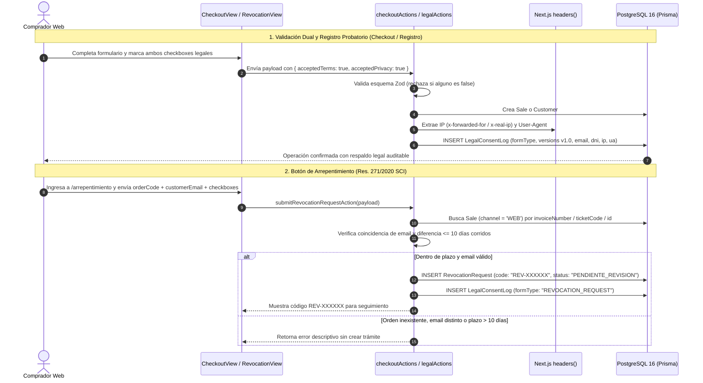

# [RF-30] Cumplimiento Legal Integral, Consentimiento Informado, Cookies y Botón de Arrepentimiento

## 1. Descripción y Objetivo
Dota a la tienda online de **Matacos Deportes** de plena conformidad normativa frente a la legislación argentina vigente —**Ley N° 25.326** de Protección de Datos Personales, **Ley N° 24.240** de Defensa del Consumidor, **Código Civil y Comercial de la Nación (art. 1110)**, **Resolución 271/2020 SCI** (Botón de Arrepentimiento) y disposiciones de **AFIP/ARCA** y **AAIP**— protegiendo tanto los derechos del comprador digital como la seguridad jurídica del comercio.

El requerimiento resuelve cinco pilares legales y operativos:
1. **Registro Probatorio Inmutable de Consentimiento (`LegalConsentLog`):** Almacena en PostgreSQL cada aceptación expresa de Términos y Condiciones y Políticas de Privacidad en formularios críticos (`GUEST_CHECKOUT`, `CUSTOMER_REGISTER`, `REVOCATION_REQUEST`, `TRANSFER_PROOF`), conservando versiones de documentos (`v1.0`), correo, DNI, nombre, referencias a `customerId`/`saleId`, dirección IP de origen (`x-forwarded-for` / `x-real-ip`), `userAgent` y marca temporal.
2. **Doble Checkbox Obligatorio sin Pérdida de Datos (`LegalConsentCheckboxGroup`):** Exige validación estricta en cliente y servidor mediante [`LegalConsentSchema`](file:///C:/Proyectos/matacos-deportes-app/src/schemas/legal.ts) con dos casillas independientes cuyos enlaces se abren en una nueva pestaña (`target="_blank" rel="noopener noreferrer"`) para no interrumpir la carga del checkout ni el registro.
3. **Portal y Botón de Arrepentimiento (`/arrepentimiento`):** Implementa el mecanismo directo exigido por la Res. 271/2020 SCI. Valida la existencia de la orden web (`channel: "WEB"`), la coincidencia de correo electrónico y el plazo legal de **10 días corridos**, generando un código único de trámite (`REV-XXXXXX`) en el modelo `RevocationRequest` y permitiendo consultar su estado en línea.
4. **Páginas Legales Dedicadas y Banner de Cookies con Privacidad por Defecto:** Expone cinco rutas públicas informativas (`/terminos-y-condiciones`, `/politicas-de-privacidad`, `/politica-de-cookies`, `/politica-de-reembolso`, `/arrepentimiento`) junto con [`CookieConsentBanner`](file:///C:/Proyectos/matacos-deportes-app/src/components/ecommerce/legal/CookieConsentBanner.tsx), que mantiene activas únicamente las cookies esenciales hasta que el visitante elija *"Aceptar todas"* o *"Solo esenciales"* (`matacos_cookie_consent`).
5. **Pie de Página con Sellos Regulatorios (`EcommerceFooter`):** Incorpora el enlace destacado al Botón de Arrepentimiento, el acceso al **Data Fiscal de AFIP/ARCA (Formulario 960/D)**, la leyenda obligatoria de la **AAIP** (art. 14 inc. 3 Ley 25.326) y el enlace oficial a **Defensa de las y los Consumidores**.

---

## 2. Tecnologías, Herramientas y Librerías

- **Next.js 15 (App Router, `next/headers` y Server Actions):**
  - Páginas públicas estáticas/dinámicas bajo `src/app/(ecommerce)/`.
  - Captura de cabeceras HTTP (`x-forwarded-for`, `x-real-ip`, `user-agent`) en [`src/server/actions/ecommerce/legalActions.ts`](file:///C:/Proyectos/matacos-deportes-app/src/server/actions/ecommerce/legalActions.ts).
- **PostgreSQL 16 & Prisma ORM 6:**
  - Modelo [`LegalConsentLog`](file:///C:/Proyectos/matacos-deportes-app/prisma/schema.prisma#L530) indexado por `email`, `createdAt` y `formType`.
  - Modelo [`RevocationRequest`](file:///C:/Proyectos/matacos-deportes-app/prisma/schema.prisma#L551) vinculado opcionalmente a `Sale` con código único `REV-XXXXXX` y estados (`PENDIENTE_REVISION`, `RECEPCIONADA`, `APROBADA_REEMBOLSADA`, `RECHAZADA_DETERIORO`, `ABANDONADA`).
- **Zod (Validación Estricta):** [`LegalConsentSchema`](file:///C:/Proyectos/matacos-deportes-app/src/schemas/legal.ts) (`z.literal(true)` en ambos consentimientos) y [`RevocationRequestSchema`](file:///C:/Proyectos/matacos-deportes-app/src/schemas/legal.ts) integrados con `StrictEmailSchema` y `StrictPhoneSchema`.
- **Almacenamiento Local de Preferencia de Cookies:** `localStorage` bajo la clave `matacos_cookie_consent` (`"accepted"` | `"essential"`).

---

## 3. Archivos Involucrados en el Requerimiento

### Rutas Públicas y Páginas Legales (Frontend)
- [`src/app/(ecommerce)/terminos-y-condiciones/page.tsx`](file:///C:/Proyectos/matacos-deportes-app/src/app/%28ecommerce%29/terminos-y-condiciones/page.tsx): Marco contractual de compras online, plazos, envíos y jurisdicción en Formosa Capital.
- [`src/app/(ecommerce)/politicas-de-privacidad/page.tsx`](file:///C:/Proyectos/matacos-deportes-app/src/app/%28ecommerce%29/politicas-de-privacidad/page.tsx): Declaración de tratamiento de datos y derechos ARCO bajo Ley 25.326.
- [`src/app/(ecommerce)/politica-de-cookies/page.tsx`](file:///C:/Proyectos/matacos-deportes-app/src/app/%28ecommerce%29/politica-de-cookies/page.tsx): Detalle técnico de cookies esenciales y almacenamiento local.
- [`src/app/(ecommerce)/politica-de-reembolso/page.tsx`](file:///C:/Proyectos/matacos-deportes-app/src/app/%28ecommerce%29/politica-de-reembolso/page.tsx): Régimen dual de cambios y devoluciones (canal web 10 días vs. mostrador Saavedra 241), exclusiones sanitarias y guarda de 60 días.
- [`src/app/(ecommerce)/arrepentimiento/page.tsx`](file:///C:/Proyectos/matacos-deportes-app/src/app/%28ecommerce%29/arrepentimiento/page.tsx): Ruta pública del Botón de Arrepentimiento.

### Componentes UI Legales y Transversales
- [`src/components/ecommerce/legal/RevocationView.tsx`](file:///C:/Proyectos/matacos-deportes-app/src/components/ecommerce/legal/RevocationView.tsx): Interfaz con pestañas para registrar una solicitud de revocación y consultar trámites `REV-XXXXXX`.
- [`src/components/ecommerce/legal/LegalConsentCheckboxGroup.tsx`](file:///C:/Proyectos/matacos-deportes-app/src/components/ecommerce/legal/LegalConsentCheckboxGroup.tsx): Grupo reutilizable de dos checkboxes obligatorios integrado en [`CheckoutView.tsx`](file:///C:/Proyectos/matacos-deportes-app/src/components/ecommerce/checkout/CheckoutView.tsx) y [`RevocationView.tsx`](file:///C:/Proyectos/matacos-deportes-app/src/components/ecommerce/legal/RevocationView.tsx).
- [`src/components/ecommerce/legal/CookieConsentBanner.tsx`](file:///C:/Proyectos/matacos-deportes-app/src/components/ecommerce/legal/CookieConsentBanner.tsx) montado globalmente en [`src/app/(ecommerce)/layout.tsx`](file:///C:/Proyectos/matacos-deportes-app/src/app/%28ecommerce%29/layout.tsx).
- [`src/components/ecommerce/EcommerceFooter.tsx`](file:///C:/Proyectos/matacos-deportes-app/src/components/ecommerce/EcommerceFooter.tsx): Pie de página con Botón de Arrepentimiento, Data Fiscal (`dataweb.jpg`), leyenda AAIP y enlace a Defensa del Consumidor.

### Backend, Esquemas, Arquitectura y Pruebas (QA)
- [`src/server/actions/ecommerce/legalActions.ts`](file:///C:/Proyectos/matacos-deportes-app/src/server/actions/ecommerce/legalActions.ts): Funciones `logLegalConsentHelper`, `submitRevocationRequestAction` y `getRevocationStatusAction`.
- [`src/server/actions/ecommerce/checkoutActions.ts`](file:///C:/Proyectos/matacos-deportes-app/src/server/actions/ecommerce/checkoutActions.ts) y [`src/server/actions/ecommerce/customerActions.ts`](file:///C:/Proyectos/matacos-deportes-app/src/server/actions/ecommerce/customerActions.ts): Invocación obligatoria de validación de consentimiento y registro en `LegalConsentLog`.
- [`src/schemas/legal.ts`](file:///C:/Proyectos/matacos-deportes-app/src/schemas/legal.ts): Contratos `LegalConsentSchema`, `RevocationRequestSchema` y `FormConsentType`.
- [`docs/SPEC-LEGAL-COMPLIANCE-PRIVACIDAD-TERMINOS.md`](file:///C:/Proyectos/matacos-deportes-app/docs/SPEC-LEGAL-COMPLIANCE-PRIVACIDAD-TERMINOS.md) y [`docs/adr/0001-consent-audit-log-and-consumer-compliance.md`](file:///C:/Proyectos/matacos-deportes-app/docs/adr/0001-consent-audit-log-and-consumer-compliance.md): Especificación técnica y decisión arquitectónica.
- [`scripts/test-legal-compliance.ts`](file:///C:/Proyectos/matacos-deportes-app/scripts/test-legal-compliance.ts): Suite automatizada de 14 aserciones ejecutada con `pnpm test:legal`.

---

## 4. Flujo de Datos y Control

### Diagrama de Secuencia: Auditoría de Consentimiento y Trámite de Arrepentimiento

### Detalle del Flujo de Control
1. **Validación Estricta de Doble Checkbox:** Tanto `createGuestOrder` como `registerCustomerAction` y `submitRevocationRequestAction` exigen explícitamente `acceptedTerms: true` y `acceptedPrivacy: true`. Si cualquiera falta o llega en `false`, Zod detiene la ejecución antes de persistir datos.
2. **Telemetría Legal No Bloqueante y Resiliente:** `logLegalConsentHelper` lee las cabeceras de la petición HTTP cuando corre en Next.js (con fallback controlado `"127.0.0.1"` / `"CLI Test Suite / Node Runner"` en scripts CLI) y almacena versiones de texto (`v1.0`) junto a IP y `userAgent`.
3. **Verificación de Elegibilidad para Arrepentimiento:** `submitRevocationRequestAction` restringe el trámite a operaciones `channel: "WEB"`, verifica que el correo electrónico coincida con el registrado en la venta (impidiendo accesos indebidos por terceros) y calcula la ventana de 10 días corridos desde `sale.createdAt`.
4. **Privacidad por Defecto en Cookies:** `CookieConsentBanner` lee `matacos_cookie_consent` en `localStorage` únicamente tras el montaje en cliente y no activa analíticas externas por defecto si el usuario descarta o elige *"Solo esenciales"*.

---

## 5. Pruebas y Validación (QA)

### Precondiciones
1. Contenedor PostgreSQL activo (`pnpm db:up`) y esquema sincronizado con los modelos `LegalConsentLog` y `RevocationRequest`.
2. Existencia de al menos una variante con stock disponible en tienda.

### Casos de Validación
1. **Paso 1 (Rechazo sin Consentimiento):** Intentar crear una orden como invitado (`createGuestOrder`) o registrar un cliente (`registerCustomerAction`) enviando `acceptedTerms: false` o `acceptedPrivacy: false`. Verificar que la validación rechace la petición sin crear registros.
2. **Paso 2 (Auditoría en `LegalConsentLog`):** Completar el Guest Checkout y el registro de cliente aceptando ambos checkboxes. Verificar en PostgreSQL la creación de filas en `LegalConsentLog` con `formType` (`GUEST_CHECKOUT` / `CUSTOMER_REGISTER`), `termsVersion: "v1.0"`, `ipAddress` y `userAgent`.
3. **Paso 3 (Solicitud de Arrepentimiento Válida):** Navegar a `/arrepentimiento`, ingresar el código `WEB-2026-XXXX` de una orden emitida dentro de los últimos 10 días, el correo del comprador y aceptar ambos checkboxes. Verificar que el sistema devuelva un código `REV-XXXXXX` en estado `PENDIENTE_REVISION` y deje registro en `LegalConsentLog` (`REVOCATION_REQUEST`).
4. **Paso 4 (Consulta de Trámite y Rechazo por Orden Inexistente):** Consultar el código `REV-XXXXXX` desde la pestaña de seguimiento en `/arrepentimiento` y comprobar la devolución de su estado; repetir el envío con una orden inexistente (`WEB-9999-9999`) y verificar el rechazo.
5. **Paso 5 (Banner de Cookies y Footer):** Verificar en la tienda web que el banner de cookies persista `"accepted"` o `"essential"` en `matacos_cookie_consent`, que los enlaces legales abran en nueva pestaña y que el pie de página exhiba el Botón de Arrepentimiento, Data Fiscal y aviso AAIP.

### Suite Automatizada Disponible
- `pnpm test:legal` ([`scripts/test-legal-compliance.ts`](file:///C:/Proyectos/matacos-deportes-app/scripts/test-legal-compliance.ts)): Ejecuta los casos automatizados de rechazo/aceptación de consentimientos en checkout y registro, persistencia en `LegalConsentLog`, emisión de código `REV-XXXXXX`, consulta de estado y rechazo de órdenes inexistentes.
