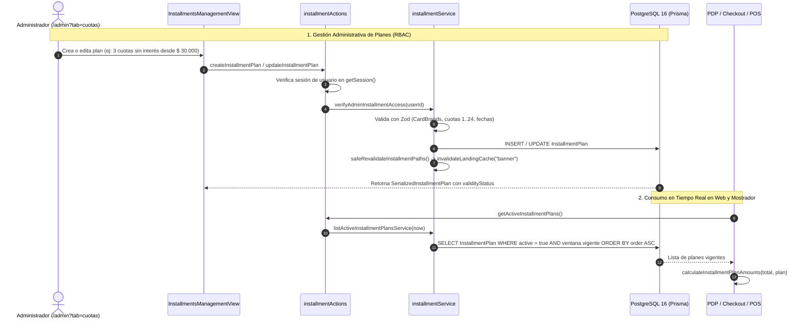

# [RF-31] Gestión Dinámica de Planes de Cuotas y Financiación con Tarjeta

## 1. Descripción y Objetivo
Permite al Administrador de **Matacos Deportes** configurar, ordenar, activar/pausar, programar por fechas y simular **planes de cuotas y financiación con tarjeta de crédito** desde el panel administrativo (`/admin/cuotas` / `/admin?tab=cuotas`), unificando las condiciones comerciales vigentes en la ficha de producto (PDP), el checkout web y la caja del punto de venta físico (POS) en Saavedra 241.

El requerimiento reemplaza las reglas fijas históricas mencionadas en la elicitación inicial (ej. 3 cuotas sin interés desde $30.000 y 4 cuotas desde $80.000) por un motor paramétrico omnicanal que resuelve:
1. **Autonomía Comercial por Grupos y Marcas de Tarjeta:** Soporta agrupación por `BANCARIZADAS` (`VISA`, `MASTERCARD`, `CABAL`), `NARANJA_X` (incluyendo bandera especial `isPlanZ` para 1 a 3 cuotas cero interés), `TODAS` o `ESPECIFICAS`, con monto mínimo de compra configurable (`minAmount`), cantidad de cuotas (`1` a `24`) y tasa de interés porcentual (`interestRate`: `0` = sin interés o recargo financiero).
2. **Vigencia Temporal y Orden de Visualización:** Permite definir fechas de inicio y fin (`startDate`, `endDate`) evaluadas en tiempo real para clasificar cada plan como `VIGENTE`, `INACTIVO`, `PROGRAMADO` o `EXPIRADO`, además de reordenar atómicamente la prioridad con la que se presentan al cliente.
3. **Respaldo de Planes Comerciales Oficiales:** Si la tabla `InstallmentPlan` se encuentra vacía, tanto la semilla ([`prisma/seed.ts`](file:///C:/Users/della/matacos-deportes-app/prisma/seed.ts)) como el servicio (`ensureDefaultInstallmentPlansSeeded`) cargan los 5 planes base oficiales de Matacos Deportes, y el administrador dispone de la acción `restoreDefaultInstallmentPlans` para restablecerlos.
4. **Cálculo Determinista y Propagación Omnicanal:** Provee la función pura [`calculateInstallmentPlanAmounts`](file:///C:/Users/della/matacos-deportes-app/src/schemas/installment.ts#L275) para calcular el recargo, total financiado, importe de cuota y monto faltante para alcanzar el mínimo en:
   - **Ficha de Producto ([`ProductDetailView.tsx`](file:///C:/Users/della/matacos-deportes-app/src/components/ecommerce/pdp/ProductDetailView.tsx)):** Insignia destacada y modal/detalle de cuotas por tarjeta.
   - **Checkout Web ([`CheckoutView.tsx`](file:///C:/Users/della/matacos-deportes-app/src/components/ecommerce/checkout/CheckoutView.tsx) y [`checkoutActions.ts`](file:///C:/Users/della/matacos-deportes-app/src/server/actions/ecommerce/checkoutActions.ts)):** Selector de cuotas filtrado por marca de tarjeta y monto total, validado también en el servidor al procesar el pago.
   - **Mostrador Físico ([`PosView.tsx`](file:///C:/Users/della/matacos-deportes-app/src/components/dashboard/PosView.tsx)):** Opciones de cuotas en cobro único o dividido con `CREDITO`, con caché local en `localStorage` (`matacos_pos_installment_plans_v1`) para continuidad operativa offline.

---

## 2. Tecnologías, Herramientas y Librerías

- **Next.js 15 (App Router & Server Actions):**
  - Acciones públicas y protegidas en [`src/server/actions/installmentActions.ts`](file:///C:/Users/della/matacos-deportes-app/src/server/actions/installmentActions.ts) (`getActiveInstallmentPlans`, `getAllInstallmentPlansAdmin`, `createInstallmentPlan`, `updateInstallmentPlan`, `deleteInstallmentPlan`, `reorderInstallmentPlans`, `restoreDefaultInstallmentPlans`).
  - Redirección dedicada [`src/app/(dashboard)/admin/cuotas/page.tsx`](file:///C:/Users/della/matacos-deportes-app/src/app/%28dashboard%29/admin/cuotas/page.tsx) hacia `/admin?tab=cuotas`.
- **Capa de Servicios y Seguridad RBAC:** [`src/server/services/installmentService.ts`](file:///C:/Users/della/matacos-deportes-app/src/server/services/installmentService.ts) con verificación administrativa (`verifyAdminInstallmentAccess`: rol `ADMIN`, nivel `>= 100` o permisos `ecommerce.banners` / `ecommerce.cuotas`) y transacciones `prisma.$transaction` para reordenamiento y restauración atómica.
- **PostgreSQL 16 & Prisma ORM 6:** Modelo [`InstallmentPlan`](file:///C:/Users/della/matacos-deportes-app/prisma/schema.prisma#L488) con índices `@@index([active, order])` y `@@index([cardGroup])`.
- **Zod (Validación y Cálculo Compartido):** [`src/schemas/installment.ts`](file:///C:/Users/della/matacos-deportes-app/src/schemas/installment.ts) con `CardBrandCodeEnum`, `CardGroupEnum`, `CreateInstallmentPlanSchema`, `UpdateInstallmentPlanSchema`, `ReorderInstallmentPlansSchema` y `calculateInstallmentPlanAmounts`.
- **Invalidación de Caché:** Sincronización automática con [`src/lib/landingCache.ts`](file:///C:/Users/della/matacos-deportes-app/src/lib/landingCache.ts) (`invalidateLandingCache("banner")`) tras cualquier mutación administrativa.
- **Formateo y Zona Horaria:** `formatCurrency` en ARS y fechas formateadas bajo `America/Argentina/Buenos_Aires`.

---

## 3. Archivos Involucrados en el Requerimiento

### Frontend Administrativo (Dashboard & POS)
- [`src/components/dashboard/InstallmentsManagementView.tsx`](file:///C:/Users/della/matacos-deportes-app/src/components/dashboard/InstallmentsManagementView.tsx): Vista administrativa completa con tarjetas por plan, interruptor activo/pausado, alta/edición modal, reordenamiento, simulador de montos, filtros y restauración de planes base.
- [`src/app/(dashboard)/admin/cuotas/page.tsx`](file:///C:/Users/della/matacos-deportes-app/src/app/%28dashboard%29/admin/cuotas/page.tsx), [`src/components/dashboard/DashboardView.tsx`](file:///C:/Users/della/matacos-deportes-app/src/components/dashboard/DashboardView.tsx) y [`src/components/dashboard/SidebarLeft.tsx`](file:///C:/Users/della/matacos-deportes-app/src/components/dashboard/SidebarLeft.tsx): Navegación a *Planes de Cuotas* (`?tab=cuotas`).
- [`src/components/dashboard/PosView.tsx`](file:///C:/Users/della/matacos-deportes-app/src/components/dashboard/PosView.tsx): Consumo de planes activos en cobros con tarjeta de crédito (pago único o dividido) y persistencia en `localStorage` para uso en mostrador.

### Frontend E-commerce y Checkout
- [`src/components/ecommerce/pdp/ProductDetailView.tsx`](file:///C:/Users/della/matacos-deportes-app/src/components/ecommerce/pdp/ProductDetailView.tsx): Cálculo de cuotas destacadas y detalle de planes en la ficha de producto.
- [`src/components/ecommerce/checkout/CheckoutView.tsx`](file:///C:/Users/della/matacos-deportes-app/src/components/ecommerce/checkout/CheckoutView.tsx): Selector interactivo de cuotas filtrado por marca de tarjeta y cumplimiento de `minAmount`.

### Backend, Servicios, Esquemas y Persistencia
- [`src/server/actions/installmentActions.ts`](file:///C:/Users/della/matacos-deportes-app/src/server/actions/installmentActions.ts): Server Actions expuestas a UI pública, POS y panel administrativo.
- [`src/server/services/installmentService.ts`](file:///C:/Users/della/matacos-deportes-app/src/server/services/installmentService.ts): Lógica de negocio, siembra automática de planes base, validación RBAC, serialización y cálculo de estado de vigencia.
- [`src/server/actions/ecommerce/checkoutActions.ts`](file:///C:/Users/della/matacos-deportes-app/src/server/actions/ecommerce/checkoutActions.ts): Resolución y validación en servidor del `installmentPlanId` / `installments` y total financiado al cobrar con tarjeta de crédito.
- [`src/schemas/installment.ts`](file:///C:/Users/della/matacos-deportes-app/src/schemas/installment.ts): Esquemas Zod, `DEFAULT_MATACOS_INSTALLMENT_PLANS` y calculadora `calculateInstallmentPlanAmounts`.
- [`prisma/schema.prisma`](file:///C:/Users/della/matacos-deportes-app/prisma/schema.prisma) y [`prisma/seed.ts`](file:///C:/Users/della/matacos-deportes-app/prisma/seed.ts): Modelo `InstallmentPlan` y carga inicial de los 5 planes oficiales.

---

## 4. Flujo de Datos y Control

### Diagrama de Secuencia: Configuración Administrativa y Consumo Omnicanal

### Detalle del Flujo de Control
1. **Validación de Grupos y Fechas:** Al crear o actualizar un plan, `CreateInstallmentPlanSchema` resuelve automáticamente las marcas permitidas mediante `resolveCardBrandsForGroup` (`BANCARIZADAS` → Visa/Mastercard/Cabal; `NARANJA_X` → Naranja X) y verifica con `.superRefine()` que `endDate` sea posterior o igual a `startDate`.
2. **Evaluación de Vigencia:** `resolveInstallmentValidityStatus` determina si el plan está `INACTIVO` (`active === false`), `PROGRAMADO` (`startDate > now`), `EXPIRADO` (`endDate < now`) o `VIGENTE`. Solo los planes `VIGENTE` son devueltos por `getActiveInstallmentPlans()`.
3. **Cálculo de Financiación:** `calculateInstallmentPlanAmounts(baseAmount, plan)` computa el recargo (`baseAmount * interestRate / 100`), el total financiado redondeado a 2 decimales, el valor de cada cuota (`totalFinanced / installments`) y el booleano `meetsMinAmount` junto a `missingForMinAmount`.
4. **Resiliencia y Fallback:** Si la consulta a PostgreSQL falla transitoriamente en `listActiveInstallmentPlansService`, el servicio entrega en memoria los 5 planes oficiales de `DEFAULT_MATACOS_INSTALLMENT_PLANS` para no bloquear el checkout ni el POS; en mostrador físico, `PosView` además cachea los planes en `localStorage`.

---

## 5. Pruebas y Validación (QA)

### Precondiciones
1. Base de datos PostgreSQL en ejecución (`pnpm db:up`) con esquema actualizado (`InstallmentPlan`) y seed aplicado (`pnpm db:seed`).
2. Usuario con rol `ADMIN` autenticado en el panel de control y productos publicados con precios en ARS.

### Casos de Validación Manual
1. **Paso 1 (Visualización de Planes Base):** Ingresar a `/admin?tab=cuotas` (o `/admin/cuotas`) como administrador. Verificar la presencia de los 5 planes iniciales (*1 pago sin interés*, *3 cuotas sin interés desde $ 30.000*, *Naranja X 1 pago*, *Plan Z*, *4 cuotas sin interés desde $ 80.000*).
2. **Paso 2 (Aislamiento RBAC):** Intentar invocar operaciones administrativas de `installmentActions` sin sesión o con un usuario cajero/vendedor sin privilegios `ADMIN`. Comprobar el rechazo con mensaje de acceso denegado.
3. **Paso 3 (Creación, Mínimo y Vigencia):** Crear un plan de `6 cuotas` con `interestRate: 15` y `minAmount: 50000`. Verificar en una ficha de producto (PDP) de `$ 40.000,00` que no habilite el plan por mínimo insuficiente y en una compra de `$ 60.000,00` en Checkout que calcule un total financiado de `$ 69.000,00` (`6` cuotas de `$ 11.500,00`).
4. **Paso 4 (Reordenamiento y Pausado):** Cambiar el orden de dos planes y pausar uno mediante el switch de estado. Comprobar que el plan pausado deje de figurar en la PDP, el Checkout y el selector de `CREDITO` del POS (`PosView.tsx`).
5. **Paso 5 (Restauración de Planes Oficiales):** Ejecutar *"Restaurar planes por defecto"* y confirmar que PostgreSQL vuelva exactamente a los 5 planes canónicos definidos en `DEFAULT_MATACOS_INSTALLMENT_PLANS`.
