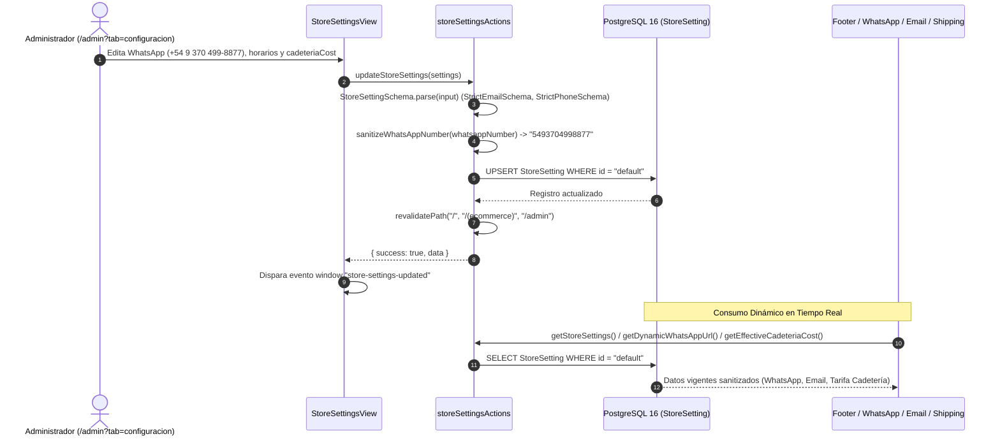

# [RF-32] Configuración Dinámica del Comercio, Canales de Contacto y Parámetros Operativos

## 1. Descripción y Objetivo
Centraliza en una pantalla administrativa autogestionable (`/admin?tab=configuracion`) la identidad comercial, canales de atención, horarios, dirección física y tarifa de cadetería de **Matacos Deportes**, eliminando valores rígidos en código fuente para que los propietarios puedan actualizar estos datos sin asistencia técnica.

El requerimiento resuelve cuatro necesidades operativas:
1. **Fuente Única de Datos Institucionales (`StoreSetting`):** Persiste en PostgreSQL el registro único (`id: "default"`) con nombre comercial (`storeName`), WhatsApp oficial (`whatsappNumber`), teléfono de mostrador (`contactPhone`), correo de contacto (`contactEmail`), correo de notificaciones (`notificationsEmail`), dirección (`storeAddress`, `storeCity`, `storePostalCode`), horarios de atención (`businessHours`), redes sociales (`instagramHandle`, `facebookHandle`) y tarifa plana de envío urbano (`cadeteriaCost`).
2. **Sanitización Automática de WhatsApp y Propagación Global:** Al guardar, [`updateStoreSettings`](file:///C:/Proyectos/matacos-deportes-app/src/server/actions/storeSettingsActions.ts) limpia el número de WhatsApp con `sanitizeWhatsAppNumber` para compatibilidad con enlaces `wa.me/`, revalida las rutas de la aplicación y emite el evento en navegador `store-settings-updated` para actualizar en vivo componentes como [`EcommerceFooter.tsx`](file:///C:/Proyectos/matacos-deportes-app/src/components/ecommerce/EcommerceFooter.tsx).
3. **Consumo Transversal en Correo, WhatsApp y Logística:** Los módulos [`getDynamicWhatsAppUrl`](file:///C:/Proyectos/matacos-deportes-app/src/lib/whatsapp.ts), [`emailService.ts`](file:///C:/Proyectos/matacos-deportes-app/src/lib/emailService.ts) (`resolveStoreInfo`) y [`shippingActions.ts`](file:///C:/Proyectos/matacos-deportes-app/src/server/actions/ecommerce/shippingActions.ts) (`getEffectiveCadeteriaCost`) leen dinámicamente los valores persistidos en `StoreSetting`, con respaldo controlado ante fallos de red.
4. **Validaciones Estrictas Compartidas (Zod):** Provee los esquemas reutilizables `StrictEmailSchema`, `StrictPhoneSchema` (10 a 13 dígitos netos) y `StrictDniSchema` (7 a 11 dígitos reales), empleados tanto en la configuración del comercio como en formularios públicos del e-commerce (`GuestCheckoutSchema`, `RevocationRequestSchema`).

---

## 2. Tecnologías, Herramientas y Librerías

- **Next.js 15 (Server Actions & Revalidation):**
  - [`src/server/actions/storeSettingsActions.ts`](file:///C:/Proyectos/matacos-deportes-app/src/server/actions/storeSettingsActions.ts): Acciones `getStoreSettings()` (con auto-inicialización de `DEFAULT_SETTINGS` y fallback en caso de error) y `updateStoreSettings(input)` con `upsert` atómico y `revalidatePath` sobre `/`, `/(ecommerce)` y `/admin`.
- **PostgreSQL 16 & Prisma ORM 6:** Modelo [`StoreSetting`](file:///C:/Proyectos/matacos-deportes-app/prisma/schema.prisma#L509) con `id: "default"` y `cadeteriaCost Decimal @default(2500) @db.Decimal(12, 2)`.
- **Zod (Validación Estricta de Contratos):** [`src/schemas/settings.ts`](file:///C:/Proyectos/matacos-deportes-app/src/schemas/settings.ts) (`STRICT_EMAIL_REGEX`, `StrictEmailSchema`, `StrictPhoneSchema`, `StrictDniSchema`, `StoreSettingSchema`).
- **React 19, Tailwind CSS y Lucide Icons:** Vista con pestañas en [`src/components/dashboard/StoreSettingsView.tsx`](file:///C:/Proyectos/matacos-deportes-app/src/components/dashboard/StoreSettingsView.tsx) que incluye vista previa dinámica del enlace `https://wa.me/...` y acceso integrado a la pestaña de clasificadores (`MasterCategoriesManager`).

---

## 3. Archivos Involucrados en el Requerimiento

### Frontend Administrativo y Público
- [`src/components/dashboard/StoreSettingsView.tsx`](file:///C:/Proyectos/matacos-deportes-app/src/components/dashboard/StoreSettingsView.tsx): Formulario de edición de parámetros comerciales, tarifa de cadetería, vista previa del enlace WhatsApp y pestaña secundaria de categorías/marcas/disciplinas.
- [`src/components/dashboard/DashboardView.tsx`](file:///C:/Proyectos/matacos-deportes-app/src/components/dashboard/DashboardView.tsx) y [`src/components/dashboard/SidebarLeft.tsx`](file:///C:/Proyectos/matacos-deportes-app/src/components/dashboard/SidebarLeft.tsx): Enrutamiento a `?tab=configuracion`.
- [`src/components/ecommerce/EcommerceFooter.tsx`](file:///C:/Proyectos/matacos-deportes-app/src/components/ecommerce/EcommerceFooter.tsx): Consumidor dinámico de dirección, horarios, teléfonos y WhatsApp, suscrito al evento `store-settings-updated`.

### Backend, Utilidades y Esquemas
- [`src/server/actions/storeSettingsActions.ts`](file:///C:/Proyectos/matacos-deportes-app/src/server/actions/storeSettingsActions.ts): Server Actions `getStoreSettings` y `updateStoreSettings`.
- [`src/schemas/settings.ts`](file:///C:/Proyectos/matacos-deportes-app/src/schemas/settings.ts): Esquemas Zod compartidos `StoreSettingSchema`, `StrictEmailSchema`, `StrictPhoneSchema` y `StrictDniSchema`.
- [`src/config/company.ts`](file:///C:/Proyectos/matacos-deportes-app/src/config/company.ts): Función `sanitizeWhatsAppNumber` y parámetros base por variables de entorno.
- [`src/lib/whatsapp.ts`](file:///C:/Proyectos/matacos-deportes-app/src/lib/whatsapp.ts): `getDynamicWhatsAppUrl` para construir enlaces de chat con el número activo en PostgreSQL.
- [`src/lib/emailService.ts`](file:///C:/Proyectos/matacos-deportes-app/src/lib/emailService.ts): Helper `resolveStoreInfo` para encabezados y remitentes de correos de órdenes web.
- [`src/server/actions/ecommerce/shippingActions.ts`](file:///C:/Proyectos/matacos-deportes-app/src/server/actions/ecommerce/shippingActions.ts): Helper `getEffectiveCadeteriaCost` que consulta `StoreSetting.cadeteriaCost` al cotizar envíos locales en Formosa Capital.
- [`prisma/schema.prisma`](file:///C:/Proyectos/matacos-deportes-app/prisma/schema.prisma): Modelo `StoreSetting`.

### Pruebas Automatizadas (QA)
- [`scripts/test-ticket04-settings-validations.ts`](file:///C:/Proyectos/matacos-deportes-app/scripts/test-ticket04-settings-validations.ts): Suite automatizada de 20 aserciones sobre validaciones estrictas (email, teléfono, DNI/CUIT), integración con `GuestCheckoutSchema`, persistencia en `StoreSetting` y propagación a WhatsApp y correos.

---

## 4. Flujo de Datos y Control

### Diagrama de Secuencia: Actualización y Propagación Dinámica de Parámetros

### Detalle del Flujo de Control
1. **Inicialización Automática:** En la primera llamada a `getStoreSettings()`, si no existe el registro `id: "default"`, se crea automáticamente en PostgreSQL tomando los valores de entorno (`DEFAULT_SETTINGS`) y una tarifa base de cadetería de `$ 2.500,00`.
2. **Validación Estricta con Zod:** `StoreSettingSchema` verifica longitudes mínimas/máximas, formato de correo con TLD real (`STRICT_EMAIL_REGEX`), cantidad neta de dígitos telefónicos (`10` a `13` dígitos ignorando guiones/espacios) y no negatividad de `cadeteriaCost`.
3. **Sanitización para Enlaces Externos:** `sanitizeWhatsAppNumber` remueve símbolos y espacios antes de persistir `whatsappNumber`, asegurando URLs válidas `https://wa.me/<digitos>` sin romper la codificación en móviles.
4. **Propagación sin Reinicios:** Tanto los correos transaccionales (`sendOrderConfirmationEmail`) como el cotizador de envíos locales (`calculateShippingCostAction`) y el footer de la tienda consumen el valor actualizado de base de datos sin requerir reconstrucción ni reinicio del servidor.

---

## 5. Pruebas y Validación (QA)

### Precondiciones
1. Contenedor PostgreSQL activo (`pnpm db:up`) y esquema sincronizado con la tabla `StoreSetting`.
2. Sesión iniciada como administrador en `/admin?tab=configuracion`.

### Casos de Validación
1. **Paso 1 (Validación de Formatos Inválidos):** Ingresar un correo sin dominio completo (ej. `usuario@dominio`) o un teléfono menor a 10 dígitos en el formulario de configuración. Verificar que Zod bloquee el guardado con un mensaje claro.
2. **Paso 2 (Sanitización de WhatsApp):** Guardar el número `+54 9 370 499-8877` junto con un nuevo `storeName` y `cadeteriaCost: 3200`. Verificar que la base de datos almacene `5493704998877` y que la vista previa del enlace muestre `https://wa.me/5493704998877`.
3. **Paso 3 (Propagación a E-commerce y Checkout):** Navegar al footer de la tienda pública y cotizar un envío con código postal `3600` en el checkout. Comprobar que el footer muestre el nuevo nombre/horarios/teléfono y la opción `CADETERIA_FORMOSA` refleje `$ 3.200,00`.
4. **Paso 4 (Propagación a Correos y WhatsApp):** Invocar `getDynamicWhatsAppUrl()` y `sendOrderConfirmationEmail()` comprobando que utilicen el nuevo número y nombre comercial.

### Suite Automatizada Disponible
- `pnpm tsx scripts/test-ticket04-settings-validations.ts` ([`scripts/test-ticket04-settings-validations.ts`](file:///C:/Proyectos/matacos-deportes-app/scripts/test-ticket04-settings-validations.ts)): Ejecuta 20 pruebas automatizadas cubriendo `StrictEmailSchema`, `StrictPhoneSchema`, `StrictDniSchema`, `GuestCheckoutSchema`, persistencia en `StoreSetting` y propagación a WhatsApp y correo electrónico.
