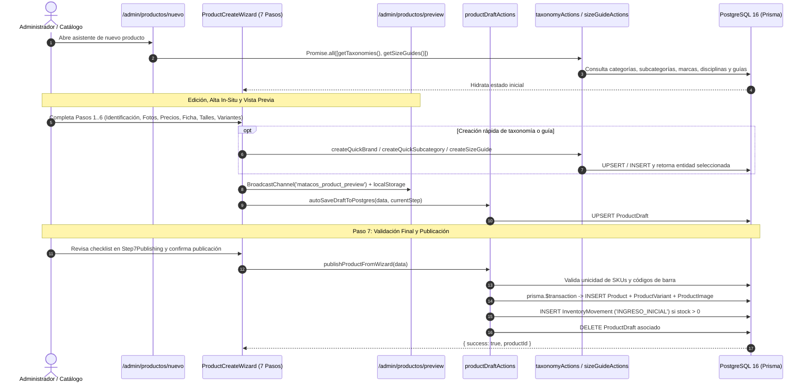

# [RF-33] Asistente Guiado de Alta de Productos (7 Pasos), Borradores, Guías de Talles y Taxonomía Avanzada

## 1. Descripción y Objetivo
Extiende la capacidad de catalogación de **Matacos Deportes** incorporando un **Asistente Guiado en 7 Pasos** (`/admin/productos/nuevo`) con autoguardado persistente de borradores en PostgreSQL, creación rápida *in-situ* de marcas, categorías, subcategorías y disciplinas, editor de ficha técnica enriquecida, gestión reutilizable de **Guías de Talles (`SizeGuide`)** y vista previa interactiva en vivo en tiempo real (integrada y en ventana independiente vía `BroadcastChannel`).

El requerimiento complementa el alta rápida modal de [RF-01](file:///C:/Proyectos/matacos-deportes-app/docs/RF-01_Gestion_Productos_Catalogo.md) y [RF-02](file:///C:/Proyectos/matacos-deportes-app/docs/RF-02_Gestion_Variantes_Precios.md) resolviendo cuatro necesidades editoriales y operativas de la tienda online:
1. **Flujo Estructurado en 7 Pasos sin Pérdida de Trabajo (`ProductDraft`):** Divide la carga de artículos complejos en 7 etapas (*1. Identificación*, *2. Fotos*, *3. Precios*, *4. Ficha Técnica*, *5. Guía de Talles*, *6. Variantes y Stock*, *7. Envío y Publicación*), permitiendo guardar borradores en PostgreSQL (`autoSaveDraftToPostgres`) y retomar el último borrador al volver (`getLatestDraftFromPostgres`).
2. **Taxonomía Jerárquica con Subcategorías y Alta Rápida (`taxonomyActions.ts`):** Incorpora el modelo `Subcategory` vinculado a `Category` (`@@unique([categoryId, slug])`) junto con acciones de creación inmediata (`createQuickBrand`, `createQuickCategory`, `createQuickSubcategory`, `createQuickDiscipline`) sin abandonar el asistente.
3. **Gestión de Guías de Talles Reutilizables (`SizeGuide`):** Permite vincular plantillas normalizadas de medidas (Calzado, Prendas Superiores, Prendas Inferiores) con auto-siembra de 3 plantillas base en [`sizeGuideActions.ts`](file:///C:/Proyectos/matacos-deportes-app/src/server/actions/sizeGuideActions.ts), editor tabular con pegado desde Excel, validación cruzada de talles faltantes respecto a las variantes cargadas y modal público [`SizeGuideModal.tsx`](file:///C:/Proyectos/matacos-deportes-app/src/components/ecommerce/pdp/SizeGuideModal.tsx) en la ficha de producto.
4. **Ficha Técnica Enriquecida y Vista Previa Sincronizada:** Soporta editor de texto enriquecido (TinyMCE), características destacadas con detección inteligente de iconos (`getSmartHighlightIcon`), datos de empaque (`weightGrams`, `dimensionsCm`) para el cotizador logístico ([RF-19](file:///C:/Proyectos/matacos-deportes-app/docs/RF-19_Gestion_Opciones_Envio_Logistica.md)) y previsualización en vivo escritorio/móvil sincronizada en `< 1 ms` en `/admin/productos/preview` mediante `BroadcastChannel` y `localStorage`.

---

## 2. Tecnologías, Herramientas y Librerías

- **Next.js 15 (App Router & Server Actions):**
  - Páginas dedicadas [`src/app/(dashboard)/admin/productos/nuevo/page.tsx`](file:///C:/Proyectos/matacos-deportes-app/src/app/%28dashboard%29/admin/productos/nuevo/page.tsx) y [`src/app/(dashboard)/admin/productos/preview/page.tsx`](file:///C:/Proyectos/matacos-deportes-app/src/app/%28dashboard%29/admin/productos/preview/page.tsx).
  - Server Actions en [`src/server/actions/productDraftActions.ts`](file:///C:/Proyectos/matacos-deportes-app/src/server/actions/productDraftActions.ts), [`src/server/actions/sizeGuideActions.ts`](file:///C:/Proyectos/matacos-deportes-app/src/server/actions/sizeGuideActions.ts) y [`src/server/actions/taxonomyActions.ts`](file:///C:/Proyectos/matacos-deportes-app/src/server/actions/taxonomyActions.ts).
- **PostgreSQL 16 & Prisma ORM 6:**
  - Nuevos modelos [`ProductDraft`](file:///C:/Proyectos/matacos-deportes-app/prisma/schema.prisma#L140), [`SizeGuide`](file:///C:/Proyectos/matacos-deportes-app/prisma/schema.prisma#L123) y [`Subcategory`](file:///C:/Proyectos/matacos-deportes-app/prisma/schema.prisma#L94).
  - Ampliación de `Product` con `slug`, `shortDescription`, `listPrice`, `vatRate`, `installments`, `gender`, `tags`, `highlights` (Json), `specs` (Json), `weightGrams`, `dimensionsCm` (Json), `status` (`DRAFT` | `PUBLISHED` | `SCHEDULED`), `publishedAt`, `metaTitle`, `metaDescription`, `subcategoryId` y `sizeGuideId`.
- **Editor Enriquecido (TinyMCE):** `@tinymce/tinymce-react` y `tinymce` encapsulados en [`RichTextEditor.tsx`](file:///C:/Proyectos/matacos-deportes-app/src/components/admin/ProductCreateWizard/RichTextEditor.tsx) y [`RichTextEditorClient.tsx`](file:///C:/Proyectos/matacos-deportes-app/src/components/admin/ProductCreateWizard/RichTextEditorClient.tsx).
- **Web BroadcastChannel API & `localStorage`:** Canal `matacos_product_preview` y clave `matacos_product_preview_data` para sincronizar en vivo la ficha del producto entre la pestaña de edición y la pestaña independiente de vista previa.
- **Helpers de Dominio y Formateo:** `generateModelCode` ([`src/lib/textUtils.ts`](file:///C:/Proyectos/matacos-deportes-app/src/lib/textUtils.ts)), `guessColorHexFromName` ([`colorMatcher.ts`](file:///C:/Proyectos/matacos-deportes-app/src/components/admin/ProductCreateWizard/colorMatcher.ts)) y `formatCurrency` en ARS.

---

## 3. Archivos Involucrados en el Requerimiento

### Rutas y Componentes del Asistente (Frontend)
- [`src/app/(dashboard)/admin/productos/nuevo/page.tsx`](file:///C:/Proyectos/matacos-deportes-app/src/app/%28dashboard%29/admin/productos/nuevo/page.tsx): Cargador servidor que precarga taxonomías y guías de talles hacia el asistente.
- [`src/app/(dashboard)/admin/productos/preview/page.tsx`](file:///C:/Proyectos/matacos-deportes-app/src/app/%28dashboard%29/admin/productos/preview/page.tsx): Ventana independiente de vista previa en tiempo real.
- [`src/components/admin/ProductCreateWizard/ProductCreateWizard.tsx`](file:///C:/Proyectos/matacos-deportes-app/src/components/admin/ProductCreateWizard/ProductCreateWizard.tsx): Orquestador de los 7 pasos, gestión de borradores y emisor de `BroadcastChannel`.
- [`src/components/admin/ProductCreateWizard/Step1Identification.tsx`](file:///C:/Proyectos/matacos-deportes-app/src/components/admin/ProductCreateWizard/Step1Identification.tsx) al [`Step7Publishing.tsx`](file:///C:/Proyectos/matacos-deportes-app/src/components/admin/ProductCreateWizard/Step7Publishing.tsx): Pasos modulares de identificación, fotos por color, precios/IVA/margen, ficha técnica (`RichTextEditor`, `highlightIcons`), guía de talles, matriz Color × Talle dual (Salón/Depósito) y checklist de publicación/logística.
- [`src/components/admin/ProductCreateWizard/LiveProductPreview.tsx`](file:///C:/Proyectos/matacos-deportes-app/src/components/admin/ProductCreateWizard/LiveProductPreview.tsx): Previsualizador responsivo escritorio/móvil de la PDP.
- [`src/components/dashboard/InventoryView.tsx`](file:///C:/Proyectos/matacos-deportes-app/src/components/dashboard/InventoryView.tsx): Acceso directo al asistente `/admin/productos/nuevo`.
- [`src/components/ecommerce/pdp/SizeGuideModal.tsx`](file:///C:/Proyectos/matacos-deportes-app/src/components/ecommerce/pdp/SizeGuideModal.tsx): Modal de consulta de talles en el e-commerce público.

### Backend, Server Actions y Persistencia
- [`src/server/actions/productDraftActions.ts`](file:///C:/Proyectos/matacos-deportes-app/src/server/actions/productDraftActions.ts): Acciones `autoSaveDraftToPostgres`, `getLatestDraftFromPostgres`, `deleteProductDraft` y `publishProductFromWizard` (con verificación de SKUs/códigos de barra únicos, alta atómica en `prisma.$transaction`, generación de `InventoryMovement` tipo `INGRESO_INICIAL` y limpieza automática del borrador).
- [`src/server/actions/sizeGuideActions.ts`](file:///C:/Proyectos/matacos-deportes-app/src/server/actions/sizeGuideActions.ts): Acciones `getSizeGuides` (con auto-siembra de 3 plantillas base) y `createSizeGuide`.
- [`src/server/actions/taxonomyActions.ts`](file:///C:/Proyectos/matacos-deportes-app/src/server/actions/taxonomyActions.ts): Acciones `getTaxonomies`, `createQuickBrand`, `createQuickCategory`, `createQuickSubcategory` y `createQuickDiscipline`.
- [`prisma/schema.prisma`](file:///C:/Proyectos/matacos-deportes-app/prisma/schema.prisma): Modelos `ProductDraft`, `SizeGuide`, `Subcategory`, `Product`, `ProductImage`, `ProductVariant` e `InventoryMovement`.

---

## 4. Flujo de Datos y Control

### Diagrama de Secuencia: Creación Guiada, Vista Previa en Vivo y Publicación Atómica

### Detalle del Flujo de Control
1. **Autoguardado y Recuperación:** `ProductCreateWizard` persiste el estado completo `WizardProductData` y el número de paso (`step`) en la tabla `ProductDraft` mediante `autoSaveDraftToPostgres`, evitando pérdida de trabajo ante cortes o recargas accidentales.
2. **Validación Cruzada de Talles y Unicidad:** En el Paso 5 (`Step5SizeGuide`), el asistente compara los talles cargados en `form.variants` contra los definidos en la guía seleccionada para alertar sobre talles sin equivalencia. En el servidor, `publishProductFromWizard` bloquea SKUs repetidos y códigos de barras duplicados tanto dentro del mismo payload como contra la base de datos.
3. **Transacción Atómica de Publicación:** Al publicar, `publishProductFromWizard` crea el producto padre, todas sus variantes con existencias duales (`stockStore`, `stockWarehouse`) y umbrales mínimos, la galería ordenada de imágenes por color, los movimientos iniciales `INGRESO_INICIAL` en `InventoryMovement`, y elimina el registro `ProductDraft` previo, revalidando `/admin` y `/productos`.

---

## 5. Pruebas y Validación (QA)

### Precondiciones
1. Contenedor PostgreSQL activo (`pnpm db:up`) y esquema sincronizado (`ProductDraft`, `SizeGuide`, `Subcategory`, `Product`).
2. Sesión iniciada en el panel administrativo con permisos de gestión de inventario/productos.

### Casos de Validación
1. **Paso 1 (Carga Inicial y Plantillas de Talles):** Acceder a `/admin/productos/nuevo` y verificar que se precarguen marcas, categorías, disciplinas y al menos las 3 guías de talles base (*Calzado Deportivo Adulto*, *Remeras y Tops Deportivos*, *Pantalones, Calzas y Shorts*).
2. **Paso 2 (Creación Rápida y Borrador):** En el Paso 1, crear una marca o subcategoría rápida, completar nombre y SKU, avanzar al Paso 3 y verificar el guardado del borrador en `ProductDraft`. Recargar la página y confirmar la recuperación del estado.
3. **Paso 3 (Vista Previa Sincronizada):** Abrir la vista previa independiente (`/admin/productos/preview`), modificar el título, precio o fotos en el asistente y comprobar que la previsualización escritorio/móvil se actualice instantáneamente vía `BroadcastChannel`.
4. **Paso 4 (Validación de Unicidad y Publicación):** Intentar publicar con dos variantes que compartan el mismo código de barras y verificar que `publishProductFromWizard` rechace el guardado. Corregir el código, completar los 6 ítems del checklist en el Paso 7 y publicar.
5. **Resultado Esperado:** El producto queda persistido en PostgreSQL junto con sus variantes, galería, guía de talles, peso/dimensiones y movimientos `INGRESO_INICIAL` en `InventoryMovement`, desapareciendo el borrador temporal de `ProductDraft`.
