# Especificación Técnica (spec.md)
## Requerimientos: Lógica de Envíos, Integración API MiCorreo (Correo Argentino), Despachos y Ciclo de Vida de Pedidos Web (RF-19 y RF-25)

**Proyecto:** Sistema Integral de Gestión, POS Offline y E-commerce — Matacos Deportes  
**Cliente:** Matacos Deportes (Saavedra 241, Formosa Capital, Argentina)  
**Institución:** Universidad de la Cuenca del Plata — Práctica Profesional Supervisada I (PPS I)  
**Rama Oficial:** `feature/rf19-rf25-envios-y-gestion-pedidos`  
**Base:** `develop`  
**Estado:** `APPROVED_FOR_DEVELOPMENT`  

---

## 1. Problem Statement

Actualmente, el e-commerce de **Matacos Deportes** presenta limitaciones críticas en la gestión logística y el ciclo de vida de los pedidos online:

1. **Tarifas Planas y Hardcodeadas en Checkout:**  
   El costo de envío nacional con Correo Argentino está fijado estáticamente en `$ 7.500,00` dentro de `checkoutActions.ts`, sin cotización en tiempo real basada en el código postal de destino, distancia ni volumen/peso de los productos.
2. **Falta de Opción de Retiro en Sucursal Postal:**  
   El sistema no ofrece la modalidad de retiro en sucursal oficial de Correo Argentino (`deliveredType: 'S'`), la cual representa entre un 30% y 40% de ahorro frente al envío a domicilio para el comprador.
3. **Tarifa de Cadetería Rígida:**  
   El reparto por cadete/moto en Formosa Capital (CP 3600) está prefijado en `$ 2.500,00` y no puede ser actualizado por el dueño del local desde la interfaz del sistema, obligando a modificar código fuente o variables de entorno ante aumentos de combustible.
4. **Ausencia de Generación de Guías y Rótulos de Despacho:**  
   El personal de mostrador en Saavedra 241 no dispone de una herramienta para registrar la imposición postal en Correo Argentino (`/shipping/import`), obtener el código de seguimiento oficial ni imprimir la etiqueta/rótulo de despacho para adherir a los paquetes.
5. **Anulación Incompleta de Pedidos Web:**  
   El procedimiento actual de cancelación solo contempla pedidos impagos. Si un pedido pagado o en preparación sufre una cancelación, no existe un flujo transaccional que reincorpore las existencias al stock físico (`stockStore` o `stockWarehouse`) mediante movimientos inmutables de auditoría `ANULACION_VENTA`.
6. **Dependencia de Credenciales Externas:**  
   La tramitación de credenciales oficiales de la API MiCorreo con Correo Argentino puede demorar días hábiles. El sistema carece de un modo Mock que emule los contratos oficiales para permitir el desarrollo y prueba integral sin bloqueos.

---

## 2. Solution Overview

Implementar un subsistema logístico y de gestión de órdenes desacoplado, resiliente y de alta fidelidad que articule **RF-19** y **RF-25**:

```mermaid
flowchart TD
    subgraph Checkout_RF19["Checkout Web (RF-19)"]
        Cart[Carrito con Variantes] --> VirtualPackage[Cálculo de Paquete Virtual y Peso Heurístico]
        VirtualPackage --> MethodChoice{Modalidad de Entrega}
        MethodChoice -->|RETIRO_LOCAL| FreeCost["Costo: $0,00"]
        MethodChoice -->|CADETERIA_FORMOSA| LocalCost["Tarifa Plana Dinámica (StoreSetting.cadeteriaCost)"]
        MethodChoice -->|CORREO_ARGENTINO_DOMICILIO| RateHome["POST /rates (deliveredType: 'D')"]
        MethodChoice -->|CORREO_ARGENTINO_SUCURSAL| AgencySelect["GET /agencies + Selector de Sucursal"]
        AgencySelect --> RateAgency["POST /rates (deliveredType: 'S')"]
        RateHome --> FreezeCost[Congelar shippingCost en Sale]
        RateAgency --> FreezeCost
        FreeCost --> FreezeCost
        LocalCost --> FreezeCost
    end

    subgraph Salon_RF25["Despacho y Ciclo de Vida en Salón Saavedra 241 (RF-25)"]
        PaidSale[Venta Web Pagada: COMPLETADA] --> Prep[ShippingStatus: EN_PREPARACION]
        Prep --> Packaging[Empaque Físico en Mostrador]
        Packaging --> ActionBtn[Operador presiona 'Generar Guía Correo Argentino']
        ActionBtn --> ImportAPI["POST /shipping/import (MiCorreo API o Mock)"]
        ImportAPI --> LabelPDF[Generación de Rótulo / Etiqueta Imprimible]
        ImportAPI --> TrackingAssigned[Asignación de Guía TN...AR]
        TrackingAssigned --> InTransit[ShippingStatus: EN_CAMINO]
        InTransit --> NotifyEmail[Email al Comprador con Enlace Directo]
        
        Prep -.->|Si hay cancelación| CancelAction[cancelWebOrderAction]
        CancelAction --> RevertStock[Prisma Transaction: StockStore + InventoryMovement ANULACION_VENTA]
    end
```



### Pilares de la Solución:
1. **Servicio Nativo `correoArgentinoService.ts`:**  
   Construido en TypeScript estricto con `fetch` nativo sin librerías de terceros (cero dependencias de `axios`). Implementa los contratos oficiales del manual `Correo Argentino - API MiCorreo.pdf`.
2. **Modo Mock / Simulación Inteligente:**  
   Activado automáticamente cuando no existen credenciales de API en el entorno o con `CORREO_ARGENTINO_MOCK=true`. Retorna tarifas realistas por peso/zona, sucursales reales de Correo Argentino y códigos de seguimiento simulados.
3. **Tarifa Plana de Cadetería Dinámica:**  
   Persistida en la tabla `StoreSetting` (`cadeteriaCost Decimal @default(2500)`), administrable desde la pantalla de configuración del local.
4. **Cubicaje Heurístico ("Paquete Virtual"):**  
   Consolida prendas y calzado del carrito. Para artículos sin dimensiones/peso cargados, imputa valores de contingencia por categoría (Calzado: 950g, Indumentaria: 300g, Accesorios: 150g, Otros: 500g).
5. **Selector Interactivo de Sucursales:**  
   Para la modalidad `CORREO_ARGENTINO_SUCURSAL`, lista las agencias habilitadas por código postal y provincia para que el comprador elija con precisión.
6. **Imposición Postal Desacoplada:**  
   La guía se genera a demanda mediante acción del operador de salón cuando el paquete físico está embalado, abriendo el PDF del rótulo para impresión térmica o A4.
7. **Cancelación con Restitución Atómica:**  
   Reversión de `stockReserved` si la orden era impaga, o reincorporación al inventario físico con movimiento `ANULACION_VENTA` si ya había sido completada.

---

## 3. User Stories

### Como Comprador Web (Tienda Online)
1. **Selección de Modalidades:** Quiero elegir entre Retiro en Saavedra 241, Cadetería en Formosa Capital, Correo Argentino a Domicilio o Correo Argentino con Retiro en Sucursal, para optar por la alternativa más conveniente.
2. **Cotización Automática:** Quiero ingresar mi código postal y ver de inmediato el costo real de envío antes de pagar.
3. **Elección de Sucursal de Correo:** Si elijo retiro en sucursal, quiero seleccionar en un menú desplegable la agencia oficial de Correo Argentino más cercana a mi domicilio (viendo su nombre y dirección).
4. **Trazabilidad y Guía:** Al despacharse mi pedido, quiero recibir un correo electrónico con el número de guía de Correo Argentino y un botón de seguimiento directo a la web del correo.

### Como Administrador General / Dueño
5. **Ajuste de Tarifa de Cadetería:** Quiero poder actualizar el costo del delivery en moto de Formosa Capital desde la pantalla de configuración del sistema sin requerir a un programador.
6. **Auditoría de Envíos:** Quiero consultar en el panel administrativo el historial de pedidos web con sus métodos de entrega, costos y guías asociadas.

### Como Personal de Salón / Mostrador en Saavedra 241
7. **Control y Empaque:** Quiero ver el listado de pedidos web pagados en estado `EN_PREPARACION` con el detalle de variantes (talle y color) para empaquetarlos en el salón.
8. **Generación de Guía e Impresión:** Cuando el paquete está listo, quiero presionar un botón *"Generar Guía Correo Argentino"* que registre el envío en el correo, asigne el código de tracking e imprima el rótulo para pegarlo en la caja.
9. **Despacho de Cadetería Local:** Para envíos en Formosa Capital, quiero poder marcar el pedido como `EN_CAMINO` con cadete y abrir el chat de WhatsApp con el comprador para coordinar la entrega.
10. **Anulación Segura:** Si un cliente solicita anular un pedido antes de su despacho, quiero cancelar la orden devolviendo automáticamente las prendas al stock de salón con registro de auditoría.

---

## 4. Implementation Decisions

### 4.1. Esquema de Base de Datos (`prisma/schema.prisma`)

1. **Ampliación de `StoreSetting`:**
   ```prisma
   model StoreSetting {
     // ... campos existentes ...
     cadeteriaCost Decimal @default(2500) @db.Decimal(12, 2) // Tarifa plana delivery Formosa CP 3600
   }
   ```
2. **Compatibilidad y Normalización en `Sale`:**
   * `shippingMethod`: String (`RETIRO_LOCAL`, `CADETERIA_FORMOSA`, `CORREO_ARGENTINO_DOMICILIO`, `CORREO_ARGENTINO_SUCURSAL`).
   * `shippingCost`: Decimal (congelado al momento de crear la orden).
   * `shippingAddress`, `shippingCity`, `shippingPostalCode`: String.
   * `shippingTrackingCode`: String? (número de guía TN...AR).
   * Nuevos campos opcionales para entrega en sucursal de Correo:
     * `shippingBranchCode String?` (código oficial de la agencia, ej. `P0001`).
     * `shippingBranchName String?` (nombre descriptivo de la sucursal).

### 4.2. Contratos y Validación Zod (`src/schemas/`)

1. **`ShippingMethodEnum` Actualizado:**
   ```typescript
   export const ShippingMethodEnum = z.enum([
     "RETIRO_LOCAL",
     "CADETERIA_FORMOSA",
     "CORREO_ARGENTINO_DOMICILIO",
     "CORREO_ARGENTINO_SUCURSAL",
   ]);
   ```
2. **`ShippingCalculationSchema` (BE-RF19 Subtarea 2):**
   ```typescript
   export const ShippingCalculationSchema = z.object({
     postalCode: z.string().trim().min(4, "Código postal inválido").max(8),
     method: ShippingMethodEnum,
     items: z.array(
       z.object({
         variantId: z.string().uuid(),
         quantity: z.number().int().min(1),
         categoryId: z.string().optional(),
         weightGrams: z.number().optional(),
       })
     ).min(1, "Debe cotizar al menos un artículo"),
     agencyCode: z.string().optional(),
   });
   ```

### 4.3. Capa de Servicio: `src/server/services/correoArgentinoService.ts`

El servicio encapsula los endpoints de **MiCorreo API**:
* `POST /token`: Autenticación con Basic Auth (`base64(username:password)`). Caché de JWT en memoria con expiración de 50 minutos.
* `POST /rates`: Cotización con origen Formosa (`postalCodeOrigin: "3600"`), destino, `deliveredType: "D" | "S"` y objeto `dimensions: { weight, height, width, length }`.
* `GET /agencies`: Listado de sucursales habilitadas por provincia (`provinceCode`) y código postal.
* `POST /shipping/import`: Alta del envío con remitente Saavedra 241 y destinatario de la orden web.
* `GET /shipping/tracking`: Consulta de eventos de trazabilidad.
* **Modo Mock Integrado:**
  * Si `process.env.CORREO_ARGENTINO_MOCK === "true"` o no se configuran credenciales en el entorno, el servicio resuelve las cotizaciones con tarifas simuladas por peso y distancia, devuelve sucursales reales de Correo Argentino en Formosa y el país, y genera números de guía `TN3600...AR`.

### 4.4. Server Actions a Implementar / Extender

1. **`calculateShippingCostAction(input)` (BE-RF19 Subtarea 3):**
   * Retorna el costo discriminado según la modalidad seleccionada y el código postal.
   * Aplica costo $0 para `RETIRO_LOCAL`.
   * Lee `StoreSetting.cadeteriaCost` para `CADETERIA_FORMOSA` si el CP es 3600.
   * Invoca `correoArgentinoService.calculateRate()` para domicilio o sucursal.
2. **`getAgenciesAction(provinceCode, postalCode)`:**
   * Devuelve las sucursales oficiales de Correo Argentino disponibles para la zona del comprador.
3. **`applyShippingToOrderAction(orderId, shippingData)` (BE-RF19 Subtarea 4):**
   * Actualiza la orden en transacción atómica recalculando `total = subtotalGross - discount + shippingCost`.
4. **`updateOrderStatusAction(orderId, newStatus, notes)` (BE-RF25 Subtarea 3):**
   * Transiciona el estado con notas de auditoría y usuario operador.
5. **`generateShippingLabelAction(orderId)` (BE-RF25 Subtarea 4):**
   * Ejecuta la pre-imposición en `correoArgentinoService.importShipment()`.
   * Asigna el `shippingTrackingCode`, pasa la orden a `EN_CAMINO`, genera el enlace de rastreo y prepara el rótulo imprimible.
   * Dispara el email de confirmación de despacho al comprador.
6. **`cancelWebOrderAction(orderId, reason)` (BE-RF25 Subtarea 5):**
   * Transacción atómica:
     * Si `status === "PENDIENTE_PAGO"` $\rightarrow$ decrementa `stockReserved`.
     * Si `status === "COMPLETADA"` $\rightarrow$ incrementa `stockStore` y registra `InventoryMovement` tipo `ANULACION_VENTA`.
     * Pasa la orden a `CANCELADA` y el envío a `CANCELADO`.
7. **`updateCadeteriaCostAction(newCost)`:**
   * Permite al administrador guardar el nuevo valor de cadetería en `StoreSetting`.

---

## 5. UI y Experiencia de Usuario

1. **Checkout Web (`src/components/ecommerce/checkout/CheckoutView.tsx`):**
   * Radio group con las 4 modalidades de entrega:
     1. Retiro en Saavedra 241 ($ 0,00).
     2. Cadetería en Formosa Capital (tarifa dinámica).
     3. Correo Argentino a Domicilio.
     4. Correo Argentino a Sucursal (despliega selector con nombre y dirección de agencias).
   * Recálculo automático en vivo de tarifas y actualización del resumen de compra.
2. **Panel de Gestión de Pedidos Web (`src/components/admin/web-orders/WebOrdersView.tsx`):**
   * Pestañas por estado logístico (`Todos`, `Pendientes de Pago`, `En Preparación`, `Listos para Retiro`, `En Camino`, `Entregados`, `Cancelados`).
   * Botón de acción contextual:
     * Si es Correo Argentino y está en `EN_PREPARACION` $\rightarrow$ Botón destacado **"Generar Guía Correo Argentino"**.
     * Botón para abrir el **Rótulo Postal imprimible** (formato etiqueta térmica 10x15 / A4 con código de barras).
     * Si es Cadetería $\rightarrow$ Botón **"Enviar con Cadete"** y enlace directo a WhatsApp.
     * Botón de **"Cancelar Pedido"** con modal de confirmación y motivo.
3. **Configuración del Local (`/admin/configuracion`):**
   * Campo de entrada para actualizar el costo de cadetería local.

---

## 6. Subtasks Checklist (Roadmap de Ejecución)

### Fase 1: Persistencia y Dominio
- [x] **T1.1:** Actualizar `prisma/schema.prisma` agregando `cadeteriaCost` en `StoreSetting` y campos de sucursal en `Sale`.
- [x] **T1.2:** Ejecutar migración/generación de Prisma (`pnpm prisma generate` con tipos tipados).
- [x] **T1.3:** Actualizar esquemas Zod en `src/schemas/ecommerce.ts`, `src/schemas/settings.ts` y nuevo `src/schemas/shipping.ts`.

### Fase 2: Servicio de Correo Argentino y Modo Mock
- [x] **T2.1:** Crear `src/server/services/correoArgentinoService.ts` con tipado estricto y métodos `/token`, `/rates`, `/agencies`, `/shipping/import` y `/shipping/tracking`.
- [x] **T2.2:** Implementar el motor Mock dentro del servicio para simular cotizaciones, agencias y números de guía realistas sin credenciales activas.

### Fase 3: Server Actions de Envíos (BE-RF19)
- [x] **T3.1:** Implementar Server Action `calculateShippingCostAction` con cálculo heurístico de paquete virtual y fallback.
- [x] **T3.2:** Implementar Server Action `getAgenciesAction` para consultar sucursales habilitadas.
- [x] **T3.3:** Implementar Server Action `applyShippingToOrderAction` con recálculo atómico del total.
- [x] **T3.4:** Implementar Server Action `updateCadeteriaCostAction` para el ajuste dinámico desde administración.

### Fase 4: Server Actions de Ciclo de Vida y Despacho (BE-RF25)
- [ ] **T4.1:** Extender `getWebOrdersAction` con filtros avanzados y paginación para el panel de administración.
- [ ] **T4.2:** Implementar Server Action `updateOrderStatusAction` con registro de auditoría.
- [ ] **T4.3:** Implementar Server Action `generateShippingLabelAction` con imposición en Correo Argentino, asignación de tracking y envío de email al comprador.
- [ ] **T4.4:** Implementar Server Action transaccional `cancelWebOrderAction` con restitución atómica de existencias físicas (`ANULACION_VENTA`) o reservas (`stockReserved`).

### Fase 5: Interfaz de Usuario y Rótulo Postal
- [ ] **T5.1:** Actualizar el Checkout con selector de 4 modalidades y desplegable de sucursales de Correo.
- [ ] **T5.2:** Crear componente de visualización e impresión de Rótulo Postal (etiqueta con código de barras y datos de origen/destino).
- [ ] **T5.3:** Actualizar la pantalla de administración de pedidos web con botones de despacho, generación de guía y anulación.
- [ ] **T5.4:** Incorporar campo de tarifa de cadetería en la pantalla de configuración del local.

### Fase 6: Pruebas y Verificación
- [ ] **T6.1:** Verificar cotización dinámica en checkout con distintas localidades y códigos postales.
- [ ] **T6.2:** Probar ciclo completo de despacho en mostrador (preparación $\rightarrow$ generación de guía $\rightarrow$ rótulo).
- [ ] **T6.3:** Probar anulación con restitución atómica en base de datos PostgreSQL.
