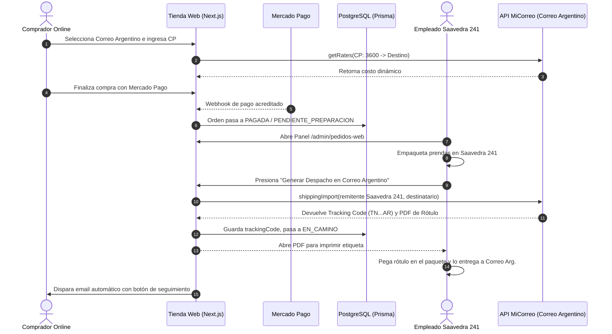

# SPEC: Logística de Envíos, Integración MiCorreo (Correo Argentino), Despachos y Seguimiento (RF-19 / RF-25)

**Proyecto:** Sistema Integral de Gestión, POS Offline y E-commerce — Matacos Deportes  
**Cliente:** Matacos Deportes (Saavedra 241, Formosa Capital, Argentina)  
**Institución:** Universidad de la Cuenca del Plata — Práctica Profesional Supervisada I (PPS I)  
**Estado:** `READY_FOR_DEVELOPMENT`  
**Rama Destino Sugerida:** `feature/be-rf19-rf25-envios-micorreo`  
**Base:** `develop` (o merge de `feature/be-rf16-pasarela-mercadopago`)  

---

## 1. Visión General del Dominio Logístico

Matacos Deportes opera su venta física y despacho centralizado desde su local en **Saavedra 241, Formosa Capital (CP 3600)**.  
El subsistema de logística y envíos abarca dos requerimientos funcionales complementarios:

1. **RF-19 (Configuración y Selección de Opciones de Envío):**  
   Experiencia del comprador durante el Checkout: selección de modalidad (Retiro Local, Cadetería local en Formosa o Correo Argentino nacional), cálculo dinámico de costos por distancia/peso mediante la API de MiCorreo, selección de entrega a Domicilio o Sucursal, y aplicación de la política de Envío Gratis Dual ($ 100.000).
2. **RF-25 (Gestión y Seguimiento de Pedidos Web):**  
   Operación del personal en Saavedra 241 y trazabilidad del comprador: preparación del paquete, alta del envío en Correo Argentino (pre-imposición), impresión del rótulo/etiqueta de despacho con código de barras, notificación por email con enlace directo de rastreo y anulación con restitución atómica de inventario.

---

## 2. Análisis y Alineación de las Subtareas (Imágenes de Contexto)

Revisando las tarjetas de planificación (`rf19 - envios.png` y `rf25 - seguimiento envio.png`), este es el diagnóstico de alineación con el código existente:

### 🔹 Subtareas BE-RF19: Configuración y Selección de Opciones de Envío

| Subtarea Original | Estado Actual en Código | Observación / Ajuste Recomendado |
| :--- | :---: | :--- |
| **1. Incorporar campos de logística en modelo Sale:** `shippingMethod`, `shippingCost`, `shippingAddress`, `shippingTrackingCode` | ✅ **YA IMPLEMENTADO** | Ya existen en `prisma/schema.prisma` en `Sale`. En lugar de `shippingAddress: Json?`, se normalizó con campos tipados (`shippingAddress`, `shippingCity`, `shippingPostalCode`) para mayor rendimiento en PostgreSQL. |
| **2. Crear esquema Zod ShippingCalculationSchema** (código postal, método, peso) | 🟡 **PARCIAL** | Existe `ShippingMethodSchema` y validación de dirección en `checkout.ts`. Falta incorporar el esquema específico que reciba dimensiones y peso para consultar MiCorreo. |
| **3. Implementar Server Action calculateShippingCost(input)** | 🟡 **PARCIAL** | Existe `calculateShippingFee()` en `src/config/company.ts` con tarifas base y envío gratis general. **Falta conectar la rama nacional con la API de MiCorreo.** |
| **3.1. Costo $0 en Retiro Local** | ✅ **YA IMPLEMENTADO** | Operativo y testeado en RF-15 y RF-16. |
| **3.2. Cadetería local Formosa (CP 3600)** | ✅ **YA IMPLEMENTADO** | Tarifa parametrizable ($ 2.500) con bonificación superando el umbral de envío gratis. |
| **3.3. Encomienda / Correo Argentino nacional** | ⏳ **PENDIENTE** | Actualmente opera con tarifa base de contingencia ($ 7.800). Debe conectarse a `correoArgentinoService.ts`. |
| **4. Implementar Server Action applyShippingToOrder** | ✅ **YA IMPLEMENTADO** | `createGuestOrder` ya calcula y congela el costo final de envío en la orden de forma atómica. |
| **NUEVA: Selector Domicilio vs. Sucursal Correo** | ⏳ **A INCORPORAR** | Correo Argentino permite enviar a Domicilio o a Sucursal (más económico). Conviene agregar `shippingTargetType: "DOMICILIO" \| "SUCURSAL"` y el selector de sucursal. |

---

### 🔹 Subtareas BE-RF25: Gestión y Seguimiento de Pedidos Web

| Subtarea Original | Estado Actual en Código | Observación / Ajuste Recomendado |
| :--- | :---: | :--- |
| **1. Ampliar enum o validación de estados de orden** | ✅ **YA IMPLEMENTADO** | En Prisma ya existen: `SaleStatus` (`PENDIENTE_PAGO`, `COMPLETADA`, `CANCELADA`) y `ShippingStatus` (`PENDIENTE`, `EN_PREPARACION`, `LISTO_RETIRO`, `EN_CAMINO`, `ENTREGADO`, `CANCELADO`). |
| **2. Server Action getWebOrdersList(filterStatus, page, limit)** | 🟡 **PARCIAL** | Existe `getCustomerOrdersAction` (para el comprador en `/cuenta`). **Falta la Server Action para el panel de administración interno del mostrador** (`/admin/pedidos-web`). |
| **3. Server Action updateOrderStatus(orderId, newStatus, notes)** | 🟡 **PARCIAL** | En RF-29 se implementó `updateOrderShippingStatusAction`, pero falta enriquecerla con auditoría de operador y cambio de estado logístico. |
| **4. Server Action setOrderTrackingInfo(orderId, trackingNumber, courierName)** | 🟡 **PARCIAL** | Ya guarda el `shippingTrackingCode` y genera el enlace oficial de Correo Argentino. Falta que sea invocado automáticamente tras la pre-imposición en MiCorreo. |
| **5. Server Action transaccional cancelWebOrder(orderId, reason)** con reversión atómica de stock | ✅ **YA IMPLEMENTADO** | `releaseExpiredWebOrders()` y la anulación en `customerActions.ts` ya ejecutan la restitución transaccional de `stockReserved` y movimientos de auditoría `ANULACION_VENTA`. |
| **NUEVA: Generación e Impresión de Rótulo / Etiqueta** | ⏳ **A INCORPORAR** | Generar la hoja imprimible (remito/etiqueta con código de barras) lista para pegar en la caja o bolsa de despacho. |

---

## 3. Integración Técnica con MiCorreo (Correo Argentino)

### 3.1. Librería Base: `YamilEzequiel/correo-argentino` (`ylazzari-correoargentino`)
Instalación prevista:
```bash
pnpm add ylazzari-correoargentino axios
```

### 3.2. Métodos a Consumir
```typescript
import CorreoArgentinoAPI from "ylazzari-correoargentino";

const correoClient = new CorreoArgentinoAPI({
  customerId: process.env.MICORREO_CUSTOMER_ID,
  apiKey: process.env.MICORREO_API_KEY,
  environment: process.env.MICORREO_ENV || "TEST", // "TEST" o "PROD"
});
```

1. **Cotización de Tarifas (`correoClient.getRates`):**
   * **Origen:** Saavedra 241, Formosa (CP 3600).
   * **Destino:** Código Postal ingresado por el comprador.
   * **Paquete estándar estimado:** Peso promedio 1 kg, dimensiones 30x20x15 cm (calzado/indumentaria).
   * **Resultado:** Cotización de Servicio Clásico vs Expreso, Domicilio vs Sucursal.
2. **Listado de Sucursales de Retiro (`correoClient.getAgencies`):**
   * Consulta las agencias oficiales de Correo Argentino disponibles según el código de provincia del comprador.
3. **Alta de Envío / Pre-imposición (`correoClient.shippingImport`):**
   * Se ejecuta desde el panel de administración cuando el empleado presiona **«Despachar por Correo Argentino»**.
   * Envía los datos de Saavedra 241 como remitente y del comprador como destinatario.
   * Retorna el **código de seguimiento oficial (Tracking ID)**.
4. **Descarga de Rótulo / Etiqueta de Despacho:**
   * Llamada al endpoint de impresión de MiCorreo (`/shipping/label` o PDF devuelto por la API).
   * Formato apto para impresora térmica de etiquetas (100x150 mm) o impresión en hoja A4 común para pegar con cinta transparente.

---

## 4. Flujo Operativo en Saavedra 241 (Paso a Paso)



---

## 5. Estrategia de Entornos y Credenciales

### Fase 1: Desarrollo y Pruebas Técnicas (Equipo Dev)
* Nos damos de alta en el ambiente de desarrollo o solicitamos credenciales a `integraciones@correoargentino.com.ar`.
* En `.env`:
  ```env
  MICORREO_CUSTOMER_ID="test_customer_123"
  MICORREO_API_KEY="test_api_key_abc"
  MICORREO_ENV="TEST"
  MICORREO_ORIGIN_POSTAL_CODE="3600"
  MICORREO_ORIGIN_STREET="Saavedra"
  MICORREO_ORIGIN_NUMBER="241"
  MICORREO_ORIGIN_CITY="Formosa"
  ```
* Si la API de prueba sufre microcortes o demoras de respuesta, el sistema debe activar automáticamente la **política de contingencia por tarifa plana/zona** para que el checkout web nunca se interrumpa.

### Fase 2: Puesta en Producción (Titulares de Matacos Deportes)
* Los dueños registran la cuenta oficial en **MiCorreo Empresas** con el CUIT comercial del local.
* Nos facilitan su `customerId` y `apiKey` de producción.
* Cambiamos `MICORREO_ENV="PROD"` en el servidor VPS de producción.

---

## 6. Checklist de Implementación para el Próximo Sprint

- [ ] **Rama de trabajo:** Crear `feature/be-rf19-rf25-envios-micorreo` desde `develop`.
- [ ] **Instalación:** `pnpm add ylazzari-correoargentino axios`.
- [ ] **Servicio Logístico:** Crear `src/lib/correoArgentino.ts` con manejo de contingencia y reintentos.
- [ ] **Cotizador en Checkout:**
  - [ ] Input de Código Postal con botón "Calcular Envío".
  - [ ] Opción de elegir *Entrega a Domicilio* o *Retiro en Sucursal de Correo*.
  - [ ] Respetar la bonificación por superar el umbral de Envío Gratis Dual ($ 100.000).
- [ ] **Panel de Gestión de Pedidos Web (`/admin/pedidos-web`):**
  - [ ] Listado de órdenes web filtradas por estado logístico.
  - [ ] Botón "Generar Envío en Correo Argentino".
  - [ ] Botón "Descargar / Imprimir Rótulo de Despacho".
  - [ ] Registro de auditoría y botón de anulación con restitución de inventario.
- [ ] **Seguimiento para el Cliente:**
  - [ ] Email transaccional automático al despachar el pedido.
  - [ ] Botón con enlace directo a la web pública de Correo Argentino (`https://www.correoargentino.com.ar/formularios/ondt`).
- [ ] **Suite de Pruebas:** Crear `scripts/test-rf19-rf25-correo-argentino.ts` para validar cotizaciones, creación de envíos y fallbacks de contingencia.
