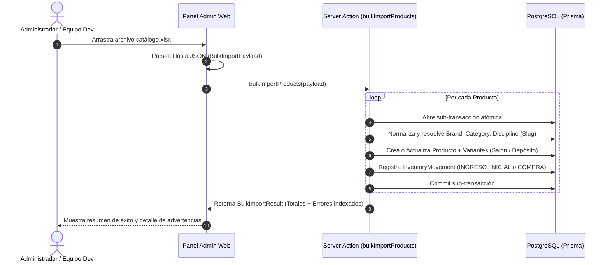

# Especificación Técnica: RF-04 — Carga Inicial y Progresiva de Stock, Modelo de Inventario Dual y Contratos Backend

**Proyecto:** Sistema Integral de Gestión, POS Offline y E-commerce — Matacos Deportes  
**Módulo:** Backend / Gestión de Inventario y Catálogo  
**Requerimiento Funcional:** **RF-04** (Carga Inicial y Progresiva de Inventario)  
**Estado:** Aprobado para Implementación  

---

## 1. Problem Statement (Declaración del Problema)

Matacos Deportes ha operado durante más de 25 años bajo un esquema 100% analógico (registro en cuadernos de ventas manuscritos y remarcación artesanal de precios). El catálogo físico del comercio comprende entre 100 y 200 productos deportivos especializados (natación, vóley, calzado urbano/Crocs, fitness y accesorios), cada uno con múltiples variantes de talle y color.

El comercio enfrenta los siguientes obstáculos críticos para la puesta en marcha de su sistema digital:
1. **Inexistencia de formatos estandarizados de proveedores:** Los distribuidores y fabricantes (Wilson, Crocs, Speedo, Topper, etc.) no entregan APIs ni planillas estandarizadas; la información de compra llega en remitos impresos, facturas o planillas heterogéneas.
2. **Imposibilidad de cierre total para inventario masivo:** El local no puede cerrar sus puertas para un inventario ciego único; requiere una **carga progresiva por marcas o disciplinas** (ej. primero todo Calzado, luego Natación).
3. **Falta de distinción de ubicaciones físicas (Salón vs. Depósito):** En el local de Saavedra 241 existen dos realidades físicas: la mercadería en exhibición en percheros/mostrador (*Salón de Ventas*) y las cajas guardadas en el depósito interno (*Depósito*). Si el sistema no distingue estas ubicaciones, el personal desconoce si debe reponer la exhibición y se pierden ventas presenciales porque el cliente "no ve" el producto.
4. **Silos artificiales de stock web vs. local:** En un comercio minorista unificado, toda unidad disponible en el local debe poder ser comercializada online, evitando que la web marque "Agotado" cuando hay unidades en el salón o depósito.
5. **Vulnerabilidad en cargas masivas sin tolerancia a fallos:** Un error tipográfico en una variante de una planilla de 100 artículos no debe provocar el aborto (*rollback*) de todo el lote, sino una ingestión parcial atómica con reporte granular de errores.
6. **Brecha digital y adopción del personal:** Los dueños (Sandra y Miguel Ángel) poseen baja familiaridad tecnológica. Entregarles una planilla vacía sin asistencia provocaría cuellos de botella y demoras críticas en el cronograma de puesta en marcha.

---

## 2. Solution (Solución Propuesta)

Desarrollar en la capa de Backend un **Motor de Ingestión Masiva y Carga Progresiva (Bulk Import Engine)** con soporte para **Modelo de Stock Dual Físico (Salón / Depósito) y Stock Unificado Omnicanal**, validado estrictamente mediante Zod y ejecutado bajo transacciones atómicas independientes por producto con PostgreSQL y Prisma ORM.

### Pilares de la Solución:
1. **Modelo de Stock Físico Dual y Disponibilidad Unificada:**
   - Cada variante registra `stockStore` (Salón de ventas) y `stockWarehouse` (Depósito interno).
   - El stock disponible para venta (tanto en Mostrador POS como en E-commerce) es unificado: `(stockStore + stockWarehouse) - stockReserved`.
2. **Sistema de Doble Umbral de Alerta Preventiva:**
   - *Alerta de Reposición Interna (Depósito → Salón):* Se dispara cuando `stockStore <= minStoreStock` y `stockWarehouse > 0` para evitar que el perchero quede vacío.
   - *Alerta de Stock Crítico (Compra a Proveedor):* Se dispara cuando `(stockStore + stockWarehouse) <= minStock`.
3. **Ingestión en Lote Resiliente (Best-Effort con Reporte Granular):**
   - Transaccionalidad atómica por entidad/producto: los productos válidos se insertan o acumulan, y las filas fallidas se consolidan en una estructura de respuesta `BulkImportResult` con índice de fila, campo causante y motivo del error.
4. **Resolución On-The-Fly y Normalización de Entidades Relacionadas:**
   - Detección, sanitización contra variantes de Case/tildes (vía slugs normalizados) y creación automática perezosa de Marcas (`Brand`), Categorías (`Category`) y Disciplinas (`Discipline`).
5. **Estrategia de Onboarding Asistido y Reutilización del Archivo Excel:**
   - El equipo de desarrollo realiza jornadas presenciales in-situ en Saavedra 241 aprovechando los días de holgura para completar en tándem la planilla oficial modelo.
   - Dicha planilla `.xlsx` / `.csv` se importa directamente al sistema y queda como respaldo documental reutilizable para reimportaciones e incrementos futuros.
6. **Trazabilidad y Auditoría Integral:**
   - Tipificación canónica exhaustiva de movimientos de inventario (`InventoryMovement`), incorporando `INGRESO_INICIAL`, `INGRESO_COMPRA`, `DEVOLUCION_CLIENTE`, `ANULACION_VENTA` y `TRANSFERENCIA_INTERNA`.

---

## 3. User Stories (Historias de Usuario)

1. Como **Administrador**, quiero cargar un lote de productos con sus respectivas variantes de talle y color en una sola operación de backend, para dar de alta progresivamente el catálogo inicial por marca o disciplina sin crearlos uno por uno.
2. Como **Administrador**, quiero que la importación en lote procese todos los productos válidos aunque algunas filas contengan errores, para no perder tiempo reintentando todo el archivo de 100 artículos por fallas menores.
3. Como **Administrador**, quiero recibir un reporte detallado al finalizar la carga en lote que indique el índice exacto de fila, nombre de producto y motivo de fallo de las filas erróneas, para corregir únicamente los registros que fallaron.
4. Como **Administrador**, quiero que el backend cree automáticamente marcas, categorías y disciplinas si no existen al momento de importar el lote, para no tener que dar de alta decenas de entidades previas manualmente.
5. Como **Administrador**, quiero que el sistema normalice los nombres de marcas, categorías y disciplinas (ignorando diferencias de mayúsculas, minúsculas y tildes), para evitar que se creen duplicados accidentales como "Natación" y "natacion".
6. Como **Administrador**, quiero seleccionar el modo de importación (`CREATE_ONLY`, `ACCUMULATE_STOCK` u `OVERWRITE`), para poder usar el mismo contrato tanto en la carga inicial de onboarding como en la recepción de remitos de reposición de proveedores.
7. Como **Administrador**, quiero que el backend genere automáticamente un SKU legible si no lo especifico en el lote, para asegurar la unicidad y formato uniforme sin tener que inventar códigos a mano.
8. Como **Administrador**, quiero poder importar variantes sin código de barras (dejándolo en `null`), para luego generar e imprimir códigos internos de barra mediante el generador de etiquetas.
9. Como **Vendedor de Mostrador**, quiero ver desglosado en el sistema cuántas unidades hay en el Salón (`stockStore`) y cuántas en el Depósito (`stockWarehouse`), para saber inmediatamente si debo ir a buscar una prenda al depósito cuando un cliente la solicita.
10. Como **Vendedor de Mostrador**, quiero recibir una alerta visual cuando una prenda tenga stock bajo en el salón pero existan unidades en el depósito, para reponer la exhibición antes de que los clientes dejen de ver el artículo.
11. Como **Vendedor de Mostrador**, quiero poder cobrar en el mostrador un artículo que está en el depósito cuando el salón no tiene unidades exhibidas, para concretar la venta inmediatamente sin trabas burocráticas.
12. Como **Cliente Online**, quiero ver la disponibilidad real combinada del producto en la tienda web, para poder comprar cualquier artículo que el comercio tenga físicamente disponible.
13. Como **Operador de Despacho**, quiero que cuando se venda la última unidad de un producto por la web y esta esté en el salón, se emita una orden de retiro inmediato de exhibición, para evitar que un cliente presencial la tome antes del empaquetado.
14. Como **Administrador**, quiero que cada carga de stock en lote genere un movimiento de inventario con la referencia del lote, para mantener la trazabilidad exacta de cuándo y cómo ingresó la mercadería.
15. Como **Cajero**, quiero registrar las devoluciones de mercadería por cambio de talle con un movimiento específico de `DEVOLUCION_CLIENTE`, para no mezclar los reingresos de clientes con compras a proveedores ni con ajustes de conteo físico.
16. Como **Cajero**, quiero registrar la anulación de tickets erróneos con el tipo `ANULACION_VENTA`, para que el stock retorne automáticamente a la ubicación física de origen.
17. Como **Vendedor**, quiero registrar traslados de mercadería del depósito al mostrador mediante `TRANSFERENCIA_INTERNA`, para que los números de salón y depósito reflejen la realidad física tras la reposición de estantes.

---

## 4. Implementation Decisions (Decisiones de Implementación)

### 4.1. Modelo de Dominio y Glosario Canónico

* **Salón de Ventas (`stockStore`):** Unidades físicas disponibles en estanterías, percheros y vitrinas del salón comercial de Saavedra 241, listas para inspección y entrega presencial inmediata.  
  _Evitar_: Stock mostrador, stock físico local, stock exhibición.
* **Depósito (`stockWarehouse`):** Unidades físicas almacenadas en cajas o estantes del depósito interno del comercio, no visibles directamente por el cliente en el salón.  
  _Evitar_: Almacén, depósito secundario, bodega.
* **Stock Reservado (`stockReserved`):** Unidades comprometidas temporalmente en carritos web confirmados pendientes de preparación o apartados de redes sociales.  
  _Evitar_: Stock bloqueado, stock congelado.
* **Stock Disponible Omnicanal:** Cantidad neta disponible para venta tanto en mostrador como en la tienda online: `(stockStore + stockWarehouse) - stockReserved`.
* **Alerta de Reposición Interna:** Condición que ocurre cuando `stockStore <= minStoreStock` y `stockWarehouse > 0`, indicando que debe trasladarse mercadería del depósito al salón de ventas.
* **Alerta de Stock Crítico:** Condición que ocurre cuando `(stockStore + stockWarehouse) <= minStock`, indicando necesidad de compra a proveedores.

---

### 4.2. Esquema Relacional de Base de Datos (`schema.prisma`)

```prisma
model Category {
  id       String    @id @default(uuid())
  name     String    @unique
  slug     String    @unique
  products Product[]
}

model Brand {
  id       String    @id @default(uuid())
  name     String    @unique
  slug     String    @unique
  products Product[]
}

model Discipline {
  id       String    @id @default(uuid())
  name     String    @unique
  slug     String    @unique
  products Product[]
}

model Product {
  id           String         @id @default(uuid())
  name         String
  description  String?
  disciplineId String
  discipline   Discipline     @relation(fields: [disciplineId], references: [id])
  costPrice    Decimal        @db.Decimal(12, 2)
  price        Decimal        @db.Decimal(12, 2)
  active       Boolean        @default(true)
  categoryId   String
  category     Category       @relation(fields: [categoryId], references: [id])
  brandId      String
  brand        Brand          @relation(fields: [brandId], references: [id])
  variants     ProductVariant[]
  createdAt    DateTime       @default(now())
  updatedAt    DateTime       @updatedAt
}

model ProductVariant {
  id              String              @id @default(uuid())
  productId       String
  product         Product             @relation(fields: [productId], references: [id], onDelete: Cascade)
  size            String              // Talle: 41, M, L, Único, etc.
  color           String              // Color: Negro, Azul, etc.
  sku             String              @unique
  barcode         String?             @unique
  stockStore      Int                 @default(0) // Stock en Salón de Ventas
  stockWarehouse  Int                 @default(0) // Stock en Depósito interno
  stockReserved   Int                 @default(0) // Stock comprometido / reservado
  minStoreStock   Int                 @default(1) // Umbral alerta de reposición interna
  minStock        Int                 @default(2) // Umbral alerta de compra a proveedor
  price           Decimal?            @db.Decimal(12, 2)
  movements       InventoryMovement[]
  saleItems       SaleItem[]
  createdAt       DateTime            @default(now())
  updatedAt       DateTime            @updatedAt
}

model InventoryMovement {
  id              String         @id @default(uuid())
  variantId       String
  variant         ProductVariant @relation(fields: [variantId], references: [id])
  type            String         // INGRESO_INICIAL, INGRESO_COMPRA, VENTA_MOSTRADOR, VENTA_WEB, DEVOLUCION_CLIENTE, ANULACION_VENTA, AJUSTE_INGRESO, AJUSTE_EGRESO, TRANSFERENCIA_INTERNA
  quantity        Int            // Cantidad del movimiento
  stockAfter      Int            // Stock total resultante (stockStore + stockWarehouse)
  location        String?        // "STORE", "WAREHOUSE", o "WAREHOUSE_TO_STORE"
  reason          String?        // Motivo / Referencia del lote
  createdAt       DateTime       @default(now())
}
```

---

### 4.3. Contratos de Validación y Tipado Backend (Zod)

#### Tipos de Movimiento Canónicos (`MovementTypeEnum`):
```typescript
export const MovementTypeEnum = z.enum([
  "INGRESO_INICIAL",
  "INGRESO_COMPRA",
  "VENTA_MOSTRADOR",
  "VENTA_WEB",
  "DEVOLUCION_CLIENTE",
  "ANULACION_VENTA",
  "AJUSTE_INGRESO",
  "AJUSTE_EGRESO",
  "TRANSFERENCIA_INTERNA",
]);
```

#### Contrato de Carga en Lote (`BulkImportSchema`):
```typescript
export const BulkVariantItemSchema = z.object({
  size: z.string().min(1, "El talle es requerido"),
  color: z.string().min(1, "El color es requerido"),
  sku: z.string().optional(), // Si no viene, se autogenera
  barcode: z.string().nullable().optional(),
  stockStore: z.number().int().min(0).default(0),
  stockWarehouse: z.number().int().min(0).default(0),
  minStoreStock: z.number().int().min(0).default(1),
  minStock: z.number().int().min(0).default(2),
  price: z.number().positive().nullable().optional(),
});

export const BulkProductItemSchema = z.object({
  name: z.string().min(3, "El nombre del producto debe tener al menos 3 caracteres"),
  description: z.string().nullable().optional(),
  disciplineName: z.string().min(2, "La disciplina es requerida (ej. Natación, Vóley, Crocs)"),
  brandName: z.string().min(2, "El nombre de la marca es requerido"),
  categoryName: z.string().min(2, "El nombre de la categoría es requerido"),
  costPrice: z.number().min(0, "El precio de costo no puede ser negativo"),
  price: z.number().min(0, "El precio de venta no puede ser negativo"),
  variants: z.array(BulkVariantItemSchema).min(1, "Debe incluir al menos una variante"),
});

export const BulkImportPayloadSchema = z.object({
  batchReference: z.string().min(3, "Referencia o identificador del lote requerido"),
  mode: z.enum(["CREATE_ONLY", "ACCUMULATE_STOCK", "OVERWRITE"]).default("ACCUMULATE_STOCK"),
  defaultTargetLocation: z.enum(["STORE", "WAREHOUSE"]).default("STORE"),
  items: z.array(BulkProductItemSchema).min(1, "El lote debe contener al menos un producto"),
});
```

#### Contrato de Respuesta del Server Action (`BulkImportResult`):
```typescript
export interface BulkImportError {
  index: number;
  productName: string;
  sku?: string;
  barcode?: string;
  field?: string;
  reason: string;
}

export interface BulkImportResult {
  success: boolean;
  batchReference: string;
  mode: "CREATE_ONLY" | "ACCUMULATE_STOCK" | "OVERWRITE";
  summary: {
    totalItemsSubmitted: number;
    successfulProducts: number;
    failedProducts: number;
    createdVariants: number;
    updatedVariants: number;
  };
  errors: BulkImportError[];
}
```

---

### 4.4. Normalización y Desduplicación contra Errores de Case y Acentos

Para evitar que "Natación", "natacion", "NATACIÓN" o "  Natacion  " generen registros duplicados:
1. Se implementa una utilidad canónica `slugify(text: string): string` que elimina espacios circundantes, pasa a minúsculas, remueve diacríticos/tildes y reemplaza caracteres no alfanuméricos por guiones.
2. Cada entidad (`Brand`, `Category`, `Discipline`) almacena su `name` canónico formateado y su `slug` indexado único.
3. En el proceso de ingestión, la búsqueda de existencia se realiza comparando `slug = slugify(inputName)`. Si ya existe, se reutiliza su `id` sin importar el formato enviado; si no existe, se guarda el `name` formateado en *Title Case* y su `slug` único.

---

### 4.5. Lógica de Deducción y Reposición de Stock

* **Venta en Mostrador (POS):**
  1. Si `stockStore >= quantity`, descuenta directamente de `stockStore`.
  2. Si `stockStore < quantity` y `(stockStore + stockWarehouse) >= quantity`, descuenta el remanente de `stockWarehouse` y registra el movimiento con origen `WAREHOUSE` y una alerta de reposición urgente.
* **Venta Online (E-commerce):**
  1. Descuenta prioritariamente de `stockWarehouse` para proteger la exhibición física.
  2. Si `stockWarehouse` es insuficiente, descuenta de `stockStore` y emite una orden inmediata de retiro de estante para empaquetado.
* **Transferencia Interna (`transferStockInternal`):**
  - Valida que `stockWarehouse >= quantity`.
  - En una transacción atómica resta `stockWarehouse` y suma `stockStore`.
  - Registra `InventoryMovement` tipo `TRANSFERENCIA_INTERNA` con `location: "WAREHOUSE_TO_STORE"`.

---

### 4.6. Estrategia Operativa de Onboarding Asistido (Jornadas In-Situ)

Dado el perfil comercial tradicional de los propietarios (Sandra Mujica y Miguel Ángel Marchi), la carga inicial de los 100–200 productos físicos se ejecutará bajo una **modalidad de acompañamiento asistido** por parte del equipo de desarrollo (alumnos de PPS I) aprovechando los días de holgura entre incrementos:

1. **Planilla Oficial Modelo (Google Sheets / Excel):**
   El equipo provee una plantilla prediseñada con columnas estandarizadas y listas de validación:
   `[Disciplina] | [Categoría] | [Marca] | [Nombre Producto] | [Descripción] | [Talle] | [Color] | [Código Barra] | [Stock Salón] | [Stock Depósito] | [Costo] | [Venta]`
2. **Relevamiento en Tándem por Sectores (Saavedra 241):**
   * **Jornada 1:** Sector *Natación* (mallas, antiparras, gorras, accesorios).
   * **Jornada 2:** Sector *Vóley* y *Fitness* (pelotas, rodilleras, pesas, bandas).
   * **Jornada 3:** Sector *Crocs y Calzado Deportivo*.
   * **Jornada 4:** Indumentaria general y accesorios restantes.
3. **Carga y Verificación Progresiva:**
   Al finalizar cada jornada, el equipo procesa el archivo a través del importador masivo del backend. Los dueños visualizan de inmediato sus productos reales en el sistema, asegurando máxima calidad de datos y eliminando la frustración por carga manual.

---

### 4.7. Ciclo de Vida del Archivo Excel y Reimportación Idempotente

El archivo Excel completado durante el onboarding funciona como **fuente de carga transaccional** y **respaldo físico de datos**:



* **Reimportaciones Posteriores:**
  * Si se agregan nuevos productos al Excel y se vuelve a subir: el sistema inserta únicamente los nuevos.
  * Si se sube mercadería recibida de reposición: en modo `ACCUMULATE_STOCK` suma las unidades a `stockStore` y `stockWarehouse` sin sobreescribir ni duplicar.
  * Si se actualizan listas de precios: en modo `OVERWRITE` actualiza los importes minoristas y de costo.

---

### 4.8. Mecanismos de Carga Post-Onboarding para los Encargados (Día a Día)

Una vez finalizada la carga inicial, el sistema provee a los encargados tres herramientas según la naturaleza del ingreso:

1. **Formulario Visual en Matriz (para 1 o pocos productos nuevos):**
   Permite dar de alta un producto y marcar casillas de talles y colores en pantalla, autogenerando la grilla para ingresar stock de salón y depósito en segundos.
2. **Importador de Remitos / Lotes (para compras grandes de 20 a 50 artículos):**
   Permite descargar la plantilla oficial desde el panel, completar las filas de la factura del distribuidor y subirla para procesamiento en lote.
3. **Recepción Rápida con Pistola de Código de Barras (para reposición de stock existente):**
   Permite al personal escanear la caja recién llegada con el lector USB, indicar la cantidad y destino (Salón o Depósito) y confirmar el ingreso en 2 segundos.

---

## 5. Testing Decisions (Decisiones de Pruebas)

### Criterios de Calidad y Enfoque de Pruebas
* **Pruebas de Caja Negra sobre Seams de Aplicación:** Se probarán los Server Actions (`bulkImportProducts`, `registerStockMovement`, `transferStockInternal`) contra una base de datos PostgreSQL de pruebas (Docker local), evaluando entradas y salidas reales sin mockear Prisma.

### Casos de Prueba Críticos:
1. **Ingestión Parcial con Errores:** Enviar un lote de 3 productos donde el segundo tiene un SKU duplicado en modo `CREATE_ONLY`. Verificar que el producto 1 y 3 se persisten correctamente y el resultado contiene `successfulProducts: 2, failedProducts: 1` con el error indexado.
2. **Auto-creación y Desduplicación de Marcas/Categorías/Disciplinas:** Importar un producto con disciplina `"natacion"` y luego otro con `"NATACIÓN"`. Verificar que ambas filas se vinculan a la misma entidad `Discipline` única (`slug: "natacion"`).
3. **Acumulación de Stock (`ACCUMULATE_STOCK`):** Cargar un producto existente con `stockStore: 5`. Subir un lote con el mismo SKU y `stockStore: 3`. Verificar que el stock final es `8` y se registró un movimiento `INGRESO_COMPRA` por 3 unidades.
4. **Disparo de Alerta de Reposición Interna:** Configurar una variante con `stockStore: 1, minStoreStock: 2, stockWarehouse: 5`. Consultar alertas de inventario y verificar que la variante reporta estado `NEEDS_STORE_REPLENISHMENT`.
5. **Autogeneración Determinista de SKU:** Subir variantes omitiendo el campo `sku`. Verificar que se generan con el formato canónico `MARCA-DISC-TALLE-COLOR-ID` sin colisiones.
6. **Transferencia Interna Atómica:** Mover 2 unidades de depósito a salón. Verificar que `stockWarehouse` disminuye en 2, `stockStore` aumenta en 2, el stock total no cambia y se genera el movimiento `TRANSFERENCIA_INTERNA`.

---

## 6. Out of Scope (Fuera de Alcance)

1. **Maquetación e Interfaces UI de Carga Masiva:** Componentes de frontend (drag-and-drop de archivos Excel/CSV, tablas interactivas) no forman parte de este requerimiento de backend.
2. **Generación e Impresión de Etiquetas con Código de Barras (RF-05):** La renderización de comandos ESC/POS o PDFs de etiquetas térmicas se implementará en el requerimiento siguiente.
3. **Facturación Electrónica con CAE de AFIP/ARCA (RF-20):** La conexión a los Web Services fiscales corresponde al Módulo 4.
4. **Pasarela de Pagos y Webhooks de Mercado Pago (RF-16):** La integración de pagos online corresponde al Módulo 3.
